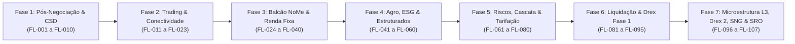

# Roadmap Estratégico — B3 Integration Atlas

Este documento consolida a **visão evolutiva dos 107 fluxos de integração da B3**, os **pilotos e iniciativas de DLT/Drex (Banco Central do Brasil)** e os **horizontes de expansão arquitetural** do projeto.

---

## 1. Visão Geral e Estado de Maturidade

O **B3 Integration Atlas** atingiu o marco de **107 fluxos de integração completamente mapeados, documentados, implementados e testados** com zero dependências externas em tempo de execução. O ecossistema abrange desde os serviços tradicionais de pós-negociação em arquivos planos (IMBARQ) até os motores binários de ultra-baixa latência (PUMA SBE), barramentos multilaterais e infraestrutura de tokenização em Real Digital / Drex.



---

## 2. Visão Evolutiva dos 107 Fluxos

### Fase 1: Pós-Negociação, Central Depositária e RTC (FL-001 a FL-010)
- **Escopo**: Mensageria de fechamento diário, posições em custódia, aluguel de ações (BTC), garantias e lançamentos de liquidação financeira.
- **Destaques**:
  - Família IMBARQ (004, 006, 011, 012, 013, 014, 018) via API REST iMercado com autenticação mTLS e SAS tokens.
  - Captura e Alocação em Tempo Real RTC (FL-007, FL-008) com preservação de integridade de lotes e give-up.
- **Status**: **100% Concluído e Provado Formalmente**.

### Fase 2: Plataformas de Negociação Puma Trading & Conectividade (FL-011 a FL-023)
- **Escopo**: Canais de entrada e difusão de ordens do Puma Trading System.
- **Destaques**:
  - Protocolo FIX 4.4 / FIX 5.0 SP2 (Order Entry e Drop Copy).
  - Codec binário Little-Endian Puma SBE (*Simple Binary Encoding*) para HFT com throughput superior a 400.000 msg/s.
  - Market Data Multicast UMDF SBE (Feeds A/B UDP).
  - Topologia de rede segura: RCC (Rede de Comunicação de Centros), mTLS ICP-Brasil e VPNs IPSec.
- **Status**: **100% Concluído e Provado Formalmente**.

### Fase 3: Balcão NoMe, Títulos de Renda Fixa e Clearing Especializada (FL-024 a FL-040)
- **Escopo**: Antigo ambiente CETIP (NoMe) para renda fixa bancária e privada e derivativos bilaterais.
- **Destaques**:
  - Registro de CDB, RDB, Debêntures, LF, CR, CRA e CRI.
  - Swaps, NDFs de Moedas e Opções Flexíveis com balanço soma-zero pós-IRRF.
  - Portabilidade de Custódia Digital STVM (FL-024) com transferência atômica sem vazamento de saldo.
  - Liquidação multilateral SPB via mensagens LDL0001 e STR BACEN.
- **Status**: **100% Concluído e Provado Formalmente**.

### Fase 4: Mercados Especializados, Agro, Índices e Ofertas (FL-041 a FL-060)
- **Escopo**: Produtos estruturados, agronegócio, sustentabilidade e distribuição pública.
- **Destaques**:
  - Títulos do Agronegócio: CPR Física e Financeira (FL-026), CDA/WA e CPR Verde (FL-082).
  - Ofertas Públicas CVM 160 (FL-033) com leilão holandês, corte uniforme e critérios de rateio pro-rata.
  - Cesta PCF e criação/resgate *in-kind* de cotas de ETFs (FL-035).
  - Descarbonização RenovaBio: registro, custódia e aposentadoria definitiva de CBIOs (FL-036).
- **Status**: **100% Concluído e Provado Formalmente**.

### Fase 5: Engenharia de Risco, Cascata CCP e Tarifação Integrada (FL-061 a FL-080)
- **Escopo**: Gestão prudencial, garantias multi-grau e solvência sistêmica da Câmara B3.
- **Destaques**:
  - Execução sequencial da Cascata de Inadimplência (*CCP Default Waterfall*) sem contaminação entre câmaras.
  - Sistema de Prelazia e Excussão de Garantias conforme Lei nº 14.711/2023 (Marco Legal das Garantias).
  - Mecanismos de Buy-In (D+3) e reversão de falhas de entrega de ativos.
  - Motor de Tarifação Integrada B3 (emolumentos, taxas de liquidação e registro escalonadas por ADTV).
- **Status**: **100% Concluído e Provado Formalmente**.

### Fase 6: Infraestrutura Crítica, Energia e Pilotos Drex Fase 1 (FL-081 a FL-095)
- **Escopo**: Setores estratégicos regulados e expansão DLT de pagamentos.
- **Destaques**:
  - Mercado Livre de Energia Elétrica (B3 & CCEE - FL-087) com liquidação horária de contratos MWh.
  - Mercado Voluntário de Créditos de Carbono com rastreabilidade de padrão VCS/Gold Standard.
  - Pix Automático e transferências SPI em tempo real (< 10 segundos) para chamadas intradiárias de margem.
  - Drex Fase 1: Liquidação interbancária de TPFt e reservas bancárias sob Hyperledger Besu.
- **Status**: **100% Concluído e Provado Formalmente**.

### Fase 7: Microestrutura L3, Drex Fase 2, SNG e SRO (FL-096 a FL-107)
- **Escopo**: Estado da arte da infraestrutura de mercado institucional e mercados conexos (crédito e seguros).
- **Destaques**:
  - Livro de Ofertas L3 Market-By-Order (FL-091) com ordenamento determinístico FIFO em nanossegundos.
  - Leilões de Fechamento MOC (*Market-on-Close*) e LOC (*Limit-on-Close*) com inviolabilidade da fase de *freeze*.
  - Gestão de Garantias Triparty Internacional (FL-099) com depósitos em custodiantes globais (Euroclear/Clearstream).
  - Barramento Central de Liquidação Unificada (FL-100) orquestrando atomicidade entre os 10 subsistemas B3.
  - Superfícies de Volatilidade SVI/SABR (FL-101) e Algoritmos SOR TWAP/VWAP/POV (FL-104).
  - **Sistema Nacional de Gravames (SNG - FL-106)**: Registro de alienação fiduciária e leasing veicular com os Detrans.
  - **Sistema de Registro de Operações de Seguros (SRO SUSEP - FL-107)**: Registro de apólices, partição estrita de cosseguro e controle de LMG.
- **Status**: **100% Concluído e Provado Formalmente**.

---

## 3. O Programa Drex do Banco Central e os Pilotos B3

A B3 desempenha papel central como operadora de infraestrutura de registro e central depositária nos testes de DLT pública e permissionada com o Banco Central do Brasil. O Atlas modela formalmente os componentes dessa integração:

### 3.1. Drex Fase 2: Liquidação Atômica DvP e PvP (FL-089)
- **Mecanismo**: Contratos inteligentes baseados em HTLC (*Hashed Time-Lock Contracts*) e padrões ERC-1155/ERC-20 operando sob a rede permissionada do Drex.
- **Invariante Provada (LAW-095)**: *Non-Custodial Atomic Swap* — ou a titularidade do ativo tokenizado e o débito em Real Digital ocorrem simultaneamente no mesmo bloco, ou nenhuma das transações persiste (reversão atômica).

### 3.2. Emissão Primária de Títulos Tokenizados (RWA) no Drex (FL-105)
- **Mecanismo**: Orquestração digital ponta a ponta:
  1. Escrituração eletrônica da emissão de Debêntures ou Títulos de Dívida Privada na Central Depositária B3.
  2. Mintagem de tokens RWA na rede Drex correspondentes ao montante escriturado.
  3. Liquidação primária de bookbuilding contra carteiras institucionais via Real Digital de Atacado.
- **Invariante Provada (LAW-111)**: Conservação estrita entre saldo escriturado na CSD e tokens emitidos on-chain (zero inflação sintética ou fracionamento não autorizado).

---

## 4. Próximas Expansões e Horizontes Tecnológicos

```
2026 Q4 (Concluído) ──► 2027 Q1-Q2 ───────────────► 2027 Q3-Q4 ───────────────► 2028+
- 107 Fluxos Provados   - Drex Fase 3 Pilotos       - Cripto Pós-Quântica       - Liquidação 24/7
- 91 Leis de Invariante - Cross-Border PvP FX       - IA Simulação Risco         - Interoperabilidade
- Zero Dependências     - Open Finance Collateral   - Hidrogênio & Biocomb.       Global Multi-CCP
```

### 4.1. Drex Fase 3: Colaterais Programáveis e Open Finance (2027 Q1-Q2)
- Integração de colaterais registrados no Open Finance para alocação direta em garantia de operações na B3.
- Execução de liquidação programável via contratos autônomos condicionada a gatilhos de oráculos de mercado.

### 4.2. Câmbio Multilateral Cross-Border PvP e Conexões Internacionais (2027 Q3-Q4)
- Modelagem de liquidação PvP interligando o Sistema de Pagamentos Brasileiro (STR) a câmaras de liquidação globais (CLS Bank, DTCC, Euroclear).
- Compensação contínua de contratos NDF de moedas emergentes da América Latina.

### 4.3. Criptografia Pós-Quântica (PQC) e Segurança de Protocolos (2028+)
- Homologação de algoritmos de encapsulamento de chaves resistentes a computação quântica (ML-KEM / Kyber) e assinaturas digitais (ML-DSA / Dilithium) para as sessões Puma FIX e mTLS ICP-Brasil.
- Modelagem de liquidação contínua 24/7/365 para ativos digitais e títulos privados com compensação intradiária.

---

## 5. Matriz de Governança e Marcos do Projeto

| Marco | Meta | Entregáveis | Status |
|---|---|---|---|
| **M1: Pós-Negociação Básica** | Mapeamento IMBARQ e CSD | IMBARQ 004, 006, 011, 012, 014 | ✅ Concluído |
| **M2: Negociação & Conectividade** | PUMA Trading e Rede | PUMA SBE, FIX, UMDF, RCC, mTLS | ✅ Concluído |
| **M3: Balcão NoMe & Títulos** | Registro Renda Fixa e Derivativos | CDB, Debêntures, Swaps, NDFs | ✅ Concluído |
| **M4: Agro, Sustentabilidade & Risco** | Mercados Especializados e Falhas | CPR, CBIO, Buy-In, Cascata CCP | ✅ Concluído |
| **M5: DLT, Drex & Fronteiras de Mercado** | Tokens RWA, Microestrutura L3, SNG/SRO | 107 Fluxos, 91 Leis, Drex Fase 2 | ✅ Concluído |
| **M6: Drex Fase 3 & Pilotos Avançados** | Smart Contracts e Cross-Border | Provas Formais e Expansão 2027 | 🔄 Planejado |
