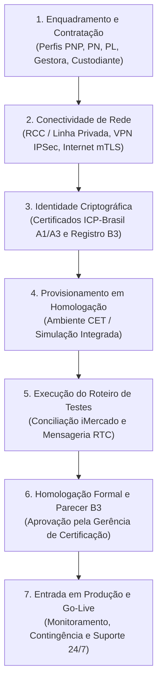
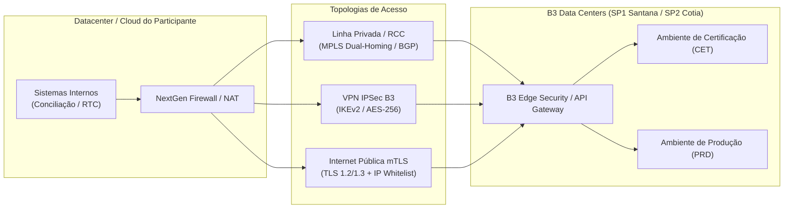
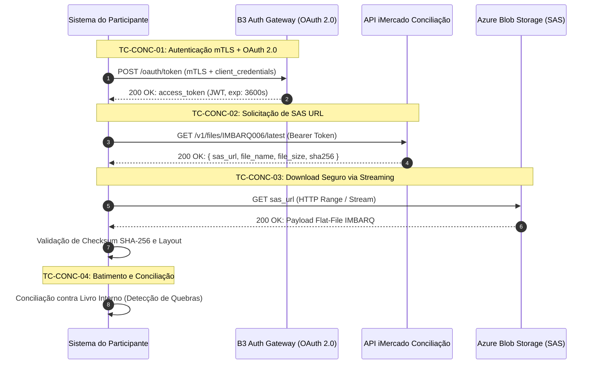
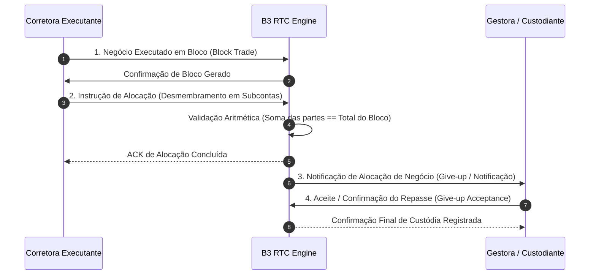

# Guia Oficial de Conectividade e Certificação Institucional B3

Este documento é o roteiro técnico e regulatório definitivo para equipes de engenharia de software, infraestrutura de redes, segurança da informação e operações de **corretoras (CTVM/DTVM)**, **gestoras de recursos (Asset Managers / Buy-side)** e **bancos custodiantes/liquidantes (Sell-side)** que necessitam integrar seus sistemas à infraestrutura de pós-negociação da B3 (Câmara de Compensação e Depositária Central de Ativos Listados).

---

## Visão Geral do Processo de Habilitação

O ingresso de uma instituição no ecossistema de integração direta da B3 obedece a um ciclo disciplinado de governança:



---

## 1. Contratação e Perfis de Participante B3

A B3 classifica seus participantes segundo a capacidade jurídica, patrimonial e operacional de executar ordens, liquidar obrigações multilaterais e prestar custódia fiduciária de ativos.

### 1.1 Taxonomia de Participantes e Responsabilidades

| Sigla | Categoria Institucional | Escopo de Atuação | Interfaces B3 Típicas |
|---|---|---|---|
| **PNP** | Participante Negociador Pleno | Corretoras/Distribuidoras que negociam em nome próprio e de clientes, liquidam suas próprias operações na Câmara e mantêm custódia. | PUMA Trading, RTC Alocação, API iMercado, CSD Depositária, CORE Risco. |
| **PN** | Participante Negociador | Corretoras que operam no pregão, mas transferem a liquidação financeira, física e o depósito de margens a um Participante de Liquidação (PL). | PUMA Trading, RTC Alocação/Repasse, Extranet Operacional. |
| **PL** | Participante de Liquidação | Bancos ou corretoras liquidantes que assumem a responsabilidade financeira e colateral perante a Clearing da B3 pelos negócios de seus PNs contratados. | API iMercado (IMBARQ004, IMBARQ014), CSD, Mensageria de Liquidação. |
| **Gestora** | Asset Manager (Buy-side) | Gestoras de recursos autorizadas pela CVM que desmembram ordens executadas por corretoras e conciliam carteiras de fundos de investimento. | RTC Captura/Alocação em Bloco, API iMercado Conciliação (IMBARQ006, IMBARQ011, IMBARQ012). |
| **Custodiante** | Custódia Qualificada / CSD | Instituições financeiras responsáveis pela guarda fiduciária, controle de titularidade e processamento de eventos corporativos. | API iMercado (IMBARQ012, IMBARQ013), Mensageria ISO 20022 / SPB, CSD. |

### 1.2 Formulários Cadastrais e Ritos Institucionais

1. **Cédula de Acesso e Termo de Adesão Tecnológica**: Instrumento jurídico firmado com a B3 Serviços Financeiros que delimita a capacidade de tráfego (largura de banda, sessões lógicas simultâneas) e os serviços contratados.
2. **Indicação de Representantes Legais e Técnicos**:
   - **Diretor Responsável (Resolução CVM)**: Responde administrativamente pela fidedignidade das operações e cumprimento de prazos regulatórios.
   - **Administrador de Segurança Institucional (ASI)**: Responsável pela indicação dos certificados digitais autorizados e gestão de permissões no Portal de Clientes B3.
   - **Contato Técnico Primário e Secundário**: Pessoal de engenharia/operações com canal direto com a equipe de suporte e plantão de TI da B3.
3. **Mnemonic e Códigos de Participante**: A B3 atribui um identificador único de participante (código numérico, ex.: `105`, e código mnemônico alfanumérico, ex.: `BRK`). Todos os arquivos gerados (IMBARQ) e mensagens de rede contêm esse código.

---

## 2. Arquitetura de Conectividade de Rede

A B3 oferece três opções principais de conexão aos seus ambientes de pré e pós-negociação:



### 2.1 Linha Privada / RCC (Rede de Comunicação de Corretoras)

- **Descrição**: Circuito MPLS ponto-a-ponto dedicado de baixa latência interligando a infraestrutura do participante diretamente aos dois datacenters principais da B3 (Santana de Parnaíba e Cotia).
- **Operadoras Homologadas**: Embratel, Lumen Technologies, Algar Telecom e Vivo Empresas.
- **Topologia de Alta Disponibilidade**: Exige obrigatoriamente circuito duplo (*dual-homing*) com roteamento dinâmico via **BGP-4**:
  - ASN do Participante (ASN público do cliente ou ASN privado na faixa RFC 6996 acordada com a B3).
  - ASNs B3: Primário e Secundário anunciando as faixas internas de pós-negociação e pregão.
- **Recomendação de Uso**: Participantes PNP, PN e Custodiantes com alta volumetria intradiária e exigência de SLA em tempo real (PUMA FIX e RTC síncrono).

### 2.2 VPN IPSec Site-to-Site B3

- **Descrição**: Túnel criptografado estabelecido sobre a internet pública ou circuitos locais, utilizado como conexão principal para Gestoras e Custodiantes de médio porte, ou como link de contingência para usuários de RCC.
- **Parâmetros de Fase 1 (IKEv2 SA)**:
  - Protocolo: **IKEv2** (IKEv1 estritamente descontinuado).
  - Criptografia: `AES-CBC-256` ou `AES-GCM-256`.
  - Integridade/Hash: `SHA-256` ou `SHA-384`.
  - Grupo Diffie-Hellman: **Group 14 (2048-bit)**, **Group 19 (ECDH 256-bit)** ou **Group 20 (ECDH 384-bit)**.
  - Lifetime: 28.800 segundos (8 horas).
  - Autenticação: Pre-Shared Key (PSK randômica >= 32 caracteres) ou Certificado ICP-Brasil.
- **Parâmetros de Fase 2 (IPsec Quick Mode SA)**:
  - Modo: `ESP` (Encapsulating Security Payload).
  - Criptografia: `AES-256` (CBC ou GCM).
  - Hash: `HMAC-SHA-256`.
  - Perfect Forward Secrecy (PFS): Ativado (**Group 14** ou superior).
  - Lifetime: 3.600 segundos (1 hora) ou 4.608.000 KB.
- **Endereçamento e NAT**: É vedada a passagem de faixas privadas RFC 1918 arbitrárias sem acordo prévio. O participante deve realizar Source NAT (SNAT) com blocos de IP fixos previamente acordados no formulário de rede.

### 2.3 Conectividade Internet com Autenticação Mútua (mTLS)

- **Descrição**: Canal de internet pública destinado às APIs REST Cloud modernas da B3 (como a API iMercado Conciliação e endpoints OpenAPI/Swagger).
- **Requisitos Técnicos**:
  - **TLS 1.2** ou **TLS 1.3** obrigatório (cifras fracas, SSLv3, TLS 1.0 e TLS 1.1 são rejeitados no handshake).
  - Conjuntos de Cifras Aprovados: `TLS_ECDHE_RSA_WITH_AES_256_GCM_SHA384`, `TLS_ECDHE_RSA_WITH_AES_128_GCM_SHA256`, `TLS_AES_256_GCM_SHA384`.
  - **IP Whitelisting**: Os IPs públicos de saída (*egress IPs*) dos servidores do participante devem ser previamente cadastrados nos firewalls perimetrais da B3.
  - **Autenticação Mútua (mTLS)**: O cliente envia seu certificado digital institucional ICP-Brasil na negociação do handshake e valida a cadeia do certificado de servidor da B3.

### 2.4 Matriz de Conectividade e Portas de Rede

| Ambiente | Serviço | Protocolo | Portas Destino | IP / Hostname de Destino |
|---|---|---|---|---|
| **CET (Homologação)** | API iMercado OAuth / SAS | HTTPS (mTLS) | TCP 443 | `api-imercado-cert.b3.com.br` |
| **CET (Homologação)** | Armazenamento SAS Blob | HTTPS | TCP 443 | `*.blob.core.windows.net` |
| **CET (Homologação)** | Gateway Mensageria RTC | TCP / FIX / MQ | TCP 9800–9850 | Faixas 10.x.x.x / 172.x.x.x via RCC/VPN |
| **PRD (Produção)** | API iMercado OAuth / SAS | HTTPS (mTLS) | TCP 443 | `api-imercado.b3.com.br` |
| **PRD (Produção)** | Armazenamento SAS Blob | HTTPS | TCP 443 | `*.blob.core.windows.net` |
| **PRD (Produção)** | Gateway Mensageria RTC | TCP / FIX / MQ | TCP 9800–9850 | Faixas homologadas via RCC dedicado |

---

## 3. Emissão de Certificados ICP-Brasil e Registro Institucional

A integridade, autenticidade e não-repúdio das comunicações entre participantes e a B3 baseiam-se em certificados digitais emitidos segundo a hierarquia da **ICP-Brasil** (Infraestrutura de Chaves Públicas Brasileira).

### 3.1 Padrão Criptográfico e Tipologia

- **Certificado Exigido**: **e-CNPJ** institucional no padrão ICP-Brasil (Pessoa Jurídica vinculada ao CNPJ da instituição).
- **Formatos Aceitos**:
  - **Tipo A1** (Software - contêiner PKCS#12 / `.pfx`): Permitido para microsserviços, backends desacoplados e automações de conciliação. A chave privada deve ser armazenada em ambiente seguro com permissões restritas de leitura (ex.: HashiCorp Vault, AWS Secrets Manager ou Azure Key Vault).
  - **Tipo A3** (Hardware - Cartão/Token ou HSM FIPS 140-2 Level 3): Recomendado para portais de operadores e exigido para certas transações de alta relevância cambial ou de custódia.
- **Autoridades Certificadoras (ACs) Recomendadas**: Certisign, Serasa Experian, Soluti, Valid, AC Imprensa Oficial, AC Digitalsign.

### 3.2 Guia Operacional OpenSSL: Extração e Tratamento de Chaves

Geralmente a AC emite o certificado A1 em arquivo `.pfx` ou `.p12`. Siga os comandos abaixo para extrair os componentes necessários aos clientes em Python, Java ou Go:

#### 1. Inspecionar o arquivo e validar a data de validade
```bash
openssl pkcs12 -in cert_institucional.pfx -nokeys -info
```

#### 2. Extrair a chave privada sem passphrase (para uso em serviços automatizados)
```bash
openssl pkcs12 -in cert_institucional.pfx -nocerts -out private_key.pem -nodes
chmod 600 private_key.pem
```

#### 3. Extrair o certificado público do cliente
```bash
openssl pkcs12 -in cert_institucional.pfx -clcerts -nokeys -out client_cert.pem
```

#### 4. Extrair a cadeia completa de autoridades intermediárias e raiz
```bash
openssl pkcs12 -in cert_institucional.pfx -cacerts -nokeys -out ca_bundle.pem
```

#### 5. Testar a negociação mTLS contra o endpoint B3 de Homologação
```bash
openssl s_client -connect api-imercado-cert.b3.com.br:443 \
    -cert client_cert.pem \
    -key private_key.pem \
    -CAfile ca_bundle.pem \
    -tls1_2 -servername api-imercado-cert.b3.com.br
```

### 3.3 Registro do Certificado na B3

1. O Administrador de Segurança Institucional (ASI) acessa o **Portal de Clientes B3**.
2. Submete o arquivo público do certificado (`client_cert.pem` — **nunca envie a chave privada!**).
3. Informa o CNPJ da matriz e os códigos mnemônicos dos participantes autorizados a operar com aquela identidade.
4. A equipe de segurança da B3 inclui a chave pública no repositório de participantes autorizados (*Authorized Key Store*) e vincula o identificador de cliente (`client_id`).
5. **Prazo de Propagação**: Até 24 horas úteis para replicação nos gateways de homologação e produção.
6. **Política de Renovação**: Deve ser iniciada com 30 dias de antecedência ao vencimento. Os gateways da B3 suportam cadastro de certificado complementar para transição transparente sem parada de serviço.

---

## 4. Acesso ao Ambiente de Homologação (CET / Testes Integrados)

O **Ambiente de Certificação e Testes (CET)** — historicamente denominado ambiente de homologação ou simulação — é uma réplica funcional da infraestrutura produtiva da B3.

### 4.1 Características do Ambiente CET

- **Inexistência de Impacto Financeiro**: Todas as operações, posições e ativos transacionados no CET possuem natureza estritamente simulada; não geram débitos no Sistema de Transferência de Reservas (STR) ou Selic.
- **Relógios e Horários do Simulador**:
  - O ambiente opera em dias úteis, simulando o pregão intradiário das 09h00 às 17h30.
  - A janela de corte (*cut-off*) de pós-negociação e geração de arquivos noturnos IMBARQ ocorre de forma acelerada ou em horários predeterminados (geralmente entre 18h00 e 19h30).
- **Massa de Dados Sintética**:
  - Contas master de teste vinculadas ao código de participante atribuído pela B3.
  - Subcontas de fundos e clientes com CPFs/CNPJs fictícios gerados com dígitos verificadores válidos.
  - Cestas padrão de ativos (ações Blue Chips, contratos futuros de índice e dólar, opções com vencimento no ciclo corrente).

---

## 5. Casos de Teste Formais de Certificação

A certificação oficial exige a execução de casos de teste estruturados, com apresentação de evidências (logs de conexão, requisições HTTP, payloads JSON, dumps de mensagens FIX e relatórios de batimento).

### 5.1 Roteiro de Certificação para Conciliação (iMercado / IMBARQ)



#### Matriz de Casos de Teste de Conciliação

| ID do Caso | Título do Teste | Pré-condições | Procedimento de Execução | Resultado Esperado | Critério de Aceite B3 |
|---|---|---|---|---|---|
| **TC-CONC-01** | Handshake mTLS e Emissão de Token OAuth | Certificado ICP-Brasil ativo e IP cadastrado na B3. | Executar chamada POST para `/oauth/token` apresentando `client_id`, `client_secret` e certificado mTLS. | Retorno HTTP `200 OK` contendo token Bearer válido, tempo de expiração (`expires_in`) e tipo `Bearer`. | Handshake TLS 1.2+ concluído sem alertas criptográficos e token JWT emitido com sucesso. |
| **TC-CONC-02** | Emissão de SAS URL para IMBARQ006 | Token OAuth ativo. | Requisitar emissão de SAS URL para o arquivo de posições `IMBARQ006` da data corrente. | Retorno HTTP `200 OK` contendo URL assinada com expiração de curto prazo, nome do arquivo e hash. | URL acessível com permissão de leitura temporária; parâmetros `sig`, `se` e `sp` presentes. |
| **TC-CONC-03** | Download Resiliente e Verificação de Hash | SAS URL válida. | Baixar arquivo via streaming com leitura em blocos e cálculo intradiário de SHA-256. | Arquivo gravado em disco com tamanho idêntico ao informado no header e SHA-256 coincidente. | 100% dos bytes transferidos sem corrupção; suporte comprovado a retry em caso de desconexão. |
| **TC-CONC-04** | Parsing Estrutural dos Arquivos de Pós-Negociação | Arquivos IMBARQ baixados. | Processar arquivos IMBARQ004, IMBARQ006, IMBARQ011, IMBARQ012 e IMBARQ014 via parsers determinísticos. | Nenhum erro de corte posicional; Header, Detalhe e Trailler lidos; totais de controle conferidos. | Parser posicional com validação de tipos de dados sem lançar exceções não tratadas. |
| **TC-CONC-05** | Detecção e Tipagem de Quebras de Conciliação | Livro interno alimentado com posições deliberadamente divergentes. | Executar motor de reconciliação cruzando dados do IMBARQ006 contra posições internas. | Geração de relatório tipando quebras: quantidade divergente, ativo não encontrado e conta faltante. | Classificação exata das discrepâncias em relatório auditável. |
| **TC-CONC-06** | Recuperação Histórica (D-1 a D-5) | Token OAuth ativo. | Solicitar arquivos de posições de datas anteriores (D-1, D-3 e D-5). | Obtenção bem-sucedida das SAS URLs e download dos arquivos históricos arquivados. | Capacidade comprovada de reprocessamento em caso de incidentes operacionais. |

---

### 5.2 Roteiro de Certificação para RTC (Real-Time Clearing)

O Real-Time Clearing (RTC) permite a captura, alocação e repasse intradiário de negócios realizados em bolsa:



#### Matriz de Casos de Teste de RTC

| ID do Caso | Título do Teste | Cenário de Negócio | Procedimento de Execução | Critério de Aceite B3 |
|---|---|---|---|---|
| **TC-RTC-01** | Estabelecimento de Sessão de Mensageria | Conexão inicial ao gateway de homologação. | Envio de mensagem de Logon com validação de sequência (`MsgSeqNum`) e heartbeat de keep-alive. | Estabelecimento de sessão sem retransmissões espúrias e sincronismo de sequência comprovado. |
| **TC-RTC-02** | Captura de Operação em Bloco | Negociação de lote expressivo de ações no pregão. | Recepção de notificação de negócio agregado com preço médio calculado pela câmara. | Ingestão correta dos campos de negócio: identificador de trade, volume, ativo e corretora contraparte. |
| **TC-RTC-03** | Alocação Multi-contas de Bloco | Desmembramento do bloco entre múltiplos fundos. | Envio de mensagem de alocação particionando o negócio em 5 subcontas de clientes com quantidades fracionadas. | A soma das subcontas deve bater 100% com o bloco original; retorno de confirmação de alocação (ACK). |
| **TC-RTC-04** | Tratamento de Rejeição de Alocação (NACK) | Erro intencional de conta ou quantidade. | Enviar instrução com conta inexistente ou quantidade somada excedente ao volume do bloco. | O sistema deve capturar a mensagem de rejeição (NACK da B3), identificar o código do erro e liberar reenvio. |
| **TC-RTC-05** | Repasse para Liquidante / Custodiante (Give-up) | Operação realizada por PN a ser liquidada por PL. | Submissão de instrução de repasse operacional apontando o código do Participante de Liquidação. | Entrega da operação na fila do custodiante/liquidante e recepção do status de aceite (*Accepted*). |
| **TC-RTC-06** | Cancelamento ou Retificação de Alocação | Correção antes do horário de corte (*cut-off*). | Submeter cancelamento de alocação anterior dentro da janela de D+0 e registrar nova partição. | Desvinculação das subcontas anteriores e consolidação da nova grade sem duplicidade de custódia. |

---

## 6. Procedimentos de Contingência, Falhas e Escalonamento no Suporte B3

A operação de mercado financeiro demanda tolerância a falhas estrita e procedimentos de contingência testados e documentados.

### 6.1 Matriz de Severidade de Incidentes e Níveis de Serviço (SLA)

| Nível de Severidade | Impacto Operacional | Exemplos Práticos | Tempo de Resposta Inicial | Janela de Mitigação |
|---|---|---|:---:|:---:|
| **SEV 1 (Crítico/Bloqueante)** | Interrupção total de envio de ordens, alocação RTC em D+0 ou impossibilidade de conciliação no cut-off. | Queda total de enlace RCC/VPN sem chaveamento; falha geral de autenticação mTLS B3. | **<= 15 minutos** | **<= 1 hora** |
| **SEV 2 (Alto Impacto)** | Degradação severa de desempenho ou indisponibilidade de ambiente secundário/contingência. | Lentidão anormal no download de arquivos IMBARQ; perda parcial de pacotes no gateway. | **<= 30 minutos** | **<= 2 horas** |
| **SEV 3 (Moderado)** | Dúvidas operacionais sobre layouts, inconsistência em arquivos retroativos sem impacto imediato. | Divergência em registro descritivo de evento corporativo de ativo específico. | **<= 2 horas** | **<= 8 horas úteis** |
| **SEV 4 (Baixo/Homologação)** | Ajustes no ambiente CET, reset de contas simuladas ou cadastramento de novos operadores de teste. | Solicitação de criação de nova massa de dados no ambiente de testes. | **<= 4 horas úteis** | **<= 24 horas úteis** |

---

### 6.2 Canais Oficiais de Atendimento e Suporte Técnico da B3

As equipes de suporte da B3 são organizadas por especialidade funcional:

```
+---------------------------------------------------------------------------------------+
|                                    CENTRAL DE ATENDIMENTO B3                          |
+---------------------------------------------------------------------------------------+
|  Telefone Geral de Operações: +55 (11) 2565-5000                                      |
|  Portal Oficial de Atendimento: https://clientes.b3.com.br                             |
+---------------------------------------------------------------------------------------+
|  1. Suporte a Negociação e Pós-Negociação (Plantão Intradiário / Pregão):             |
|     - Telefone: +55 (11) 2565-5001 / 5002                                             |
|     - E-mail: suporte.posnegociacao@b3.com.br / negociacao@b3.com.br                  |
|     - Escopo: Travamento de alocações RTC, dúvidas em horários de cut-off, ordens.    |
+---------------------------------------------------------------------------------------+
|  2. Suporte de Conectividade e Redes (Plantão RCC / Telecom 24/7):                    |
|     - Telefone: +55 (11) 2565-5003                                                    |
|     - E-mail: rede.rcc@b3.com.br / telecom@b3.com.br                                  |
|     - Escopo: Problemas de BGP, enlaces MPLS de operadoras, VPN IPSec e firewalls.   |
+---------------------------------------------------------------------------------------+
|  3. Equipe de Homologação, Certificação e Credenciamento:                             |
|     - E-mail: certificacao@b3.com.br / homologacao.sistemas@b3.com.br                 |
|     - Escopo: Agendamento de testes formais, validação de evidências e go-live.      |
+---------------------------------------------------------------------------------------+
```

---

### 6.3 Procedimentos Operacionais Padrão (POPs) de Contingência

#### Cenário A: Falha na Conexão Primária de Linha Privada (RCC)
1. O firewall/roteador de borda detecta a perda de BGP peering com o roteador B3 no datacenter Santana (SP1).
2. O tráfego deve chavear automaticamente para o segundo enlace MPLS no datacenter Cotia (SP2).
3. Caso ambos os circuitos de telecom falhem simultaneamente:
   - A equipe de rede ativa o túnel de contingência **VPN IPSec B3** via internet pública.
   - O NAT de contingência entra em vigor e o tráfego de pós-negociação é reestabelecido em menos de 5 minutos.
   - Abertura imediata de chamado junto à gerência de telecom da B3 (`rede.rcc@b3.com.br`).

#### Cenário B: Indisponibilidade da API iMercado Conciliação (HTTP 500 / Timeout)
1. O cliente automatizado registra 3 tentativas de retry com backoff exponencial e interrompe novas chamadas.
2. O sistema emite alerta operacional SEV-2 no canal de monitoramento da equipe interna.
3. **Plano de Ação de Contingência**:
   - Um operador habilitado com credencial A3 acessa o portal web da **Extranet B3 Middle Office**.
   - Navega até o menu de download manual de arquivos de conciliação.
   - Realiza o download manual dos arquivos `IMBARQ006`, `IMBARQ004`, etc.
   - Deposita os arquivos no diretório de entrada (*drop folder*) do sistema de backoffice.
   - O parser determinístico local processa os arquivos offline, garantindo que o batimento diário seja concluído antes da abertura do mercado no dia seguinte.

#### Cenário C: Falha Crítica no Canal de Mensageria RTC próximo ao Cut-off (D+0)
1. Caso ocorra pane no gateway de mensageria da corretora ou da B3 impossibilitando o envio eletrônico de instruções de alocação de blocos:
2. A instituição aciona imediatamente o plantão de suporte pós-negociação via telefone (`+55 11 2565-5001`).
3. O operador gera a **Planilha Padronizada de Alocação em Contingência B3** (formato `.xlsx` oficial com layout de colunas validado).
4. O arquivo é assinado digitalmente com o certificado institucional ICP-Brasil da corretora e transmitido via canal de chamado seguro para que a equipe de operações da B3 processe as alocações manualmente em tempo hábil.

#### Cenário D: Expiração Imprevista de Certificado Digital em Produção
1. Notificação imediata ao Administrador de Segurança Institucional (ASI).
2. Caso um certificado reserva já esteja homologado no CET, o ASI solicita a transposição emergencial da chave pública para o perfil produtivo via chamado urgente ao plantão de certificação.
3. Em paralelo, a instituição emite com rito de emergência um novo certificado e-CNPJ A1 junto à Autoridade Certificadora credenciada.
4. Envio do certificado público para `certificacao@b3.com.br` com contato telefônico para autorização de exceção.

---

## 7. Checklist de Prontidão Operacional (Go-Live)

Antes de solicitar o parecer final de homologação e a autorização de go-live em produção, certifique-se de que todos os itens abaixo estão cumpridos e documentados:

```markdown
### 1. Governança e Contratos
- [ ] Cédula de acesso e contrato de prestação de serviços B3 formalmente assinados.
- [ ] Mnemônico institucional (MNEMONIC) e código numérico de participante ativados.
- [ ] Administrador de Segurança Institucional (ASI) e contatos técnicos cadastrados.

### 2. Infraestrutura e Redes
- [ ] Enlace primário de rede testado e homologado (Linha Privada RCC ou VPN IPSec).
- [ ] Roteamento redundante / contingência testada com simulação de corte de enlace.
- [ ] Regras de firewall abertas para portas e IPs autorizados da B3.
- [ ] Resolução de nomes DNS internos configurada para os hosts da B3 sem latência anômala.

### 3. Criptografia e Identidade
- [ ] Certificado e-CNPJ ICP-Brasil A1 emitido e armazenado em cofre seguro.
- [ ] Chave pública e cadeia cadastrados no repositório de participantes B3.
- [ ] Script de monitoramento configurado para alertar vencimento do certificado em D-30 e D-15.
- [ ] Teste de handshake TLS 1.2/1.3 realizado com sucesso via OpenSSL.

### 4. Sistemas e Aplicações
- [ ] Módulo cliente com autenticação OAuth 2.0 e renovação automática de token.
- [ ] Download resiliente de SAS URLs com validação estrita de hash SHA-256.
- [ ] Parsers posicionais homologados para todos os arquivos aplicáveis ao perfil institucional:
  - [ ] IMBARQ004 (Lançamentos Financeiros de Liquidação)
  - [ ] IMBARQ006 (Posições da Câmara)
  - [ ] IMBARQ011 (Empréstimo de Ativos / BTC)
  - [ ] IMBARQ012 (Posições e Eventos da Depositária)
  - [ ] IMBARQ014 (Garantias e Chamadas de Margem CORE)
- [ ] Motor de conciliação interno validado contra livro interno com classificação de quebras.
- [ ] Módulo RTC apto a tratar confirmações (ACK) e rejeições (NACK) com retry idempotente.

### 5. Operações e Contingência
- [ ] Operadores treinados no procedimento de download manual via Extranet B3.
- [ ] Telefones e e-mails de plantão B3 disponíveis na sala de controle e runbook interno.
- [ ] Teste formal de simulação de contingência executado e aprovado com sucesso.
```

---

## Referências e Links Institucionais

- [Portal de Clientes B3](https://clientes.b3.com.br/) — Solicitações de chamados, documentação de projetos e cadastramento.
- [Portal Institucional B3 — Middle e Backoffice](https://www.b3.com.br/pt_br/solucoes/plataformas/middle-e-backoffice/) — Catálogos técnicos e documentação de sistemas.
- [Instituto Nacional de Tecnologia da Informação (ITI)](https://www.gov.br/iti/pt-br) — Padrões e cadeia de autoridades da ICP-Brasil.
- [Atlas de Integrações B3 — Catálogo de Fontes](../catalog/sources.json) — Mapeamento rastreável das fontes oficiais da B3.
- [Atlas de Integrações B3 — Catálogo de Fluxos](../catalog/flows.json) — Inventário completo dos fluxos e evidências técnicas.
