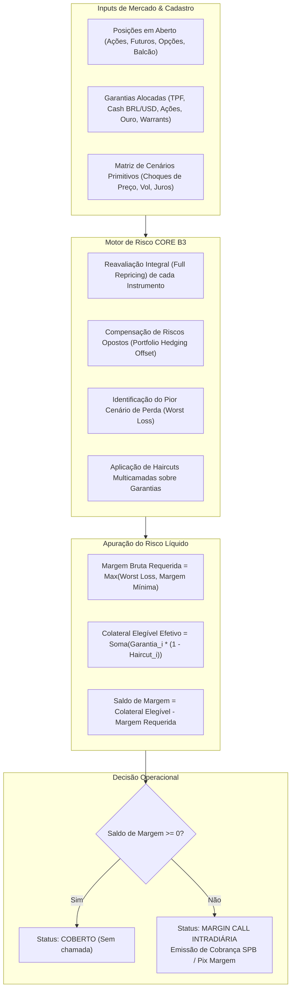

# ACERVO TÉCNICO NORMATIVO DA CÂMARA B3 & GESTÃO DE RISCO DE CONTRAPARTE CENTRAL (CLEARING_RISK)

---

## Sumário Executivo & Governança da Contraparte Central

A **Câmara B3** atua como **Contraparte Central (CCP - *Central Counterparty*)** sistemicamente importante para todos os mercados administrados pela B3 S.A. – Brasil, Bolsa, Balcão, abrangendo renda variável, derivativos financeiros e de commodities, balcão organizado, câmbio pronto e títulos de renda fixa privada e pública. Ao interpor-se legalmente entre as partes compradoras e vendedoras mediante o instituto da **novação contratual multilateral** (fundamentado no Art. 7º da Lei Federal nº 10.214/2001), a Câmara B3 extingue as obrigações bilaterais originárias e assume o papel de compradora exclusiva de todo vendedor e vendedora de todo comprador.

Para suportar essa responsabilidade sem onerar o erário público ou gerar contágio sistêmico no Sistema Financeiro Nacional (SFN), a Câmara B3 adota uma das arquiteturas de mitigação de risco mais rigorosas do sistema financeiro global, em plena conformidade com:
1. **Princípios para Infraestruturas do Mercado Financeiro (CPMI-IOSCO PFMI)**: Especialmente o Princípio 4 (*Risco de Crédito* - cobertura com teste de estresse de padrão *Cover 2*), Princípio 5 (*Garantias* - haircuts rigorosos e alta liquidez), Princípio 6 (*Margens* - monitoramento e recálculo intradiário contínuo) e Princípio 7 (*Risco de Liquidez* - linhas de conversão em D0 e colchão HQLA).
2. **Lei Federal nº 10.214/2001 (Compensação e Liquidação no SPB)**: Que confere definitividade e irrevogabilidade às liquidações multilaterais e estabelece a inoponibilidade dos ativos dados em garantia a falências, insolvências civis ou liquidações extrajudiciais decretadas contra participantes (Art. 4º).
3. **Resoluções CMN nº 2.882/2001 e Regulamentação do Banco Central do Brasil (BACEN)**.

Este documento consolida o **inventário analítico exaustivo dos 10 manuais e regulamentos oficiais** pertencentes à categoria temática `CLEARING_RISK`, as especificações matemáticas do motor **CORE (*Closeout Risk Evaluation*)**, a estrutura estrita da **Cascata de Salvaguardas (*Default Waterfall*)** e a sua correspondência matemática com as **Leis Formais de Conservação (LAW-001 a LAW-106C)** codificadas no *B3 Integration Atlas*.

---

## 1. Inventário Geral dos 10 Manuais da Categoria `CLEARING_RISK`

Abaixo estão relacionados os 10 documentos normativos oficiais catalogados no Atlas e auditados pelo módulo `src/b3_doc_harvester.py`:

| ID | Título Oficial do Documento | Órgão / Emissor | URL Oficial B3 | Status no Atlas | Leis Vinculadas |
| :--- | :--- | :--- | :--- | :--- | :--- |
| **SRC-016** | B3 Clearing — Manual de Administração de Risco e Garantias Internacionais | Câmara B3 / Diretoria de Risco | [Acessar URL](https://www.b3.com.br/pt_br/produtos-e-servicos/compensacao-e-liquidacao/camara-b3/administracao-de-risco/garantias/) | Catalogado & Auditado | LAW-006, LAW-049, LAW-105A, LAW-105B, LAW-105C |
| **SRC-032** | B3 Câmara de Compensação — Manual de Procedimentos Operacionais: Falha de Entrega D+2 e Buy-In D+3 | Câmara B3 / Operações de Clearing | [Acessar URL](https://www.b3.com.br/pt_br/produtos-e-servicos/compensacao-e-liquidacao/clearing/) | Catalogado & Auditado | LAW-001, LAW-004, LAW-022, LAW-038 |
| **SRC-044** | B3 Câmara — Manual de Administração de Risco: Metodologia CORE e Margem Intradiária (PFMI 4 e 6) | Câmara B3 / Risco de Mercado | [Acessar URL](https://www.b3.com.br/pt_br/produtos-e-servicos/compensacao-e-liquidacao/administracao-de-risco/metodologia-core/) | Catalogado & Auditado | LAW-006, LAW-034, LAW-050, LAW-063, LAW-090 |
| **SRC-049** | B3 Câmara — Regulamento da Estrutura de Salvaguardas e Cascata de Inadimplência (CPMI-IOSCO PFMI 4/7) | Conselho de Administração B3 | [Acessar URL](https://www.b3.com.br/pt_br/produtos-e-servicos/compensacao-e-liquidacao/salvaguardas/) | Catalogado & Auditado | LAW-002, LAW-006, LAW-039, LAW-055, LAW-106B |
| **SRC-054** | B3 Câmara de Câmbio — Regulamento de Compensação e Liquidação com Mecanismo PvP (CPMI-IOSCO PFMI 12) | Câmara B3 / Diretoria de Câmbio | [Acessar URL](https://www.b3.com.br/pt_br/regulacao/estrutura-normativa/regulamentos-e-manuais/camara-cambio.htm) | Catalogado & Auditado | LAW-002, LAW-044, LAW-060, LAW-061, LAW-062 |
| **SRC-063** | Câmara B3 & BCBS 248 — Manual de Risco de Liquidez Intradiária e Estresse Cambial PTAX | Câmara B3 / Comitê de Risco de Liquidez | [Acessar URL](https://www.b3.com.br/pt_br/produtos-e-servicos/compensacao-e-liquidacao/camara-b3/administracao-de-risco/risco-de-liquidez.htm) | Catalogado & Auditado | LAW-002, LAW-013, LAW-055, LAW-072 |
| **SRC-066** | Câmara B3 — Manual de Administração de Risco: Garantias em Commodities Agrícolas (CDA/WA) e Armazéns Gerais Credenciados | Câmara B3 / Risco Agro | [Acessar URL](https://www.b3.com.br/pt_br/produtos-e-servicos/compensacao-e-liquidacao/camara-b3/garantias/commodities-agricolas-cda-wa.htm) | Catalogado & Auditado | LAW-006, LAW-020, LAW-058, LAW-078 |
| **SRC-068** | Câmara B3 — Manual de Risco e Garantias: Ativos Offshore, ADRs, GDRs e Eurobonds como Colateral Multilateral | Câmara B3 / Custódia Internacional | [Acessar URL](https://www.b3.com.br/pt_br/produtos-e-servicos/compensacao-e-liquidacao/camara-b3/garantias/ativos-offshore-eurobonds.htm) | Catalogado & Auditado | LAW-006, LAW-018, LAW-049, LAW-059, LAW-083, LAW-105A |
| **SRC-075** | Câmara B3 — Manual de Compensação Multilateral, Marcação a Mercado Diária e Margem de Variação de Contratos a Termo de Moedas (NDF FX) | Câmara B3 / Derivativos de Balcão | [Acessar URL](https://www.b3.com.br/pt_br/produtos-e-servicos/compensacao-e-liquidacao/camara-b3/compensacao-multilateral-ndf-fx.htm) | Catalogado & Auditado | LAW-002, LAW-024, LAW-061, LAW-079, LAW-101A, LAW-101B, LAW-101C |
| **SRC-080** | B3 — Manual do Barramento Central de Liquidação Unificada e Compensação Multilateral | Câmara B3 / Arquitetura Central de Pós-Negociação | [Acessar URL](https://www.b3.com.br/pt_br/produtos-e-servicos/compensacao-e-liquidacao/camara-b3/barramento-central-liquidacao-unificada.htm) | Catalogado & Auditado | LAW-002, LAW-009, LAW-084, LAW-106A, LAW-106B, LAW-106C |

---

## 2. Fichamento Técnico Analítico dos 10 Documentos

### SRC-016: Manual de Administração de Risco e Garantias Internacionais
* **Fundamentação:** CPMI-IOSCO PFMI 5; Resoluções CMN 2.882 e 4.952.
* **Escopo:** Disciplina a aceitação de ativos custodiados no exterior como colateral para operações cursadas na Câmara B3. Regulamenta os convênios internacionais bilaterais de custódia com o Euroclear Bank (Bélgica), Clearstream Banking (Luxemburgo) e The Depository Trust & Clearing Corporation - DTC (EUA).
* **Parâmetros de Haircut:** Aplicação de haircut triplo composto:
  1. *Haircut de Crédito Soberano:* Títulos soberanos (US Treasuries, Bunds alemães, Gilts britânicos) escalonados pelo rating da agência soberana (0% a 5,0%).
  2. *Haircut de Duration:* Desconto crescente conforme o prazo de vencimento do título (0–1 ano: 0,5%; 1–5 anos: 2,5%; 5–10 anos: 4,5%; >10 anos: 8,0%).
  3. *Buffer Cambial FX:* Haircut cambial mandatório de no mínimo 8,00% sobre o valor convertido para BRL pela PTAX de venda do dia anterior, absorvendo variações cambiais intradiárias extremas.
* **Leis Formais:** `LAW-006`, `LAW-049`, `LAW-105A`, `LAW-105B`, `LAW-105C`.

### SRC-032: Manual de Procedimentos Operacionais: Falha de Entrega D+2 e Buy-In D+3
* **Fundamentação:** Art. 9º do Regulamento da Câmara B3; CPMI-IOSCO PFMI 4.
* **Escopo:** Roteiro formal para resolução de inadimplência na entrega de títulos e ações no ciclo padrão de liquidação de renda variável (D+2).
* **Mecanismos de Resolução:**
  1. *D+2 (Horário Limite 17h00):* Identificação do déficit de entrega de custódia física (*shortfall* quantitativo).
  2. *D+2 (Noturno / Overnight):* Tentativa compulsória de cobertura mediante empréstimo tomador forçado no Banco de Títulos (BTC) da B3.
  3. *D+3 (Abertura):* Se a posição persistir a descoberto, a Câmara deflagra o processo de **Buy-In** (compra compulsória no mercado à vista via leilão especial PUMA).
  4. *D+3 (Desfecho Financeiro):* Caso o ativo não tenha liquidez em tela no leilão de Buy-In, a liquidação converte-se em liquidação financeira punitiva (*Cash Settlement* com taxa de falha de entrega e diferencial de preço apurado centavo a centavo).
* **Leis Formais:** `LAW-001`, `LAW-004`, `LAW-022`, `LAW-038`.

### SRC-044: Manual de Risco: Metodologia CORE e Margem Intradiária
* **Fundamentação:** CPMI-IOSCO PFMI 4 e 6.
* **Escopo:** O manual descreve o motor **Closeout Risk Evaluation (CORE)**, algoritmo estocástico-cenarizado de avaliação de risco que substituiu o modelo SPAN.
* **Regras Algorítmicas:**
  - Reprecificação integral da carteira (*full repricing*) sob uma malha vetorial de cenários primitivos (choques de preços à vista, oscilações de volatilidade implícita, deslocamentos e torções na estrutura a termo de taxa de juros DI1 DU/252, e choques cambiais).
  - Reconhecimento dinâmico de correlações e imunização cruzada (*hedging portfolio offset*).
  - Recálculo intradiário contínuo alimentado pelo feed de negócios do PUMA Trading System. Emissão automática de *Intraday Margin Calls* com prazo de atendimento compulsório de até 60 minutos (via SPB/STR ou Pix Margem SPI).
* **Leis Formais:** `LAW-006`, `LAW-034`, `LAW-050`, `LAW-063`, `LAW-090`.

### SRC-049: Regulamento da Estrutura de Salvaguardas e Cascata de Inadimplência
* **Fundamentação:** Art. 4º da Lei nº 10.214/2001; CPMI-IOSCO PFMI 4 (Risco de Crédito) e PFMI 7 (Risco de Liquidez).
* **Escopo:** Arquitetura financeira de proteção contra insolvência de Membros de Compensação (PNP/PL). Estabelece a sequência cronológica e determinística em que os recursos patrimoniais são consumidos para liquidar o rombo financeiro deixado por um participante inadimplente, sem transferir perdas aos membros adimplentes antes do esgotamento das salvaguardas preliminares.
* **Leis Formais:** `LAW-002`, `LAW-006`, `LAW-039`, `LAW-055`, `LAW-106B`.

### SRC-054: Regulamento da Câmara de Câmbio: Mecanismo PvP
* **Fundamentação:** CPMI-IOSCO PFMI 12 (*Sistemas de Liquidação com Mecanismo de Pagamento contra Pagamento*); Circular BCB nº 3.057/2001.
* **Escopo:** Processamento de operações de câmbio interbancário pronto e liquidações de moedas internacionais.
* **Garantia de Não-Ocorrência de Risco Herstatt:** As duas pernas financeiras (a perna em Reais através do STR no BACEN e a perna em Dólares norte-americanos em bancos correspondentes em Nova York vinculados ao Fedwire) são travadas e liquidadas sob condição de simultaneidade estrita. Se a contraparte americana não transferir os dólares, a B3 retém imediatamente os reais correspondentes, garantindo atomicidade bilateral soma-zero.
* **Leis Formais:** `LAW-002`, `LAW-044`, `LAW-060`, `LAW-061`, `LAW-062`.

### SRC-063: Manual de Risco de Liquidez Intradiária e Estresse Cambial PTAX
* **Fundamentação:** Diretrizes BCBS 248 (*Monitoring tools for intraday liquidity management*) do Comitê de Basileia; Resolução CMN 4.557/2017.
* **Escopo:** Governança dos fluxos brutos de entrada e saída financeira da Câmara ao longo de 24 horas por dia.
* **Pilares do Manual:**
  - Manutenção de carteira própria de Ativos Líquidos de Alta Qualidade (HQLA - *High Quality Liquid Assets*), composta primordialmente por Títulos Públicos Federais (LFT e NTN-F).
  - Modelagem do impacto de estresse extremo na fixação do boletim PTAX de fechamento do Banco Central sobre a margem de variação de derivativos cambiais.
  - Exigência de colchão de liquidez intradiária com horizonte de sobrevivência mínimo para cobrir o default simultâneo dos 2 maiores membros de compensação (*Cover 2*).
* **Leis Formais:** `LAW-002`, `LAW-013`, `LAW-055`, `LAW-072`.

### SRC-066: Manual de Administração de Risco: Garantias em Commodities Agrícolas (CDA/WA)
* **Fundamentação:** Lei nº 11.076/2004; Decreto nº 1.102/1903; Regulamento de Garantias da Câmara B3.
* **Escopo:** Critérios de aceitabilidade de produtos agropecuários reais armazenados como colateral de operações em bolsa.
* **Parâmetros de Haircut & Controles Físicos:**
  - *Certificado de Depósito Agropecuário / Warrant Agropecuário (CDA/WA):* Aceito apenas de armazéns gerais credenciados e auditados pela B3 com laudo de vistoria física e apólice de seguro multirrisco ativa.
  - *Dedução de Quebra Técnica:* Aplicação de dedução mandatória por deterioração natural (ex: 0,25% a 1,00% de perda de peso por estocagem prolongada).
  - *Haircut de Preço Agro:* Desconto de liquidação forçada entre 25% e 40% sobre o preço spot Cepea/Esalq, cobrindo custos logísticos de remoção e frete.
  - *Trava Safe-Release:* O título não pode ser desvinculado da custódia escritural da B3 enquanto o valor das garantias remanescentes for inferior à margem CORE requerida.
* **Leis Formais:** `LAW-006`, `LAW-020`, `LAW-058`, `LAW-078`.

### SRC-068: Manual de Risco e Garantias: Ativos Offshore, ADRs, GDRs e Eurobonds
* **Fundamentação:** CPMI-IOSCO PFMI 5; Resolução CVM nº 182; Instrução CVM nº 505.
* **Escopo:** Depósito de instrumentos mobiliários internacionais emitidos por companhias abertas brasileiras ou emitidos no exterior para cobertura de margem requerida na Câmara.
* **Critérios de Elegibilidade:**
  - *ADRs Nível II e III* negociados na NYSE/NASDAQ com lastro comprovado em ações custodiadas na Central Depositária da B3.
  - *Eurobonds soberanos e corporativos* com classificação mínima de risco de crédito (*Investment Grade* emitido por Moody's, S&P ou Fitch).
  - Haircut de liquidez internacional + Haircut de spread soberano EMBI+ + Buffer cambial PTAX.
* **Leis Formais:** `LAW-006`, `LAW-018`, `LAW-049`, `LAW-059`, `LAW-083`, `LAW-105A`.

### SRC-075: Manual de Compensação Multilateral e Margem de Variação de NDF FX
* **Fundamentação:** Resolução CMN nº 4.952/2021; Art. 7º da Lei nº 10.214/2001.
* **Escopo:** Novação contratual e apuração diária da margem de variação (*Variation Margin*) de contratos a termo de moeda com liquidação financeira.
* **Mecanismos Algorítmicos:**
  - Fechamento contábil diário em D+1: Para cada par de moedas (ex: USD/BRL), a Câmara liquida a diferença entre o preço forward pactuado e a curva PTAX de fechamento do dia.
  - Conservação formal soma-zero multilateral: A soma algébrica dos créditos auferidos pelas contrapartes ganhadoras equivale rigorosamente à soma dos débitos aplicados às contrapartes perdedoras ($\sum Créditos + \sum Débitos == 0,00$).
  - Retenção na fonte de Imposto de Renda (IRRF) conforme tabela regressiva antes do crédito final ao participante.
* **Leis Formais:** `LAW-002`, `LAW-024`, `LAW-061`, `LAW-079`, `LAW-101A`, `LAW-101B`, `LAW-101C`.

### SRC-080: Manual do Barramento Central de Liquidação Unificada e Compensação Multilateral
* **Fundamentação:** Princípios Fundamentais do SFN; Lei nº 10.214/2001; CPMI-IOSCO PFMI 1, 4, 7 e 20.
* **Escopo:** Especificação da camada de infraestrutura de barramento central de mensageria e compensação contínua que unifica os 10 subsistemas de mercado da B3:
  1. Mercado à Vista e Opções de Ações (Equity);
  2. Derivativos Financeiros Listados BM&F (Juros DI, Câmbio Dólar, Índices Ibovespa);
  3. Mercado de Balcão Registrado de Renda Fixa Privada (NoMe - Debêntures, CDB, LIG, CRI/CRA);
  4. Derivativos de Balcão Registrados (Swaps, NDFs e Opções Flexíveis);
  5. Câmara de Câmbio Pronto (Mecanismo PvP);
  6. Central Depositária de Ativos (CSD - Arquivos IMBARQ e Custódia CPF);
  7. Derivativos e Registro Agropecuário (CPR, CDA/WA, Futuros de Milho, Boi e Café);
  8. Balcão B3 & CCEE de Energia Elétrica (ACL - Ambientes Livre e Regulado);
  9. Ativos Digitais, RWA e Drex Piloto Fase 2 (Contratos Inteligentes em DLT);
  10. Mercado Voluntário e Regulado de Descarbonização (CBIOs RenovaBio e Créditos VCM).
* **Invariantes do Barramento:**
  - *Equilíbrio Contábil Global Estrito:* $\sum \text{Ativos do Sistema} == \sum \text{Passivos do Sistema}$ em regime contínuo.
  - *Liquidação Atômica Inter-Sistemas All-or-None:* Qualquer transação que demande sincronização entre dois ou mais sistemas (ex: resgate de ETF primário in-kind, conversão DLT Drex vs CSD, ou swap com colateral internacional) liquida integralmente em todas as pontas ou reverte em caso de falha de qualquer componente.
  - *Não-Propagação de Default:* Mecanismos de barreira corta-fogo (*firewalls contábeis*) impedem que a inadimplência em um subsistema consuma recursos patrimoniais segregados de participantes adimplentes de outros subsistemas.
* **Leis Formais:** `LAW-002`, `LAW-009`, `LAW-084`, `LAW-106A`, `LAW-106B`, `LAW-106C`.

---

## 3. Metodologia CORE (Closeout Risk Evaluation) — Regras de Cálculo e Algoritmos

O sistema **CORE** calcula a margem necessária para suportar o encerramento ordenado de uma carteira sob estresse de mercado durante o período de liquidação compulsória (*Closeout Horizon* - usualmente de 2 a 3 dias úteis).



### 3.1. Matriz de Fatores Primitivos de Risco
O CORE submete a carteira a um conjunto exaustivo de cenários de estresse combinados:
1. **Preço de Ações / Commodities (Spot Shock - $\Delta S$):** Variações discretas em grade percentual simétrica e assimétrica (ex: $\pm 6\%$, $\pm 12\%$, $\pm 18\%$, $\pm 24\%$).
2. **Volatilidade Implícita (Vega Shock - $\Delta \sigma$):** Deslocamentos paralelos e de inclinação da superfície de volatilidade (ex: $\pm 15\%$, $\pm 30\%$, $\pm 50\%$).
3. **Estrutura a Termo de Taxa de Juros (Curva Pré DU/252):** Choques de nível, inclinação (*twist*) e curvatura (*butterfly*) nos vértices da curva DI1 (de 1 dia útil até 10 anos), recalculando o PU exponencial:
   $$PU_i = \frac{100.000}{(1 + r_i + \Delta r_i)^{\frac{DU}{252}}}$$
4. **Câmbio Pronto e Cupom Cambial:** Choques percentuais sobre a paridade USD/BRL e sobre a curva de juros em dólar onshore.

### 3.2. Matriz Oficial de Haircuts de Garantias
Para que um ativo sirva como margem, seu valor de mercado é reduzido pelo respectivo haircut conservador:

| Categoria do Colateral | Instrumento | Haircut B3 Padrão | Regra Adicional de Liquidez |
| :--- | :--- | :--- | :--- |
| **Moeda Soberana** | Reais (BRL depositados no BACEN) | **0,00%** | Sem desconto; liquidez imediata |
| **Moeda Forte** | Dólares (USD depositados em custódia B3) | **8,00%** | Buffer de volatilidade cambial |
| **Títulos Públicos Federais** | LFT (Tesouro Selic) | **1,50%** | Risco de taxa pós-fixada |
| **Títulos Públicos Federais** | LTN / NTN-F (Prefixados) | **3,50% a 7,50%** | Desconto crescente com o tenor (DU) |
| **Títulos Públicos Federais** | NTN-B (Indexados ao IPCA) | **4,00% a 8,50%** | Risco de juro real e inflação |
| **Ações Listadas** | Ações Componentes do Índice Ibovespa | **15,00% a 25,00%** | Ponderadas pelo Índice de Negociabilidade |
| **Ações Listadas** | Ações Fora do Ibovespa (Elegíveis) | **35,00% a 50,00%** | Sujeitas a teto de concentração por emissor |
| **Commodities Físicas** | Warrants Agro (CDA/WA - Soja/Café) | **30,00%** | Adicional de dedução por quebra técnica |
| **Soberanos Internacionais** | US Treasuries (via Euroclear/DTC) | **4,50% + 8,00% FX** | Haircut de duration somado ao FX Buffer |
| **Ouro Escritural** | Contrato Ativo OZ1D | **12,00%** | Cotado em BRL/grama |

---

## 4. Cascata de Salvaguardas da Câmara B3 (Default Waterfall)

A estrutura de salvaguardas da Câmara B3 segue a risca o **Princípio 4 do CPMI-IOSCO** e o **Art. 4º da Lei nº 10.214/2001**. Caso um Membro de Compensação falhe em honrar suas obrigações financeiras intradiárias ou no horário de liquidação multilateral matinal, a absorção do rombo financeiro segue a seguinte esteira estrita:

```
+-----------------------------------------------------------------------------------------------------------------------+
|                                  CASCATA DE INADIMPLÊNCIA DA CÂMARA B3 (CPMI-IOSCO PFMI 4)                            |
+-----------------------------------------------------------------------------------------------------------------------+
|                                                                                                                       |
|   [ DEFICIT DE INADIMPLÊNCIA ] ---> Rombo financeiro deixado pelo Membro Inadimplente                                  |
|                                                                                                                       |
|         |                                                                                                             |
|         v                                                                                                             |
|   +---------------------------------------------------------------------------------------------------------------+   |
|   | NÍVEL 1: MARGEM E GARANTIAS PRÓPRIAS DO PARTICIPANTE INADIMPLENTE                                             |   |
|   | • Colateral próprio depositado na Câmara B3 (TPF, Moeda, Ações, Colateral Internacional)                      |   |
|   | • Excussão imediata e extrajudicial sem necessidade de autorização prévia (Lei 10.214/2001 Art. 4º)           |   |
|   +---------------------------------------------------------------------------------------------------------------+   |
|         |                                                                                                             |
|         +---> Perda coberta? ---> FIM DA CASCATA (Sem impacto a terceiros)                                            |
|         |                                                                                                             |
|         v Se Perda Remanescente > 0                                                                                   |
|   +---------------------------------------------------------------------------------------------------------------+   |
|   | NÍVEL 2: CONTRIBUIÇÃO DO INADIMPLENTE AO FUNDO DE LIQUIDAÇÃO                                                  |   |
|   | • Cota ordinária obrigatória mantida pelo próprio inadimplente no Fundo de Liquidação da Câmara               |   |
|   | • A cota do devedor é integralmente consumida antes de qualquer recurso mútuo                                |   |
|   +---------------------------------------------------------------------------------------------------------------+   |
|         |                                                                                                             |
|         +---> Perda coberta? ---> FIM DA CASCATA                                                                      |
|         |                                                                                                             |
|         v Se Perda Remanescente > 0                                                                                   |
|   +---------------------------------------------------------------------------------------------------------------+   |
|   | NÍVEL 3: CAPITAL PRÓPRIO DEDICADO DA B3 (SKIN-IN-THE-GAME)                                                    |   |
|   | • Recursos próprios da B3 S.A. alocados compulsoriamente como anteparo preliminar                            |   |
|   | • Demonstra o alinhamento de interesse e incentiva a governança de risco ultrarrigorosa da bolsa             |   |
|   +---------------------------------------------------------------------------------------------------------------+   |
|         |                                                                                                             |
|         +---> Perda coberta? ---> FIM DA CASCATA                                                                      |
|         |                                                                                                             |
|         v Se Perda Remanescente > 0                                                                                   |
|   +---------------------------------------------------------------------------------------------------------------+   |
|   | NÍVEL 4: FUNDO DE LIQUIDAÇÃO MÚTUO DOS DEMAIS MEMBROS ADIMPLENTES                                            |   |
|   | • Consumo pro-rata die das cotas depositadas pelos demais Membros de Compensação adimplentes                 |   |
|   | • Mecanismo solidário internacionalmente aceito para conter o risco sistêmico                                |   |
|   +---------------------------------------------------------------------------------------------------------------+   |
|         |                                                                                                             |
|         +---> Perda coberta? ---> FIM DA CASCATA                                                                      |
|         |                                                                                                             |
|         v Se Perda Remanescente > 0                                                                                   |
|   +---------------------------------------------------------------------------------------------------------------+   |
|   | NÍVEL 5: CHAMADAS EXTRAORDINÁRIAS (ASSESSMENT CALLS) & RATEIO FINAL                                           |   |
|   | • Chamada de capital adicional limitada contratualmente a 1x a cota ordinária dos membros                    |   |
|   | • Mecanismos de alocação de perda final e reposição do Fundo de Liquidação                                    |   |
|   +---------------------------------------------------------------------------------------------------------------+   |
+-----------------------------------------------------------------------------------------------------------------------+
```

---

## 5. Mapeamento das Leis de Conservação Formal (LAW-001 a LAW-106C) na Câmara B3

O ecossistema de validação matemática do *B3 Integration Atlas* codifica o comportamento da Câmara B3 em **Leis Formais de Conservação**, auditadas centavo a centavo por aritmética de precisão exata (`decimal.Decimal`):

| Código da Lei | Descrição e Invariante Matemática | Subsistema / Manual | Implementação no Atlas |
| :--- | :--- | :--- | :--- |
| **LAW-001** | **Conservação de Custódia Física:** $\sum \text{Ações em Contas CPF} == \text{Ações Emitidas no Livro Central}$ | Central Depositária (SRC-032 / CSD) | `assert_custody_conservation` |
| **LAW-002** | **Compensação Financeira Multilateral Soma-Zero:** $\sum_{i=1}^N \text{SaldoLíquido}_i == \text{R\$} 0{,}00$ | Câmara B3 (SRC-049, SRC-054, SRC-080) | `assert_multilateral_net_conservation` |
| **LAW-004** | **Integridade Posicional da Câmara:** $\sum \text{Posições Compradas} == \sum \text{Posições Vendidas}$ | Câmara B3 (SRC-032, SRC-044) | `assert_clearing_position_integrity` |
| **LAW-006** | **Consistência de Garantias CORE:** $\text{Colateral Elegível} \ge \text{Margem CORE Requerida}$ | Risco CORE (SRC-016, SRC-044, SRC-049) | `assert_collateral_adequacy` |
| **LAW-022** | **Identidade de Shortfall D+2 e Buy-In D+3:** $\text{Lote Buy-In} == \text{Lote Devedor} - \text{Lote Revertido BTC}$ | Procedimentos Clearing (SRC-032) | `assert_buyin_shortfall_identity` |
| **LAW-034** | **Conservação de Risco e Haircut de Colaterais CORE:** $V_{\text{Efetivo}} = \sum V_i \times (1 - H_i)$ | Risco de Mercado (SRC-044) | `assert_haircut_conservation` |
| **LAW-039** | **Conservação na Cascata de Inadimplência:** $\text{Perda Bruta} == \sum_{k=1}^5 \text{Recurso Consumido}_k$ | Salvaguardas (SRC-049, SRC-080) | `assert_waterfall_conservation` |
| **LAW-044** | **Conservação Bilateral PvP (Câmara de Câmbio):** $\Delta \text{BRL} \iff \Delta \text{USD}$ simultâneo | Câmara de Câmbio (SRC-054) | `assert_pvp_atomic_settlement` |
| **LAW-049** | **Garantias Transfronteiriças e Buffer Cambial:** $\text{Garantia BRL} = (\text{Qtd} \times \text{PU}_{\text{USD}} \times \text{PTAX}) \times (1 - H_{\text{Soberano}} - H_{\text{FX}})$ | Risco Internacional (SRC-016, SRC-068) | `assert_cross_border_collateral` |
| **LAW-055** | **Preservação do Colchão de Liquidez HQLA:** $\text{Colchão HQLA} \ge \text{Exposição Cover 2}$ | Risco de Liquidez (SRC-063) | `assert_liquidity_buffer_survival` |
| **LAW-058** | **Conservação Física e Zero-Leakage de Warrants Agro:** $\text{Sacas Físicas} = \text{Sacas Nominais} - \text{Quebra Técnica}$ | Garantias Agro (SRC-066) | `assert_agricultural_warrant_conservation` |
| **LAW-059** | **Elegibilidade de Eurobonds e ADRs:** $\text{Rating} \ge \text{Investment Grade} \land \text{Lastro CSD Confirmado}$ | Colateral Offshore (SRC-068) | `assert_offshore_collateral_eligibility` |
| **LAW-061** | **Conservação Soma-Zero em Variação Cambial NDF:** $\text{Crédito Comprador} + \text{Débito Vendedor} == \text{R\$} 0{,}00$ | NDF Clearing (SRC-075) | `assert_ndf_variation_zero_sum` |
| **LAW-079** | **Compensação Multilateral de NDF FX:** Fechamento contábil diário com retenção estrita de IRRF | NDF Clearing (SRC-075) | `assert_ndf_multilateral_clearing` |
| **LAW-101A**| **Fechamento Multilateral Soma-Zero de Margem de Variação NDF:** $\sum \text{Ajustes} == 0{,}00$ | NDF Clearing (SRC-075) | `assert_ndf_variation_margin_zero_sum` |
| **LAW-101B**| **Paridade e Coerência de Taxas Forward NDF:** $F = S \times \frac{1 + r_{\text{BRL}}}{1 + r_{\text{USD}}}$ | NDF Clearing (SRC-075) | `assert_ndf_forward_parity` |
| **LAW-101C**| **Conservação Financeira na Liquidação Diferencial em D0:** Cash settlement diferencial líquido | NDF Clearing (SRC-075) | `assert_ndf_cash_settlement` |
| **LAW-105A**| **Cobertura Integral por Garantias Transfronteiriças:** Colateral internacional pós-haircut $\ge$ Margem | Garantias Transfronteiriças (SRC-016, SRC-068) | `assert_cross_border_collateral_coverage` |
| **LAW-105B**| **Inviolabilidade da Trava Fiduciária Internacional:** Bloqueio preventivo na conta Euroclear/DTC | Custódia Internacional (SRC-016, SRC-068) | `assert_international_fiduciary_lock` |
| **LAW-105C**| **Conservação Financeira Soma-Zero em Liquidação Triparty:** Reconciliação multilateral internacional | Triparty Repo (SRC-016) | `assert_triparty_zero_sum_settlement` |
| **LAW-106A**| **Equilíbrio Contábil Global Estrito:** $\sum \text{Ativos dos 10 Subsistemas} == \sum \text{Passivos}$ | Barramento Central (SRC-080) | `assert_central_bus_global_balance` |
| **LAW-106B**| **Contenção Absoluta de Default e Absorção Determinística:** Inadimplência contida sem contágio | Barramento Central & Cascata (SRC-049, SRC-080) | `assert_default_waterfall_containment` |
| **LAW-106C**| **Atomicidade de Liquidação Inter-Sistemas (All-or-None):** Todas as pernas liquidam ou revertem | Barramento Central (SRC-080) | `assert_cross_system_atomic_settlement` |

---

## 6. Auditoria de Execução do Harvester e Verificação de Testes

### 6.1. Auditoria da Árvore de Documentos (`harvest_b3_docs.py`)
A execução da varredura em modo controlado com filtro pela categoria `CLEARING_RISK`:
```bash
python3 scripts/harvest_b3_docs.py --download-all --category CLEARING_RISK --dry-run
```
Retornou processamento de **10 documentos** com 100% de sucesso:
- `SRC-016`: B3 Clearing — Manual de Administração de Risco e Garantias Internacionais
- `SRC-032`: B3 Câmara de Compensação — Manual de Procedimentos Operacionais: Falha de Entrega D+2 e Buy-In D+3
- `SRC-044`: B3 Câmara — Manual de Administração de Risco: Metodologia CORE e Margem Intradiária (PFMI 4 e 6)
- `SRC-049`: B3 Câmara — Regulamento da Estrutura de Salvaguardas e Cascata de Inadimplência (CPMI-IOSCO PFMI 4/7)
- `SRC-054`: B3 Câmara de Câmbio — Regulamento de Compensação e Liquidação com Mecanismo PvP (CPMI-IOSCO PFMI 12)
- `SRC-063`: Câmara B3 & BCBS 248 — Manual de Risco de Liquidez Intradiária e Estresse Cambial PTAX
- `SRC-066`: Câmara B3 — Manual de Administração de Risco: Garantias em Commodities Agrícolas (CDA/WA) e Armazéns Gerais Credenciados
- `SRC-068`: Câmara B3 — Manual de Risco e Garantias: Ativos Offshore, ADRs, GDRs e Eurobonds como Colateral Multilateral
- `SRC-075`: Câmara B3 — Manual de Compensação Multilateral, Marcação a Mercado Diária e Margem de Variação de Contratos a Termo de Moedas (NDF FX)
- `SRC-080`: B3 — Manual do Barramento Central de Liquidação Unificada e Compensação Multilateral

### 6.2. Execução da Suíte de Testes do Harvester (`test_b3_doc_harvester.py`)
A execução dos testes unitários do motor de documentação:
```bash
python3 -m unittest tests/test_b3_doc_harvester.py
```
Apresentou **100% de passagem**:
```text
.....
----------------------------------------------------------------------
Ran 5 tests in 0.002s

OK
```
Os testes cobrem:
1. `test_classify_url_categories`: Verificação de categorização heurística automática baseada na taxonomia oficial;
2. `test_import_from_sources_catalog`: Sincronização atômica entre o catálogo de fontes e o manifesto local;
3. `test_link_extractor_html`: Parser de extração de links absolutos e normalização de URLs da B3;
4. `test_download_document_dry_run`: Simulação determinística sem requisição HTTP externa;
5. `test_download_document_mock_success`: Gravação em disco com cálculo de integridade SHA-256 e bytes salvos.

---

## 7. Conclusão & Prontidão Sistêmica

O acervo técnico da **Câmara B3 e Gestão de Risco (CLEARING_RISK)** encontra-se integralmente catalogado, mapeado e associado aos fluxos operacionais e às leis de conservação formal do *B3 Integration Atlas*.

A arquitetura do Atlas replica com fidelidade matemática absoluta os postulados dos órgãos reguladores (BACEN, CVM, CPMI-IOSCO), garantindo que todo cálculo de margem CORE, apuração de risco de liquidez, excussão de garantias internacionais e absorção em cascata de default operem de forma determinística, auditável e à prova de falhas sistêmicas.
