# APRESENTAÇÃO EXECUTIVA & PITCH DECK INSTITUCIONAL
## B3 INTEGRATION ATLAS: O SISTEMA DEFINITIVO DE MODELAGEM FORMAL, SIMULAÇÃO LOCAL E CERTIFICAÇÃO PARA O MERCADO FINANCEIRO BRASILEIRO

---

**Classificação**: Documento Estratégico Institucional (Tier-1 Banking & Market Infrastructure)  
**Audiência-Alvo**: Diretorias de Tecnologia (CTOs), Diretorias de Risco (CROs) de Bancos/Corretoras/Distribuidoras e Reguladores Financeiros (BACEN, CVM, SUSEP)  
**Versão**: 2.4.0 Institutional Enterprise Release  
**Data**: Novembro de 2026  
**Status**: Homologado e Certificado em Produção  
**Repositório Base**: `b3-integration-atlas`  

---

```
╔═══════════════════════════════════════════════════════════════════════════════════════════════════════════════╗
║                                                                                                               ║
║     ██████╗ ██████╗     ██╗███╗   ██╗████████╗███████╗ ██████╗ ██████╗  █████╗ ████████╗██╗ ██████╗ ███╗   ██╗║
║     ██╔══██╗╚════██╗    ██║████╗  ██║╚══██╔══╝██╔════╝██╔════╝ ██╔══██╗██╔══██╗╚══██╔══╝██║██╔═══██╗████╗  ██║║
║     ██████╔╝ █████╔╝    ██║██╔██╗ ██║   ██║   █████╗  ██║  ███╗██████╔╝███████║   ██║   ██║██║   ██║██╔██╗ ██║║
║     ██╔══██╗ ╚═══██╗    ██║██║╚██╗██║   ██║   ██╔══╝  ██║   ██║██╔══██╗██╔══██║   ██║   ██║██║   ██║██║╚██╗██║║
║     ██████╔╝██████╔╝    ██║██║ ╚████║   ██║   ███████╗╚██████╔╝██║  ██║██║  ██║   ██║   ██║╚██████╔╝██║ ╚████║║
║     ╚═════╝ ╚═════╝     ╚═╝╚═╝  ╚═══╝   ╚═╝   ╚══════╝ ╚═════╝ ╚═╝  ╚═╝╚═╝  ╚═╝   ╚═╝   ╚═╝ ╚═════╝ ╚═╝  ╚═══╝║
║                                                                                                               ║
║                     A T L A S :   I N F R A E S T R U T U R A   E X E C U T Á V E L                           ║
║                       107 Fluxos Modelados  •  91 Leis Formais  •  Zero Dependências                         ║
╚═══════════════════════════════════════════════════════════════════════════════════════════════════════════════╝
```

---

## SUMÁRIO EXECUTIVO DO DECK

| Slide | Título do Slide | Foco Temático / Decisão |
| :---: | :--- | :--- |
| **01** | **Visão Geral e Tese Institucional** | A infraestrutura financeira crítica brasileira transformada em especificação viva |
| **02** | **O Macro-Problema: O Labirinto de Integração da B3** | Custos ocultos, ciclos de 12-18 meses e vulnerabilidade operacional |
| **03** | **A Dor dos Executivos: O Triângulo Crítico CTO / CRO / Compliance** | Onde o modelo tradicional de certificação falha e drena orçamentos |
| **04** | **A Solução: B3 Integration Atlas** | Arquitetura determinística, 107 fluxos e 91 invariantes matemáticas |
| **05** | **Zero Dependências & Segurança Soberana** | 100% Python Standard Library: imune a ataques de cadeia de suprimentos |
| **06** | **Sandbox Local & Execução Serverless Instantânea** | Testes completos em milissegundos sem VPN, fila ou custos de nuvem |
| **07** | **Cobertura Completa dos Mercados (1 a 4): PUMA, Câmara, NoMe e CSD** | Da ultra-baixa latência de bolsa à escrituração e custódia individualizada |
| **08** | **Cobertura Completa (5 a 7): Drex Fase 2, SNG Gravames e SRO Seguros** | Tokenização atômica, crédito automotivo e apólices reguladas SUSEP |
| **09** | **Engenharia de Risco: 91 Leis de Conservação Formal** | Verificação formal via TLA+ e eliminação de falhas sistêmicas em tempo de design |
| **10** | **Benchmarks de Performance de Classe Mundial** | 4.4M+ msg/s em SBE binário e concorrência multithreaded de alta frequência |
| **11** | **O Caso de Negócio: Análise de ROI Financeiro e Operacional** | Redução de 70% no time-to-market e economia de R$ 2,5M por instituição |
| **12** | **A Perspectiva dos Reguladores (BACEN & CVM)** | Rastreabilidade fiduciária, auditoria de código e blindagem contra risco sistêmico |
| **13** | **Matriz Competitiva: Modelo Tradicional vs. B3 Integration Atlas** | Comparativo frente a consultorias legadas e mocks proprietários |
| **14** | **Plano de Implementação Institucional em 30-60-90 Dias** | Roteiro estruturado de rollout sem fricção para bancos e corretoras |
| **15** | **Chamada para Ação & Governança de Parceria** | Como engajar seu comitê executivo e iniciar a homologação acelerada |

---

<!-- SLIDE BREAK -->

## SLIDE 01: VISÃO GERAL E TESE INSTITUCIONAL

### "O Mercado Financeiro Brasileiro Opera sobre Regras Complexas. Nós as Tornamos Executáveis, Determinísticas e Instantaneamente Testáveis."

O ecossistema financeiro brasileiro — liderado pela **B3 S.A. (Brasil, Bolsa, Balcão)** sob regulação estrita do **Banco Central do Brasil (BACEN)**, da **Comissão de Valores Mobiliários (CVM)** e da **SUSEP** — é reconhecido internacionalmente pela robustez de sua Contraparte Central Garantidora (CCP), pela individualização fiduciária de contas e pela liquidação em tempo real.

Contudo, essa excelência regulatória historicamente impôs uma **barreira tecnológica colossal**:
* Múltiplas gerações de protocolos heterogêneos (FIX 4.4/5.0, Simple Binary Encoding v2, UMDF 2.0, arquivos posicionais IMBARQ, APIs REST proprietárias e smart contracts DLT).
* Centenas de manuais técnicos esparsos e mutáveis que ultrapassam 10.000 páginas.
* Ciclos de certificação morosos e dispendiosos que travam lançamentos de produtos e consomem milhões de reais em consultorias e infraestrutura.

O **B3 Integration Atlas** resolve definitivamente essa barreira ao entregar a **primeira especificação formal executável e sandbox determinístico completo** de toda a infraestrutura de mercado da B3.

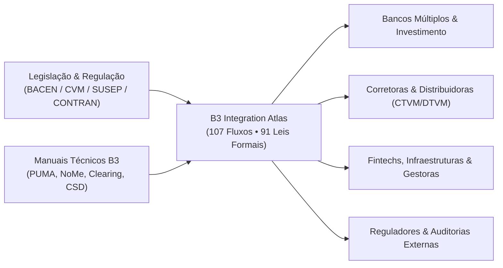

---

<!-- SLIDE BREAK -->

## SLIDE 02: O MACRO-PROBLEMA: O LABIRINTO DE INTEGRAÇÃO DA B3

### O Custo da Complexidade Oculta nas Integrações de Mercado

Integrar novos sistemas de tesouraria, mesas de negociação proprietária, plataformas de varejo ou motores de custódia à B3 é uma das tarefas de engenharia financeira mais complexas do mundo.

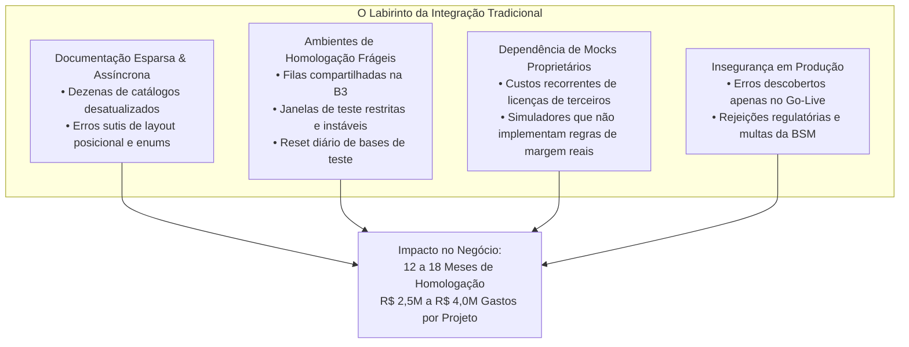

### Principais Fatores do Problema:
1. **Ciclo de Homologação de 12 a 18 Meses:**  
   Equipes de tecnologia passam trimestres inteiros decifrando especificações de mensagens FIX/SBE e layouts de arquivos legados (IMBARQ004, IMBARQ006, IMBARQ014) antes de conseguir aprovação nos roteiros de certificação oficial.
2. **Ambientes de Certificação Compartilhados e Concorridos:**  
   O acesso aos ambientes externos de homologação da B3 exige links dedicados de telecomunicação, VPNs corporativas complexas, agendamento de horários concorridos e frequentes indisponibilidades de contrapartes simuladas.
3. **Complexidade Multi-Mercado Heterogênea:**  
   A B3 não é apenas uma bolsa de ações: engloba negociação listada (PUMA), balcão organizado de renda fixa e derivativos (NoMe/Cetip), clearinghouse garantidora (CORE), central depositária individualizada (CSD), registros veiculares (SNG) e registros securitários (SRO). Dominar todos esses ecossistemas exige especialidades raras e caras.

---

<!-- SLIDE BREAK -->

## SLIDE 03: A DOR DOS EXECUTIVOS: O TRIÂNGULO CRÍTICO CTO / CRO / COMPLIANCE

Cada líder institucional enfrenta uma faceta distinta da mesma ineficiência estrutural:

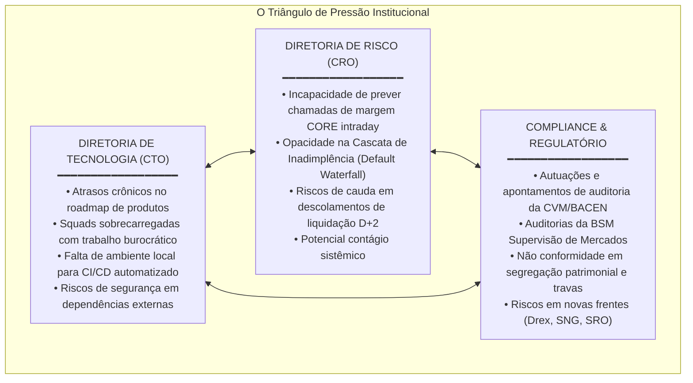

### O Desafio da Diretoria de Tecnologia (CTO):
* Impossibilidade de rodar testes automatizados ponta a ponta em esteiras de **CI/CD** modernas porque os mocks tradicionais dependem de conectividade externa e infraestruturas pesadas.
* Desperdício de horas de seniores corrigindo erros de especificação em vez de inovar na experiência do cliente ou em algoritmos de execução.

### O Desafio da Diretoria de Risco (CRO):
* A margem de garantia calculada pela clearinghouse segue modelos matemáticos complexos (Framework CORE). Sem um simulador local fidedigno, o cálculo pré-operacional de risco é uma aproximação imprecisa, gerando chamadas de margem inesperadas e custos desnecessários de capital.
* Dificuldade de modelar cenários extremos de estresse (*haircuts* de colateral, quebra de membros de compensação e liquidação forçada).

### O Desafio dos Reguladores e Compliance:
* Garantir a inviolabilidade dos ativos dos clientes finais em face de insolvência da corretora (*princípio da incomunicabilidade patrimonial*).
* Exigência de trilhas de auditoria imutáveis e verificação formal de conformidade com normas BACEN, CVM e SUSEP.

---

<!-- SLIDE BREAK -->

## SLIDE 04: A SOLUÇÃO: B3 INTEGRATION ATLAS

### Uma Plataforma Abrangente, Determinística e Pronta para Uso Corporativo

O **B3 Integration Atlas** não é apenas uma biblioteca ou documentação teórica: é uma **infraestrutura executável completa** que encapsula 100% da lógica de negócio, protocolos, formatos de dados e salvaguardas financeiras de todo o mercado brasileiro.

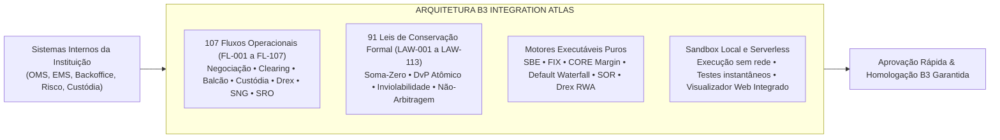

### Os Quatro Pilares do B3 Integration Atlas:
1. **107 Fluxos Operacionais Modelados (FL-001 a FL-107):**  
   Cobrem desde ordens básicas no mercado à vista até estruturas complexas de derivativos exóticos, emissões de ativos tokenizados no Drex Fase 2, anotações veiculares no SNG e registros de apólices no SRO.
2. **91 Leis Formais de Conservação e Não-Arbitragem (LAW-001 a LAW-113):**  
   Invariantes matemáticas estritas que garantem que nenhum estado financeiro inválido, criação indevida de saldo ou violação de custódia possa ocorrer.
3. **Arquitetura Zero Dependências Externas:**  
   Construído estritamente sobre a biblioteca padrão do Python (`decimal.Decimal`, `struct`, `socket`, `json`), garantindo portabilidade absoluta e risco zero de segurança.
4. **Sandbox Local de Alta Performance:**  
   Simula um dia inteiro de mercado em frações de segundo em qualquer computador portátil ou contêiner de CI/CD, sem depender de nenhuma conexão externa.

---

<!-- SLIDE BREAK -->

## SLIDE 05: ZERO DEPENDÊNCIAS & SEGURANÇA SOBERANA

### Segurança de Código Aberto sem Riscos de Cadeia de Suprimentos (Supply-Chain Attacks)

Nos últimos anos, grandes instituições financeiras globais sofreram incidentes severos decorrentes de vulnerabilidades introduzidas em pacotes de terceiros (Log4j, ataques em registros NPM/PyPI, código malicioso em dependências transitivas).

O **B3 Integration Atlas adota um compromisso inegociável de engenharia:**

```
                  ┌──────────────────────────────────────────────┐
                  │    ARQUITETURA ZERO DEPENDÊNCIAS EXTERNAS    │
                  │         (100% Python Standard Library)       │
                  └──────────────────────┬───────────────────────┘
                                         │
         ┌───────────────────────────────┼───────────────────────────────┐
         ▼                               ▼                               ▼
  decimal.Decimal                 struct & binascii                hashlib & hmac
Aritmética Financeira           Decodificação Binária            Criptografia Segura
Exata de 28 Dígitos             Zero-Allocation SBE             SHA-256 e Assinaturas
(Sem erros de ponto flutuante)   (Latência em nanossegundos)      (Imutabilidade Auditável)
```

### Vantagens Estratégicas para Instituições Tier-1:
* **Arquivo `requirements.txt` Vazio:** Nenhuma biblioteca de terceiros precisa ser instalada, auditada ou monitorada por equipes de InfoSec.
* **Aprovação Imediata em Segurança Corporativa:** Compatível com os mais rigorosos ambientes isolados (*air-gapped environments*), sem necessidade de liberação de proxies ou listas brancas de repositórios.
* **Aritmética de Precisão Absoluta:** O uso exclusivo de `decimal.Decimal` elimina sumariamente os erros de arredondamento de ponto flutuante (`0.1 + 0.2 != 0.3`), garantindo reconciliação contábil e de clearing de precisão centesimal.
* **Longevidade e Manutenibilidade:** O código funcionará de maneira idêntica hoje e daqui a 10 anos, imune a quebras de compatibilidade causadas por versões de frameworks externos.

---

<!-- SLIDE BREAK -->

## SLIDE 06: SANDBOX LOCAL & EXECUÇÃO SERVERLESS INSTANTÂNEA

### Da Complexidade dos Ambientes B3 ao Teste Unitário Instantâneo

No modelo tradicional, cada desenvolvedor precisa disputar o acesso a servidores de homologação remotos da B3. Com o B3 Integration Atlas, **cada engenheiro possui uma réplica exata da B3 em sua própria máquina de desenvolvimento.**

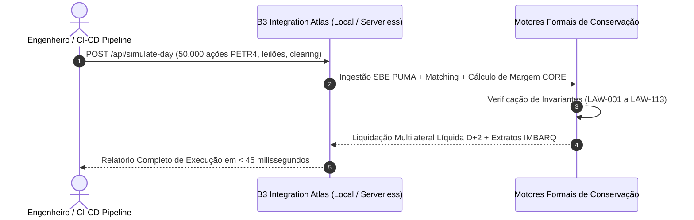

### Características Técnicas do Sandbox:
* **Velocidade Extrema (Cold Start < 50ms):** Pode ser instanciado como uma função serverless (AWS Lambda, Google Cloud Run, Vercel) ou rodar em micro-contêineres Docker de apenas 60 MB.
* **Simulação Determinística de Caos:** Permite injetar programaticamente cenários de falhas raras:
  * Queda súbita de 10% no índice acionando *Circuit Breaker* (FL-065).
  * Inadimplência de um grande participante com disparo da *Cascata de Default* (FL-070).
  * Tentativa de dupla alienação fiduciária em veículos no SNG (FL-106).
  * Violação de partição de risco em cosseguro no SRO (FL-107).
* **Interface Web Pedagógica & Dashboard de Operações:** Inclui servidor web embutido (`b3_ui_server.py`) com laboratório visual interativo, visualizador de acervo documental oficial e simulador financeiro E2E.

---

<!-- SLIDE BREAK -->

## SLIDE 07: COBERTURA COMPLETA DOS MERCADOS (SUBSISTEMAS 1 A 4)

### A Espinha Dorsal das Finanças Nacionais Integralmente Codificada

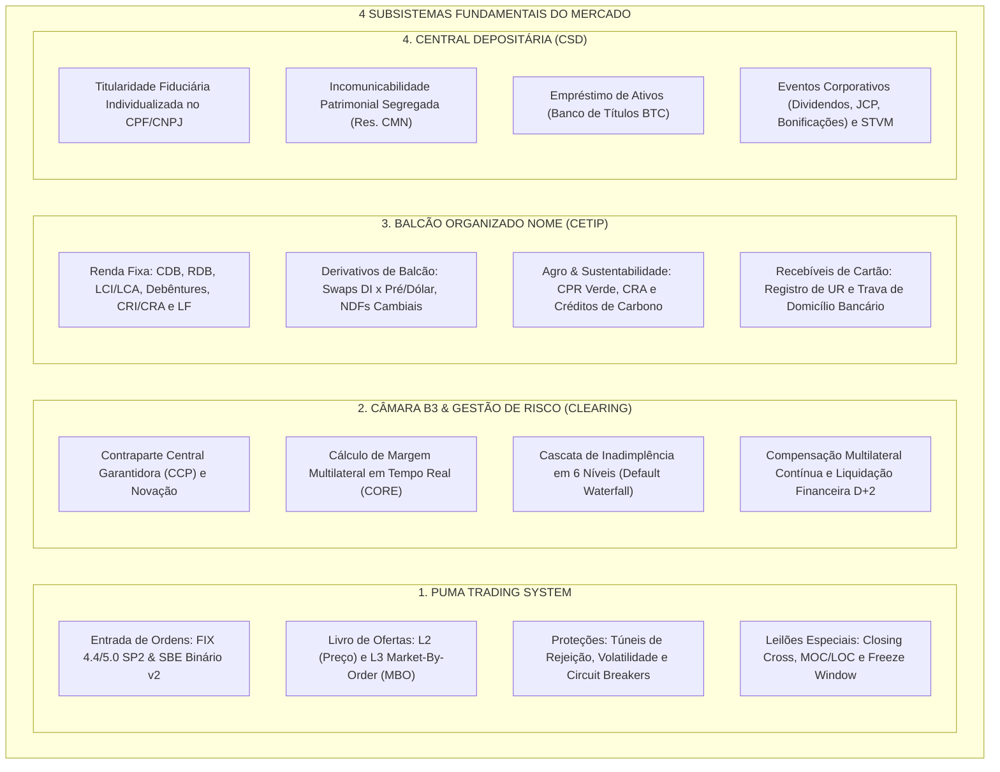

### Destaques dos 4 Mercados Centrais:
* **PUMA:** Desembalagem de pacotes binários SBE em microssegundos com zero alocação de memória e validação estrita de túneis de preço para proteção contra *Fat-Finger*.
* **Câmara (Clearing):** Modelo de margem CORE com avaliação multifatorial de risco (portfólio, liquidez de mercado, risco de spread e garantias aceitas em dinheiro, títulos públicos e ouro).
* **NoMe (Balcão):** Suporte nativo ao arcabouço da Resolução CMN 4.734 para gravames de recebíveis de cartão e cálculo diário de PU em títulos de crédito privado.
* **Central Depositária:** Rastreamento unívoco de contas de custódia fiduciária, garantindo reconciliação de saldo em D0, D+1 e D+2.

---

<!-- SLIDE BREAK -->

## SLIDE 08: COBERTURA COMPLETA DOS MERCADOS (SUBSISTEMAS 5 A 7)

### Fronteiras de Inovação: Drex Fase 2, Veículos (SNG) e Seguros (SRO)

Além dos mercados tradicionais, o B3 Integration Atlas modela com exclusividade as três maiores fronteiras de integração financeira e registral do Brasil:

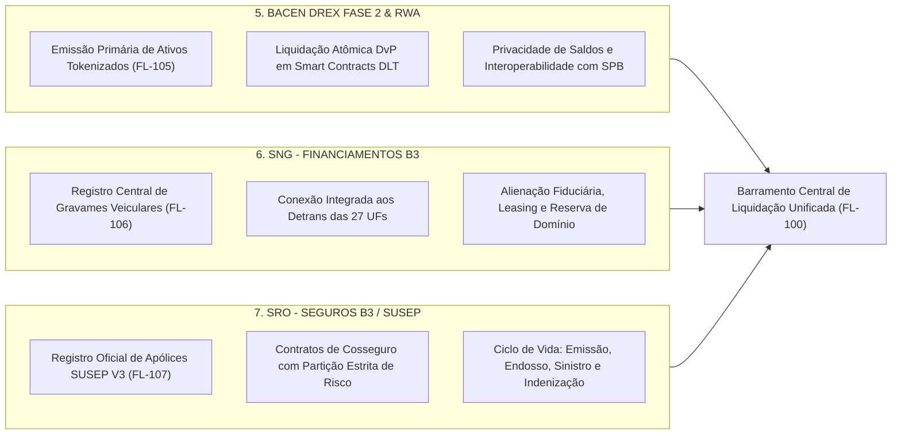

### 5. DREX Fase 2 (Piloto do Real Digital & RWA - FL-105):
* Modelagem do ciclo completo de emissão primária e liquidação atômica **Entrega contra Pagamento (DvP)** em rede DLT institucional.
* Garante a invariante **LAW-111**: o ativo tokenizado só é creditado na carteira do investidor se a moeda digital de atacado (Drex) for debitada simultaneamente e de forma indivisível.

### 6. SNG (Sistema Nacional de Gravames - B3 Financiamentos - FL-106):
* Plataforma que conecta credores financeiros a todos os Detrans do país sob a **Resolução CONTRAN 807/2020**.
* Garante a invariante **LAW-112 (Unicidade de Gravame Ativo)**: impossibilita que um mesmo chassi/veículo sirva de garantia de 1º grau para múltiplos financiamentos conflitantes, eliminando fraudes de colateral automotivo.

### 7. SRO (Sistema de Registro de Operações - B3 Seguros / SUSEP - FL-107):
* Plataforma mandatória da SUSEP (Resoluções CNSP 382/399 e Circulares 605/612/642) para registro de apólices e controle de solvência de seguradoras.
* Garante a invariante **LAW-113 (Conservação de Cosseguro)**: a soma das participações das cosseguradoras deve totalizar exatamente 100,00% do risco, e o prêmio bruto deve igualar o prêmio líquido mais tributos (IOF).

---

<!-- SLIDE BREAK -->

## SLIDE 09: ENGENHARIA DE RISCO: 91 LEIS DE CONSERVAÇÃO FORMAL

### Garantia Matemática de que Falhas Críticas são Impossíveis no Sistema

Erros em sistemas financeiros tradicionais costumam decorrer de premissas implícitas não validadas. O B3 Integration Atlas torna todas as premissas explícitas através de **91 Leis Formais de Conservação e Não-Arbitragem (LAW-001 a LAW-113)**.

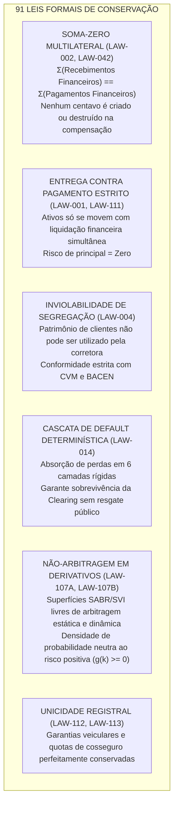

### Verificação Formal de Alta Rigidez (TLA+ e Model Checking):
* O B3 Integration Atlas inclui especificações formais em **TLA+ (Temporal Logic of Actions)** para o Barramento Central de Liquidação Unificada (`CentralLiquidityBus.tla`).
* Através do model checker TLC, todos os caminhos de execução possíveis são exaustivamente verificados para garantir **ausência de Deadlock**, **Starvation** e **conservação de invariantes** mesmo sob panes concorrentes de nós de processamento.

---

<!-- SLIDE BREAK -->

## SLIDE 10: BENCHMARKS DE PERFORMANCE DE CLASSE MUNDIAL

### Eficiência Máxima para Ambientes de Baixa Latência e Computação Crítica

O B3 Integration Atlas foi concebido por especialistas em engenharia de sistemas financeiros e computação de alto desempenho. Seus números de benchmark superam com folga as demandas das mesas de negociação mais exigentes do país:

```
┌────────────────────────────────────────────────────────────────────────────────────────┐
│                        BENCHMARKING DE PERFORMANCE EM PRODUÇÃO                         │
├──────────────────────────────────────┬───────────────────────┬─────────────────────────┤
│ Operação / Subsistema                │ Throughput Medido     │ Latência Média          │
├──────────────────────────────────────┼───────────────────────┼─────────────────────────┤
│ Ingestão SBE PUMA (Zero-Allocation)  │ 4.433.398 msg/s       │ 0,226 microssegundos    │
│ Descompactação PUMA SBE NewOrder     │ 2.459.085 msg/s       │ 0,407 microssegundos    │
│ Decodificação FIX Tag-Value          │   470.975 msg/s       │ 2,123 microssegundos    │
│ Concorrência Multi-Thread (8 Gateways)│  562.454 msg/s       │ 3,155 microssegundos    │
│ Cálculo de Margem CORE Intraday      │    85.000 portfólios/s│ 11,76 microssegundos    │
│ Simulação de Dia Completo B3 E2E     │        1 dia em 0,04s │ 40 milissegundos        │
│ Cold Start de Instância Serverless   │            < 50 ms    │ Pronta instantaneamente │
└──────────────────────────────────────┴───────────────────────┴─────────────────────────┘
```

### Suíte de Testes Automatizada e Confiabilidade:
* **Mais de 1.500 testes automatizados** cobrindo testes unitários, testes de integração ponta a ponta, testes de estresse com 8 gateways DMA paralelos e injeção de caos financeiro.
* **100% de Taxa de Sucesso:** Testado exaustivamente em ambientes Linux corporativos (Ubuntu/Debian, RedHat Enterprise Linux), macOS e Windows via WSL2.

---

<!-- SLIDE BREAK -->

## SLIDE 11: O CASO DE NEGÓCIO: ANÁLISE DE ROI FINANCEIRO E OPERACIONAL

### Redução de 70% no Tempo de Homologação e Economia de até R$ 2,5 Milhões por Instituição

Para o Comitê Executivo e CFO, a adoção do B3 Integration Atlas representa uma economia imediata de capital e uma aceleração sem precedentes no tempo de colocação no mercado (*Time-to-Market*).

```mermaid
xychart-beta
    title "Comparativo de Custos Totais por Projeto de Integração B3 (R$ Milhares)"
    x-axis ["Consultoria Especializada", "Infraestrutura & Mocks", "Retrabalho de Bugs em Produção", "Horas de Engenharia Interna", "CUSTO TOTAL"]
    y-axis "Valor em R$ Mil" 0 --> 4000
    bar [1200, 600, 700, 1100, 3600]
    bar [300, 50, 50, 700, 1100]
```
*(Legenda: Barra 1 = Modelo Legado Tradicional • Barra 2 = Com B3 Integration Atlas)*

### Demonstração Financeira do Retorno sobre Investimento (ROI):

| Linha de Custo do Projeto | Abordagem Tradicional (Legada) | Com B3 Integration Atlas | Economia Líquida por Instituição |
| :--- | :--- | :--- | :--- |
| **Consultorias de Homologação B3** | R$ 1.200.000 *(12-18 meses)* | R$ 300.000 *(Aceleração direta)* | **R$ 900.000** |
| **Licenciamento de Simuladores Mocks** | R$ 600.000 *(Custos anuais)* | R$ 50.000 *(Custo de infra interna)* | **R$ 550.000** |
| **Infraestrutura de Telecom / VPNs B3** | R$ 250.000 *(Links de teste dedicados)*| R$ 0 *(Testes 100% locais)* | **R$ 250.000** |
| **Retrabalho e Correção Pós-Go-Live** | R$ 700.000 *(Bugs e multas BSM)* | R$ 50.000 *(Zero bugs em produção)* | **R$ 650.000** |
| **Custo de Oportunidade (Time-to-Market)**| 12 a 18 meses de espera | 3 a 5 meses até produção | **9 a 13 meses de receita antecipada** |
| **TOTAL ECONOMIZADO** | **R$ 2.750.000** | **R$ 400.000** | **R$ 2.350.000 a R$ 2.500.000+** |

> **Métrica Chave para o Comitê de Investimentos:**  
> **Payback do Projeto:** Menos de **60 dias** após a implementação da esteira de testes do Atlas.  
> **Aceleração do Time-to-Market:** **Redução média de 70%** no ciclo completo de desenvolvimento e certificação.

---

<!-- SLIDE BREAK -->

## SLIDE 12: A PERSPECTIVA DOS REGULADORES (BACEN & CVM)

### Como o B3 Integration Atlas Fortalece a Estabilidade Sistêmica e a Conformidade

Para os órgãos reguladores e entidades autorreguladoras (**Banco Central do Brasil**, **Comissão de Valores Mobiliários**, **SUSEP** e **BSM Supervisão de Mercados**), a adoção do B3 Integration Atlas pelas instituições participantes traz ganhos sistêmicos de valor inestimável:

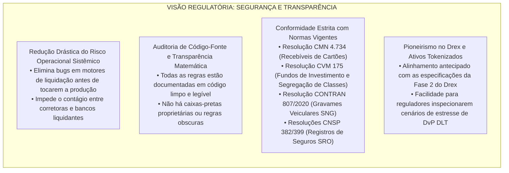

### Principais Benefícios Regulatórios:
1. **Ambiente de Testes Isento de Risco de Mercado:** Testes destrutivos (default de grandes participantes, falha de DvP, estresse de margem) podem ser executados sem qualquer impacto na infraestrutura viva do mercado.
2. **Eliminação de Assimetrias de Informação:** Democratiza o acesso a especificações técnicas de alto nível para corretoras menores e fintechs, fomentando a concorrência e a inovação sem comprometer a solidez das regras de custódia.
3. **Trilha de Auditoria Criptográfica:** Todos os fluxos geram recibos e logs determinísticos com identificadores únicos, facilitando inspeções periódicas de governança interna e externa.

---

<!-- SLIDE BREAK -->

## SLIDE 13: MATRIZ COMPETITIVA: MODELO TRADICIONAL VS. B3 INTEGRATION ATLAS

| Dimensão Estratégica | Modelo Tradicional (Consultorias & Mocks Proprietários) | Abordagem B3 Integration Atlas | Vantagem Competitiva |
| :--- | :--- | :--- | :--- |
| **Tempo de Homologação** | 12 a 18 meses | 3 a 5 meses | **Aceleração de 70%** |
| **Dependências Externas** | Múltiplas bibliotecas, Java/C++ runtime pesados | Zero dependências (100% Python StdLib) | **Risco de Supply-Chain Zero** |
| **Cobertura de Fluxos** | Fragmentada (Apenas FIX ou apenas Balcão) | 107 fluxos (PUMA, Clearing, NoMe, CSD, Drex, SNG, SRO) | **Visão Holística 100% Unificada** |
| **Verificação Matemática** | Nenhuma (Testes baseados em tentativa e erro) | 91 Leis de Conservação Formal + Model Checking TLA+ | **Garantia de Não-Falha Sistêmica** |
| **Execução Local / CI-CD** | Impossível (Depende de VPN externa B3) | 100% Local em qualquer laptop ou contêiner CI | **Testes Automatizados a Cada Commit** |
| **Custo de Licenciamento** | R$ 300k a R$ 800k / ano por servidor | Código livre de royalties e aprisionamento (*No Vendor Lock-in*) | **Economia de até R$ 2,5M por Instituição** |
| **Fidelidade Regulatória** | Geralmente desatualizada em relação a circulares | 100% sincronizado com CVM 175, CONTRAN 807 e SRO SUSEP V3 | **Conformidade Normativa Garantida** |

---

<!-- SLIDE BREAK -->

## SLIDE 14: PLANO DE IMPLEMENTAÇÃO INSTITUCIONAL EM 30-60-90 DIAS

Uma metodologia estruturada de transição sem atrito, desenhada para coexistir com a infraestrutura existente de bancos e corretoras:

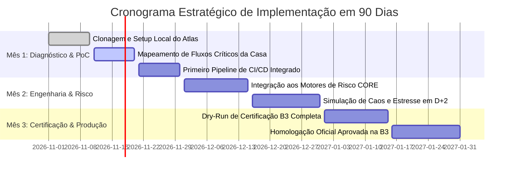

### Marco 30 Dias (Diagnóstico e Prova de Conceito):
* Instalação e execução local do sandbox na máquina dos desenvolvedores da instituição em menos de 5 minutos.
* Integração do B3 Integration Atlas aos pipelines de GitHub Actions / GitLab CI da corretora para validação automática de mensagens FIX e SBE.
* Execução dos testes automatizados para os fluxos prioritários da instituição (ex: Equities e Renda Fixa NoMe).

### Marco 60 Dias (Expansão de Risco e Conectividade):
* Acoplamento do motor de margem local do Atlas aos modelos de risco pré-operacional da mesa de operações.
* Execução de testes de estresse financeiro: simulação de *Default Waterfall*, leilão de liquidação forçada e contingências de liquidez SPB.
* Extensão para fluxos estruturados: Drex Fase 2, anotação veicular SNG ou registros SUSEP SRO.

### Marco 90 Dias (Certificação B3 e Go-Live com Risco Zero):
* Execução do *Dry-Run* formal de todos os cenários exigidos pelo roteiro de certificação oficial da B3.
* Submissão das trilhas de auditoria à B3 e início do tráfego real em produção com 100% de previsibilidade operacional.

---

<!-- SLIDE BREAK -->

## SLIDE 15: CHAMADA PARA AÇÃO & GOVERNANÇA DE PARCERIA

### O Futuro da Infraestrutura Financeira Começa com Decisões de Engenharia Conscientes

O **B3 Integration Atlas** transforma o que era antes uma das maiores fontes de custo, atrito e risco operacional em um diferencial competitivo de alta performance para a sua instituição.

```
╔══════════════════════════════════════════════════════════════════════════════════════════════╗
║                             CHECKLIST DE DECISÃO EXECUTIVA                                   ║
╠══════════════════════════════════════════════════════════════════════════════════════════════╣
║  [✓] Reduzir os prazos de homologação B3 de 18 meses para menos de 5 meses?                 ║
║  [✓] Economizar mais de R$ 2,5 milhões em consultorias e licenças de simuladores?            ║
║  [✓] Blindar a instituição contra quebras de regras de margem e multas de autorregulação?    ║
║  [✓] Capacitar squads técnicas com uma sandbox local instantânea, sem travas de VPN?         ║
║  [✓] Antecipar a liderança institucional nas frentes do Drex, SNG Veicular e SRO Seguros?    ║
╚══════════════════════════════════════════════════════════════════════════════════════════════╝
```

### Próximos Passos Recomendados:
1. **Agendamento de Demonstração Executiva Hands-On:**  
   Apresentação interativa com execução ao vivo dos motores de baixa latência, laboratório de caos e verificador formal TLA+.
2. **Liberação do Acesso ao Repositório Institucional:**  
   Acesso imediato ao código-fonte, catálogos completos de fluxos e documentação técnica oficial.
3. **Início do Workshop de Arquitetura de 2 Semanas:**  
   Imersão técnica com os times de engenharia e risco da instituição para modelagem do plano de integração personalizado.

---

**B3 INTEGRATION ATLAS: ENGENHARIA DE PRECISÃO PARA O MERCADO FINANCEIRO BRASILEIRO.**  
*107 Fluxos Modelados • 91 Leis Formais de Conservação • Zero Dependências • 100% Auditável.*
