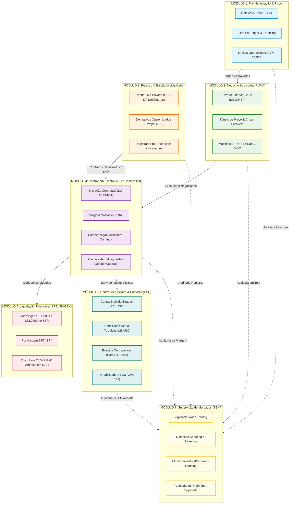

# GUIA UNIFICADO DA ARQUITETURA B3
## Da Pré-Negociação à Custódia: O Mapa Completo dos 7 Módulos Estruturantes da Infraestrutura de Mercado Financeiro (FMI)

---

> **Aviso de Escopo & Governança:**  
> Este documento consolida a arquitetura completa do ecossistema da **B3 (Brasil, Bolsa, Balcão)** implementada no *B3 Integration Atlas*. O objetivo é desmistificar e simplificar o entendimento de todo o ciclo de vida dos instrumentos financeiros brasileiros — superando a visão restrita de "apenas pós-negociação" e demonstrando como os 7 módulos se conectam de forma atômica, determinística e com garantia matemática formal (84 Leis de Conservação).
>
> **Execução:** 100% Local | Zero Dependências Externas | Biblioteca Padrão do Python (`decimal.Decimal`).

---

## 1. Visão Geral: Os 7 Módulos do Ecossistema B3

A B3 opera como uma **Infraestrutura de Mercado Financeiro (FMI - Financial Market Infrastructure)** sistemicamente importante sob as normas do Banco Central do Brasil (BACEN) e da Comissão de Valores Mobiliários (CVM), em estrita conformidade com os princípios CPMI-IOSCO.

O ecossistema é organizado em **7 módulos interdependentes**:



---

## 2. Detalhamento dos 7 Módulos

### 2.1 Módulo 1 — Pré-Negociação & Governança de Risco (Pre-Trade Risk)

O motor de pré-negociação atua como o **guardião perimetral** da bolsa. Antes que qualquer ordem alcance o livro central, ela deve ser avaliada e aprovada em uma latência ultrabaixa (< 80 microssegundos).

* **Objetivo:** Proteger a higidez patrimonial do participante, das corretoras e de todo o sistema contra erros operacionais, estouros de risco e algoritmos descontrolados.
* **Componentes Principais:**
  1. **Gateways de Acesso DMA (Direct Market Access):**
     * **DMA 1:** Acesso via Home Broker/terminal da corretora (risco centralizado).
     * **DMA 2:** Acesso via provedor terceirizado credenciado.
     * **DMA 3:** Acesso direto à bolsa com checagem de risco em tempo real pelo software da corretora.
     * **DMA 4 (Sponsored Access / Colocation):** Ordem enviada diretamente ao roteador da B3 no Data Center de Santana de Parnaíba com validação de limites implementada em hardware (FPGA / switches pré-trade).
  2. **Filtros de Fat-Finger:**
     * Rejeição sumária de ordens com preço descolado da referência além de um limiar estrito (ex: > 5% do último negócio em pregão contínuo).
     * Teto de quantidade máxima por ordem e teto financeiro nocional máximo por lote.
  3. **Throttler de Mensageria:**
     * Controle de vazão (leaky bucket) limitando o número máximo de mensagens por segundo (mps) por sessão FIX/SBE para evitar ataques de saturação de infraestrutura.
  4. **Limites de Crédito e Saldo Operacional (CVM 35 / CVM 505 / CVM 135):**
     * Verificação de saldo projetado e garantias depositadas do investidor com bloqueio automático caso o limite diário seja atingido.

---

### 2.2 Módulo 2 — Negociação Listada (PUMA Trading System)

O **PUMA Trading System** é o motor de casamento de ordens (matching engine) de ativos listados em bolsa com execução anônima e multilateral.

* **Objetivo:** Garantir a formação transparente e eficiente de preços de mercado para Ações, Futuros BM&F, Opções, FIIs, BDRs, ETFs e CBIOs.
* **Componentes Principais:**
  1. **Protocolos de Negociação:**
     * **Entrada de Ordens:** FIX 4.4 / FIX 5.0 SP2 e PUMA SBE (Simple Binary Encoding) para ultra-alta velocidade.
     * **Difusão de Market Data:** UMDF (Universal Market Data Feed) com FAST Multicast UDP.
  2. **Estrutura de Livro de Ofertas:**
     * **L2 (Market By Price - MBP):** Agregação das quantidades e número de ofertas por nível de preço.
     * **L3 (Market By Order - MBO):** Fila individualizada ordem a ordem com timestamp de nanossegundos, preservando a identidade posicional no book.
  3. **Algoritmos de Matching:**
     * **FIFO (Price-Time Priority):** A ordem que chegou primeiro ao melhor preço tem prioridade absoluta de execução (padrão em Ações e Opções).
     * **Pro-Rata:** Execução proporcional ao tamanho de cada ordem na fila (utilizado em certos contratos futuros de taxa de juros).
  4. **Fases de Negociação:**
     * *Pré-Abertura* $\to$ *Leilão de Abertura* $\to$ *Negociação Contínua* $\to$ *Leilão de Volatilidade* $\to$ *Leilão de Fechamento (Closing Cross)* $\to$ *After-Market*.
  5. **Mecanismos de Proteção e Túneis de Oscilação:**
     * **Túnel de Rejeição:** Descarta ordens que firam o limite superior ou inferior diário (ex: $\pm 20\%$).
     * **Túnel Estático:** Dispara leilão de volatilidade se o preço tentar romper a faixa em relação ao preço de abertura/referência (ex: $\pm 10\%$).
     * **Túnel Dinâmico:** Dispara leilão de volatilidade para variações abruptas em relação ao último negócio (ex: $\pm 2\%$).
     * **Circuit Breaker:** Suspensão geral das negociações do mercado:
       * Nível I: Queda de 10% no Ibovespa $\to$ paralisação de 30 minutos.
       * Nível II: Reabertura com queda de 15% $\to$ paralisação adicional de 1 hora.
       * Nível III: Reabertura com queda de 20% $\to$ paralisação por tempo indeterminado pelo Conselho da B3.
  6. **Leilão de Fechamento e Ordens MOC/LOC:**
     * Apuração do Preço Teórico de Fechamento (PTP).
     * Janela de congelamento (*freeze period*) onde cancelamentos são sumariamente vedados.
     * Prioridade de execução: ordens *Market-On-Close* (MOC) têm precedência matemática sobre ordens limitadas (*Limit-On-Close* - LOC).

---

### 2.3 Módulo 3 — Registro & Balcão Organizado (NoMe / Balcão Cetip)

Ao contrário da negociação listada em tela (anônima e padronizada), o **Mercado de Balcão e Registro** acolhe instrumentos customizados, operações bilaterais e escrituração de títulos de crédito.

* **Objetivo:** Registro eletrônico com segurança jurídica, validação de lastro, publicidade e oponibilidade contra terceiros de operações financeiras não padronizadas.
* **Componentes Principais:**
  1. **Captação Bancária & Renda Fixa Privada:**
     * Certificados de Depósito Bancário (CDB), Recibos de Depósito Bancário (RDB), Letras de Crédito Imobiliário e do Agronegócio (LCI / LCA), Letras Financeiras (LF / LFS), Debêntures e Notas Comerciais.
     * Validação de data de emissão, vencimento, indexador (DI, IPCA, Pré), taxa de remuneração e forma de amortização.
  2. **Derivativos de Balcão Customizados:**
     * Swaps bilaterais (ex: Taxa Pré $\times$ DI, DI $\times$ Dólar, DI $\times$ IPCA).
     * Termo de Moedas (NDF - Non-Deliverable Forward) com ajuste na data de liquidação pela PTAX.
     * Opções Flexíveis com datas de vencimento arbitrárias, barreiras ativadoras/desativadoras (Knock-in / Knock-out) e tetos de ganho (*Cap*).
  3. **Títulos do Agronegócio & Securitização:**
     * Cédula de Produto Rural (CPR Física e Financeira) com conformidade ao Código Florestal / CAR e assinatura digital qualificada.
     * Cédula Imobiliária Rural (CIR) com constituição de patrimônio de afetação de terra sob a Lei 13.986/2020.
     * Certificados de Recebíveis Imobiliários e do Agronegócio (CRI / CRA) e Créditos de Saúde/Educação.
  4. **Sistema Registrador de Recebíveis & Gravames (Resolução CMN 4.734 / Circular BCB 3.952):**
     * Centralização dos recebíveis de cartões de pagamento (credenciadoras/adquirentes).
     * Constituição e publicidade de garantias: penhor, cessão fiduciária e travas de domicílio bancário.
     * Garantia da unicidade do recebível: impede que o mesmo fluxo de cartão seja dado em garantia a dois bancos simultaneamente (anti-duplicidade registral).

---

### 2.4 Módulo 4 — Pós-Negociação & Contraparte Central (Câmara B3 / CCP)

A **Câmara de Compensação e Liquidação (Clearinghouse / CCP)** é o coração da segurança sistêmica dos mercados da B3.

* **Objetivo:** Mitigar a zero o risco de crédito de contraparte bilateral e promover a máxima eficiência de capital através de novação e compensação multilateral contínua.
* **Componentes Principais:**
  1. **Novação Contratual (Art. 7º da Lei 10.214/2001):**
     * Imediatamente após a confirmação do negócio no PUMA ou a homologação no Balcão, os contratos bilaterais entre comprador e vendedor originais são extintos.
     * A B3 interpõe-se juridicamente entre as partes: torna-se compradora de todo vendedor e vendedora de todo comprador.
  2. **Motor de Margem Multiativo CORE (Closeout Risk Evaluation):**
     * Cálculo de risco em tempo real em nível de carteira consolidada.
     * Avaliação do custo de liquidação forçada das posições em caso de falência do participante sob cenários de estresse de preços, volatilidade, correlações e liquidez.
     * Aceitação de garantias em múltiplos ativos (Moeda corrente, Títulos Públicos Federais Selic, Ouro, Ações do IBrX-100, Letras Financeiras com haircuts conservadores).
  3. **Compensação Multilateral Contínua (Multilateral Netting):**
     * Agrega todas as compras e vendas de cada participante no dia, apurando:
       * **Um único saldo financeiro líquido** (a pagar ou a receber).
       * **Um único saldo líquido de custódia por código de ativo**.
     * Redução brutal da necessidade de liquidez no sistema bancário (eficiência típica > 85% de redução de volume bruto para líquido).
  4. **Cascata de Salvaguardas (Default Waterfall):**
     * Caso um participante entre em colapso e não honre suas obrigações, as perdas são absorvidas estritamente na seguinte ordem, protegendo o mercado de efeito dominó:
       1. Margens e garantias do próprio participante inadimplente.
       2. Aporte do participante inadimplente no Fundo de Liquidação.
       3. Capital próprio da B3 alocado prioritariamente (*skin in the game*).
       4. Fundo de Liquidação das Câmaras (aportes dos demais participantes).
       5. Chamada de recomposição extraordinária / patrimônio geral da B3.

---

### 2.5 Módulo 5 — Liquidação Financeira & SPB (BACEN / STR / SPI / Drex)

A liquidação financeira é o processo de **transferência definitiva de fundos** entre os participantes e a Câmara B3.

* **Objetivo:** Assegurar a irrevogabilidade e a finalidade da liquidação financeira em moeda do Banco Central (evitando o risco de crédito comercial entre bancos).
* **Componentes Principais:**
  1. **SPB (Sistema de Pagamentos Brasileiro) & STR (Sistema de Transferência de Reservas):**
     * Conexão direta entre o Barramento Central da B3 e o Banco Central.
     * Envio das mensagens de liquidação multilateral líquida:
       * `LDL0001` (Abertura e processamento do ciclo de liquidação de diferenças líquidas).
       * `LDL0003` (Notificação de resultado e encerramento do ciclo no STR).
     * Ciclos regulamentares: D0 (compra e venda de câmbio / derivativos intradiários), D+1 (ajustes diários de futuros BM&F, Tesouro Direto), D+2 (ações à vista, liquidação física de opções e debêntures).
  2. **Pix Margem 24/7 (SPI - Sistema de Pagamentos Instantâneos):**
     * Utilização da infraestrutura do Pix para chamada de margem intradia em tempo real, inclusive fora do horário bancário tradicional e fins de semana.
     * Liquidação confirmada em menos de 10 segundos com chave de reconciliação atômica `E2EID`.
  3. **Drex Fase 2 (Moeda Digital do Banco Central / DLT):**
     * Liquidação atômica programável:
       * **DvP Atômico (Delivery versus Payment):** O ativo tokenizado só transfere a titularidade na carteira de custódia se o Drex for simultaneamente debitado e creditado na conta do vendedor no mesmo bloco da rede DLT.
       * **PvP Atômico (Payment versus Payment):** Liquidação de câmbio entre Drex e moedas estrangeiras sem defasagem temporal de risco de liquidação.

---

### 2.6 Módulo 6 — Central Depositária & Custódia (CSD)

A **Central Depositária da B3 (CSD - Central Securities Depository)** é a entidade responsável pela guarda centralizada e escrituração definitiva dos valores mobiliários do mercado brasileiro.

* **Objetivo:** Garantir a certeza jurídica da titularidade dos investidores, impedir a criação de títulos fictícios e administrar os direitos patrimoniais dos emissores.
* **Componentes Principais:**
  1. **Contas Individualizadas por CPF/CNPJ:**
     * Ao contrário do modelo *omnibus* comum em mercados internacionais, a B3 adota como pilar a **individualização da custódia** até o investidor final (identificado por CPF ou CNPJ).
     * Princípio da Incomunicabilidade Patrimonial: os ativos custodiados não se confundem com o patrimônio da corretora ou da própria B3 e não respondem por dívidas das instituições intermediárias.
  2. **Conciliação Diária de Posições (Layouts Oficiais IMBARQ):**
     * Geração noturna de arquivos posicionais padronizados para batimento contábil:
       * `IMBARQ004`: Demonstração consolidada da liquidação financeira.
       * `IMBARQ006`: Posições em aberto na Câmara (contratos futuros, opções e margens).
       * `IMBARQ011`: Contratos de empréstimo de ativos (Banco de Títulos B3 - BTC).
       * `IMBARQ012`: Posições em custódia na Central Depositária (Disponível, Garantia, Bloqueada, Judicial).
       * `IMBARQ013`: Extrato analítico de movimentações de custódia.
       * `IMBARQ014`: Saldo e alocação detalhada de garantias.
       * `IMBARQ018`: Proventos e eventos corporativos pendentes e creditados.
  3. **Eventos Corporativos (Corporate Actions Lifecycle):**
     * Processamento de eventos em dinheiro: Dividendos e Juros sobre Capital Próprio (JCP) com retenção de IRRF quando aplicável.
     * Processamento de eventos em ativos: Bonificações, Desdobramentos (*Splits*), Agrupamentos (*Reverse Splits*) e Direitos de Subscrição.
     * Cronologia Rigorosa:
       * **Data Com:** Quem possui a custódia no fechamento deste dia adquire o direito ao provento.
       * **Data Ex:** No início deste dia, o ativo passa a negociar sem o direito ao provento e tem seu preço de abertura ajustado matematicamente.
       * **Data de Pagamento:** Liquidação financeira do crédito na conta do investidor.
  4. **Portabilidade Digital de Custódia (STVM - Resolução CVM 179):**
     * Mecanismo de transferência eletrônica de valores mobiliários entre diferentes custodiantes sem necessidade de liquidação financeira.
     * Princípio de conservação de custódia: soma exata de ativos transferidos da origem para o destino sem perda nem duplicação.

---

### 2.7 Módulo 7 — Supervisão & Autorregulação de Mercados (BSM)

A **BSM Supervisão de Mercados** é a entidade autorreguladora autônoma vinculada à B3, responsável pela auditoria, monitoramento e aplicação de penalidades para garantir a equidade dos mercados.

* **Objetivo:** Detectar fraudes, práticas não equitativas e abusos de mercado em tempo real e em auditorias post-trade.
* **Componentes Principais:**
  1. **Detecção de Wash Trading (Negociação Fictícia / Self-Trading):**
     * Identificação de negócios onde a ponta compradora e a vendedora pertencem ao mesmo beneficiário final (mesmo CPF/CNPJ), simulando volume artificial de negociação ou gerando prejuízos tributários artificiais.
  2. **Detecção de Spoofing & Layering:**
     * Algoritmos de análise de livro L2/L3 que identificam a inserção repetida de grandes ordens não intencionais em níveis de preço sucessivos (*layering*) com cancelamento quase instantâneo assim que a outra ponta é executada (*spoofing*).
  3. **Vigilância no Leilão de Fechamento (MOC Front-Running / PTP Manipulation):**
     * Monitoramento de inserções massivas de ordens LOC/MOC no leilão de fechamento para manipular artificialmente o preço de fechamento de índices como o Ibovespa.
  4. **Auditoria de Patrimônio Separado e Lastro Registral:**
     * Verificação de que ativos de securitização (CRI/CRA) e títulos do agronegócio (CIR) mantêm a afetação patrimonial intacta, impedindo a sobrecolateralização cruzada irregular.

---

## 3. Matriz Comparativa: Listado vs. Balcão Registrado vs. Pós-Negociação vs. Custódia

| Critério | Negociação Listada (PUMA) | Balcão Registrado (NoMe/Cetip) | Pós-Negociação (Câmara B3) | Central Depositária (CSD) |
| :--- | :--- | :--- | :--- | :--- |
| **Ambiente** | Tela centralizada, anônima, livro de ofertas eletrônico | Bilateral, negociado por telefone/chat e registrado na B3 | Câmara de compensação e liquidação (Clearinghouse) | Sistema eletrônico de escrituração de valores mobiliários |
| **Ativos Típicos** | Ações, Futuros BM&F, Opções, FIIs, BDRs, ETFs, CBIOs | CDB, RDB, LCI, LCA, Debêntures, Swaps, NDF, Recebíveis | Todos os contratos negociados ou registrados aceitos na CCP | Todos os ativos admitidos à guarda centralizada |
| **Formação de Preço** | Algoritmo contínuo FIFO / Pro-Rata / Leilão | Livremente pactuado entre as partes contratantes | Mark-to-Market diário (MTM) e apuração de ajustes | Valor patrimonial, preço de fechamento ou custo histórico |
| **Risco de Contraparte** | Zero contraparte bilateral: Novação imediata pela CCP | Mitigado por garantia ou assumido bilateralmente pelas partes | Assumido integralmente pela B3 sob a Lei 10.214/2001 | Inexistente (custódia é segregada do balanço da instituição) |
| **Mecanismo Central** | Casamento de ordens (*Matching Engine*) | Registro fiduciário, trava de gravame e chancela de lastro | Compensação multilateral contínua e Margem CORE | Manutenção de saldos individualizados por investidor (CPF/CNPJ) |
| **Protocolo Típico** | FIX 4.4, PUMA SBE, UMDF FAST | Cetip XML, NoMe API, SWIFT MT | Mensageria interna CCP, Arquivos IMBARQ | Arquivo IMBARQ012, API Portabilidade STVM |

---

## 4. O Ciclo de Vida End-to-End de uma Ordem na B3

Para consolidar o modelo mental de como tudo se encaixa na prática, acompanhe a trajetória completa de **1 ordem de compra de 1.000 ações PETR4 a R$ 38,50**:

```mermaid
sequenceDiagram
    autonumber
    actor Inv as Investidor (CPF 123)
    participant Corr as Corretora (DMA)
    participant Risk as Pré-Trade Risk (Módulo 1)
    participant Puma as PUMA Matching (Módulo 2)
    participant RTC as Trade Capture RTC
    participant CCP as Câmara B3 / Margem (Módulo 4)
    participant SPB as SPB / STR (Módulo 5)
    participant CSD as Central Depositária (Módulo 6)
    participant BSM as BSM Surveillance (Módulo 7)

    Inv->>Corr: Envia Ordem de Compra (1.000 PETR4 @ R$ 38,50)
    Corr->>Risk: Roteia ordem via FIX / SBE
    Note over Risk: Checa limites CVM 35/505, fat-finger e throttling (<80 µs)
    Risk-->>Corr: Aprovado no Pré-Trade Risk

    Corr->>Puma: Injeta ordem no Livro Central L3
    Note over Puma: Valida túneis de oscilação; encontra contraparte de venda; executa negócio
    Puma-->>BSM: Notifica execução para auditoria de Wash Trading / Spoofing
    Puma->>RTC: Emite Execution Report (Negócio Fechado)

    RTC->>CCP: Envia negócio para Novação Contratual
    Note over CCP: Extingue contrato bilateral; B3 assume o risco (Lei 10.214); calcula Margem CORE
    CCP-->>SPB: Inclui financeiro líquido (R$ 38.500) na fila de compensação D+2 (LDL0001)

    Note over SPB: No dia D+2: Liquidação definitiva em moeda do Banco Central
    SPB-->>CCP: Confirmação de liquidação financeira

    CCP->>CSD: Comando de transferência física de custódia
    Note over CSD: Credita 1.000 PETR4 na conta individualizada do CPF 123 (IMBARQ012)
    CSD-->>Inv: Extrato de custódia final atualizado
    BSM-->>BSM: Registra conformidade regulatória sem alertas
```

---

## 5. Mapeamento das 84 Leis Formais de Conservação

O *B3 Integration Atlas* garante a consistência absoluta da arquitetura através de **84 Leis Formais de Conservação** validadas por *proof systems* baseados em matemática finita e aritmética exata:

* **Leis LAW-001 a LAW-025:** Conservação fundamental de custódia física (IMBARQ012), compensação financeira multilateral soma-zero (IMBARQ004) e integridade de posições na Câmara (IMBARQ006).
* **Leis LAW-026 a LAW-050:** Portabilidade atômica STVM, paridade cambial PTAX em BDRs, conservação física de CPR Agro e integridade patrimonial de cotas de fundos CVM 175.
* **Leis LAW-051 a LAW-075:** Prevenção de dupla contagem de créditos de descarbonização CBIO (RenovaBio), prelazia de garantias (Marco Legal das Garantias - Lei 14.711/2023) e paridade de opções e derivativos de balcão NoMe.
* **Leis LAW-076 a LAW-085:** Incomunicabilidade de patrimônio separado em Certificados de Recebíveis (CR Saúde / CR Educação), trava fiduciária de energia CCEE e não-arbitragem em Swaps IRS.
* **Leis LAW-086 a LAW-097:** DvP Atômico em contratos inteligentes Drex Fase 2, Pix Margem SPI com reconciliação E2EID, túneis de oscilação PUMA e afetação de terra em CIR.
* **Leis LAW-098 a LAW-106C:** Leilão de fechamento MOC com prioridade de lote, triparty repo com custodiantes internacionais e Barramento Central de Liquidação Unificada com absorção estrita de cascata de default.

---

## 6. Conclusão & Próximos Passos Locais

Com a visão completa e unificada dos 7 módulos:
1. **Pós-negociação** deixa de ser um silo isolado e passa a ser vista como a consequência lógica e encadeada do Pré-Trade Risk, da Negociação Listada e do Registro em Balcão.
2. A B3 atua como um sistema integrado de engrenagens: a falha em qualquer uma das proteções (do filtro de fat-finger na ponta até a conciliação IMBARQ na custódia) colocaria em risco a higidez de todo o mercado de capitais brasileiro.
3. Todas as implementações locais do projeto podem ser executadas, inspecionadas e testadas interativamente via linha de comando no terminal local através do comando `b3-atlas explain` e `b3-atlas trace-trade`.
