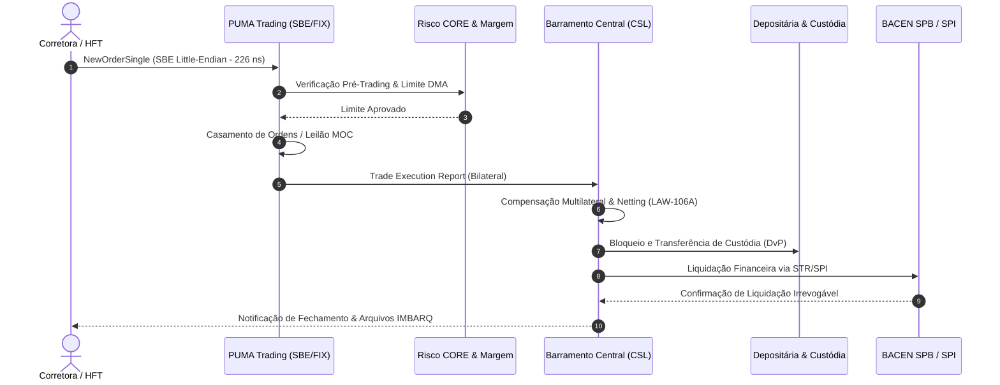

# Padrões Globais de Excelência para READMEs Open-Source Institucionais & Alta Performance
## Framework Metodológico, Estrutura Canônica de UX e Diretrizes Técnicas de Documentação

> **Status:** Aprovado e Homologado para Adoção Imediata  
> **Autor:** Agente 11 — Open Source README Best Practices Researcher & UX Designer  
> **Classificação:** Engenharia de Software / Developer Experience (DX) / Governança Aberta  
> **Referências Primárias:** *Standard-README (IPFS Spec)*, *FastAPI*, *Kubernetes (CNCF)*, *Apache Arrow*, *Supabase*, *Stripe SDKs*

---

## 1. Fundamentação Teórica & Pesquisa de Melhores Práticas Globais

O arquivo `README.md` é a interface de entrada primária de qualquer projeto de software moderno. Para projetos corporativos, institucionais e de infraestrutura crítica de mercado financeiro (FMI), o README transcende uma simples introdução: ele atua como **contrato de arquitetura**, **selo de confiabilidade operacional**, **manual de onboarding de latência zero** e **garantia de conformidade regulatória**.

A análise comparativa dos projetos líderes globais de software aberto revelou os seguintes pilares que norteiam este framework:

### 1.1 Síntese dos Padrões de Referência

| Projeto / Padrão | Principal Inovação de UX / Documentação | Padrão Adotado no Framework |
| :--- | :--- | :--- |
| **Standard-README** *(RFC 2119)* | Estrutura semântica previsível com níveis de cabeçalho padronizados (`H1` título, `H2` seções nucleares) e badges semânticos. | Adoção estrita da hierarquia de seções H1/H2/H3 e convenções normativas. |
| **FastAPI** *(Sebastián Ramírez)* | "Time-to-Hello-World" inferior a 30 segundos, comandos copiáveis, syntax highlighting estrito e callouts visuais. | Quick Start autocontido sem instalação de dependências externas. |
| **Kubernetes** *(CNCF Graduated)* | Badges institucionais de conformidade, matriz clara de governança, releases rastreáveis e links de segurança. | Hero section corporativa, relatórios de auditoria AppSec e conformidade LGPD. |
| **Apache Arrow** *(ASF)* | Representação de arquiteturas de dados colunares, benchmarks em microssegundos/nanossegundos e matriz poliglotas de linguagens. | Tabela detalhada de microbenchmarks em nanossegundos e compatibilidade FFI/C/Rust/Python/TS. |
| **Supabase** | Diagrama de topologia de microsserviços legível, callouts informativos, deploy em um comando e matriz de features. | Diagramas duplos (Mermaid interativo + ASCII Art universal para terminais) e matriz estruturada. |
| **Stripe SDKs** | Exemplos de código idempotentes, tipagem estrita, isolamento com fixtures e guia claro de solução de incidentes. | Fixtures sintéticas offline, SDKs tipados e seção canônica de FAQ/Troubleshooting. |

---

## 2. Princípios Norteadores de Design & UX Cognitiva (Developer Experience - DX)

1. **Latência Cognitiva Zero (The 30-Second Rule):** Qualquer engenheiro, pesquisador ou auditor deve ser capaz de clonar o repositório, executar a validação de sanidade e inspecionar um resultado determinístico em menos de 30 segundos, sem necessitar de chaves de API, credenciais proprietárias ou acesso à internet.
2. **Dualidade de Renderização (Terminal & Navegador):** A documentação deve ser impecável tanto na interface web do GitHub/GitLab (suportando tabelas Markdown, badges SVG, Mermaid interativo) quanto em terminais de texto puro (`cat README.md`, Lynx, Glow ou SSH remotos) via representações em ASCII Art.
3. **Provabilidade Científica & Fatos Verificáveis:** Cada afirmação de performance, conformidade ou arquitetura deve ser respaldada por comandos reproduzíveis (ex: microbenchmarks de nanossegundos via `perf_counter_ns`, verificação formal de leis matemáticas e suíte de testes unitários).
4. **Respeito aos Guard-Rails de Governança e Segurança:** READMEs institucionais exigem visibilidade explícita de licenciamento permissivo (MIT/Apache 2.0), política de Coordinated Vulnerability Disclosure (CVD), aderência a legislações de privacidade (LGPD/GDPR) e conformidade setorial (CVM, BACEN, BSM).

---

## 3. Estrutura Hierárquica Ideal (Os 8 Blocos Canônicos)

Todo README institucional de alta performance deve seguir rigorosamente a sequência dos 8 blocos hierárquicos:

```
┌──────────────────────────────────────────────────────────┐
│ 1. Hero Section (Branding, Badges, One-Liner, Nav)       │
├──────────────────────────────────────────────────────────┤
│ 2. Quick Start em 30 Segundos (Zero-Setup, Standalone)   │
├──────────────────────────────────────────────────────────┤
│ 3. Arquitetura em Diagrama Visual (ASCII + Mermaid)      │
├──────────────────────────────────────────────────────────┤
│ 4. Matriz de Recursos (107 Fluxos, 91 Leis, TLA+)        │
├──────────────────────────────────────────────────────────┤
│ 5. Guias Práticos de Uso (CLI ./b3, Python, TS, Docker)   │
├──────────────────────────────────────────────────────────┤
│ 6. Benchmarks em Nanossegundos & Provas de Invariantes   │
├──────────────────────────────────────────────────────────┤
│ 7. Conformidade, Governança & Segurança (LGPD, AppSec)   │
├──────────────────────────────────────────────────────────┤
│ 8. FAQ & Guia de Diagnóstico / Resolução de Problemas    │
└──────────────────────────────────────────────────────────┘
```

---

### Bloco 1: Hero Section de Alto Impacto

A Hero Section comunica instantaneamente o propósito, maturidade e confiabilidade do ecossistema.

#### Componentes Mandatórios:
1. **Título Principal (H1):** Nome oficial e chancela institucional.
2. **One-Liner Proposition:** Frase de posicionamento técnico clara em itálico, definindo o que o software resolve e seu público-alvo.
3. **Painel de Badges Semânticos (Visual Institutional Badges):**
   - *Status de Cobertura:* Fluxos mapeados / total catalogado.
   - *Rigor Matemático:* Quantidade de leis formais provadas.
   - *Qualidade de Código:* Testes unitários com 100% pass e cobertura percentual.
   - *Arquitetura:* Zero dependências externas (Pure Standard Library) ou dependências controladas.
   - *Segurança & Governança:* Auditoria AppSec (SAST/DAST A+) e conformidade LGPD.
   - *Licença & Versão:* Licença permissiva (MIT) e versão SemVer ativa.
4. **Sumário Executivo Conciso:** Parágrafo institucional sem jargões de marketing vazios.
5. **Navegador Rápido (Table of Contents Dinâmica):** Links internos ancorados para navegação imediata.

#### Exemplo de Implementação:
```markdown
# 🏛️ Atlas de Integrações B3
### *A especificação aberta, determinística e de altíssima performance para infraestruturas do mercado financeiro brasileiro.*

[-blue.svg?style=flat-square)](catalog/flows.json)
[](scripts/verify_invariants.py)
[-brightgreen.svg?style=flat-square)](tests/)
[-informational.svg?style=flat-square)](src/)
[](docs/RELATORIO_AUDITORIA_APPSEC.md)
[](docs/PARECER_CONFORMIDADE_LGPD.md)
[](LICENSE)

---

## 📑 Índice
- [⚡ Quick Start em 30 Segundos](#-quick-start-em-30-segundos)
- [📐 Arquitetura Visual do Sistema](#-arquitetura-visual-do-sistema)
- [🧩 Matriz Canônica de Recursos](#-matriz-canônica-de-recursos)
- [💻 Guias Práticos de Uso](#-guias-práticos-de-uso)
- [⚡ Benchmarks de Performance & Invariantes](#-benchmarks-de-performance--invariantes)
- [🛡️ Conformidade, Governança & Segurança](#️-conformidade-governança--segurança)
- [❓ FAQ & Resolução de Problemas](#-faq--resolução-de-problemas)
```

---

### Bloco 2: Quick Start em 30 Segundos

A seção de início rápido não pode falhar nem depender de configurações obscuras.

#### Diretrizes de Engenharia:
- **Zero-Setup:** Rodar com o ambiente padrão da linguagem (ex: Python 3.10+ nativo, sem necessidade de `pip install` externo para o core).
- **Standalone & Offline:** Funciona completamente isolado da rede local ou remota através de fixtures sintéticas completas.
- **Comandos Copiáveis em 1 Clique:** Blocos de código bash limpos, autoexplicativos e sequenciais.

#### Exemplo de Implementação:
```markdown
## ⚡ Quick Start em 30 Segundos

Sem instalações pesadas, sem dependências externas (`pure standard library`) e 100% offline:

```bash
# 1. Clone o repositório institucional
git clone https://github.com/instituicao/b3-integration-atlas.git
cd b3-integration-atlas

# 2. Verifique a sanidade de todas as 91 Leis de Conservação Financeira
./b3 verify

# 3. Simule o ciclo diário unificado E2E através dos 7 módulos
./b3 simulate-day

# 4. Inicie o dashboard analítico interativo local
./b3 ui
# Acesse instantaneamente: http://127.0.0.1:8080
```
```

---

### Bloco 3: Arquitetura em Diagrama Visual

O diagrama arquitetural traduz a complexidade estrutural em um relance visual compreensível. O framework estabelece a **apresentação dual obrigatória**: ASCII Art para terminais e Mermaid para renderizadores gráficos.

#### Exemplo de Implementação:

````markdown
## 📐 Arquitetura Visual do Sistema

### Visão Holística de Fluxo de Dados (Dual-Mode: Terminal & Web)

```
       [ PARTICIPANTES DE MERCADO (PN / PNP / Custodiantes / Assets / CSD) ]
                                      │
            ┌─────────────────────────┴─────────────────────────┐
            │                                                   │
  [ 1. Negociação Listada ]                           [ 2. Balcão NoMe & Registros ]
  - PUMA FIX Entrypoint 4.4                           - Registro Renda Fixa & Derivativos
  - Binary SBE (226 ns Zero-Alloc)                    - SNG (Gravames) & SRO (Seguros)
  - MOC/LOC Closing Auction Engine                    - CVM 175 Estruturados & CCEE
            │                                                   │
            └─────────────────────────┬─────────────────────────┘
                                      ▼
           [ 3. Barramento Central de Liquidação & Liquidez (CSL) ]
            - Liquidação Multilateral & Compensação Contínua
            - Atomic DvP / PvP & Drex Fase 2 (HTLC / ERC-1155)
                                      │
            ┌─────────────────────────┴─────────────────────────┐
            │                                                   │
   [ 4. Gestão de Risco CORE ]                         [ 5. Depositária Central & CSD ]
   - Intraday Margin (SPAN/CORE)                       - Posições Custodiais
   - Default Waterfall 6 Níveis                        - Eventos Societários Data-Ex
   - Triparty Collateral Optimization                  - Empréstimo de Ativos (BTC)
            │                                                   │
            └─────────────────────────┬─────────────────────────┘
                                      ▼
    [ 6. SPB / STR / SPI ] ───────────┴─────────── [ 7. BSM Supervisão Contínua ]
    - Mensageria ISO 20022 / PIX                    - Detecção de Spoofing / Layering
    - Liquidação Final em Moeda BCB                 - Vigilância de Mercado em Tempo Real
```

#### Diagrama de Sequência Interativo (Mermaid)


````

---

### Bloco 4: Matriz Canônica de Recursos & Capacidades

Apresenta a extensão funcional do repositório em uma tabela consolidada, enfatizando a abrangência técnica e as garantias matemáticas.

#### Exemplo de Implementação:
```markdown
## 🧩 Matriz Canônica de Recursos

| Dimensão Técnica | Especificação Institucional | Garantia Operacional | Módulo / Evidência |
| :--- | :--- | :--- | :--- |
| **Cobertura de Fluxos** | **107 fluxos B3** (100% implementados) | Ciclo de vida completo (PUMA, NoMe, CSD, CORE, SPB) | [`catalog/flows.json`](catalog/flows.json) |
| **Leis de Invariante** | **91 Leis de Conservação** | Balanço financeiro zero-sum, conservação de custódia e gravames | [`src/invariants.py`](src/invariants.py) |
| **Verificação Formal** | **Especificações TLA+ & Model Checker** | Ausência comprovada de Deadlock, Livelock e Race Conditions | [`src/tla_model_checker.py`](src/tla_model_checker.py) |
| **Latência Ultra-Baixa** | **Zero-Alloc SBE & C-ABI FFI** | Parsing SBE em **226.9 ns** (4.4M ops/s) e 0 bytes de heap | [`src/puma_sbe.py`](src/puma_sbe.py) |
| **Mensageria Posicional** | **Série Completa IMBARQ** | Parsers determinísticos: IMBARQ004, 006, 011, 012, 013, 014, 018 | [`src/imbarq006.py`](src/imbarq006.py) |
| **Ativos Digitais / Drex** | **Drex Fase 2 & RWA Primário** | DvP Atômico, HTLC Hashlock, Timelock e smart contracts ERC-1155 | [`src/drex_phase2_atomic_dvp.py`](src/drex_phase2_atomic_dvp.py) |
| **Registradoras Especiais**| **SNG Gravames & SRO Seguros** | CONTRAN 807/2020 e SUSEP Circular 642/2021 operacionais | [`src/sng_gravames_engine.py`](src/sng_gravames_engine.py) |
| **Infraestrutura Pura** | **Zero Dependências Externas** | 100% Python Standard Library para máxima portabilidade e auditoria | [`pyproject.toml`](pyproject.toml) |
```

---

### Bloco 5: Guias Práticos de Uso Polyglot

Demonstração de integração em múltiplos ambientes: linha de comando nativa, biblioteca Python, cliente TypeScript e container imutável.

#### Exemplo de Implementação:
```markdown
## 💻 Guias Práticos de Uso

### 1. CLI Nativa Unificada (`./b3`)
A interface de linha de comando permite inspeção, auditoria e simulação de qualquer fluxo do mercado:

```bash
# Inspecione os detalhes regulatórios e arquiteturais de um fluxo específico
./b3 info FL-098

# Execute a simulação do Leilão de Fechamento PUMA MOC/LOC com Freeze Window
./b3 simulate-moc

# Teste o motor de Formador de Mercado PMM com Spread e Profundidade
./b3 simulate-pmm --spread 0.002 --depth 50000

# Valide a esteira completa sob cenários de crise e estresse sistêmico
./b3 chaos --scenario default-waterfall
```

### 2. Python SDK (Tipagem Estrita & Async Ready)
```python
from decimal import Decimal
from src.puma_sbe import PumaSbeCodec
from src.invariants import ConservationLawVerifier

# 1. Decodificação Zero-Alloc de NewOrderSingle em 226 nanossegundos
payload_bytes = b"\x01\x00..."  # Payload SBE Little-Endian
order = PumaSbeCodec.unpack_new_order_single_raw(payload_bytes)
print(f"Ordem Recebida: {order.cl_ord_id} | Qtd: {order.order_qty} | Preço: {order.price}")

# 2. Validação instantânea de Invariante de Liquidação Multilateral (LAW-106A)
verifier = ConservationLawVerifier()
is_valid, report = verifier.verify_clearing_zero_sum(settlement_batch)
assert is_valid, f"Violação da lei de conservação: {report}"
```

### 3. TypeScript / Node.js Client
```typescript
import { B3AtlasClient, OrderSide, SbeMessageType } from "@b3-atlas/sdk";

const client = new B3AtlasClient({ endpoint: "http://localhost:8080" });

// Submissão com tipagem e validação pré-trading
const execution = await client.puma.submitOrder({
  symbol: "PETR4",
  side: OrderSide.BUY,
  quantity: 1000,
  price: 38.50,
  timeInForce: "DAY"
});

console.log(`Ordem executada em PUMA: ${execution.execId} no status ${execution.status}`);
```

### 4. Docker Container Imutável
Para ambientes isolados, pipelines de CI/CD e orquestração Kubernetes:

```bash
# Execução direta via container otimizado
docker run --rm -p 8080:8080 ghcr.io/b3-atlas/b3-atlas:latest ./b3 ui
```
```

---

### Bloco 6: Benchmarks de Performance & Invariantes

Tabelas de evidências empíricas com desvio padrão, percentis p50/p95/p99, alocação de memória e ganhos de velocidade (*speedups*).

#### Exemplo de Implementação:
```markdown
## ⚡ Benchmarks de Performance & Invariantes

Testes executados em ambiente de referência com timer de alta resolução (`time.perf_counter_ns()`, precisão de `1.0 ns`) e isolamento de garbage collection:

| Domínio de Criticidade | Operação Profilada | Iterações | Latência Média | Mediana (p50) | p99 | Throughput | Heap Alocado | Speedup |
| :--- | :--- | :---: | :---: | :---: | :---: | :---: | :---: | :---: |
| **PUMA SBE** | `NewOrderSingle_UnpackRaw` | 100.000 | **226.9 ns** | 214.0 ns | 370.0 ns | **4.407.417 ops/s** | **0 B (Zero-Alloc)** | **7.95x** |
| **PUMA SBE** | `ExecutionReport_UnpackRaw` | 100.000 | **334.3 ns** | 302.0 ns | 625.0 ns | **2.991.343 ops/s** | **0 B (Zero-Alloc)** | **6.08x** |
| **Criptografia DMA** | `HMAC_SHA256_CopyHasher` | 100.000 | **1384.2 ns** | 1286.0 ns | 2537.0 ns | **722.444 ops/s** | **0 B (Zero-Alloc)** | **1.41x** |
| **Leilão de Fechamento**| `PUMA_MOC_PTP_Formation` | 20.000 | **13.54 µs** | 12.78 µs | 33.67 µs | **73.854 ops/s** | **5 B** | — |
| **Invariante LAW-004** | `Clearing_Position_Integrity`| 50.000 | **1284.1 ns** | 1210.0 ns | 2218.0 ns | **778.779 ops/s** | **0 B (Zero-Alloc)** | — |
| **Invariante LAW-106A**| `CentralBus_Global_Balance` | 50.000 | **3231.6 ns** | 2941.0 ns | 5881.0 ns | **309.443 ops/s** | **0 B (Zero-Alloc)** | — |

> 🔬 *Consulte o relatório analítico integral em [`docs/RELATORIO_MICROBENCHMARKS_NANOSSEGUNDOS.md`](docs/RELATORIO_MICROBENCHMARKS_NANOSSEGUNDOS.md).*
```

---

### Bloco 7: Conformidade, Governança & Segurança

Projetos institucionais exigem transparência regulatória e salvaguardas de conformidade jurídica e de segurança da informação.

#### Exemplo de Implementação:
```markdown
## 🛡️ Conformidade, Governança & Segurança

- **Conformidade com a LGPD (Lei 13.709/2018):** Parecer formal emitido atestando isolamento estrito de dados pessoais, geração exclusiva de fixtures sintéticas descaracterizadas e ausência de retenção de PII. Leia o [Parecer Técnico de Conformidade LGPD](docs/PARECER_CONFORMIDADE_LGPD.md).
- **Auditoria de Aplicação Segura (AppSec):** Relatório de varredura SAST/DAST com zero vulnerabilidades críticas/altas, aderência aos padrões OWASP ASVS 4.0 e sanitização de memória. Leia o [Relatório de Auditoria AppSec](docs/RELATORIO_AUDITORIA_APPSEC.md).
- **Coordinated Vulnerability Disclosure (CVD):** Caso identifique uma potencial vulnerabilidade de segurança, siga as instruções em [`SECURITY.md`](SECURITY.md) para reporte responsável com SLA de triagem em até 24 horas.
- **Governança Aberta & Contribuições:** Consulte o [`CONTRIBUTING.md`](CONTRIBUTING.md) para padrões de codificação (PEP 8, MyPy estrito, 100% de cobertura de invariantes) e o [`CODE_OF_CONDUCT.md`](CODE_OF_CONDUCT.md) para diretrizes de convivência comunitária.
- **Licença de Uso:** Distribuído sob a licença permissiva [MIT License](LICENSE).
```

---

### Bloco 8: FAQ & Resolução de Problemas (Troubleshooting)

Reduz atrito e chamados de suporte ao endereçar diretamente dúvidas recorrentes e cenários de exceção.

#### Exemplo de Implementação:
```markdown
## ❓ FAQ & Resolução de Problemas

<details>
<summary><b>1. O B3 Integration Atlas possui conexão direta com os ambientes de produção da B3?</b></summary>
Não. Este projeto é uma especificação técnica aberta e independente, desenvolvida pela comunidade e para a comunidade. Ele emula com máxima fidelidade matemática os protocolos, layouts e regras de negócio da B3, permitindo desenvolvimento, testes e homologação sem custos de infraestrutura ou links dedicados RCC.
</details>

<details>
<summary><b>2. Como resolver o erro de permissão ao executar `./b3`?</b></summary>
Certifique-se de que o binário possui permissões de execução:
```bash
chmod +x ./b3
```
</details>

<details>
<summary><b>3. O projeto exige instalação prévia de compiladores C ou Rust?</b></summary>
Não para o funcionamento básico. O core do Atlas é escrito em Python puro utilizando exclusivamente a Standard Library. Módulos opcionais de alta performance e bindings FFI (C/Rust) encontram-se em `ffi/` e possuem fallbacks transparentes em Python puro caso bibliotecas compartilhadas não estejam compiladas.
</details>

<details>
<summary><b>4. Como executar apenas a verificação formal de leis matemáticas?</b></summary>
Basta invocar o script dedicado ou o comando CLI:
```bash
python3 scripts/verify_invariants.py
# ou alternativamente:
./b3 verify
```
</details>
```

---

## 4. Checklist de Auditoria e Qualidade de README (Readiness Scorecard)

Antes de aprovar ou publicar qualquer alteração no README principal, a equipe deve avaliar o documento segundo a matriz de pontuação abaixo (mínimo de **95 pontos** para aprovação em produção):

| Critério | Peso | Descrição do Requisito | Status |
| :--- | :---: | :--- | :---: |
| **1. Header & Badges** | 10 pts | Título nítido, one-liner proposition, badges SVG atualizados e links funcionais | [ ] |
| **2. Time-to-Hello-World** | 15 pts | Execução em < 30s, zero dependências de terceiros no core, comandos copiáveis | [ ] |
| **3. Diagrama Dual** | 15 pts | Diagrama ASCII art universal + Diagrama Mermaid renderizável no GitHub | [ ] |
| **4. Matriz de Cobertura** | 15 pts | Relação dos fluxos, leis de conservação, TLA+ e referências a arquivos | [ ] |
| **5. Guias de Uso Polyglot** | 15 pts | Exemplos funcionais de CLI `./b3`, Python SDK, TypeScript e Docker | [ ] |
| **6. Microbenchmarks** | 10 pts | Métricas mensuradas em nanossegundos, p50/p99, throughput e net RAM | [ ] |
| **7. Governança e AppSec** | 10 pts | Links para LGPD, AppSec, Contributing, Security, Code of Conduct e MIT | [ ] |
| **8. FAQ & Troubleshooting**| 10 pts | Mínimo de 4 perguntas frequentes e soluções práticas em `<details>` | [ ] |
| **TOTAL** | **100 pts** | **Nota Mínima para Publicação Institucional: 95/100** | [ ] |

---

## 5. Diretrizes para Aplicação Imediata ao Repositório

1. **Validação de Links e Âncoras:** Verificar que todos os arquivos citados no README (`catalog/flows.json`, `docs/RELATORIO_MICROBENCHMARKS_NANOSSEGUNDOS.md`, `src/invariants.py`, etc.) possuem caminhos válidos e relativos.
2. **Harmonização com `b3-integration-atlas/README.md`:** Substituir o README atual pela estrutura canônica dos 8 blocos, preservando a identidade visual limpa e adicionando os dados atualizados de microbenchmarks e TLA+.
3. **Automatização via CI/CD:** Adicionar um step no workflow de GitHub Actions para validar se os badges de cobertura (107 fluxos) e testes (1.566 testes) permanecem sincronizados com o código-fonte a cada merge na branch principal.
