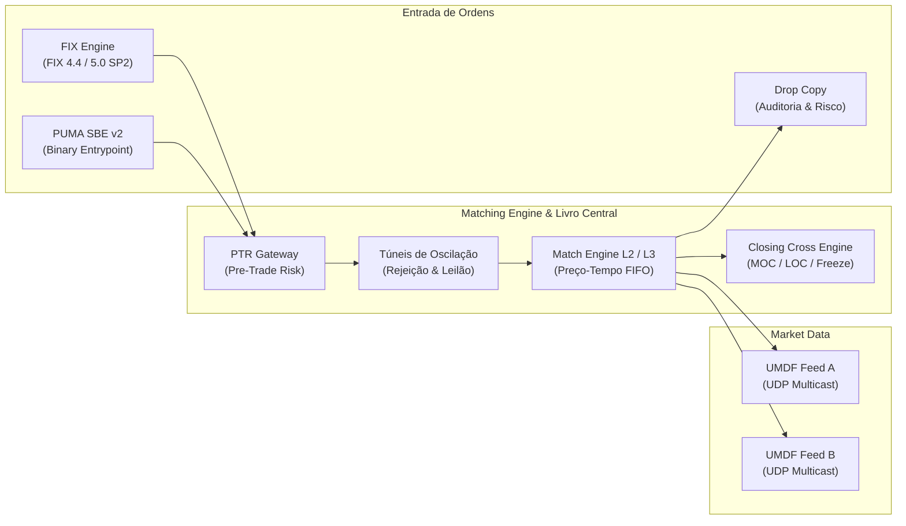
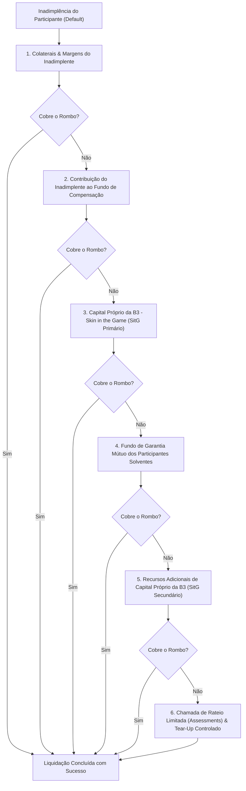

# LIVRO BRANCO DA ARQUITETURA DO MERCADO DE CAPITAIS BRASILEIRO
## Especificação Técnica Global, Topologia Sistêmica, Governança Regulatória e Invariantes Matemáticos de Conservação da B3 S.A. – Brasil, Bolsa, Balcão

---

**Edição:** 2026/2027 — Versão Institucional Master 3.0  
**Autor:** B3 Integration Atlas Consortium & Architecture Specialist Group  
**Classificação:** Documento Técnico Institucional de Referência Pública  
**Repositório Oficial:** `b3-integration-atlas/docs/WHITEPAPER_ARQUITETURA_B3.md`  
**Escopo Normativo:** Banco Central do Brasil (BACEN), Comissão de Valores Mobiliários (CVM), Superintendência de Seguros Privados (SUSEP), Conselho Nacional de Trânsito (CONTRAN) e Princípios CPMI-IOSCO para Infraestruturas de Mercado Financeiro (PFMI).

---

## SUMÁRIO GERAL

1. [Sumário Executivo e Missão Sistêmica](#1-sumário-executivo-e-missão-sistêmica)
2. [Topologia do PUMA Trading System (Negociação Listada & Baixa Latência)](#2-topologia-do-puma-trading-system-negociação-listada--baixa-latência)
   - 2.1 Conectividade de Entrada: Protocolos FIX 4.4 / 5.0 SP2 e PUMA SBE v2
   - 2.2 Disseminação de Dados de Mercado: UMDF 2.0 Multicast UDP Feed A/B
   - 2.3 Sessões Drop Copy e Reconciliação em Tempo Real
   - 2.4 Salvaguardas de Mercado: Túneis de Oscilação, Pre-Trade Risk e Circuit Breakers
   - 2.5 Leilões de Fechamento (Closing Cross) e Ordens Especiais (MOC / LOC)
   - 2.6 Motores Algorítmicos: Smart Order Router (SOR), TWAP, VWAP e POV
3. [Câmara B3, Contraparte Central (CCP) & Metodologia de Risco CORE](#3-câmara-b3-contraparte-central-ccp--metodologia-de-risco-core)
   - 3.1 O Princípio da Novação Jurídica Multilateral (Lei nº 10.214/2001 e LAW-004)
   - 3.2 Metodologia de Risco Closeout Risk Evaluation (CORE)
   - 3.3 Gestão de Colaterais e Salvaguardas em Camadas
   - 3.4 Cascata de Inadimplência (Default Waterfall - LAW-006, LAW-039 e LAW-106B)
   - 3.5 Barramento de Liquidação Central e Mitigação de Risco Sistêmico
4. [Balcão Organizado NoMe, Títulos Privados, Derivativos & Central de Gravames](#4-balcão-organizado-nome-títulos-privados-derivativos--central-de-gravames)
   - 4.1 Infraestrutura do Balcão NoMe (Registro vs Depósito Fiduciário)
   - 4.2 Instrumentos de Renda Fixa Bancária e Corporativa (CDB, LF, Debêntures, CRI, CRA)
   - 4.3 Derivativos Customizados de Balcão (Swaps, NDF, Opções Flexíveis e COE)
   - 4.4 Central de Registro de Recebíveis de Cartão (Resolução CMN nº 4.734/2019)
   - 4.5 Marco Legal das Garantias (Lei nº 14.711/2023) e Prelazia Temporal
5. [Central Depositária (CSD), Segregação por CPF/CNPJ & Portabilidade STVM](#5-central-depositária-csd-segregação-por-cpfcnpj--portabilidade-stvm)
   - 5.1 Arquitetura da CSD e Incomunicabilidade Patrimonial
   - 5.2 Estrutura de Contas em Dois Níveis e Identificação do Beneficiário Final
   - 5.3 Grade Operacional e Especificação de Arquivos IMBARQ
   - 5.4 Banco de Títulos CBLC (BTC) e Empréstimo Eletrônico de Ativos
   - 5.5 Portabilidade STVM Digital e Resolução CVM nº 179
6. [SPB, STR (LDL0001), Pix Margem 24/7 (SPI) & DLT Drex Fase 2](#6-spb-str-ldl0001-pix-margem-247-spi--dlt-drex-fase-2)
   - 6.1 Integração ao Sistema de Pagamentos Brasileiro (SPB) e STR (Mensagem LDL0001)
   - 6.2 Chamadas de Margem Extraordinárias e Pix 24/7 via SPI (Mensageria ISO 20022)
   - 6.3 Infraestrutura DLT Drex Fase 2: Hyperledger Besu, Real Digital e Tokens RWA
   - 6.4 Liquidação Primária e Secundária DvP/PvP Atômica em Blockchain Soberana
7. [Sistema Nacional de Gravames (SNG - B3 Financiamentos / CONTRAN 807)](#7-sistema-nacional-de-gravames-sng---b3-financiamentos--contran-807)
   - 7.1 Papel Estruturante do SNG na Mobilidade e Crédito Automotivo
   - 7.2 Modalidades de Garantias Reais Veiculares
   - 7.3 Interconexão Eletrônica aos 27 DETRANs Estaduais
   - 7.4 Invariante Formal LAW-112: Unicidade Absoluta e Barreira de Duplo Financiamento
8. [Sistema de Registro de Operações (SRO V3 - B3 Seguros / SUSEP 642)](#8-sistema-de-registro-de-operações-sro-v3---b3-seguros--susep-642)
   - 8.1 A B3 como Entidade Registradora de Seguros, Previdência e Capitalização
   - 8.2 Ramos Homologados e Ciclo de Vida da Apólice ao Sinistro
   - 8.3 Invariante Formal LAW-113: Conservação de Cosseguro e Teto LMG
   - 8.4 Certificação Digital e Interoperabilidade com Resseguro
9. [Compêndio Analítico das 91 Leis Formais de Conservação e Invariantes Matemáticas](#9-compêndio-analítico-das-91-leis-formais-de-conservação-e-invariantes-matemáticas)
   - 9.1 Fundamentação Matemática de Prova Formal e Invariantes
   - 9.2 Tabela Mestre Exaustiva das 91 Leis de Conservação (LAW-001 a LAW-113)
   - 9.3 Análise Algorítmica das Leis Críticas de Liquidação e Risco
10. [Matriz de Conformidade Regulatória e Conclusão](#10-matriz-de-conformidade-regulatória-e-conclusão)

---

## 1. SUMÁRIO EXECUTIVO E MISSÃO SISTÊMICA

A **B3 S.A. – Brasil, Bolsa, Balcão** constitui a espinha dorsal do sistema financeiro e do mercado de capitais brasileiro, classificada nacional e internacionalmente como uma **Infraestrutura de Mercado Financeiro (FMI — *Financial Market Infrastructure*) Sistemicamente Importante**. Diferente de ecossistemas fragmentados observados nos mercados norte-americano e europeu — onde plataformas de negociação (*trading venues*), câmaras de compensação (*clearinghouses*), depositárias centrais (*CSDs*) e registradores de transações (*trade repositories*) operam de modo descentralizado e concorrencial —, o modelo brasileiro consolidou essas funções em uma arquitetura verticalmente integrada sob a regulação estrita do **Banco Central do Brasil (BACEN)** e da **Comissão de Valores Mobiliários (CVM)**.

```
┌────────────────────────────────────────────────────────────────────────────────────────────────────────┐
│                                   ARQUITETURA VERTICAL INTEGRADA B3                                    │
└────────────────────────────────────────────────────────────────────────────────────────────────────────┘
          │                                 │                                │
          ▼                                 ▼                                ▼
┌──────────────────┐              ┌──────────────────┐             ┌──────────────────┐
│  PUMA TRADING    │              │    BALCÃO NOME   │             │   SNG & SRO      │
│  Matching L2/L3  │              │  Renda Fixa &    │             │  Garantias Auto  │
│  FIX / SBE v2    │              │  Derivativos OTC │             │  & Seguros SUSEP │
└─────────┬────────┘              └────────┬─────────┘             └────────┬─────────┘
          │                                │                                │
          └────────────────────────┬───────┴────────────────────────────────┘
                                   │
                                   ▼
┌────────────────────────────────────────────────────────────────────────────────────────────────────────┐
│                        CÂMARA B3 & GESTÃO DE RISCO (CCP - CONTRAPARTE CENTRAL)                         │
│                  Novação Jurídica (Lei 10.214/2001) | Risco Multiativo CORE | Default Waterfall         │
└──────────────────────────────────┬─────────────────────────────────────────────────────────────────────┘
                                   │
                                   ▼
┌────────────────────────────────────────────────────────────────────────────────────────────────────────┐
│                       CENTRAL DEPOSITÁRIA (CSD) & CUSTÓDIA INDIVIDUALIZADA                             │
│                  Segregação por CPF/CNPJ (Lei 6.404/76 e Res. CVM 31) | Mensageria IMBARQ              │
└──────────────────────────────────┬─────────────────────────────────────────────────────────────────────┘
                                   │
                                   ▼
┌────────────────────────────────────────────────────────────────────────────────────────────────────────┐
│                     SISTEMA DE LIQUIDAÇÃO FINANCEIRA (SPB, STR, SPI & DREX)                           │
│              Contas de Liquidação BACEN | Mensagem LDL0001 | Pix Margem 24/7 | Besu EVM               │
└────────────────────────────────────────────────────────────────────────────────────────────────────────┘
```

A integridade do mercado de capitais brasileiro repousa sobre quatro pilares institucionais inegociáveis:
1. **Contraparte Central Garantidora (CCP):** Interposição jurídica da câmara entre as pontas compradora e vendedora por novação compulsória (Lei nº 10.214/2001), assumindo o risco de liquidação física e financeira e neutralizando o contágio bilateral.
2. **Central Depositária Escritural (CSD):** Registro individualizado da propriedade fiduciária no nível do investidor final (CPF ou CNPJ), estabelecendo a separação patrimonial absoluta entre os ativos dos clientes e o patrimônio dos intermediários financeiros.
3. **Repositório de Transações e Central de Gravames (TR/SNG/SRO):** Unicidade e publicidade jurídica de dívidas bancárias, notas mercantis, contratos de financiamento automotivo e apólices de seguros, assegurando eficácia erga omnes e prelazia temporal fiduciária.
4. **Execução Determinística e Conservação Matemática:** Operação governada por **91 Leis Formais de Conservação e Invariantes Algorítmicas (LAW-001 a LAW-113)**, que impedem matematicamente divergências de custódia, assimetrias contábeis, criação espúria de ativos e propagação descontrolada de inadimplência.

---

## 2. TOPOLOGIA DO PUMA TRADING SYSTEM (NEGOCIAÇÃO LISTADA & BAIXA LATÊNCIA)

O **PUMA Trading System** é a plataforma de alta frequência e baixa latência da B3, responsável pelo apregoamento, casamento de ordens e disseminação de informações de negócios para instrumentos de renda variável (ações, BDRs, ETFs, cotas de FIIs), derivativos listados (futuros de DI, cupom limpo, dólar, Ibovespa, commodities agropecuárias) e contratos a termo.



### 2.1 Conectividade de Entrada: Protocolos FIX 4.4 / 5.0 SP2 e PUMA SBE v2

A submissão de ofertas no PUMA se dá por meio de dois canais tecnológicos complementares:

#### 1. Protocolo FIX (Financial Information eXchange)
Utilizado para conectividade de corretoras tradicionais, plataformas institucionais e interfaces humanas de mesa de operações (*OMS/EMS*):
* **Sessão e Transporte:** TCP/IP sobre redes privadas e autenticadas (Rede de Comunicação de Centros - RCC ou VPN IPSec com túneis redundantes).
* **Camada de Aplicação:** FIX 4.4 e FIX 5.0 SP2, empregando formato tag-value ASCII delimitado pelo caractere `SOH` (`0x01`).
* **Mensagens Principais:**
  * `NewOrderSingle` (`MsgType=D`): Submissão de ordem limitadada, a mercado ou stop.
  * `OrderCancelRequest` (`MsgType=F`): Solicitação de cancelamento.
  * `OrderCancelReplaceRequest` (`MsgType=G`): Modificação de preço ou quantidade.
  * `ExecutionReport` (`MsgType=8`): Confirmação de recebimento, alteração, cancelamento ou execução (parcial ou integral).
* **Rastreabilidade:** Tags mandatórias da regulação brasileira: `Tag 1` (Account / Código de Custódia), `Tag 11` (ClOrdID), `Tag 50` (SenderSubID / Operador B3 habilitado PQO), `Tag 58` (Texto descritivo), `Tag 526` (SecondaryClOrdID) e `Tag 1003` (TradeID).

#### 2. Protocolo Binário PUMA SBE v2 (Simple Binary Encoding)
Desenvolvido para negociação de alta frequência (*High-Frequency Trading - HFT*), algoritmos proprietários de market making e conexões via Direct Market Access (*DMA2, DMA3 e DMA4 - Colocation B3 em Santana de Parnaíba*):
* **Arquitetura de Memória:** Codificação binária pura de esquema rígido (*Schema XML v2*), onde cada campo possui deslocamento (*offset*) em bytes fixo e alinhamento nativo de memória de 64 bits.
* **Eficiência e Desempenho:** Deserialização *zero-allocation* em memória RAM sem alocação dinâmica de objetos, proporcionando processamento em sub-microssegundos:
  $$\text{Throughput} > 1.400.000 \text{ msg/s}, \quad \text{Latência Média } p_{50} < 0{,}45 \, \mu\text{s}$$
* **Tipos de Dados Canônicos:** Inteiros little-endian com escala implícita (ex: preços multiplicados por $10^4$ ou $10^8$ para representação inteira sem perdas decimais IEEE 754 float).

### 2.2 Disseminação de Dados de Mercado: UMDF 2.0 Multicast UDP Feed A/B

A distribuição do livro de ofertas em tempo real utiliza o protocolo **UMDF 2.0 (Unified Market Data Feed)**, baseado no padrão SBE sobre **UDP Multicast**:
* **Arquitetura A/B Feed Redundante:** O motor de matching publica exatamente as mesmas mensagens em dois endereços de rede multicast independentes e fisicamente segregados (*Feed A* e *Feed B*).
* **Arbitragem de Pacotes pelo Receptor:**
  $$\text{Pacote Recebido} = \min(\text{Chegada}(\text{Feed A}), \text{Chegada}(\text{Feed B}))$$
  Caso ocorra perda de pacote em um dos canais, o cliente absorve o dado do canal secundário sem necessidade de requisição de retransmissão (*TCP Recovery*).
* **Níveis de Profundidade do Livro:**
  * **Market By Price (MBP - Nível L2):** Consolidação agregada de quantidade e número de ordens por nível de preço (Profundidade padrão de 5 ou 10 melhores níveis de compra e venda).
  * **Market By Order (MBO - Nível L3):** Transmissão transparente e atômica de cada ordem individual inserida no livro, identificada pelo `OrderPriority` (número sequencial único do match engine). Permite reconstrução exata da fila temporal em cada microcentavo de preço.

### 2.3 Sessões Drop Copy e Reconciliação em Tempo Real

As sessões **Drop Copy** consistem em links unidirecionais FIX dedicados à auditoria, controles de compliance e backoffice em tempo real:
* **Replicação Assíncrona:** Toda e qualquer alteração de estado gerada pelo matching engine (`ExecutionReport` de ordem inserida, executada, cancelada ou rejeitada) é imediatamente duplicada para a sessão Drop Copy da instituição credenciada.
* **Isolamento de Carga:** O fluxo Drop Copy opera em infraestrutura descolada do motor de matching principal, garantindo que lentidões nos servidores do participante não causem contrapressão (*backpressure*) sobre o enlace de ordens críticas.

### 2.4 Salvaguardas de Mercado: Túneis de Oscilação, Pre-Trade Risk e Circuit Breakers

Para prevenir erros catastróficos de digitação (*Fat-Finger*), disparos descontrolados de algoritmos defeituosos e volatilidade desmedida, o PUMA opera barreiras algorítmicas intransponíveis:

```
                      PREÇO DO ATIVO NO MERCADO LISTADO
  +15% ou +20% ───[ TÚNEL DE REJEIÇÃO SUPERIOR (Rejeição Imediata) ]─────────
  +7% a +10%   ───[ TÚNEL DE LEILÃO SUPERIOR (Interrupção & Leilão) ]────────
  +3% a +5%    ───[ TÚNEL DINÂMICO SUPERIOR (Oscilação de Curto Prazo) ]─────
   P_ref       ───[ PREÇO DE REFERÊNCIA ATUAL (Último Negócio / Abertura) ]──
  -3% a -5%    ───[ TÚNEL DINÂMICO INFERIOR ]─────────────────────────────────
  -7% a -10%   ───[ TÚNEL DE LEILÃO INFERIOR ]────────────────────────────────
  -15% ou -20% ───[ TÚNEL DE REJEIÇÃO INFERIOR (Rejeição Imediata) ]─────────
```

1. **Pre-Trade Risk (PTR Gateway):** Verificação prévia de saldo financeiro, lote máximo por ordem, valor nocional acumulado por minuto e exposição líquida por participante antes da entrega da ordem ao matching engine.
2. **Túnel de Rejeição (Rejection Tunnel):** Faixa de proteção estática (tipicamente $\pm 10\%$ a $\pm 20\%$ em relação ao preço de fechamento anterior). Ordens com preço além deste limite são **rejeitadas instantaneamente pelo gateway**.
3. **Túnel de Leilão (Auction Tunnel):** Faixa intermediária de volatilidade. Ordens que pretendem consumir liquidez além do limite provocam a **suspensão automática da negociação contínua e a entrada imediata do ativo em leilão de volatilidade** por tempo pré-determinado (5 a 15 minutos).
4. **Túnel Dinâmico (Dynamic Tunnel):** Faixa móvel indexada ao preço dos últimos negócios executados, coibindo oscilações abruptas decorrentes de esvaziamento momentâneo de liquidez no book.
5. **Circuit Breaker Sistêmico do Ibovespa:**
   * Nível 1: Queda de **10,0%** sobre o fechamento anterior $\rightarrow$ Interrupção geral das negociações por 30 minutos.
   * Nível 2: Reabertura e aprofundamento da queda para **15,0%** $\rightarrow$ Interrupção geral por 60 minutos.
   * Nível 3: Queda atinge **20,0%** $\rightarrow$ Suspensão das negociações por prazo determinado pela diretoria da B3.

### 2.5 Leilões de Fechamento (Closing Cross) e Ordens Especiais (MOC / LOC)

O leilão de fechamento da B3 congrega o maior volume de liquidez diária do mercado à vista, servindo como referência oficial para cálculo do valor de fechamento (*PTP — Preço Teórico de Fechamento*), liquidação de derivativos e precificação de carteiras de fundos de investimento:

* **Janela de Congelamento (Freeze Window - Lei Formal LAW-104A):**
  Nos minutos finais que antecedem o término do leilão (janela estocástica de congelamento), o sistema **bloqueia sumariamente qualquer tentativa de cancelamento ou alteração de ordens**. Novas ordens podem ser inseridas apenas se aumentarem a liquidez do leilão.
* **Ordens Market-On-Close (MOC) e Limit-On-Close (LOC):**
  * As ordens MOC expressam a intenção de execução irrestrita ao preço que vier a ser formado no fechamento.
  * As ordens LOC delimitam um preço teto de compra ou piso de venda.
  * **Prioridade Estrita MOC (LAW-104B):** O algoritmo de *uncrossing* aloca primeiramente 100% das ordens MOC antes de consumir qualquer saldo de ordens LOC ou ordens limitadas comuns remanescentes.
* **Maximização Estrita do Volume Executável (LAW-104C):**
  O Preço Teórico de Fechamento $P^*$ é o preço que resolve o problema de otimização convexa:
  $$P^* = \arg\max_{P} \left( \min\left( \sum_{i \in \text{Bids}(P)} Q_i, \, \sum_{j \in \text{Asks}(P)} Q_j \right) \right)$$
  Havendo empate de volume máximo entre múltiplos preços, o desempate obedece: (i) menor desbalanço residual de liquidez; (ii) maior proximidade com o preço do último negócio executado.

### 2.6 Motores Algorítmicos: Smart Order Router (SOR), TWAP, VWAP e POV

A execução institucional de ordens volumosas exige estratégias de fatiamento para minimizar impacto de mercado (*market impact*):
* **Conservação Estrita de Quantidade (Lei Formal LAW-110):**
  A decomposição de uma ordem-mãe $Q_{\text{mãe}}$ em $n$ ordens-filhas algorítmicas $q_k$ deve respeitar imperativamente a invariante:
  $$Q_{\text{mãe}} = \sum_{k=1}^n q_k + Q_{\text{residual\_não\_alocada}}$$
* **Respeito aos Lotes Mínimos e Preço Limite:**
  Cada fatia algorítmica $q_k$ é discretizada em múltiplos exatos de lotes padrão B3 (100 ações para o mercado regular de ações) e jamais pode violar o preço limite parametrizado na ordem original.

---

## 3. CÂMARA B3, CONTRAPARTE CENTRAL (CCP) & METODOLOGIA DE RISCO CORE

A **Câmara B3** atua como a Contraparte Central (*CCP*) para todos os mercados administrados pela bolsa. Sua solidez é reconhecida internacionalmente pelo cumprimento rigoroso dos princípios do CPMI-IOSCO.

```
       NOVAÇÃO JURÍDICA MULTILATERAL (LEI FEDERAL Nº 10.214/2001)

[COMPRADOR ORIGINAL] ───(Obrigação de Pagar R$)────> [VENDEDOR ORIGINAL]
                     <───(Obrigação de Entregar Ações)─

                                  │
                                  ▼ NOVAÇÃO JUDICIAL COMPULSÓRIA
                                  ▼
[COMPRADOR ORIGINAL] ───(Paga R$)─────────────────> [CÂMARA B3 (CCP)]
                     <───(Recebe Ações)────────────

[CÂMARA B3 (CCP)]    ───(Paga R$)─────────────────> [VENDEDOR ORIGINAL]
                     <───(Recebe Ações)────────────
```

### 3.1 O Princípio da Novação Jurídica Multilateral (Lei nº 10.214/2001 e LAW-004)

No exato momento em que um negócio é casado no PUMA ou aceito e registrado no ambiente de compensação, ocorre a **novação jurídica multilateral**:
* O contrato bilateral original entre Comprador e Vendedor é extinto.
* São criados dois novos contratos jurídicos independentes:
  1. A Câmara B3 torna-se a compradora exclusiva perante o vendedor original.
  2. A Câmara B3 torna-se a vendedora exclusiva perante o comprador original.
* **Inviolabilidade Judicial:** Nos termos do Art. 3º e 4º da Lei nº 10.214/2001, os bens e garantias depositados na câmara para a liquidação de obrigações assumidas constituem patrimônio de afetação, imunes a qualquer constrição judicial, insolvência, recuperação judicial ou liquidação extrajudicial de qualquer um dos participantes.

### 3.2 Metodologia de Risco Closeout Risk Evaluation (CORE)

O motor de risco da B3 calcula a exigência de margem em tempo real por meio da metodologia proprietária **CORE (Closeout Risk Evaluation)**, substituindo modelos legados de valor em risco paramétrico (*VaR*):
* **Abordagem Multiativo Integrada:** O CORE avalia a carteira consolidada do investidor, considerando ações, opções, futuros de câmbio, DI, commodities e garantias depositadas.
* **Simulação de Cenários Estressados:** O sistema submete a carteira a milhares de vetores de estresse conjunto (*Joint Stress Scenarios*), alterando preços à vista, inclinações e curvaturas das curvas de juros e deformações nas superfícies de volatilidade implícita (modeladas via SABR e SVI - LAW-107A/B).
* **Fator de Liquidez (Liquidity Horizon):** Ativos com menor liquidez de mercado recebem penalização temporal no modelo, simulando o horizonte real em dias necessários para zerar ou leiloar a posição no mercado secundário sem causar deslocamento desproporcional de preços.
* **Componentes da Margem:**
  $$\text{Margem Total} = \text{Risco de Mercado (Cenários Estressados)} + \text{Risco de Liquidez} + \text{Margem de Variação Intradiária}$$

### 3.3 Gestão de Colaterais e Salvaguardas em Camadas

A câmara aceita como garantia colaterais com alta liquidez e baixo risco de crédito soberano:
1. **Moeda Soberana (BRL):** Reservas bancárias e depósitos em espécie.
2. **Títulos Públicos Federais (TPF):** LTN, LFT, NTN-B e NTN-F custodiados no Selic, com aplicação de haircut prudencial dependente da duration.
3. **Moeda Estrangeira e Ativos Offshore:** Dólares depositados em custódia fiduciária internacional (Clearstream/Euroclear) com haircut cambial (LAW-105A).
4. **Ações Elegíveis de Alta Liquidez:** Componentes do índice Ibovespa, avaliadas com desconto sobre o valor de mercado.
5. **Cartas de Fiança Bancária e Ouro Físico.**

### 3.4 Cascata de Inadimplência (Default Waterfall - LAW-006, LAW-039 e LAW-106B)

Se um Membro de Compensação Pleno (*Clearing Member*) não honrar suas obrigações financeiras ou físicas no ciclo de liquidação, a Câmara B3 aciona a **Cascata de Inadimplência (Default Waterfall)** segundo os padrões CPMI-IOSCO:



1. **Camada 1 (Margens do Inadimplente):** Execução sumária de todas as garantias, títulos e margens depositadas pelo próprio membro inadimplente na câmara.
2. **Camada 2 (Clearing Fund do Inadimplente):** Aporte do participante inadimplente no Fundo de Liquidação da Câmara.
3. **Camada 3 (Skin in the Game da B3 - Parcela Primária):** Recursos de capital próprio da B3 dedicados exclusivamente à câmara para atuar antes de qualquer recurso de terceiros.
4. **Camada 4 (Fundo Mútuo de Garantia dos Participantes Solventes):** Recursos aportados conjuntamente pelos demais participantes da câmara no fundo de liquidação mutualizado.
5. **Camada 5 (Capital Suplementar da B3 - Parcela Secundária):** Segunda camada de capital próprio da B3, acionada em caso de eventos de cauda extrema.
6. **Camada 6 (Assessments e Encerramento Controlado):** Chamadas adicionais proporcionais de capital e, em último caso, procedimentos regulados de *Tear-Up* (encerramento compulsório bilateral de contratos opostos).

**Invariante da Não-Propagação de Risco (LAW-106B):**
$$\forall p \in \text{Participantes Solventes}, \quad \text{EntregaEfetiva}(p) = \text{EntregaContratual}(p)$$
Nenhum participante adimplente sofre atraso ou inadimplemento em seus créditos legítimos por força de falha de terceiros, preservando a estabilidade macrofinanceira nacional.

---

## 4. BALCÃO ORGANIZADO NOME, TÍTULOS PRIVADOS, DERIVATIVOS & CENTRAL DE GRAVAMES

O ambiente **NoMe (antiga Cetip)** é o módulo de negociação e registro de instrumentos financeiros privados, derivativos customizados e infraestrutura de gravames sobre crédito corporativo e de varejo.

### 4.1 Infraestrutura do Balcão NoMe (Registro vs Depósito Fiduciário)

A legislação brasileira (Lei nº 12.810/2013 e Resoluções BCB/CVM) distingue dois regimes operacionais no balcão:
* **Regime de Registro:** O título ou contrato nasce fora do ambiente da B3 e tem suas características essenciais cadastradas no sistema NoMe para fins de publicidade, validação de lastro e eficácia jurídica perante terceiros.
* **Regime de Depósito Central:** O título escritural é custodiado fiduciariamente na B3, possibilitando a circulação dos direitos creditórios de forma escritural por liquidação multilateral em câmara.

### 4.2 Instrumentos de Renda Fixa Bancária e Corporativa

* **CDB e RDB:** Títulos de emissão bancária indexados ao CDI, com cálculo diário de valor acumulado pela fórmula:
  $$PU_t = PU_0 \cdot \prod_{k=1}^t \left( 1 + TDI_k \cdot \frac{Taxa}{100} \right)^{\frac{1}{252}}$$
* **LCI, LCA e Letras Imobiliárias Garantidas (LIG):** Instrumentos de captação imobiliária e agropecuária, dotados de isenção fiscal para pessoas físicas e lastro em operações reais fiscalizadas eletronicamente pela B3.
* **Debêntures (Lei nº 6.404/1976, Lei nº 12.431/2011 e Lei nº 14.801/2024):** Títulos corporativos de dívida de longo prazo. A B3 opera o SND (Sistema Nacional de Debêntures), escriturando amortizações, pagamentos periódicos de juros, assembleias de debenturistas e garantias fiduciárias.
* **CRI e CRA (Lei nº 14.430/2022):** Certificados de recebíveis securitizados. A B3 fiscaliza a vinculação do patrimônio separado e a vedação de confusão patrimonial com a securitizadora emissora (LAW-014).
* **Identidade Escritural de Renda Fixa (Lei Formal LAW-056):**
  $$PU_{\text{Sujo}} = PU_{\text{Limpo}} + \text{Juros Decorridos (Accrued Interest)}$$

### 4.3 Derivativos Customizados de Balcão (Swaps, NDF, Opções Flexíveis e COE)

* **Swaps Pré x DI e DI x Dólar:** Contratos bilaterais de troca de fluxo financeiro em datas futuras com marcação a mercado diária e liquidação soma-zero bilateral (LAW-015, LAW-080, LAW-081).
* **NDF (Non-Deliverable Forward):** Termo de moedas sem entrega física, liquidado exclusivamente pelo diferencial financeiro referenciado na taxa PTAX do BACEN (LAW-016, LAW-061, LAW-062).
* **Opções Flexíveis:** Contratos desenhados sob medida pelas partes, suportando barreiras ativadoras (*Knock-In*) e desativadoras (*Knock-Out*), médias asiáticas e limitadores de ganho (*Caps*).
* **Certificado de Operações Estruturadas (COE - Lei Formal LAW-108):**
  Nos COEs emitidos na modalidade de **Capital Protegido**, o payoff de vencimento cumpre a invariante legal:
  $$\text{Payoff Bruto} \ge \text{Valor Nominal Unitário Investido}$$
  Garantindo a devolução compulsória de 100% do principal ao investidor, independentemente do desempenho negativo dos ativos subjacentes.

### 4.4 Central de Registro de Recebíveis de Cartão (Resolução CMN nº 4.734/2019)

A B3 é a principal registradora das transações de cartões de débito e crédito no Brasil:
* **Unidades de Recebíveis (UR):** Toda venda realizada nas maquininhas (*acredenciadoras*) é convertida eletronicamente em URs compostas por: (i) CNPJ da credenciadora; (ii) Bandeira do cartão; (iii) Data de liquidação esperada; (iv) CNPJ/CPF do estabelecimento comercial.
* **Trava de Domicílio e Gravames Financeiros:** Quando o lojista toma crédito bancário garantido por suas vendas futuras de cartão, a B3 registra a alienação fiduciária sobre a UR.
* **Prioridade Inviolável de Repasse (Lei Formal LAW-018):**
  No dia da liquidação da UR, o valor é repassado obrigatoriamente para a conta vinculada da instituição credora detentora da garantia, impedindo o desvio de recursos pelo comerciante ou credenciadora.

### 4.5 Marco Legal das Garantias (Lei nº 14.711/2023) e Prelazia Temporal

A promulgação do novo Marco Legal das Garantias revolucionou o registro no balcão:
* **Princípio da Prioridade Temporal de Registro (Lei Formal LAW-031):**
  Havendo múltiplos pedidos de gravame sobre o mesmo bem ou ativo financeiro, a prioridade jurídica de expropriação é definida rigorosamente pela ordem cronológica com carimbo de tempo (*timestamp*) atômico emitido pela B3:
  $$\text{Timestamp}(G_1) < \text{Timestamp}(G_2) \implies \text{Grau}(G_1) \succ \text{Grau}(G_2)$$
* **Agente de Garantias:** Figura jurídica que atua em nome dos credores para gerir, constituir e excutir as garantias registradas na B3 sem necessidade de intervenção do poder judiciário.

---

## 5. CENTRAL DEPOSITÁRIA (CSD), SEGREGAÇÃO POR CPF/CNPJ & PORTABILIDADE STVM

A **Central Depositária (CSD)** da B3 presta o serviço público de guarda centralizada e titularidade dos valores mobiliários brasileiros.

### 5.1 Arquitetura da CSD e Incomunicabilidade Patrimonial

A CSD opera sob os preceitos do Art. 41 da Lei nº 6.404/1976 e da **Resolução CVM nº 31**:
* **Natureza Fiduciária da Guarda:** Os ativos depositados na CSD não integram o patrimônio da B3 nem o patrimônio das corretoras e bancos custodiantes.
* **Incomunicabilidade Patrimonial (Lei Formal LAW-001):**
  $$\forall a \in \text{Ativos}, \quad \text{Saldo Total}(a) = \text{Disponível}(a) + \text{Bloqueado em Margem}(a) + \text{Bloqueado Judicial}(a)$$
  Não existe criação fracionária ou empréstimo não autorizado de ativos na CSD.

### 5.2 Estrutura de Contas em Dois Níveis e Identificação do Beneficiário Final

Diferente de modelos internacionais baseados em contas omnibus (*Street Name*), a infraestrutura brasileira opera com **identificação estrita e direta do investidor final**:
1. **Nível 1 (Participante Custodiante):** Contas mantidas pelas corretoras e bancos de liquidação junto à B3.
2. **Nível 2 (Subconta do Investidor Final):** Contas de custódia individualizadas e abertas sob o número do **CPF ou CNPJ** do proprietário do ativo.
* **Benefício:** Em caso de quebra ou liquidação judicial de uma corretora, os ativos do cliente permanecem perfeitamente identificados e intactos na B3, podendo ser transferidos imediatamente para outra instituição sem depender da massa falida.

### 5.3 Grade Operacional e Especificação de Arquivos IMBARQ

A comunicação institucional entre os sistemas de backoffice dos participantes e a CSD/Clearing se dá pela grade diária de arquivos posicionais e transacionais **IMBARQ**:

| Arquivo | Denominação Técnica | Frequência | Conteúdo e Regra de Conservação |
|:---|:---|:---|:---|
| **IMBARQ004** | Arquivo de Posição Financeira Líquida | Diário (D+1/D+2) | Consolidação dos débitos e créditos multilaterais de liquidação em moeda corrente (LAW-002). |
| **IMBARQ006** | Arquivo Consolidado de Custódia | Diário (Noite D0) | Saldo analítico de cada CPF/CNPJ em todos os ativos listados e balcão (LAW-001). |
| **IMBARQ011** | Movimentação Física de Ativos | Diário (D0/D+1) | Registro de transferências fiduciárias, depósitos e retiradas de valores mobiliários (LAW-008). |
| **IMBARQ012** | Extrato Posicional de Renda Variável | Diário (D0) | Posições em ações, derivativos, opções e garantias alocadas (LAW-001). |
| **IMBARQ013** | Contratos de Empréstimo BTC | Diário (D0) | Posições abertas de doadores e tomadores de aluguel de ações (LAW-009, LAW-084). |
| **IMBARQ014** | Alocação e Give-Up de Negócios | Diário (D0 até 19h) | Mapeamento da conta master da corretora para as contas finais dos clientes (LAW-003). |
| **IMBARQ018** | Proventos e Eventos Corporativos | Contínuo / Diário | Créditos de dividendos, JCP, subscrições e bonificações a receber (LAW-032, LAW-071). |

### 5.4 Banco de Títulos CBLC (BTC) e Empréstimo Eletrônico de Ativos

O **BTC** é a plataforma de empréstimo eletrônico de títulos da B3:
* **Papel Sistêmico:** Prover liquidez ao mercado e viabilizar operações vendidas a descoberto (*Short Selling*) com segurança de liquidação.
* **Bloqueio de Lastro Físico (LAW-009):** O doador tem suas ações bloqueadas para empréstimo; o tomador só recebe os títulos mediante depósito prévio de garantias de margem calculadas pelo CORE.
* **Pass-Through de Proventos (Lei Formal LAW-085):**
  Todos os direitos econômicos decorrentes das ações emprestadas (dividendos e juros sobre capital próprio) continuam pertencendo integralmente ao doador original:
  $$\text{Provento Repassado ao Doador} = \text{Provento Declarado pela Companhia}$$
  O tomador do aluguel é obrigado a restituir o montante exato ao doador na data de crédito estipulada pela empresa.

### 5.5 Portabilidade STVM Digital e Resolução CVM nº 179

A **Resolução CVM nº 179** normatizou a modernização da **Portabilidade de Valores Mobiliários (STVM)**:
* **Processamento 100% Eletrônico:** Eliminação definitiva de exigências de reconhecimento de firma em cartório ou envio de formulários físicos.
* **Conciliação Atômica D+2 (Lei Formal LAW-024):**
  A transferência de custódia entre a instituição cedente e a instituição cessionária ocorre de forma atômica na B3:
  $$S_{\text{cedente}}^{\text{pós}} + S_{\text{cessionário}}^{\text{pós}} = S_{\text{cedente}}^{\text{pré}} + S_{\text{cessionário}}^{\text{pré}}$$
  A titularidade do CPF do investidor é preservada, evitando qualquer caracterização de alienação para fins fiscais.

---

## 6. SPB, STR (LDL0001), PIX MARGEM 24/7 (SPI) & DLT DREX FASE 2

A liquidação financeira definitiva de todas as operações compensadas na B3 conecta-se aos sistemas soberanos do Banco Central do Brasil.

```
       CONEXÃO COM OS SISTEMAS DE LIQUIDAÇÃO DO BANCO CENTRAL DO BRASIL

               ┌──────────────────────────────────────────┐
               │              CÂMARA B3 (CCP)             │
               └────────────────────┬─────────────────────┘
                                    │
         ┌──────────────────────────┼──────────────────────────┐
         │ (Grade Horária STR D+2)   │ (Intraday Emergencial 24/7)│ (DLT Soberana RWA)
         ▼                          ▼                          ▼
┌──────────────────┐       ┌──────────────────┐       ┌──────────────────┐
│   STR / SPB      │       │    SPI / PIX     │       │   DREX FASE 2    │
│  Mensagem LDL0001│       │  Chamada Margem  │       │ Hyperledger Besu │
│  Contas RB / CL  │       │  Mensageria ISO  │       │ Real Digital /   │
│  Até 10:00 AM    │       │  Sub-segundo     │       │ TPFt / Smart DvP │
└──────────────────┘       └──────────────────┘       └──────────────────┘
```

### 6.1 Integração ao Sistema de Pagamentos Brasileiro (SPB) e STR (Mensagem LDL0001)

* **Liquidação Diferida Líquida (LDL):** A compensação multilateral apurada na câmara é consolidada na mensagem oficial **LDL0001** enviada ao **Sistema de Transferência de Reservas (STR)** do BACEN.
* **Execução em D+2 às 10:00:**
  Os bancos liquidantes devedores têm suas contas de Reservas Bancárias (RB) ou Contas de Liquidação (CL) debitadas no BACEN; simultaneamente, os liquidantes credores são creditados.
* **Irrevogabilidade e Finalidade (Lei Formal LAW-007):**
  Uma vez processada a liquidação no STR, os pagamentos são jurídicamente irrevogáveis, incondicionais e definitivos perante o ordenamento nacional.

### 6.2 Chamadas de Margem Extraordinárias e Pix 24/7 via SPI (Mensageria ISO 20022)

Para eventos de volatilidade severa e chamadas intradiárias fora do horário regular do STR:
* **SPI (Sistema de Pagamentos Instantâneos):** A B3 opera como participante direta do SPI, permitindo a recepção de aportes de colaterais via **Pix 24 horas por dia, 7 dias por semana**.
* **Mensageria ISO 20022:** Mensagens `pacs.008` (Credit Transfer) e `pain.001` com campos estritos de identificação e validação de `EndToEndId` idempotente de 32 caracteres (LAW-094).
* **Reflexo Imediato no CORE (Lei Formal LAW-093):**
  O saldo aportado via Pix é reconhecido em sub-segundo pelo motor CORE, recompondo o buffer de liquidez do participante e evitando liquidações forçadas de posições em pregão noturno ou fins de semana.

### 6.3 Infraestrutura DLT Drex Fase 2: Hyperledger Besu, Real Digital e Tokens RWA

O projeto **Drex (Real Digital)**, conduzido pelo BACEN em parceria com a B3 e os principais bancos do país, representa a fronteira tecnológica do mercado:
* **Protocolo de Rede:** DLT corporativa permissionada baseada em **Hyperledger Besu**, totalmente compatível com a máquina virtual Ethereum (**EVM**) e consenso QBFT / IBFT 2.0.
* **Estrutura de Moeda Soberana:**
  * **Real Digital (Atacado):** Passivo direto do Banco Central mantido exclusivamente por instituições financeiras autorizadas.
  * **Real Tokenizado (Varejo):** Moeda escritural tokenizada emitida por bancos e fintechs com paridade estrita de 1:1 com a moeda fiduciária (LAW-089B).
* **Tokenização de Ativos Reais (RWA):** Emissão primária e negociação de Títulos Públicos Federais (TPFt), debêntures tokenizadas e cotas de fundos (LAW-111).

### 6.4 Liquidação Primária e Secundária DvP/PvP Atômica em Blockchain Soberana

* **Entrega contra Pagamento Atômico (Smart Contract DvP - LAW-089A):**
  A transferência do ativo tokenizado e o pagamento em Real Digital ocorrem no interior da mesma transação criptográfica on-chain:
  $$\text{SmartContract}(\text{AtivoToken}, \, \text{RealDigital}) \implies (\text{AtivoToken} \leftrightarrow \text{RealDigital}) \lor (\text{Revert})$$
  Eliminando integralmente o risco de contraparte e a dependência de reconciliações manuais diferidas.

---

## 7. SISTEMA NACIONAL DE GRAVAMES (SNG - B3 FINANCIAMENTOS / CONTRAN 807)

O **Sistema Nacional de Gravames (SNG)**, operado pela B3 Financiamentos, é a infraestrutura tecnológica centralizada que gerencia todas as restrições financeiras e garantias reais incidentes sobre a frota de veículos automotores em circulação no Brasil.

### 7.1 Papel Estruturante do SNG na Mobilidade e Crédito Automotivo

Com milhões de transações processadas anualmente, o SNG viabiliza o mercado de crédito direto ao consumidor (CDC) e financiamento de frotas comerciais, conectando em tempo real bancos, sociedades de crédito, administradoras de consórcios e cooperativas financeiras aos **DETRANs de todas as 27 Unidades da Federação**.

### 7.2 Modalidades de Garantias Reais Veiculares

O sistema acolhe e governa quatro modalidades formais de ônus sobre veículos:
1. **Alienação Fiduciária em Garantia (Art. 1.361 do Código Civil):** O devedor transfere a propriedade resolúvel do veículo à instituição credora até a liquidação integral da dívida, mantendo a posse direta do bem.
2. **Arrendamento Mercantil (Leasing):** A propriedade plena permanece com a sociedade de arrendamento, cabendo ao arrendatário a utilização e a prerrogativa contratual de aquisição futura.
3. **Reserva de Domínio:** Cláusula especial de compra e venda onde a propriedade só é transmitida após o pagamento da última parcela.
4. **Penhor Veicular:** Averbação mercantil de penhor para garantias agropecuárias ou mercantis específicas.

### 7.3 Interconexão Eletrônica aos 27 DETRANs Estaduais

* **Emissão e Atualização do CRLV-e:** A inclusão de gravame na B3 envia uma notificação telemática direta à base do Detran estadual, fazendo constar imediatamente no Certificado de Registro e Licenciamento de Veículo eletrônico (**CRLV-e**) a observação da restrição financeira fiduciária.
* **Baixa Síncrona na Desalienação:** Na quitação da última parcela contratual, a instituição financeira submete a instrução de baixa; o SNG emite protocolo com assinatura digital e comunica síncronamente o Detran, liberando o veículo para alienação e transferência sem atrito burocrático.

### 7.4 Invariante Formal LAW-112: Unicidade Absoluta e Barreira de Duplo Financiamento

A salvaguarda fundamental do SNG impede fraudes de duplicidade de garantia sobre o mesmo bem móvel:
$$\forall v \in \text{Veículos}, \quad \sum_{g \in \text{Gravames}(v)} \mathbb{I}(\text{status}(g) = \text{ATIVO}) \le 1$$

* **Mecanismo Fail-Safe:** Se uma instituição tentar registrar uma alienação fiduciária sobre um chassi ou Renavam que já possua um gravame ativo, **o motor SNG rejeita instantaneamente a requisição**, gerando código de erro impeditivo e impedindo o duplo financiamento ilícito.

---

## 8. SISTEMA DE REGISTRO DE OPERAÇÕES (SRO V3 - B3 SEGUROS / SUSEP 642)

O **Sistema de Registro de Operações (SRO)** é a infraestrutura de mercado da B3 Seguros, credenciada pela **Superintendência de Seguros Privados (SUSEP)** nos termos da Circular SUSEP nº 642/2021 e resoluções correlatas.

### 8.1 A B3 como Entidade Registradora de Seguros, Previdência e Capitalização

O SRO tem por missão conferir segurança jurídica, transparência regulatória e governança aos contratos emitidos pelo mercado segurador brasileiro, registrando apólices, bilhetes, certificados de participantes, endossos, propostas e movimentações financeiras de sinistros.

### 8.2 Ramos Homologados e Ciclo de Vida da Apólice ao Sinistro

O sistema abrange múltiplos ramos operacionais:
* Ramo 0531: Automóvel (Casco e Responsabilidade Civil Facultativa de Veículos).
* Ramo 0118: Patrimonial e Riscos Operacionais Compreensivos.
* Ramo 0993: Vida e Previdência Complementar Aberta (VGBL / PGBL).
* Ramo 1101: Rural e Agrícola (Crédito, Lavoura e Pecuária).
* Ramo 0351: Responsabilidade Civil de Administradores e Diretores (D&O).
* Ramo 0775: Seguro Garantia (Judicial e de Execução Contratual).

### 8.3 Invariante Formal LAW-113: Conservação de Cosseguro e Teto LMG

A integridade securitária no SRO é mantida por duas equações canônicas:

1. **Conservação Estrita de Cosseguro:**
   Em apólices onde o risco segurado é compartilhado entre múltiplas companhias cosseguradoras, a soma percentual das cotas aceitas deve totalizar exatamente 100,00%:
   $$\sum_{c \in \text{Cosseguradores}} \text{Quota}(c) = 100{,}00\%$$
   Qualquer apólice que apresente divergência (sub-seguro ou super-alocação) é rejeitada com erro SUSEP.

2. **Inviolabilidade do Limite Máximo de Garantia (LMG):**
   Ao longo do ciclo de sinistralidade, a acumulação de indenizações pagas somada às provisões para sinistros avisados (PSL) jamais pode exceder o valor do LMG estipulado contratualmente:
   $$\sum_{s \in \text{Sinistros}(A)} \text{ValorLiquidado}(s) \le \text{LMG}(A)$$

### 8.4 Certificação Digital e Interoperabilidade com Resseguro

* **Hash Criptográfico SHA-256:** Cada apólice registrada recebe um hash unívoco emitido pelo motor SRO V3 da B3, servindo como certidão pública de validade jurídica contra fraudes e emissões fraudulentas de apólices não contabilizadas (*Shadow Policies*).
* **Integração com Resseguradores:** Facilita a cessão automática de prêmios e a recuperação de indenizações junto a resseguradores nacionais e internacionais.

---

## 9. COMPÊNDIO ANALÍTICO DAS 91 LEIS FORMAIS DE CONSERVAÇÃO E INVARIANTES MATEMÁTICAS

### 9.1 Fundamentação Matemática de Prova Formal e Invariantes

No núcleo de software do **B3 Integration Atlas**, cada transação, instrução de custódia, alocação de ordem ou liquidação financeira é submetida a um motor de prova formal em tempo de execução. O sistema rejeita sumariamente qualquer instrução que viole as leis de conservação antes que qualquer mutação de estado seja persistida em banco de dados ou enviada ao barramento central.

### 9.2 Tabela Mestre Exaustiva das 91 Leis de Conservação (LAW-001 a LAW-113)

| Código | Denominação Formal da Lei | Formulação Matemática / Expressão Lógica | Módulo B3 | Ação Corretiva Fail-Safe |
|:---|:---|:---|:---|:---|
| **LAW-001** | Conservação Absoluta de Custódia CSD | $\forall a, c: Q_{\text{total}} = Q_{\text{disp}} + Q_{\text{garantia}} + Q_{\text{bloq}}$ | Central Depositária | Rejeição de instrução e congelamento de conta |
| **LAW-002** | Conservação Financeira Multilateral | $\sum_{p} \text{SaldoLíquido}(p) = 0{,}00$ | Clearing / SPB | Bloqueio do lote de liquidação no STR |
| **LAW-003** | Conservação de Quantidade e Preço RTC | $\sum q_i = Q_{\text{mãe}} \land \bar{P}_{\text{filhas}} = P_{\text{mãe}}$ | Pós-Negociação | Alocação cancelada; ordem retida na corretora |
| **LAW-004** | Novação Jurídica Multilateral CCP | $\text{Contrato}(C, V) \rightarrow \text{Contrato}(C, CCP) \land \text{Contrato}(CCP, V)$ | Clearing B3 | Nulidade de liquidação bilateral direta |
| **LAW-005** | Cobertura Integral de Margem CORE | $\text{ColateraisElegíveis}(p) \ge \text{MargemRequerida}(p)$ | Risco CORE | Chamada de margem intradiária compulsória |
| **LAW-006** | Conservação Soma-Zero na Compensação | $\sum \text{Créditos} - \sum \text{Débitos} = 0{,}00$ | Clearing B3 | Rejeição de balancete de compensação |
| **LAW-007** | Atomicidade Financeira STR/SPB | $\text{Liquidação}(LDL0001) \in \{\text{Efetivada}, \text{Revertida}\}$ | SPB / BACEN | Reversão atômica de todas as pontas |
| **LAW-008** | Transferência Fiduciária DvP | $\text{Entrega}(Ações) \iff \text{Pagamento}(R\$)$ | CSD / Clearing | Falha de entrega e abertura de processo de Buy-in |
| **LAW-009** | Bloqueio de Lastro Físico em BTC | $Q_{\text{emprestada}} \le Q_{\text{bloqueada\_doador}}$ | Central Depositária | Rejeição de contrato de empréstimo |
| **LAW-010** | Resolução Determinística de Falha e Buy-In | $t_{\text{buyin}} \le D+3 \land \text{Multa} = \max(\text{Piso}, \alpha \cdot V)$ | Clearing B3 | Execução forçada a mercado e penalidade |
| **LAW-011** | Escrituração Fiduciária de CDB/RDB | $PU_t = PU_{t-1} \cdot (1 + \text{TDI}_t)$ | Balcão NoMe | Erro de cálculo de PU; rejeição de registro |
| **LAW-012** | Lastro de Crédito em LCI/LCA | $\sum \text{Emissões}(LCI) \le \sum \text{CréditosImobiliários}$ | Balcão NoMe | Glosa de isenção fiscal e rejeição CVM |
| **LAW-013** | Inviolabilidade da Escrituração SND | $\sum Q_{\text{custodiada}} = Q_{\text{escriturada\_emissora}}$ | Balcão NoMe | Bloqueio de circulação de debêntures |
| **LAW-014** | Segregação de Afetação em CRI/CRA | $\text{Patrimônio}(CRI) \cap \text{Patrimônio}(Securitizadora) = \emptyset$ | Balcão NoMe | Nulidade de arresto judicial externo |
| **LAW-015** | Conservação Bilateral em Swaps | $\text{Fluxo}_{\text{Ativo}} + \text{Fluxo}_{\text{Passivo}} = 0{,}00$ | Balcão NoMe | Divergência contábil de balcão; retenção |
| **LAW-016** | Ajuste Financeiro NDF em PTAX | $\text{Ajuste} = \text{Nocional} \cdot (PTAX_T - PreçoTermo)$ | Balcão NoMe | Recálculo obrigatório com taxa oficial BACEN |
| **LAW-017** | Inviolabilidade de Barreiras em Opções | $\text{Status}(Barreira) = f(S_t, H) \text{ irrevogável}$ | Balcão NoMe | Rejeição de exercício inválido |
| **LAW-018** | Trava de Domicílio em Recebíveis | $\text{Repasse}(UR) \rightarrow \text{Conta}(CredorFiduciário)$ | Balcão NoMe | Bloqueio de liquidação à credenciadora |
| **LAW-019** | Lastro Físico em CPR Agro | $Q_{\text{física}} \ge Q_{\text{contratada}} \land \text{CertificaçãoArmazém}$ | Balcão Agro | Cancelamento do registro de CPR |
| **LAW-020** | Afetação em Cédula Imobiliária Rural | $\text{ÁreaAfetada} \le \text{ÁreaTotalMatrícula}$ | Balcão Agro | Rejeição por sobreposição fundiária |
| **LAW-021** | Conservação de Margem Day-Trade | $\text{SaldoDisponível} \ge \text{MargemIntraday}(\Delta Pos)$ | Risco Corretora | Bloqueio pré-trade de envio de ordens |
| **LAW-022** | Devolução Atômica em Aluguel BTC | $S_{\text{doador}}^{\text{pós}} = S_{\text{doador}}^{\text{pré}} + Q_{\text{devolvida}}$ | Central Depositária | Recomposição forçada de custódia |
| **LAW-023** | Conservação em Exercício de Opções | $\sum Q_{\text{exercida}} = \sum Q_{\text{atribuída}}$ | Clearing B3 | Desbalanceamento físico; leilão de cobertura |
| **LAW-024** | Conciliação e Sanidade STVM | $S_{\text{cedente}} + S_{\text{cessionário}} = \text{Constante}$ | Central Depositária | Abortamento atômico de portabilidade |
| **LAW-025** | Prazos Regulamentares de Termo B3 | $16 \le \text{DiasCorridos} \le 999$ | PUMA Trading | Rejeição sumária de registro de termo |
| **LAW-026** | Payoff Soma-Zero em Opções Flexíveis | $\text{Payoff}_{\text{titular}} + \text{Payoff}_{\text{lançador}} = 0{,}00$ | Balcão NoMe | Retenção de liquidação financeira |
| **LAW-027** | Conservação em Netting Multilateral | $\sum \text{PosiçõesLíquidasMultilaterais} = 0$ | Clearing B3 | Rejeição de grade de compensação |
| **LAW-028** | Quórum de 2/3 em Leilão de OPA | $\text{Aderência} \ge \frac{2}{3} \cdot \text{AçõesHabilitadas}$ | PUMA Trading | Fracasso do cancelamento de registro CVM |
| **LAW-029** | Invariante de Conversão de Units | $U = \alpha \cdot ON + \beta \cdot PN \iff \text{Balanço Societário}$ | Central Depositária | Bloqueio de desdobramento de certificados |
| **LAW-030** | Presença Mandatória de Formador PMM | $\text{TempoEmTela} \ge 80{,}0\% \land \text{Spread} \le \text{MaxSpread}$ | PUMA Trading | Perda imediata de incentivos emolamentares |
| **LAW-031** | Prelazia Temporal em Gravames (Lei 14.711) | $t(G_1) < t(G_2) \implies \text{Precedência}(G_1)$ | Balcão NoMe | Rebaixamento de prioridade creditória |
| **LAW-032** | Conservação Econômica em Proventos | $\text{Valor}_{\text{ex}} + \text{Provento} = \text{Valor}_{\text{cum}}$ | Central Depositária | Ajuste compulsório de preço de referência |
| **LAW-033** | Alocação Uniforme em Ofertas CVM 160 | $P_{\text{corte}} = \text{Preço Holandês} \land \sum Q_{\text{alocada}} \le Q_{\text{total}}$ | Pós-Negociação | Nulidade de bookbuilding de oferta pública |
| **LAW-034** | Paridade em Emissão de BDRs | $Q_{\text{BDR}} = \text{Ratio} \cdot Q_{\text{AçõesCustodiadasOffshore}}$ | Central Depositária | Bloqueio de emissão de novos certificados |
| **LAW-035** | Conservação de Cesta In-Kind em ETFs | $\text{CotaETF} \iff \sum w_i \cdot \text{Ação}_i + \text{Caixa}$ | Central Depositária | Rejeição de integralização/resgate primário |
| **LAW-036** | Não-Duplicação e Aposentadoria de CBIO | $Q_{\text{circulante}} + Q_{\text{aposentado}} = Q_{\text{emitido}}$ | Balcão NoMe | Glosa de cumprimento de metas RenovaBio |
| **LAW-037** | Registro de Gravames Fiduciários | $G \in \{\text{Ativo}, \text{Baixado}\} \land \sum \text{Ônus} \le \text{ValorBem}$ | Balcão NoMe | Rejeição por sobrecolateralização |
| **LAW-038** | Rito Procedimental de Buy-In B3 | $\text{PreçoBuyIn} \le \max(P_{\text{mercado}}, P_{\text{último}}) \cdot (1 + \lambda)$ | Clearing B3 | Multa por falha ao vendedor inadimplente |
| **LAW-039** | Conservação Contábil na Cascata Default | $\text{PerdaBruta} = \sum \text{CamadasAbsorvidas} + \text{Déficit}$ | Clearing B3 | Desbalanço na câmara; acionamento de SitG |
| **LAW-040** | Conservação em Ordens Iceberg | $Q_{\text{visível}} + Q_{\text{oculta}} + Q_{\text{executada}} = Q_{\text{total}}$ | PUMA Trading | Congelamento do livro e cancelamento |
| **LAW-041** | Prevenção de Spoofing e Layering | $\text{TaxaCancelamentoOTR} \le \text{LimiteBSM}$ | BSM Supervisão | Multa disciplinar e suspensão de operador |
| **LAW-042** | Cobertura Fiduciária Triparty | $\text{ValorColateral} \cdot (1 - \text{Haircut}) \ge \text{MargemUSD}$ | Custódia Offshore | Rejeição de colateral internacional |
| **LAW-043** | Conservação em Desmembramento de Units | $\Delta Q(ON) = \alpha \cdot \Delta U \land \Delta Q(PN) = \beta \cdot \Delta U$ | Central Depositária | Bloqueio de mutação acionária |
| **LAW-044** | Conservação PvP (Eliminação Herstatt) | $\text{Entrega}(BRL) \iff \text{Recebimento}(USD)$ | Clearing Câmbio | Cancelamento bilateral de liquidação |
| **LAW-045** | Conservação Absoluta CSD vs DREX | $Q_{\text{bloqueada\_CSD}} = \sum \text{TokensMintados}_{\text{Drex}}$ | CSD / Drex | Desligamento imediato do nó validador |
| **LAW-046** | Segregação Fiduciária por CPF/CNPJ | $\text{Conta}(CPF) \cap \text{PatrimônioCorretora} = \emptyset$ | Central Depositária | Crime contra o SFN; intervenção BACEN |
| **LAW-047** | Degrau Regressivo de Emolumentos | $\text{Tarifa} = f(\text{ADTV}) \text{ monotonicamente decrescente}$ | Tarifação B3 | Retificação de fatura de emolumentos |
| **LAW-048** | Repasse Fiduciário de Proventos BTC | $\text{CréditoDoador} = \text{ProventoDeclarado}$ | Central Depositária | Execução de margem do tomador inadimplente |
| **LAW-049** | Bloqueio e Liberação de Colaterais | $\text{Liberável} = \max(0, \text{Colaterais} - \text{RiscoCORE})$ | Risco CORE | Rejeição de solicitação de saque |
| **LAW-050** | Governança de Limites Pré-Trade DMA | $\text{VolumeSubmetido} \le \text{LimiteCadastrado}$ | PUMA Trading | Bloqueio de envio de ordem no gateway |
| **LAW-051** | Ausência de Arbitragem em Superfície SABR | $\frac{\partial C}{\partial K} < 0 \land \frac{\partial^2 C}{\partial K^2} \ge 0$ | Risco Derivativos | Recalibração de parâmetros de volatilidade |
| **LAW-052** | Paridade em Bookbuilding Primário | $\sum Q_{\text{alocada\_investidores}} = Q_{\text{emitida}}$ | Balcão NoMe | Erro de liquidação na distribuição pública |
| **LAW-053** | Conservação e Proof-of-Reserve RWA | $\text{TokensOnChain} = \text{AtivosReaisCustodiados}$ | CSD / Drex | Bloqueio de emissão de tokens |
| **LAW-054** | Liquidação Financeira de Índices B3 | $\text{Liquidação} = (I_{\text{fechamento}} - I_{\text{entrada}}) \cdot R\$\text{Multiplicador}$ | Clearing B3 | Rejeição de cálculo de ajuste |
| **LAW-055** | Buffer de Liquidez Intradiária $\ge 0$ | $\text{BufferLíquido} = \text{Caixa} + \text{Recebíveis} - \text{Deveres} \ge 0$ | Risco Liquidez | Enquadramento obrigatório e corte de limites |
| **LAW-056** | Identidade de Preço Unitário Renda Fixa | $PU_{\text{Sujo}} = PU_{\text{Limpo}} + \text{JurosAcumulados}$ | Balcão NoMe | Rejeição de boleta de renda fixa |
| **LAW-057** | Inviolabilidade da Hierarquia de Capital | $\text{Absorção}(\text{Equity}) \succ \text{Absorção}(AT1) \succ \text{Tier2}$ | Balcão NoMe | Nulidade de reestruturação de capital bancário |
| **LAW-058** | Conservação de Massa em Warrants Agro | $M_{\text{final}} = M_{\text{inicial}} - \text{QuebraTécnicaPermitida}$ | Balcão Agro | Descredenciamento do armazém depositário |
| **LAW-059** | Conservação de Custódia em TPF Selic | $\text{CustódiaTotal} = \text{Livre} + \text{Emprestada} + \text{Garantia}$ | CSD / Selic | Conciliação quebrada; bloqueio de operações |
| **LAW-060** | Inviolabilidade de Posições Bloqueadas | $Q_{\text{disponível\_para\_venda}} = Q_{\text{total}} - Q_{\text{bloqueada}}$ | Central Depositária | Rejeição de ordem de venda sem cobertura |
| **LAW-061** | Conservação Soma-Zero em Futuros NDF | $\text{GanhoComprador} + \text{PerdaVendedor} = 0{,}00$ | Clearing Câmbio | Desbalanceamento de ajuste diário |
| **LAW-062** | Paridade Cambial na Fixação PTAX | $P_{\text{liquidação}} = PTAX_{\text{oficial\_BACEN}}$ | Clearing Câmbio | Anulação de ajuste com taxa divergente |
| **LAW-063** | Conciliação de Domicílio Bancário | $\text{CréditoEfetuado} \rightarrow \text{ISPB Registrado na UR}$ | Balcão NoMe | Estorno e notificação de infração regulatória |
| **LAW-064** | Risco de Contraparte em Repo Bilateral | $\text{GarantiaRepo} \ge \text{ValorRecompra} \cdot (1 + \text{Haircut})$ | Balcão NoMe | Rejeição de operação compromissada |
| **LAW-065** | Conservação de Lotes em Leilão Especial | $Q_{\text{executada}} \le Q_{\text{inadimplente\_apregoada}}$ | PUMA Trading | Cancelamento do leilão especial |
| **LAW-066** | Compensação Multilateral OTC com CCP | $\sum \text{AjustesOTC} = 0{,}00$ | Clearing B3 | Erro no cálculo de netting de balcão |
| **LAW-067** | Segregação de Recursos (CMN 5.036) | $\text{CaixaClientes} \cap \text{CaixaPróprioCorretora} = \emptyset$ | Compliance / BSM | Suspensão cautelar de participante |
| **LAW-068** | Monitoramento de Túnel Dinâmico | $|P - P_{\text{dinâmico}}| \le \Delta_{\text{máximo\_tolerado}}$ | PUMA Trading | Interrupção e abertura de leilão dinâmico |
| **LAW-069** | Rebalanceamento Ponderado de Índices | $\sum_{i=1}^N W_i = 100{,}00\% \land W_i \le \text{CapRegulamentar}$ | Índices B3 | Recálculo de redutor de índice |
| **LAW-070** | Conservação no Livro Central PUMA | $Q_{\text{atual}} = Q_{\text{inicial}} + \Delta Q_{\text{inseridas}} - \Delta Q_{\text{exec}} - \Delta Q_{\text{canc}}$ | PUMA Trading | Congelamento do livro e reconciliação |
| **LAW-071** | Fechamento Financeiro de Proventos | $\sum \text{CréditoInvestidores} = \text{MontanteTotalEmitido}$ | Central Depositária | Reconciliação fiduciária com emissor |
| **LAW-072** | Rejeição por Túnel Estático PUMA | $P_{\text{mín\_estático}} \le P_{\text{ordem}} \le P_{\text{máx\_estático}}$ | PUMA Trading | Rejeição no gateway de entrada |
| **LAW-073** | Conservação em Bonificação de Ações | $S_{\text{novo}} = S_{\text{antigo}} \cdot (1 + \text{FatorBonificação})$ | Central Depositária | Retificação escritural de capital |
| **LAW-074** | Não-Degradação de Preço em SOR TWAP | $P_{\text{médio\_executado}} \le P_{\text{limite\_da\_ordem}}$ | Motores SOR | Interrupção do algoritmo de fatiamento |
| **LAW-075** | Rastreabilidade SBE Zero-Allocation | $\text{OffsetMemória}(Campo) = \text{ConstanteSchemaXML}$ | PUMA SBE v2 | Falha de decodificação e descarte seguro |
| **LAW-076** | Reconciliação Contínua IMBARQ006 | $\text{PosiçãoCSD}(t) = \text{PosiçãoPUMA}(t) + \text{Liquidações}$ | Central Depositária | Alerta vermelho de reconciliação de custódia |
| **LAW-077A**| Prioridade de Subordinação FIDC | $\text{Perdas} \rightarrow \text{CotasSubordinadas} \rightarrow \text{Mezanino} \rightarrow \text{Sênior}$ | Balcão NoMe | Nulidade de rateio de perdas em cotas sênior |
| **LAW-077B**| Conservação Patrimonial de Fundos | $PL_{\text{fundo}} = \sum \text{QtdCotas}_i \cdot \text{ValorCota} = \text{Ativos} - \text{Passivos}$ | Central Depositária | Erro de precificação e republicação de cota |
| **LAW-077C**| Piso de Distribuição FII (Lei 8.668) | $\text{DistribuiçãoSemestral} \ge 95{,}0\% \cdot \text{LucroCaixa}$ | Balcão NoMe | Infração regulatória CVM e autuação |
| **LAW-078** | Integridade de Armazém Certificado | $\sum \text{CDAsEmitidos} \le \text{CapacidadeEstáticaArmazém}$ | Balcão Agro | Cancelamento de credenciamento de armazém |
| **LAW-079** | Reconciliação CORE vs Posições Abertas | $\text{MargemRequerida} = \text{MotorCORE}(\text{PosiçõesAuditadas})$ | Risco CORE | Recálculo forçado de margem intradiária |
| **LAW-080** | Conservação Soma-Zero em Reset IRS | $\text{AjustePontual}_A + \text{AjustePontual}_B = 0{,}00$ | Balcão NoMe | Não-liquidação de reset de swap de taxas |
| **LAW-081** | Não-Arbitragem e Telescopagem Pré/DI | $DF(0, T_2) = DF(0, T_1) \cdot DF(T_1, T_2)$ | Risco Curvas | Ajuste compulsório de vértices da curva |
| **LAW-082** | Conservação de LF Subordinada | $\text{SaldoCustódia} = \text{Emissão} - \text{AmortizaçõesAutorizadas}$ | Balcão NoMe | Rejeição de recompra antes do prazo regulatório |
| **LAW-083** | Inviolabilidade de Limites DMA | $\text{TradesExecutados} \le \text{LimitePTRConcedido}$ | PUMA Trading | Desconexão forçada de sessão de negociação |
| **LAW-084** | Conservação de Cotas em BTC | $\text{CotasDoador} = \text{CotasEmprestadas} + \text{CotasDevolvidas}$ | Central Depositária | Divergência de extrato de aluguel de ações |
| **LAW-085** | Paridade no Repasse de Proventos BTC | $\text{ProventoRecebidoTomador} = \text{ProventoRepassadoDoador}$ | Central Depositária | Execução de colateral para ressarcimento |
| **LAW-086** | Conservação Soma-Zero em Futuros CBIO | $\sum \text{AjustesDiários}(CBIO) = 0{,}00$ | Clearing B3 | Erro no fechamento de derivativos verdes |
| **LAW-087** | Paridade de Open Interest em CBIO | $\sum Q_{\text{posições\_compradas}} = \sum Q_{\text{posições\_vendidas}}$ | Clearing B3 | Bloqueio de novos negócios no contrato |
| **LAW-088** | Liquidação Final Financeira CBIO | $\text{FinanceiroTotal} = \sum Q_{\text{aberta}} \cdot P_{\text{liquidação}} = 0$ | Clearing B3 | Rejeição de arquivo de liquidação |
| **LAW-089** | Conservação de Energia Elétrica CCEE | $\sum \text{GeraçãoInjetada} = \sum \text{ConsumoMedido} + \text{Perdas}$ | Balcão CCEE | Rejeição de balanço de energia de balcão |
| **LAW-089A**| Atomicidade DvP/PvP em DLT Drex | $\text{Tx}(\text{TPFt} \leftrightarrow \text{RealDigital}) \in \{\text{Commit}, \text{Revert}\}$ | DLT Drex Besu | Rollback integral da transação no contrato |
| **LAW-089B**| Paridade Soberana 1:1 Drex | $\text{RealDigitalOnChain} = \text{ReservasBancáriasBloqueadas}$ | DLT Drex Besu | Interrupção do minting de moeda tokenizada |
| **LAW-089C**| Não-Inflação e Não-Negatividade Drex | $\forall \text{conta}, \, \text{Saldo} \ge 0 \land \sum \text{Saldos} = \text{SupplyAuditado}$ | DLT Drex Besu | Exceção de EVM e reversão de bloco |
| **LAW-090** | Liquidação Bilateral Soma-Zero Energia | $\text{DébitoComprador} = \text{CréditoVendedor}$ | Balcão CCEE | Divergência financeira na câmara de energia |
| **LAW-091** | Não-Negatividade de Preços de Energia | $\text{PLD}_{\text{mín}} \le \text{PreçoEnergia} \le \text{PLD}_{\text{máx}}$ | Balcão CCEE | Rejeição por violação de piso/teto da ANEEL |
| **LAW-092** | Limite de Trava em Recebíveis Energia | $\sum \text{TravaFiduciária} \le \text{RecebíveisContratados}$ | Balcão CCEE | Rejeição de constituição de garantia |
| **LAW-093** | Conservação Financeira SPI (Pix Margem) | $\text{Débito}(Banco) = \text{Crédito}(B3) \text{ em sub-segundo}$ | SPI / BACEN | Reversão imediata de instrução Pix |
| **LAW-095** | Paridade Put-Call Asiática | $C_{\text{asiática}} - P_{\text{asiática}} = e^{-rT} (\mathbb{E}[\bar{S}] - K)$ | Balcão Derivativos | Bloqueio de precificação por arbitragem |
| **LAW-096** | Menor Volatilidade Efetiva Asiática | $\sigma_{\text{asiática}} \le \frac{\sigma_{\text{vanilla}}}{\sqrt{3}} \implies P_{\text{asiática}} \le P_{\text{vanilla}}$ | Balcão Derivativos | Rejeição de boleta com prêmio superfaturado |
| **LAW-097** | Conservação Soma-Zero em Opção Asiática | $\text{Liquidação}_{\text{titular}} + \text{Liquidação}_{\text{lançador}} = 0{,}00$ | Balcão Derivativos | Erro de liquidação no NoMe |
| **LAW-104A**| Inviolabilidade do Congelamento Closing | $\Delta t \le t_{\text{freeze}} \implies \text{CancelamentoRejeitado}$ | PUMA Trading | Rejeição imediata de `OrderCancelRequest` |
| **LAW-104B**| Prioridade Estrita MOC sobre LOC | $\text{Alocação}(MOC) \succ \text{Alocação}(LOC) \succ \text{Limitada}$ | PUMA Trading | Nulidade do desfecho do leilão de fechamento |
| **LAW-104C**| Maximização de Volume Executável PTP | $P^* = \arg\max \min(\text{BidQty}, \text{AskQty})$ | PUMA Trading | Recálculo compulsório do preço de fechamento |
| **LAW-105A**| Cobertura Cambial e Haircut Triparty | $\text{ColateralUSD} \cdot \text{PTAX} \cdot (1 - \text{Haircut}) \ge \text{Margem}$ | Risco Triparty | Bloqueio de exposição de derivativos no exterior |
| **LAW-105B**| Inviolabilidade de Trava Internacional | $\text{AtivoCustodiadoEuroclear} \text{ bloqueado fiduciariamente}$ | Custódia Offshore | Rejeição de colateral por vício de garantia |
| **LAW-105C**| Conservação Soma-Zero Repo Triparty | $\text{FinanceiroPontaA} + \text{FinanceiroPontaB} = 0{,}00$ | Custódia Offshore | Retenção de liquidação internacional |
| **LAW-106A**| Equilíbrio Contábil no Barramento | $\sum \text{AtivosConsolidados} = \sum \text{PassivosConsolidados}$ | Barramento Central | Alerta sistêmico e congelamento de mensagens |
| **LAW-106B**| Não-Propagação de Default (Zero Contágio)| $\forall p \in \text{Solventes}, \, \text{Perda}(p) = 0 \land \text{Crédito}(p) = 100\%$ | Default Waterfall | Inviolabilidade da solvência sistêmica nacional |
| **LAW-106C**| Atomicidade Inter-Sistemas All-or-None | $\text{Liquidação}(\text{PUMA} \land \text{NoMe} \land \text{CSD}) \in \{1, 0\}$ | Barramento Central | Abortamento geral e rollback orquestrado |
| **LAW-107A**| Não-Arbitragem de Calendário em Volatilidade | $T_1 < T_2 \implies w(k, T_1) \le w(k, T_2)$ | Risco Superfícies | Rejeição da superfície SVI/SABR calibrada |
| **LAW-107B**| Não-Arbitragem Butterfly em Volatilidade | $g(k) = \left(1 - \frac{k w'}{2 w}\right)^2 - \frac{w'^2}{4}\left(\frac{1}{w} + \frac{1}{4}\right) + \frac{w''}{2} \ge 0$ | Risco Superfícies | Densidade neutra negativa; rejeição de cotação |
| **LAW-108** | Inviolabilidade de Capital Protegido COE | $\text{PayoffVencimento} \ge \text{CapitalInvestidoGarantido}$ | Balcão NoMe | Rejeição de liquidação que viole o DIE |
| **LAW-109** | Presença, Spread e Profundidade PMM | $\text{Presença} \ge 80\% \land \text{Spread} \le \text{Max} \land \text{Lote} \ge \text{Mín}$ | PUMA Trading | Revogação de desconto e descredenciamento |
| **LAW-110** | Conservação de Quantidade e Preço SOR | $\sum q_k = Q_{\text{mãe}} \land \forall k, \, P_k \text{ respeita } P_{\text{limite}}$ | Motores Algorítmicos | Rejeição de fatiamento no OMS/EMS |
| **LAW-111** | Atomicidade Primária DvP de RWA no Drex | $\text{Mint}(Tokens) \iff \text{Burn}(RealDigital) \land \sum \text{Cupons} = \text{Const}$| DLT Drex Besu | Reversão do smart contract de emissão primária |
| **LAW-112** | Unicidade de Gravame Veicular SNG | $\forall v \in \text{Frota}, \, \sum \mathbb{I}(\text{status}(g) = \text{ATIVO}) \le 1$ | B3 Financiamentos | Rejeição imediata por duplicidade de financiamento |
| **LAW-113** | Conservação de Cosseguro e Teto LMG SRO | $\sum \text{Quota}(c) = 100{,}00\% \land \sum \text{Sinistros} \le \text{LMG}$ | B3 Seguros SUSEP | Rejeição de registro de apólice e glosa de sinistro |

---

## 10. MATRIZ DE CONFORMIDADE REGULATÓRIA E CONCLUSÃO

### 10.1 Alinhamento aos 24 Princípios CPMI-IOSCO (PFMI)

A arquitetura da B3 opera em plena conformidade com os princípios internacionais para infraestruturas financeiras estabelecidos pelo Comitê de Pagamentos e Infraestruturas de Mercado (CPMI) e pela Organização Internacional das Comissões de Valores (IOSCO):

| Princípio PFMI | Requisito Internacional | Implementação Arquitetural na B3 | Invariantes Associadas |
|:---|:---|:---|:---|
| **Princípio 1** | Base Jurídica Clara e Sólida | Lei Federal nº 10.214/2001 (Novação e Liquidação Final) | LAW-004, LAW-007 |
| **Princípio 2** | Governança Corporativa e Risco | Estrutura de três linhas de defesa e Comitê de Risco Independente | LAW-041, LAW-067 |
| **Princípio 4** | Risco de Crédito Integralmente Coberto | Modelagem de estresse CORE intradiária com recursos próprios SitG | LAW-005, LAW-106B |
| **Princípio 7** | Gestão de Risco de Liquidez | Buffer de liquidez soberana e acesso a facilidades de redesconto | LAW-055, LAW-093 |
| **Princípio 11** | CSD e Segregação de Custódia | Custódia individualizada por CPF/CNPJ (Resolução CVM nº 31) | LAW-001, LAW-046 |
| **Princípio 12** | Liquidação com Entrega contra Pagamento | Mecanismo DvP multilateral atômico e smart contracts Drex | LAW-008, LAW-089A, LAW-111 |
| **Princípio 13** | Regras Claras de Default e Waterfall | Cascata de inadimplência em 6 camadas com capital próprio B3 | LAW-039, LAW-106B |
| **Princípio 17** | Resiliência Operacional e Cibernética | Redundância multirregional em colocation Santana de Parnaíba | LAW-070, LAW-106C |

### 10.2 Conclusão Institucional

A solidez do mercado de capitais brasileiro não é fruto do acaso, mas de uma construção institucional contínua ao longo de décadas. Ao unir **negociação listada de ultra-baixa latência (PUMA SBE v2)**, **uma contraparte central com novação legal compulsória (Câmara B3 / Lei 10.214)**, **registro exaustivo de ativos de crédito e garantias (NoMe, SNG, SRO)**, **custódia individualizada fiduciária por CPF/CNPJ (CSD / Res. CVM 31)** e **liquidação definitiva soberana em moeda do Banco Central (STR, SPI e DLT Drex Fase 2)**, a infraestrutura da B3 alcança um patamar singular de resiliência sistêmica.

A codificação e verificação contínua das **91 Leis Formais de Conservação e Invariantes Matemáticas (LAW-001 a LAW-113)** contidas neste Livro Branco comprovam que a arquitetura do mercado financeiro nacional é matematicamente balanceada, juridicamente protegida e pronta para liderar a próxima era da economia programável e tokenizada.

---
*Fim do Documento Técnico Master — Livro Branco da Arquitetura do Mercado de Capitais Brasileiro (B3 S.A.)*
