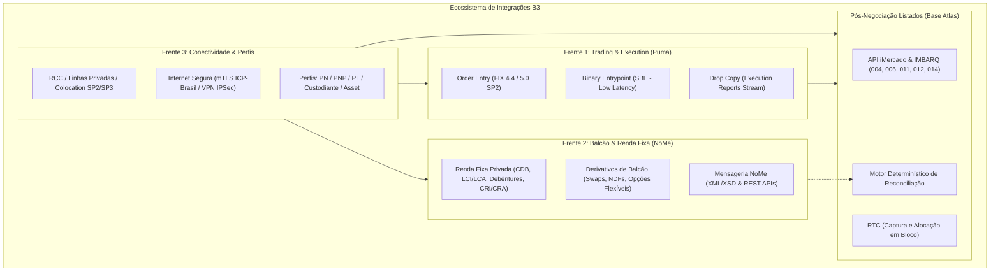
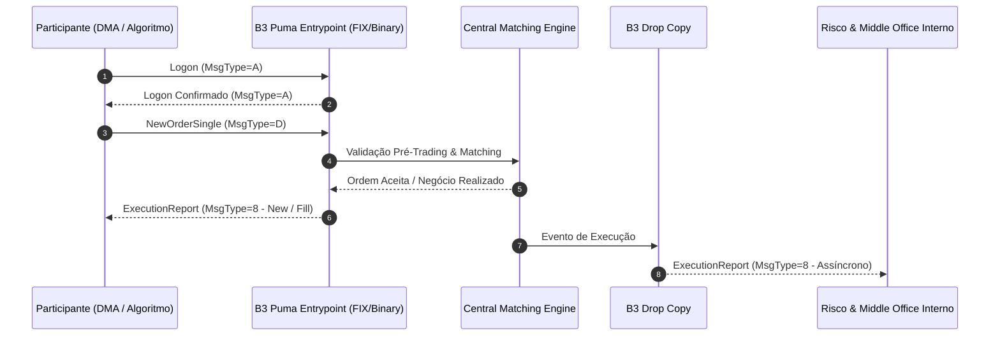
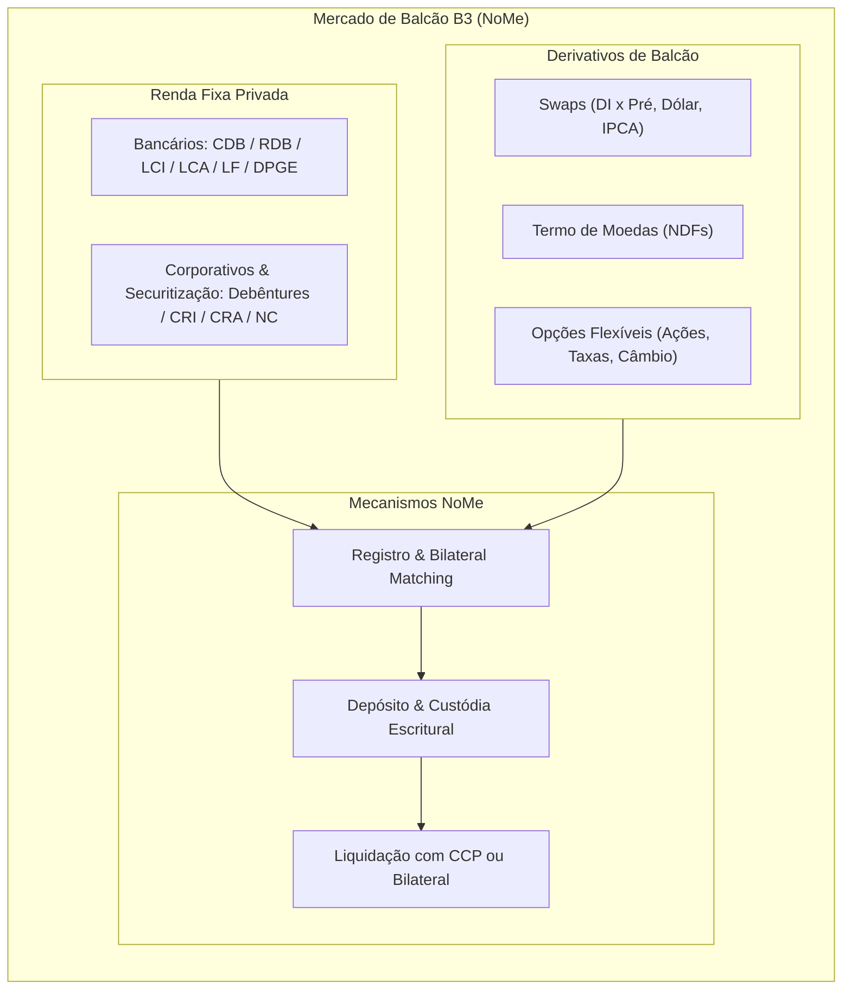
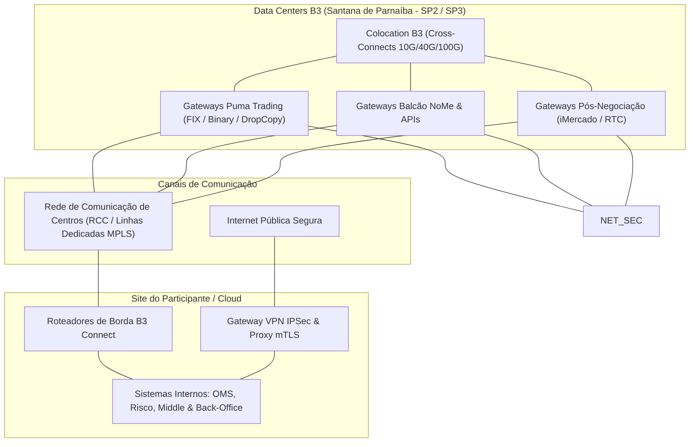
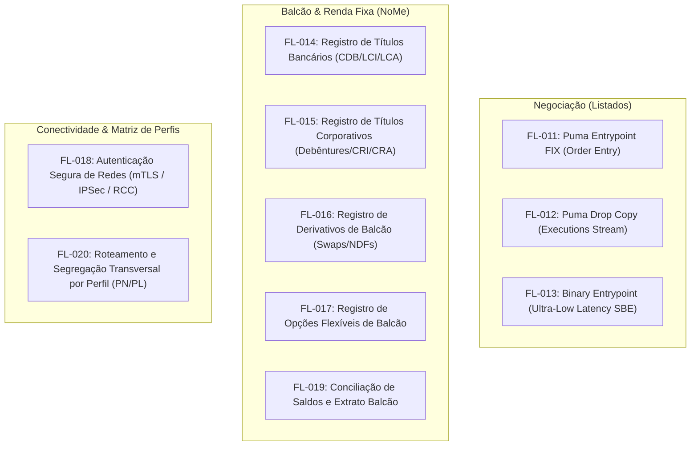

# Roadmap de Expansão Arquitetural B3: Trading, Balcão e Conectividade

## 1. Visão Geral e Contexto Estratégico

O **Atlas de Integrações B3** consolidou sua primeira fase cobrindo a pós-negociação de ativos listados (ações, opções, futuros e derivativos), com a modelagem determinística da família **IMBARQ** (IMBARQ006, IMBARQ004, IMBARQ011, IMBARQ012, IMBARQ014), motor de reconciliação de custódia e cliente assíncrono para a API iMercado.

No entanto, a arquitetura de uma instituição financeira ou participante de mercado (corretora, participante liquidante, custodiante central ou asset manager) demanda integração de ponta a ponta com a B3. Este documento estabelece o roadmap arquitetural e a especificação funcional para a expansão do Atlas em três novas frentes estratégicas:

1. **Frente 1: Negociação de Listados (Trading & Execution)** — Conexão com o motor de correspondência *Puma Trading System* via protocolo FIX (Order Entry e Drop Copy) e mensageria binária de alta frequência (*Binary Entrypoint*).
2. **Frente 2: Balcão e Renda Fixa (NoMe / Antiga CETIP)** — Registro, depósito, negociação secundária bilateral e liquidação de títulos de renda fixa privada (CDB, LCI/LCA, Debêntures, CRI/CRA) e derivativos customizados de balcão (Swaps, NDFs, Opções Flexíveis).
3. **Frente 3: Conectividade e Infraestrutura de Rede** — Topologia de comunicação física e lógica (Rede de Comunicação de Centros - RCC, Colocation, Internet Segura via mTLS e VPN IPSec) e segregação por perfis de participantes (PN, PNP, PL, Custodiantes e Gestoras).

---

## 2. Frente 1: Negociação de Listados (Trading & Execution)

### 2.1. Arquitetura do Puma Trading System

O *Puma Trading System* é a plataforma central de negociação multi-ativo da B3, responsável pelo gerenciamento de livros de ofertas (*central order book*), casamento determinístico de ordens (*matching engine*), leilões e disseminação de cotações em tempo real.

O acesso de roteamento e recepção de ordens é segregado em três pilares principais:
- **FIX Order Entry (Entrypoint B3)**: Canal interativo transacional baseado no padrão FIX.
- **Drop Copy**: Canal passivo de subscrição e espelhamento em tempo real de mensagens de execução e status de ordens.
- **Binary Entrypoint**: Canal binário proprietário de ultra-baixa latência projetado para algoritmos de alta frequência (*HFT*) e formadores de mercado (*Market Makers*).

---

### 2.2. Protocolo FIX (Order Entry via FIX 4.4 / FIX 5.0 SP2)

A B3 disponibiliza especificações do protocolo FIX customizadas para a praça brasileira, utilizando primordialmente **FIX 4.4** e **FIX 5.0 SP2** com dialetos próprios da bolsa.

#### Ciclo de Vida da Sessão FIX:
1. **Estabelecimento de Conexão**: Conexão TCP/IP na porta e IP designados pela B3 (via RCC ou VPN).
2. **Logon (`MsgType=A`)**: Envio de mensagem inicial contendo:
   - `49=SenderCompID`: Identificador atribuído à corretora/mesa.
   - `56=TargetCompID`: Identificador da B3 (ex: `BVMF`).
   - `34=MsgSeqNum`: Sequenciador rigoroso iniciado em `1`.
   - `98=EncryptMethod=0` (None / TLS já aplicado no transporte).
   - `108=HeartBtInt`: Frequência de batimentos (habitualmente 30 segundos).
   - `553=Username` / `554=Password`: Credenciais operacionais cadastradas na B3.
3. **Heartbeat (`MsgType=0`) e Test Request (`MsgType=1`)**: Manutenção do canal e validação de latência.
4. **Resend Request (`MsgType=2`) e Sequence Reset (`MsgType=4`)**: Recuperação de pacotes perdidos ou sincronização forçada de estado.
5. **Logout (`MsgType=5`)**: Encerramento ordenado da sessão antes da janela noturna de manutenção.

#### Principais Mensagens de Negociação e Execução:

1. **`NewOrderSingle` (`MsgType=D`)** — Inserção de Ordem no Livro:
   - `11=ClOrdID`: Identificador único da ordem gerado pelo cliente (máximo 20 caracteres alfanuméricos, único por sessão/dia).
   - `55=Symbol` ou `48=SecurityID` + `22=SecurityIDSource=8`: Código de negociação do ativo na B3 (ex: `PETR4`, `VALE3`, `WINZ26`).
   - `54=Side`: Sentido da ordem (`1` = Compra / Buy, `2` = Venda / Sell).
   - `60=TransactTime`: Timestamp UTC com precisão de milissegundos ou microssegundos (`YYYYMMDD-HH:MM:SS.sss`).
   - `38=OrderQty`: Quantidade inteira de títulos ou contratos.
   - `40=OrdType`: Tipo de ordem (`1` = Mercado / Market, `2` = Limitada / Limit, `3` = Stop, `4` = Stop Limit).
   - `44=Price`: Preço limite unitário (obrigatório se `OrdType=2` ou `4`).
   - `59=TimeInForce`: Validade da oferta (`0` = Day, `1` = Good 'Til Cancel - GTC, `3` = Immediate or Cancel - IOC, `4` = Fill or Kill - FOK, `6` = Good 'Til Date - GTD).
   - `1=Account`: Conta de custódia do investidor final na corretora.
   - `50=SenderSubID`: Operador responsável ou identificador de DMA.
   - `581=AccountType`: Perfil da conta (`1` = Cliente, `2` = Carteira Própria, `3` = Formador de Mercado).
   - `528=OrderCapacity`: Capacidade operacional (`A` = Agency, `P` = Principal, `R` = Riskless Principal).
   - `1003=TradeID` / Tags de DMA (Conformidade Resolução CVM 35 / MiFID II): Identificação de modelo de acesso (DMA1 via mesa, DMA2 via plataforma de terceiros, DMA3 via conexão direta à bolsa, DMA4 via colocation).

2. **`OrderCancelReplaceRequest` (`MsgType=G`)** — Modificação de Ordem:
   - `11=ClOrdID`: Novo identificador para a ordem modificada.
   - `41=OrigClOrdID`: O `ClOrdID` da ordem anterior que se deseja alterar.
   - `38=OrderQty`: Nova quantidade total desejada.
   - `44=Price`: Novo preço.
   *Atenção*: Se o preço for melhorado ou piorado, ou a quantidade aumentada, a ordem perde prioridade cronológica no livro da B3.

3. **`OrderCancelRequest` (`MsgType=F`)** — Cancelamento de Ordem:
   - `11=ClOrdID`: Identificador desta solicitação de cancelamento.
   - `41=OrigClOrdID`: O `ClOrdID` da ordem ativa a ser cancelada no book.
   - `55=Symbol`, `54=Side`, `38=OrderQty`.

4. **`ExecutionReport` (`MsgType=8`)** — Confirmação e Relatório de Execução:
   - `37=OrderID`: Identificador definitivo gerado pelo Puma Trading System.
   - `11=ClOrdID` e `41=OrigClOrdID`: IDs locais de controle.
   - `17=ExecID`: Identificador unívoco do evento de execução gerado pelo motor da B3.
   - `150=ExecType`: Natureza do evento (`0` = New, `4` = Canceled, `5` = Replaced, `8` = Rejected, `F` = Trade/Partial Fill, `I` = Order Status).
   - `39=OrdStatus`: Estado consolidado da ordem (`0` = New, `1` = Partially Filled, `2` = Filled, `4` = Canceled, `8` = Rejected, `C` = Expired).
   - `32=LastQty`: Quantidade executada neste evento específico de negócio.
   - `31=LastPx`: Preço no qual este negócio ocorreu.
   - `14=CumQty`: Quantidade total acumulada já executada para esta ordem.
   - `151=LeavesQty`: Quantidade remanescente aberta no book.
   - `6=AvgPx`: Preço médio ponderado das execuções acumuladas.
   - `103=OrdRejReason` / `58=Text`: Código numérico e descrição literal caso a ordem tenha sido rejeitada por limite de oscilação, túnel de preço ou regras de risco pré-trading da B3.

5. **`OrderCancelReject` (`MsgType=9`)** — Rejeição de Cancelamento/Modificação:
   - Retornado quando a ordem original já foi 100% preenchida (`LeavesQty=0`), cancelada anteriormente ou não encontrada.
   - `102=CxlRejReason`: Código explicativo do erro (ex: `1` = Unknown order, `2` = Broker Option, `3` = Order already in pending status).

---

### 2.3. Drop Copy (Acompanhamento em Tempo Real para Risco e Middle-Office)

O serviço de **Drop Copy** é uma interface FIX unidirecional (em relação aos eventos de ordens) que provê uma réplica em tempo real de todas as mensagens de negociação e status de ordens originadas por múltiplas sessões de Order Entry vinculadas a uma instituição.

#### Características Operacionais:
- **Desacoplamento de Performance**: Sessões de trading (DMA/HFT) não sofrem degradação de latência com relatórios secundários; o Drop Copy roda em portas e servidores dedicados na infraestrutura Puma.
- **Consolidação Multi-Mesa**: Um único canal de Drop Copy pode receber os feeds de dezenas de sessões de Order Entry de diferentes mesas de operações (Varejo, Institucional, Tesouraria, Derivativos, DMA de terceiros).
- **Aplicações Essenciais**:
  1. *Monitoramento de Risco Intradiário (LiNe B3 e Risco Proprietário)*: Acompanhamento contínuo de perda máxima diária, consumo de margem intradiária, limites de concentração por ativo e identificação de ordens anômalas (*fat-finger*).
  2. *Alimentação Imediata de Middle-Office*: Permite ao back-office e custodiante visualizar negócios no segundo em que ocorrem, sem esperar a geração noturna do IMBARQ006 ou batches de RTC.
  3. *Trilhas Regulatórias e Auditoria*: Registro auditável de todas as ofertas, rejeições, cancelamentos e negócios (cumprimento da instrução CVM 505 e diretrizes da BSM Supervisão de Mercados).

---

### 2.4. Binary Entrypoint (Mensageria Binária de Baixa Latência)

Para participantes que operam estratégias algorítmicas de altíssima frequência (*HFT*) e provimento de liquidez contínua (*Market Making*), a B3 disponibilizou o canal **Binary Entrypoint**.

#### Diferenciais Técnicos em Relação ao FIX Tradicional:
- **Encoding Compacto (Simple Binary Encoding - SBE)**: Enquanto o FIX textual exige parsing de tags ASCII, busca de delimitadores (`SOH` - `0x01`) e conversões caras de strings para inteiros/floats, o formato binário define structs com tamanho e alinhamento de memória fixos (ex: inteiros de 64 bits little-endian, structs compactas de 32/64 bytes).
- **Zero-Copy & Cache Friendliness**: O payload do pacote de rede pode ser interpretado diretamente via ponteiros de memória em linguagens de sistemas (C, C++, Rust), minimizando *cache misses* na CPU e latências de conversão para a escala de microssegundos (< 10µs).
- **Semântica de Comunicação**:
  - Sessão ponto-a-ponto via TCP com mensagens binárias delimitadas por cabeçalho de comprimento fixo.
  - Sequenciador de pacotes binários e canal de recuperação (*TCP Recovery Engine*).
  - Suporte completo às operações equivalentes do FIX: `NewOrder`, `OrderCancel`, `OrderReplace` e `OrderExecutionReport`.

---

## 3. Frente 2: Balcão e Renda Fixa (NoMe / Antiga CETIP)

### 3.1. O Ecossistema de Balcão e a Plataforma NoMe

Após a integração entre a Cetip e a BM&FBOVESPA, as operações de balcão organizado e registro de ativos privados foram consolidadas no **NoMe (Novo Mercado de Balcão)** e nos sistemas integrados de registro da B3.

Diferente do mercado de bolsa (onde ordens anônimas casam no livro central da câmara), o mercado de balcão é eminentemente **bilateral** e orientado a **registro de operações customizadas** celebradas previamente entre as partes, com depósito centralizado e custódia escritural.

---

### 3.2. Registro e Liquidação de Renda Fixa Privada

A B3 é a infraestrutura central de registro de títulos e valores mobiliários de renda fixa do mercado de capitais brasileiro. O ciclo de vida desses títulos envolve:

#### Tipologia de Instrumentos:
1. **Instrumentos de Emissão Bancária**:
   - **CDB** (Certificado de Depósito Bancário) e **RDB** (Recibo de Depósito Bancário).
   - **LCI** (Letra de Crédito Imobiliário) e **LCA** (Letra de Crédito do Agronegócio) — isentas de IR para pessoa física.
   - **LF** (Letra Financeira) — prazo mínimo de 2 anos, sem resgate antecipado, utilizada para composição de capital regulatório bancário.
   - **DPGE** (Depósito a Prazo com Garantia Especial do FGC).
2. **Instrumentos de Crédito Corporativo e Securitização**:
   - **Debêntures** (Simples, Conversíveis, Permutáveis, Incentivadas Lei 12.431/06 para infraestrutura).
   - **CRI** (Certificado de Recebíveis Imobiliários) e **CRA** (Certificado de Recebíveis do Agronegócio).
   - **Notas Comerciais** (NC) e Letras Imobiliárias Garantidas (LIG).

#### Ciclo Operacional no NoMe:
- **Cadastro de Emissão**: Registro dos termos definitivos da escritura: identificador do ativo (código IF / ISIN), emissor, data de emissão, data de vencimento, base de cálculo (252 dias ou civil 360), taxa/indexador (% DI, DI + spread, IPCA + cupom, pré-fixado).
- **Negociação no Mercado Secundário**: Transação bilateral entre compradores e vendedores. Ambos os participantes submetem as pontas da operação informando preço unitário (PU), quantidade, valor financeiro e data de liquidação (D+0, D+1, D+2).
- **Operações Compromissadas**: Compra ou venda de ativos com o compromisso simultâneo de recompra/revenda em data futura e taxa pré-ajustada, utilizando os títulos de renda fixa privada como lastro custodiado.
- **Eventos Corporativos de Custódia**: A B3 processa o pagamento programado de juros semestrais/anuais, amortizações ordinárias ou extraordinárias, e liquida o saldo final de resgate no vencimento.
- **Liquidação Financeira**:
  - Liquidação Bruta em Tempo Real (**LBTR**) via **STR** (Sistema de Transferência de Reservas do Banco Central do Brasil) para operações D+0.
  - Liquidação Líquida Multilateral na câmara de compensação B3 para operações de balcão integradas.

---

### 3.3. Derivativos de Balcão (Swaps, Termo e Opções Flexíveis)

Os derivativos negociados em balcão atendem a necessidades corporativas específicas de hedge e alocação estruturada, com especificações flexíveis não padronizadas:

1. **Contratos de Swap Registrados**:
   - Troca de fluxos de rendimento entre duas pontas: Ponta Ativa (rendimento a receber) e Ponta Passiva (rendimento a pagar).
   - Principais pares: DI x Pré, DI x Dólar (Cupom Cambial), CDI x IPCA, CDI x IGP-M.
   - Registro bilateral com conferência automática de parâmetros: principal nocional, datas de reajuste de PU, amortizações periódicas e liquidação no vencimento pela diferença financeira líquida.

2. **Termo de Moedas (NDF - Non-Deliverable Forward)**:
   - Contrato a termo de moeda sem entrega física do principal em moeda estrangeira.
   - As partes fixam uma taxa a termo ($R\$/US\$). No vencimento, a liquidação ocorre em reais pela diferença apurada contra a taxa PTAX oficial do Banco Central.

3. **Opções Flexíveis de Balcão**:
   - Contratos de opções customizados sobre ações listadas, moedas, índices ou taxas de juros.
   - Parâmetros customizados: strike arbitrário, datas de exercício flexíveis, estilo de exercício (Europeu, Americano, Bermuda, Barreira Knock-in / Knock-out).

4. **Modelos de Salvaguarda e Garantias**:
   - **Registro sem Garantia (Bilateral)**: O risco de inadimplência recai integralmente sobre a contraparte; a B3 atua apenas como registradora e depositária escritural.
   - **Registro com Garantia Central (CCP B3)**: As operações são aceitas pela câmara de compensação da B3, que assume a posição de contraparte central garantidora, exigindo alocação diária de margem de garantia e marcação a mercado (*MtM*) intradiária.

---

### 3.4. Interfaces de Mensageria e APIs NoMe

A integração com o NoMe e os sistemas de registro da B3 evoluiu de rotinas antigas de importação de arquivos para uma matriz híbrida de alta tecnologia:

1. **Mensageria XML NoMe (Padrão Cetip / B3)**:
   - Estrutura hierárquica baseada em esquemas XML (`.xsd`) proprietários da B3.
   - Mensagens de requisição e resposta empacotadas via filas seguras ou HTTP POST seguro.
   - Exemplo de blocos estruturais:
     - `REG_OPERACAO_RENDA_FIXA`: Identificação de conta do comitente, código do título, taxa de operação, PU, financeiro, modalidade de liquidação.
     - `CONFERENCIA_BILATERAL`: Notificação de batimento das pontas compradora e vendedora.
     - `EXTRATO_CUSTODIA_BALCAO`: Posição consolidada e analítica de ativos sob custódia escritural da instituição.

2. **APIs RESTful / JSON de Registro e Balcão**:
   - Catálogo moderno de microserviços HTTP REST da B3 para consulta de saldos, cadastro de operações de balcão e recuperação de extratos analíticos.
   - Autenticação padronizada com OAuth 2.0 e mTLS (certificados digitais ICP-Brasil).

---

## 4. Frente 3: Conectividade e Infraestrutura de Rede

### 4.1. Topologia de Rede e Conexão Física/Lógica

A integração técnica com os sistemas de produção e homologação da B3 exige rigorosos padrões de arquitetura de conectividade, escalabilidade e redundância:

#### Modalidades de Conectividade:
1. **Rede de Comunicação de Centros (RCC / B3 Connect)**:
   - Infraestrutura de telecomunicação dedicada e redundante fornecida pelas operadoras de telecom credenciadas pela B3.
   - Utilização de circuitos MPLS ou enlaces de fibra apagada (*Dark Fiber*) com dupla abordagem física no data center do participante.
   - Largura de banda garantida e acordos de nível de serviço (SLA) críticos para evitar jitter e descarte de pacotes durante picos de volatilidade.
2. **Colocation B3**:
   - Instalação de equipamentos (servidores e switches) dos participantes dentro do data center oficial da B3 (Santana de Parnaíba - SP).
   - Cabeamento de fibra óptica dedicado (*cross-connects*) ligando os racks do participante diretamente aos switches da bolsa, propiciando latências determinísticas inferiores a 10 microssegundos.
3. **Conexão via Internet Segura com mTLS e VPN IPSec**:
   - **VPN IPSec Site-to-Site**: Túnel criptografado estabelecido entre os firewalls do participante e os roteadores de borda da B3 (criptografia AES-256-GCM, troca de chaves IKEv2 com chaves assimétricas).
   - **mTLS (Mutual TLS)**: Todas as conexões HTTP REST (como a API iMercado) e canais FIX seguros sobre internet exigem autenticação mútua. A instituição deve apresentar um certificado digital corporativo emitido por Autoridade Certificadora subordinada à **ICP-Brasil** (tipo A1 ou A3/HSM com CNPJ válido), garantindo autenticidade, não-repúdio e integridade criptográfica ponta a ponta.

---

### 4.2. Segregação por Perfis de Participantes

A estrutura regulatória da B3 impõe uma clara segregação de responsabilidades jurídicas, financeiras e técnicas entre os agentes de mercado:

| Perfil de Participante | Descrição Institucional | Responsabilidades Principais | Canais de Integração Típicos |
|---|---|---|---|
| **PN (Participante de Negociação)** | Corretoras de valores que possuem acesso direto ao Puma Trading System para roteamento de ordens próprias e de clientes. | - Roteamento de ordens ao Puma - Validação de limites operacionais - Risco intradiário de clientes | - FIX Order Entry - Drop Copy - RTC (Captura em Bloco) |
| **PNP (Participante de Negociação Não Pleno)** | Corretoras ou distribuidoras com escopo operacional simplificado, sem infraestrutura de liquidação própria. | - Roteamento de ordens via patrocinador - Distribuição de produtos | - Sessões FIX intermediadas - Portais de parceiros |
| **PL (Participante Liquidante / Clearing Member)** | Bancos múltiplos ou grandes corretoras autorizados a liquidar operações na câmara B3. | - Responsabilidade financeira irrestrita perante a câmara - Depósito de garantias e liquidação financeira multilateral - Gestão de risco de contraparte dos PNs patrocinados | - IMBARQ (004, 006, 011, 014) - API iMercado Conciliação - STR / SELIC / SPB - RTC (Alocação e Repasse) |
| **Custodiante Central / Agente de Custódia** | Bancos mandatados para a guarda, escrituração e conciliação dos ativos dos investidores. | - Manutenção dos livros de custódia individualizados - Conciliação diária de posições e eventos corporativos - Gestão de aluguel de ações (BTC) | - IMBARQ012 (Posições de Custódia) - IMBARQ011 (Empréstimo BTC) - IMBARQ013 (Movimentações) - Mensageria NoMe Extrato |
| **Asset Manager / Gestora de Recursos** | Gestoras de fundos de investimento (Buy-side) que executam ordens e demandam pós-trade eficiente. | - Gestão discricionária de portfólios - Envio de ordens via DMA (Direct Market Access) - Conferência de alocação de blocos (give-up) com corretores e custodiantes | - OMS / EMS integrado via FIX - Drop Copy para risco de fundos - RTC Alocação - API iMercado para extratos de fundos |

---

## 5. Inventário Preliminar de Novos Fluxos Candidatos (FL-011 a FL-020)

Para assegurar a evolução ordenada do **Atlas de Integrações B3**, formalizamos o inventário de dez novos fluxos candidatos a integrar o catálogo oficial:

### Especificação Detalhada dos Novos Fluxos:

1. **`FL-011` — Envio e Gerenciamento de Ordens de Negociação (Puma Entrypoint FIX)**
   - **Sistema**: Puma Trading System
   - **Interface**: FIX 4.4 / FIX 5.0 SP2 (Order Entry B3)
   - **Fontes Associadas**: `SRC-006`
   - **Pendências**: Obtenção do dicionário canônico de tags customizadas B3, regras de validação pré-trading (túneis de oscilação), modelo de certificação de algoritmos de negociação e suíte de testes de conformidade.

2. **`FL-012` — Captura Passiva de Ordens e Execuções em Tempo Real (Puma Drop Copy)**
   - **Sistema**: Drop Copy
   - **Interface**: FIX Drop Copy (`ExecutionReport`, `OrderCancelReject`)
   - **Fontes Associadas**: `SRC-007`
   - **Pendências**: Especificação de credenciamento de sessões Drop Copy multi-mesa, parametrização de compIDs autorizados e homologação em simulador de execuções intradiárias.

3. **`FL-013` — Entrada de Ordens de Baixa Latência (Binary Entrypoint)**
   - **Sistema**: Puma Trading System
   - **Interface**: Puma Binary Entrypoint Protocol (SBE / Binary Messaging)
   - **Fontes Associadas**: `SRC-008`
   - **Pendências**: Mapeamento dos schemas XML de compilação SBE (Simple Binary Encoding), implementação de serializadores/deserializadores zero-copy em C/Rust/Python e benchmark de latência de empacotamento.

4. **`FL-014` — Registro de Operações de Renda Fixa Privada Bancária (CDB, RDB, LCI e LCA)**
   - **Sistema**: NoMe (Novo Mercado de Balcão)
   - **Interface**: XML NoMe / API REST Balcão Renda Fixa
   - **Fontes Associadas**: `SRC-009`
   - **Pendências**: Mapeamento dos schemas XSD de cadastro de emissão e batimento bilateral de negociação secundária de títulos de captação bancária, com validação de contas de liquidação financeira.

5. **`FL-015` — Registro e Manutenção de Debêntures e Títulos Corporativos (CRI e CRA)**
   - **Sistema**: NoMe (Novo Mercado de Balcão)
   - **Interface**: XML NoMe / API REST Balcão
   - **Fontes Associadas**: `SRC-009`, `SRC-010`
   - **Pendências**: Mapeamento completo do ciclo de eventos corporativos (juros, amortização periódica, repactuação de garantias e vencimento) e estruturação de esteira de custódia balcão.

6. **`FL-016` — Registro e Gerenciamento de Derivativos de Balcão (Swaps e NDFs)**
   - **Sistema**: NoMe Derivativos de Balcão
   - **Interface**: XML NoMe / API REST Derivativos
   - **Fontes Associadas**: `SRC-011`
   - **Pendências**: Mapeamento de convenções financeiras de PU, curvas de juros e cupons cambiais, distinção entre registro sem garantia bilateral vs. câmara central garantidora (CCP B3) e chamadas de margem.

7. **`FL-017` — Registro de Opções Flexíveis de Balcão**
   - **Sistema**: NoMe Derivativos de Balcão
   - **Interface**: XML NoMe / API NoMe Opções Flexíveis
   - **Fontes Associadas**: `SRC-011`
   - **Pendências**: Mapeamento de modelos de prêmio, datas de exercício flexíveis (europeu, americano, barreira), tratamento de ativos subjacentes e liquidação física vs. financeira.

8. **`FL-018` — Estabelecimento e Autenticação de Sessão Segura mTLS / VPN**
   - **Sistema**: Conectividade B3 (RCC / Internet Segura)
   - **Interface**: mTLS (ICP-Brasil) / IPSec / B3 Connect
   - **Fontes Associadas**: `SRC-012`
   - **Pendências**: Procedimentos formais para emissão de CSR e credenciamento de certificados e-CNPJ A1/A3 perante as Autoridades Certificadoras B3, roteamento estático e configuração de túneis redundantes.

9. **`FL-019` — Conciliação de Posições e Ativos de Balcão (Extrato Balcão NoMe)**
   - **Sistema**: NoMe / Extrato Balcão
   - **Interface**: Arquivo Posicional / API de Consulta de Saldos NoMe
   - **Fontes Associadas**: `SRC-009`, `SRC-013`
   - **Pendências**: Mapeamento das estruturas de relatórios e extratos de custódia balcão, integração ao motor determinístico de conciliação do Atlas e tratamento de batimento com livros internos bancários.

10. **`FL-020` — Roteamento e Segregação de Operações por Perfil de Participante (PN / PNP / PL / Custodiante)**
    - **Sistema**: Plataformas B3 (Puma / RTC / NoMe)
    - **Interface**: Matriz de Identificação e Acesso de Participantes B3
    - **Fontes Associadas**: `SRC-014`
    - **Pendências**: Mapeamento transversal das tags de identificação de participante (Broker ID, Clearing Member, Investor ID, Give-Up Party) em operações de negociação, alocação e liquidação.

---

## 6. Próximos Passos e Metodologia de Implementação

Seguindo o rigor metodológico estabelecido em [method.md](method.md):
1. **Adição ao Catálogo Oficial**: Integração formal das novas fontes (`SRC-006` a `SRC-014`) e dos fluxos candidatos (`FL-011` a `FL-020`) nos arquivos [sources.json](../catalog/sources.json) e [flows.json](../catalog/flows.json).
2. **Coleta e Extração de Manuais Oficiais**: Obtenção e versionamento dos manuais canônicos de FIX Entrypoint, SBE Binary, Schemas XML NoMe e Guia de Conectividade RCC da B3.
3. **Módulos Piloto de Negociação**:
   - Construção de parser de mensagens FIX e simulador de sessão de Drop Copy para monitoramento de risco.
   - Modelagem de parser para os extratos analíticos de balcão NoMe.
4. **Validação Contínua de Integridade**: Manutenção de 100% de conformidade com os scripts de teste automatizado [test_catalog.py](../scripts/test_catalog.py).
