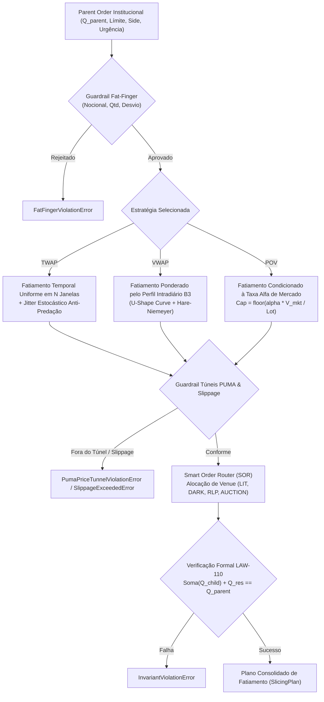
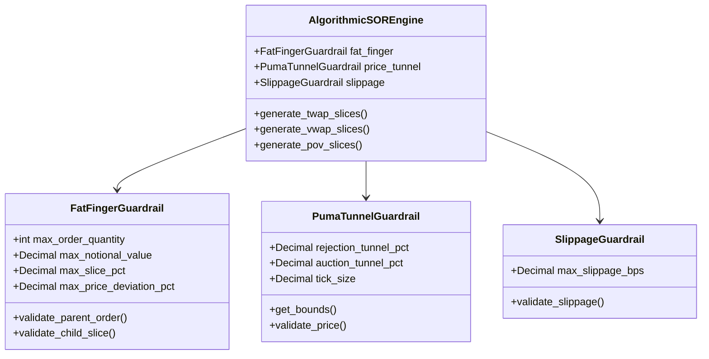

# Especificação Técnica — Smart Order Router (SOR) & Fatiamento Algorítmico TWAP/VWAP/POV (FL-104)

---

## 1. Visão Geral e Arcabouço Normativo

O fluxo **`FL-104` — Smart Order Router (SOR) e Fatiamento Algorítmico Institucional** estabelece a arquitetura determinística de execução, fatiamento e roteamento inteligente de ordens institucionais de grande porte (*Block Orders* / *Parent Orders*) no ambiente de negociação **B3 PUMA Trading System**.

O objetivo primário do motor é mitigar o impacto de mercado (*market impact*), otimizar o preço médio de execução em relação a benchmarks consagrados (*Arrival Price*, *TWAP* e *VWAP*), evitar pegadas de liquidez (*footprints*) exploráveis por algoritmos predadores de Alta Frequência (*HFT / Predatory Algorithms*), e garantir a melhor execução (*Best Execution*).

### 1.1 Normativos e Enquadramento Regulatório
- **Resolução CVM nº 135/2022 e Resolução CVM nº 35/2021**: Regras de conduta de intermediários no mercado de valores mobiliários, dever de melhor execução da ordem do cliente (*Best Execution*), transparência e prevenção a conflitos de interesse.
- **Instrução CVM nº 505/2011 e Ofício-Circular B3 / BSM**: Governança algorítmica, controles prévios de risco (*Pre-Trade Risk Checks*), prevenção de ordens artificiais ou manipulativas e testes de estresse em robôs de negociação.
- **Manual de Procedimentos Operacionais de Negociação da B3 (PUMA Trading System)**:
  * Regras de Túneis de Negociação (Túnel Operacional e Túnel de Rejeição de Preço).
  * Mecanismos de negociação contínua (*CLOB - Central Limit Order Book / Lit Book*).
  * Mecanismos de cruzamento a ponto médio (*Midpoint Crossing / Dark Pool*).
  * Mecanismos de Provedor de Liquidez de Varejo (*RLP - Retail Liquidity Provider*).
  * Leilões de Fechamento (*Closing Cross / Call MOC*).

---

## 2. Estratégias Algorítmicas de Fatiamento

O motor suporta três estratégias analíticas com distribuição determinística de lotes e preservação estrita de integridade matemática:



### 2.1 TWAP (Time-Weighted Average Price) com Jitter Anti-Predação
A estratégia TWAP visa executar a ordem de forma linearmente distribuída ao longo do horizonte temporal definido por $N$ janelas:

1. **Alocação Base de Lotes**:
   $$L_{\text{base}} = \left\lfloor \frac{Q_{\text{parent}}}{N \times \text{lot\_size}} \right\rfloor$$
2. **Jitter Estocástico Anti-Predatório**:
   Algoritmos TWAP ingênuos executam fatias em intervalos e volumes fixos, permitindo que participantes adversariais identifiquem a cadência e executem estratégias de *front-running*. O motor introduz:
   * **Perturbação Temporal**: Desvio aleatório $\delta t_k \sim \mathcal{U}(-\tau_{\text{jitter}}, +\tau_{\text{jitter}})$ em segundos.
   * **Perturbação de Lote**: Desvio de volume $\Delta L_k \in \{-\Delta, +\Delta\}$, compensado deterministicamente entre janelas adjacentes para garantir que a soma final continue conservando exatamente $Q_{\text{parent}}$.

### 2.2 VWAP (Volume-Weighted Average Price) e Curva em "U" da B3
A estratégia VWAP modula o tamanho de cada fatia com base no perfil histórico intradiário de liquidez do mercado de ações e derivativos da B3:

$$\omega_k = \frac{V_{\text{hist}, k}}{\sum_{j=1}^N V_{\text{hist}, j}}, \quad \sum_{k=1}^N \omega_k = 1.0$$

O perfil canônico intradiário da B3 reflete a clássica curva em "U" (*U-shape curve*):
- **Abertura (10:00 - 11:24)**: Elevada atividade decorrente do acúmulo de informações *overnight*, abertura da NYSE e leilão de abertura (pesos entre 13% e 15%).
- **Horário de Almoço (12:00 - 13:30)**: Desaceleração acentuada do volume transacionado (pesos entre 5% e 6%).
- **Tarde e Encerramento (15:30 - 17:00)**: Aceleração forte com o fechamento dos mercados europeus e o leilão de fechamento / *Closing Cross MOC* (pesos entre 12% e 16%).

#### Algoritmo de Resíduos Maiores (Hare-Niemeyer / Hamilton)
Para converter o valor ideal contínuo em múltiplos estritos do lote padrão (ex: 100 ações na B3), adota-se o algoritmo de Hare-Niemeyer:
1. Calcula a cota contínua em lotes: $q_k^* = L_{\text{total}} \times \omega_k$.
2. Aloca a parte inteira: $l_k = \lfloor q_k^* \rfloor$.
3. Ordena os resíduos fracionários $r_k = q_k^* - l_k$ em ordem decrescente.
4. Distribui 1 lote aos maiores resíduos até consumir o resíduo total $R = L_{\text{total}} - \sum l_k$.
5. Resultado: $\sum l_k = L_{\text{total}}$ e $\sum Q_k = Q_{\text{parent}}$ estritamente.

### 2.3 POV (Percent-of-Volume / Participation Rate)
A estratégia POV limita a participação do participante institucional a no máximo $\alpha \in (0, 0.50]$ do volume total negociado pelo mercado na janela $k$:

$$Q_k \le \text{Cap}_k = \left\lfloor \frac{\alpha \cdot V_{\text{mkt}, k}}{\text{lot\_size}} \right\rfloor \times \text{lot\_size}$$

- Se a ordem couber na capacidade das janelas disponíveis ($\sum \text{Cap}_k \ge Q_{\text{parent}}$), a totalidade é fatiada com residual zero.
- Se a ordem exceder a capacidade de absorção do mercado dentro do teto de participação $\alpha$, o volume excedente é retido em `residual_unallocated_quantity`, garantindo proteção total contra impacto excessivo e preservando a conservação da invariante LAW-110.

---

## 3. Smart Order Router (SOR) e Roteamento de Ambientes

O motor SOR analisa a liquidez dos múltiplos ambientes integrados ao PUMA e direciona cada fatia filha (*Child Order*) conforme a urgência da ordem e a profundidade disponível:

| Venue PUMA B3 | Descrição Operacional | Casos de Uso / Urgência |
| :--- | :--- | :--- |
| **`PUMA_LIT`** | Livro contínuo transparente central (CLOB). | Urgência ALTA ou quando esgotada a liquidez oculta. |
| **`PUMA_DARK_MIDPOINT`** | Mecanismo de cruzamento a ponto médio sem exibição pública de livro. | Urgência BAIXA; captura o meio do *spread* com impacto zero. |
| **`PUMA_RLP`** | Retail Liquidity Provider (internalizadores autorizados). | Ordens de tamanho moderado com garantia de preço não pior que o melhor bid/ask. |
| **`PUMA_AUCTION`** | Leilão de fechamento e leilões de oscilação PUMA. | Fatias finais de ordens executadas na janela pré-fechamento (16:40-17:00). |

---

## 4. Matriz de Guardrails de Segurança Operacional



### 4.1 Guardrail Fat-Finger
- **Quantidade Máxima**: Impede submissão de ordens acima de um teto pré-definido (default: 1.000.000 de cotas).
- **Nocional Máximo**: Limita a exposição financeira máxima da ordem (default: R$ 50.000.000,00).
- **Desvio Máximo de Preço**: Bloqueia ordens com limite distante mais de 10% do preço de referência.
- **Teto Proporcional da Fatia**: Garante que nenhuma fatia absorva volume desproporcional.

### 4.2 Túneis de Negociação PUMA B3
Todo preço limite de fatia deve se situar estritamente dentro da banda do túnel de rejeição:
$$P_{\text{ref}} \times (1 - \text{tunnel}_{\text{down}}) \le P_{\text{child}} \le P_{\text{ref}} \times (1 + \text{tunnel}_{\text{up}})$$
Desvios superiores a 5% são sumariamente rejeitados via `PumaPriceTunnelViolationError`.

### 4.3 Limites de Slippage
Mede a degradação em relação ao preço de chegada (*Arrival Price*) em pontos-base (bps):
$$\text{Slippage}_{\text{BUY}} = \frac{P_{\text{child}} - P_{\text{arrival}}}{P_{\text{arrival}}} \times 10\,000 \le \text{Max Slippage (bps)}$$
$$\text{Slippage}_{\text{SELL}} = \frac{P_{\text{arrival}} - P_{\text{child}}}{P_{\text{arrival}}} \times 10\,000 \le \text{Max Slippage (bps)}$$

---

## 5. Invariante Formal LAW-110

A **Lei 83 / LAW-110** estabelece a prova matemática de conservação de lotes e inviolabilidade de preço limite para roteadores inteligentes:

$$\begin{cases}
\sum_{k=1}^N Q_{\text{child}, k} + Q_{\text{residual}} = Q_{\text{parent}} & \text{(Conservação Estrita de Quantidade)} \\
Q_{\text{child}, k} > 0, \quad Q_{\text{child}, k} \equiv 0 \pmod{\text{lot\_size}} & \text{(Não-Negatividade e Lote Padrão)} \\
P_{\text{child}, k} \le P_{\text{parent\_limit}} \quad (\text{se BUY}) & \text{(Não-Transgressão de Preço)} \\
P_{\text{child}, k} \ge P_{\text{parent\_limit}} \quad (\text{se SELL}) & \text{(Não-Transgressão de Preço)}
\end{cases}$$

O método `verify_invariants(raise_on_error=True)` inspeciona cada uma dessas propriedades e lança `InvariantViolationError` caso qualquer asserção seja rompida.

---

## 6. Layout Canônico JSON de Fixture

```json
{
  "description": "Configuração canônica do Algorithmic SOR TWAP/VWAP/POV PUMA B3",
  "reference_price": "34.50",
  "engine_config": {
    "fat_finger": {
      "max_order_quantity": 1000000,
      "max_notional_value": "50000000.00",
      "max_slice_pct": "0.40",
      "max_price_deviation_pct": "0.10"
    },
    "price_tunnel": {
      "rejection_tunnel_pct": "0.05",
      "auction_tunnel_pct": "0.02",
      "tick_size": "0.01"
    },
    "slippage": {
      "max_slippage_bps": "50.0"
    },
    "intraday_profile": [
      "0.15", "0.13", "0.09", "0.06", "0.05",
      "0.06", "0.08", "0.10", "0.12", "0.16"
    ]
  },
  "parent_order": {
    "parent_id": "ORD-B3-INST-20261107-001",
    "symbol": "PETR4",
    "side": "BUY",
    "quantity": 100000,
    "arrival_price": "34.50",
    "limit_price": "34.80",
    "strategy": "TWAP",
    "time_windows": 10,
    "start_time": "10:00:00",
    "end_time": "17:00:00",
    "lot_size": 100,
    "urgency": "MEDIUM",
    "jitter_range_pct": "0.15",
    "seed": 42
  }
}
```
