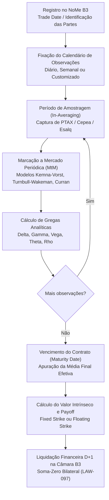

# Especificação Técnica — Opções Asiáticas de Média Aritmética e Geométrica no Balcão NoMe B3 (FL-092)

## 1. Visão Geral e Arcabouço Regulatório

O fluxo **FL-092** normatiza e implementa o ciclo de vida institucional completo de **Opções Asiáticas de Balcão** registradas no **Sistema NoMe (Novo Mercado de Balcão da B3)** e compensadas na **Câmara B3**:
1. **Dólar Comercial PTAX BACEN 800 Venda (`USD_PTAX`)**: Cotação em BRL por USD (tick R$ 0,0001), multiplicador unitário sobre notional financeiro negociado.
2. **Soja em Grão FOB Santos Indicador CEPEA/ESALQ (`SOYBEAN`)**: Lote padrão de 450 sacas de 60 kg (27 t), cotado em USD/saca (tick USD 0,01).
3. **Milho em Grão Campinas Indicador CEPEA/ESALQ (`CORN`)**: Lote padrão de 450 sacas de 60 kg (27 t), cotado em BRL/saca (tick R$ 0,01).
4. **Boi Gordo Indicador CEPEA/ESALQ (`CATTLE`)**: Lote padrão de 330 arrobas líquidas de 15 kg (4.950 kg), cotado em BRL/arroba (tick R$ 0,01).
5. **Café Arábica tipo 4/5 Indicador CEPEA/ESALQ (`COFFEE`)**: Lote padrão de 100 sacas de 60 kg (6 t), cotado em USD/saca (tick USD 0,05).

Opções asiáticas são contratos derivativos cujo valor de liquidação no vencimento depende da **média (aritmética ou geométrica)** das cotações do ativo subjacente observadas ao longo de um cronograma periódico predeterminado (diário, semanal, quinzenal ou datas customizadas de fixação PTAX/Cepea), atenuando riscos de manipulação pontual de mercado na data de expiração e reduzindo o custo de prêmio para proteção cambial e de commodities agrícolas.

### 1.1 Normativos Aplicáveis
- **Resolução CMN nº 4.952/2021 e Resolução BCB nº 264/2022**: Obrigatoriedade de registro das características do derivativo de balcão (datas de amostragem, metodologia de cálculo da média, strike e partes).
- **Instrução Normativa RFB nº 1.585/2015**: Incidência de IRRF sobre o ganho líquido auferido pelo titular pessoa jurídica (alíquota padrão de 15% para derivativos de balcão ou tabela progressiva/regressiva).
- **Regulamento de Derivativos e Câmaras B3**: Liquidação exclusivamente financeira no D+1 pós-vencimento contra a média efetivamente apurada.

---

## 2. Ciclo de Vida do Contrato e Estrutura de Amostragem



### 2.1 Modalidades de Exercício e Payoff
1. **Opções de Preço Médio (Average Price Options / Fixed Strike)**:
   - **Call**: $\text{Payoff} = \max(\bar{S} - K, 0)$
   - **Put**: $\text{Payoff} = \max(K - \bar{S}, 0)$
2. **Opções de Strike Flutuante (Average Strike Options / Floating Strike)**:
   - **Call**: $\text{Payoff} = \max(S_T - \bar{S}, 0)$
   - **Put**: $\text{Payoff} = \max(\bar{S} - S_T, 0)$
   onde $\bar{S}$ representa a média realizada (Aritmética ou Geométrica) e $S_T$ a cotação no vencimento.

---

## 3. Modelagem Quantitativa Analítica

### 3.1 Média Geométrica: Modelo Fechado Exato Kemna & Vorst (1990)

Sob movimento browniano geométrico com taxa livre de risco $r$, rendimento de conveniência/dividendos $q$ e volatilidade $\sigma$, para uma amostragem discreta $t_1, t_2, \dots, t_N$:
A variável $Y = \ln(G_N) = \frac{1}{N} \sum_{i=1}^N \ln S_{t_i}$ possui distribuição estritamente normal.

Para uma opção em andamento com $m$ observações passadas fixadas e $k = N - m$ observações futuras:
$$\mu_Y = \frac{1}{N} \sum_{i=1}^m \ln S_i^{\text{past}} + \frac{k}{N} \ln S_0 + \left(r - q - \frac{1}{2}\sigma^2\right) \frac{1}{N} \sum_{j=m+1}^N \tau_j$$
$$V_Y = \text{Var}(Y) = \frac{\sigma^2}{N^2} \sum_{i=1}^k \sum_{j=1}^k \min(\tau_i, \tau_j)$$
$$\hat{F}_G = E[G_N] = \exp\left( \mu_Y + \frac{1}{2} V_Y \right), \quad \sigma_Y = \sqrt{V_Y}$$

O prêmio analítico exato descontado a valor presente com $DF = e^{-r \tau_N}$ é:
$$d_1 = \frac{\ln(\hat{F}_G / K) + \frac{1}{2} V_Y}{\sigma_Y}, \quad d_2 = d_1 - \sigma_Y$$
$$C_G = e^{-r \tau_N} [ \hat{F}_G N(d_1) - K N(d_2) ]$$
$$P_G = e^{-r \tau_N} [ K N(-d_2) - \hat{F}_G N(-d_1) ]$$

### 3.2 Média Aritmética: Casamento de Momentos de Turnbull & Wakeman (1991)

Para a média aritmética $A = \frac{1}{N} \sum_{i=1}^N S_{t_i}$, decompõe-se em observações passadas e futuras:
$$A = \frac{m}{N} A_{\text{past}} + \frac{k}{N} A_{\text{future}}$$
Momentos estocásticos de $A_{\text{future}}$:
$$M_{1,f} = E[A_{\text{future}}] = \frac{1}{k} \sum_{j=m+1}^N S_0 e^{(r-q)\tau_j}$$
$$M_{2,f} = E[A_{\text{future}}^2] = \frac{S_0^2}{k^2} \sum_{i=m+1}^N \sum_{j=m+1}^N \exp\left( (r - q)(\tau_i + \tau_j) + \sigma^2 \min(\tau_i, \tau_j) \right)$$
$$\sigma_A^2 = \ln\left( \frac{M_{2,f}}{M_{1,f}^2} \right)$$

Strike ajustado para as fixações restantes:
$$K^* = \frac{N K - m A_{\text{past}}}{k}$$
Se $K^* > 0$:
$$C_A = \frac{k}{N} e^{-r \tau_N} [ M_{1,f} N(d_1) - K^* N(d_2) ]$$
$$P_A = \frac{k}{N} e^{-r \tau_N} [ K^* N(-d_2) - M_{1,f} N(-d_1) ]$$
Se $K^* \le 0$ (Call deterministicamente no dinheiro):
$$C_A = e^{-r \tau_N} [ E[A] - K ], \quad P_A = 0$$

### 3.3 Aproximação de Curran (1994) por Condicionamento Geométrico

Condiciona a média aritmética na média geométrica $G$, calculando a integral analítica inferior:
$$C_{\text{Curran}} = e^{-r \tau_N} \left[ \frac{1}{N} \sum_{j=1}^N E[S_j] N(\hat{d}_{1,j}) - K N(d_2^G) \right]$$
$$P_{\text{Curran}} = C_{\text{Curran}} - e^{-r \tau_N} (E[A] - K)$$

### 3.4 Gregas Analíticas de 1ª e 2ª Ordem
- **Delta ($\Delta$)**: $\frac{\partial V}{\partial S_0} = e^{-r \tau_N} \frac{k}{N} \frac{M_{1,f}}{S_0} N(d_1)$ (Call) e $\Delta_P = \Delta_C - e^{-r \tau_N} \frac{k}{N} \frac{M_{1,f}}{S_0}$ (Put).
- **Gamma ($\Gamma$)**: $\frac{\partial^2 V}{\partial S_0^2} = e^{-r \tau_N} \left(\frac{k}{N} \frac{M_{1,f}}{S_0}\right) \frac{N'(d_1)}{S_0 \sigma_A} \ge 0$.
- **Vega ($\mathcal{V}$)**: Sensibilidade à volatilidade anualizada $\frac{\partial V}{\partial \sigma} \ge 0$, com Vega 1% $=\mathcal{V} \times 0{,}01$.
- **Theta ($\Theta$)**: Decaimento temporal por ano e por dia útil: $\Theta_{\text{diário}} = \frac{\Theta_{\text{anual}}}{252}$.
- **Rho ($\rho$)**: Sensibilidade à taxa de juros $\frac{\partial V}{\partial r}$.

---

## 4. Invariantes Formais Auditadas

| Código | Invariante Formal | Equação / Condição | Tolerância |
|---|---|---|---|
| **LAW-095** | Paridade Put-Call Asiática e Não-Arbitragem | $C - P == e^{-r T} (E[\bar{S}] - K)$ (Fixed)<br/>$C_{\text{fl}} - P_{\text{fl}} == e^{-r T} (E[S_T] - E[\bar{S}])$ (Floating) | $10^{-4}$ (0,0001) |
| **LAW-096** | Menor Volatilidade Efetiva e Dominância de Preço | $\sigma_{\text{Asian}} \le \sigma_{\text{Vanilla}}$<br/>$\text{Prêmio ATM}_{\text{Asian}} \le \text{Prêmio ATM}_{\text{Vanilla}}$ | Exato ($\le$) |
| **LAW-097** | Conservação Financeira Bilateral Soma-Zero em Liquidação | $\text{Gross}_{\text{Holder}} + \text{Gross}_{\text{Writer}} == \text{R\$ } 0{,}00$ | Centavo a centavo |

---

## 5. Especificação de Schemas e Layout JSON

O arquivo `fixtures/asian_exotic_options.json` contém contratos representativos de todas as classes de ativos e modalidades:

```json
{
  "contract_id": "OPT-ASIAN-USD-001",
  "nome_protocol": "NOME-2026-ASIAN-009121",
  "underlying_type": "USD_PTAX",
  "option_type": "CALL",
  "strike_type": "FIXED_STRIKE",
  "average_type": "ARITHMETIC",
  "sampling_frequency": "DAILY",
  "trade_date": "2026-10-01",
  "start_averaging_date": "2026-10-01",
  "expiration_date": "2026-10-30",
  "settlement_date": "2026-11-03",
  "strike_price": "5.4000",
  "quantity": "100000.00",
  "contract_multiplier": "1.00",
  "spot_initial": "5.4200",
  "risk_free_rate": "0.1075",
  "dividend_yield": "0.0450",
  "volatility": "0.1550",
  "observations": [
    {
      "observation_date": "2026-10-01",
      "observed_price": "5.4150",
      "weight": "1.0",
      "source": "BACEN_PTAX_VENDA"
    }
  ]
}
```

---

## 6. Evidência dos Testes Automatizados

O fluxo possui conformidade formal executável via `unittest`:
```bash
python3 -m unittest tests/test_asian_exotic_options.py
```
Garante cobertura total de testes para:
1. Especificações padronizadas de contratos B3 (`USD_PTAX`, `SOYBEAN`, `CORN`, `CATTLE`, `COFFEE`).
2. Geração automática e customizada de cronogramas periódicos de observação.
3. Colapso analítico no limite $N=1$ para o modelo Black-Scholes-Merton.
4. Auditoria formal contínua da Paridade Put-Call Asiática (LAW-095).
5. Comprovação da Menor Volatilidade Efetiva e Dominância de Preço (LAW-096).
6. Conservação Financeira Bilateral Soma-Zero centavo a centavo na Liquidação (LAW-097).
