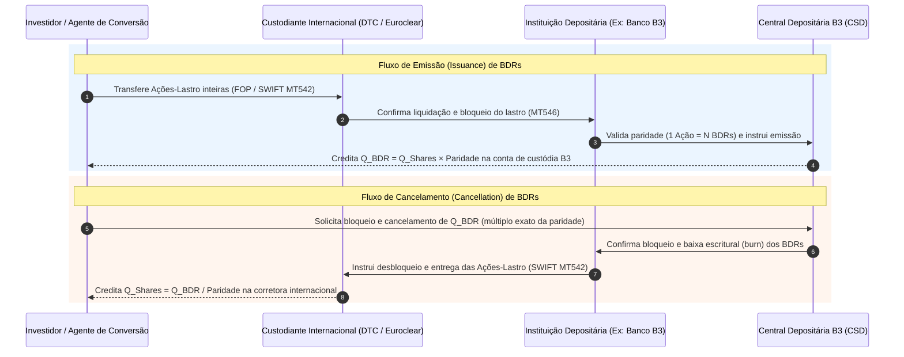
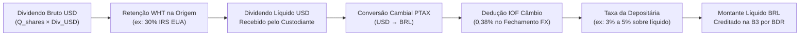

# Especificação Técnica — Emissão, Cancelamento e Eventos Corporativos de BDRs na B3 (FL-034)

## 1. Visão Geral e Arcabouço Regulatório

Os **BDRs (*Brazilian Depositary Receipts*)** são certificados de depósito de valores mobiliários emitidos no Brasil por uma **Instituição Depositária** (ex: Banco B3 S.A., Itaú Coribanco, Bradesco, Citibank DTVM), que representam ações ou títulos de dívida emitidos por companhias abertas ou assemelhadas com sede no exterior, nos termos da **Resolução CVM nº 182/2023** (que sucedeu a Instrução CVM nº 332/2000) e do **Manual de Procedimentos Operacionais da Central Depositária da B3**.

O ciclo de vida operacional de um programa de BDR envolve duas infraestruturas de mercado sincronizadas:
1. **Custódia Internacional (*Overseas Custodian*)**: Instituição custodiante no país de origem do ativo-lastro (ex: *Depository Trust Company* — **DTC / DTCC** nos Estados Unidos, ou **Euroclear / Clearstream** na Europa), onde as ações-lastro (*underlying shares*) ficam depositadas e bloqueadas (*locked*) em conta titulada pela Instituição Depositária brasileira.
2. **Central Depositária da B3 (CSD)**: Onde os certificados BDR são emitidos escrituralmente (*minted*), negociados no ambiente PUMA Trading System, alocados via RTC, emprestados via BTC e mantidos nas contas de custódia dos investidores finais, bem como extintos (*burned*) quando há solicitação de cancelamento para retirada das ações no exterior.

---

## 2. Classificação Regulatória dos Programas de BDR (Resolução CVM 182)

| Nível Regulatório (`BdrSponsorLevel`) | Patrocínio | Sufixo B3 | Registro CVM do Emissor | Mercados Autorizados e Características |
|---|---|---|---|---|
| `SPONSORED_LEVEL_1` | Patrocinado Nível I | `31` | Dispensado | Instituído pela companhia estrangeira; negociação restrita a mercados de balcão não organizados ou segmentos específicos para investidores qualificados. |
| `SPONSORED_LEVEL_2` | Patrocinado Nível II | `32` | Obrigatório (Cat. A ou B) | Listagem e negociação em bolsa (B3), sem realização de oferta pública de distribuição com esforços amplos no Brasil. |
| `SPONSORED_LEVEL_3` | Patrocinado Nível III | `33` | Obrigatório (Cat. A) | Listagem plena em bolsa (B3) com permissão para ofertas públicas de distribuição primária ou secundária no Brasil (CVM 160). |
| `UNSPONSORED_LEVEL_1` | Não Patrocinado Nível I | `34` / `35` | Dispensado (Divulgação na origem) | Instituído por uma ou mais instituições depositárias sem acordo com o emissor estrangeiro; responde pela maioria absoluta do volume de BDRs de ações globais (`AAPL34`, `MSFT34`, `NVDC34`). |

---

## 3. Regras de Paridade e Conservação Estrita de Lastro

### 3.1 Paridade Lastro Internacional vs. BDR Local
Cada programa de BDR define uma razão de paridade determinística entre a ação-lastro custodiada no exterior ($Q_{\text{shares}}$) e a quantidade de certificados BDR emitidos na B3 ($Q_{\text{bdr}}$):

$$\text{Paridade}: \quad P_{\text{shares}} \text{ Ação(ões)-Lastro} \iff P_{\text{bdr}} \text{ BDR(s)}$$

Na prática operacional dos programas negociados na B3, $P_{\text{shares}} = 1$ e $P_{\text{bdr}} = R \in \mathbb{Z}^+$ (ex: `AAPL34` com $1\text{ Ação AAPL} = 20\text{ BDRs}$; `MSFT34` com $1\text{ Ação MSFT} = 24\text{ BDRs}$; `NVDC34` com $1\text{ Ação NVDA} = 10\text{ BDRs}$).

### 3.2 Regras de Múltiplos Exatos e Proibição de Fração de Ação no Exterior
As centrais depositárias estrangeiras (**DTC** nos EUA e **Euroclear** na Europa) **não liquidam transferências de custódia interinstitucionais (FOP / DVP via SWIFT MT540/MT542) com frações de ações** (*fractional shares*). Portanto:

1. **Regra de Emissão (`ISSUANCE`)**:
   - A quantidade de ações-lastro depositadas no exterior ($Q_{\text{shares}}$) deve ser um **número inteiro estritamente positivo** ($Q_{\text{shares}} \in \mathbb{Z}^+$) e múltiplo de $P_{\text{shares}}$.
   - A quantidade de BDRs emitidos na B3 é dada por:
     $$Q_{\text{bdr}} = \left(\frac{Q_{\text{shares}}}{P_{\text{shares}}}\right) \times P_{\text{bdr}}$$

2. **Regra de Cancelamento (`CANCELLATION`)**:
   - A quantidade de BDRs apresentada para cancelamento ($Q_{\text{bdr}}$) deve ser um **número inteiro estritamente positivo** e **múltiplo exato de $P_{\text{bdr}}$**:
     $$Q_{\text{bdr}} \pmod{P_{\text{bdr}}} = 0$$
   - Caso $Q_{\text{bdr}}$ não seja múltiplo exato da paridade (ex: tentativa de cancelar `250` BDRs de `AAPL34` cuja paridade é `1:20`, o que equivaleria a `12,5` ações `AAPL`), a solicitação é **rejeitada deterministicamente** (`ParityMultipleError`). O investidor deve comprar ou vender a sobra fracionária de `10` BDRs no mercado secundário da B3 antes de instruir o cancelamento de `240` ou `260` BDRs.

3. **Invariante de Conservação Estrita de Lastro (*Strict Backing Conservation*)**:
   - Em qualquer ponto do tempo $t$, o saldo total de BDRs em circulação na Central Depositária B3 ($S_{\text{bdr}}(t)$) e o saldo de ações-lastro bloqueadas no custodiante internacional ($S_{\text{shares}}(t)$) obedecem exatamente à identidade:
     $$S_{\text{bdr}}(t) \times P_{\text{shares}} = S_{\text{shares}}(t) \times P_{\text{bdr}}$$
   - Nenhum cancelamento pode reduzir $S_{\text{bdr}}(t)$ ou $S_{\text{shares}}(t)$ abaixo de zero (`InsufficientBdrBalanceError`).

---

## 4. Repasse de Dividendos Internacionais (*Cross-Border Cash Dividends*)

Quando a companhia emissora estrangeira anuncia a distribuição de dividendos ou *cash distributions* na moeda de origem (tipicamente **USD**), a Instituição Depositária recebe os recursos no exterior já líquidos do imposto retido na fonte estrangeira, fecha o câmbio para **BRL** com base na cotação de mercado/PTAX, recolhe o IOF Câmbio cabível, deduz sua tarifa contratual de serviço e repassa o valor líquido aos detentores dos BDRs na B3.

### 4.1 Modelo Matemático de Cálculo Determinístico

Seja um programa de BDR com razão $P_{\text{shares}} : P_{\text{bdr}}$, com saldo elegível na *Record Date* de $Q_{\text{shares}}$ ações-lastro bloqueadas no exterior e $Q_{\text{bdr}}$ BDRs em circulação na B3:

1. **Montante Bruto em Moeda Estrangeira ($\text{USD}$)**:
   $$V_{\text{gross, USD}} = \text{round}\left(Q_{\text{shares}} \times D_{\text{share, USD}},\ 2\right)$$
   Onde $D_{\text{share, USD}}$ é o dividendo bruto declarado por ação-lastro no país de origem.

2. **Imposto Retido na Fonte no País de Origem (*Withholding Tax* — WHT)**:
   Nos Estados Unidos (NYSE/Nasdaq), a alíquota padrão do IRS para investidores não residentes (*Non-Resident Alien* — NRA) é de $r_{\text{wht}} = 30\%$:
   $$T_{\text{wht, USD}} = \text{round}\left(V_{\text{gross, USD}} \times r_{\text{wht}},\ 2\right)$$
   $$V_{\text{net, USD}} = V_{\text{gross, USD}} - T_{\text{wht, USD}}$$

3. **Conversão Cambial para Reais ($\text{USD} \rightarrow \text{BRL}$ via PTAX)**:
   Aplicando a taxa de câmbio contratada/PTAX de referência ($FX_{\text{ptax}}$, com 4 casas decimais):
   $$V_{\text{converted, BRL}} = \text{round}\left(V_{\text{net, USD}} \times FX_{\text{ptax}},\ 2\right)$$

4. **Imposto sobre Operações Financeiras — IOF Câmbio ($r_{\text{iof}} = 0,38\%$ / $0.0038$)**:
   $$T_{\text{iof, BRL}} = \text{round}\left(V_{\text{converted, BRL}} \times r_{\text{iof}},\ 2\right)$$
   $$V_{\text{after\_iof, BRL}} = V_{\text{converted, BRL}} - T_{\text{iof, BRL}}$$

5. **Taxa da Instituição Depositária ($r_{\text{fee}}$, tipicamente entre $3\%$ e $5\%$)**:
   Calculada sobre o montante nacionalizado líquido de IOF:
   $$F_{\text{dep, BRL}} = \text{round}\left(V_{\text{after\_iof, BRL}} \times r_{\text{fee}},\ 2\right)$$
   $$V_{\text{net\_total, BRL}} = V_{\text{after\_iof, BRL}} - F_{\text{dep, BRL}}$$

6. **Dividendo Líquido Unitário por BDR ($\text{BRL}$)**:
   $$D_{\text{net\_per\_bdr, BRL}} = \text{round}\left(\frac{V_{\text{net\_total, BRL}}}{Q_{\text{bdr}}},\ 6\right)$$

### 4.2 Exemplo Numérico Completo (`AAPL34`)
- **Programa**: `AAPL34` (Apple Inc., `UNSPONSORED_LEVEL_1`, ISIN BDR `BRAAPLBDR004`, ISIN Lastro `US0378331005`)
- **Paridade**: $1\text{ Ação AAPL} = 20\text{ BDRs}$
- **Posição Elegível na Data-Com**: $5.000\text{ Ações AAPL}$ bloqueadas no DTC $\iff 100.000\text{ BDRs AAPL34}$ na Depositária B3
- **Dividendo Declarado**: $\text{US\$ } 0,25$ por ação AAPL
- **Alíquotas e Câmbio**: $r_{\text{wht}} = 30\%$, $FX_{\text{ptax}} = 5,8000\text{ BRL/USD}$, $r_{\text{iof}} = 0,38\%$, $r_{\text{fee}} = 3,00\%$

| Etapa | Fórmula | Valor Apurado |
|---|---|---|
| 1. Dividendo Bruto (USD) | $5.000 \times 0,25$ | $\text{US\$ } 1.250,00$ |
| 2. Withholding Tax EUA (30% USD) | $1.250,00 \times 0,30$ | $\text{US\$ } 375,00$ |
| 3. Dividendo Líquido no Exterior (USD) | $1.250,00 - 375,00$ | $\text{US\$ } 875,00$ |
| 4. Valor Convertido PTAX (BRL) | $875,00 \times 5,8000$ | $\text{R\$ } 5.075,00$ |
| 5. IOF Câmbio (0,38% BRL) | $\text{round}(5.075,00 \times 0,0038,\ 2)$ | $\text{R\$ } 19,29$ |
| 6. Base Pós-IOF (BRL) | $5.075,00 - 19,29$ | $\text{R\$ } 5.055,71$ |
| 7. Taxa da Depositária (3,00% BRL) | $\text{round}(5.055,71 \times 0,03,\ 2)$ | $\text{R\$ } 151,67$ |
| 8. Montante Líquido Total Distribuível (BRL) | $5.055,71 - 151,67$ | $\text{R\$ } 4.904,04$ |
| 9. Valor Líquido Unitário por BDR (BRL) | $4.904,04 / 100.000$ | $\text{R\$ } 0,049040\text{ / BDR}$ |

---

## 5. Especificação do Payload JSON (`fixtures/bdr_conversion_requests.json`)

O arquivo de lote contém:
- `programs`: Cadastro dos programas de BDR autorizados na B3, com tickers, ISINs, custodiante internacional, nível de patrocínio, razão de paridade e saldos iniciais de lastro e BDRs.
- `conversion_requests`: Instruções formais de `ISSUANCE` (emissão) e `CANCELLATION` (cancelamento) submetidas pelos Agentes de Conversão.
- `dividend_distributions`: Eventos corporativos de pagamento de dividendos em moeda estrangeira para cálculo do repasse líquido em BRL.

### 5.1 Regras de Validação e Códigos de Rejeição
1. **`ParityMultipleError`**: Lançada quando a quantidade de BDRs em um cancelamento (ou emissão informada por BDRs) não é divisível exatamente pelo fator `bdr_per_share` do programa, ou quando a quantidade de ações-lastro não é inteira.
2. **`InsufficientBdrBalanceError`**: Lançada quando um cancelamento solicita a extinção de mais BDRs do que o saldo em circulação no programa ou quando o lastro bloqueado no custodiante internacional é insuficiente.
3. **`BackingConservationError`**: Lançada quando há divergência entre o saldo de ações-lastro bloqueadas no exterior e o saldo de BDRs emitidos na Depositária B3 ($\text{Ações} \times \text{Paridade} \neq \text{BDRs}$).
4. **`BdrValidationError`**: Lançada quando parâmetros obrigatórios (ISIN, taxas, PTAX, quantidades negativas/zero, datas ou programa inexistente) violam as regras de domínio.
