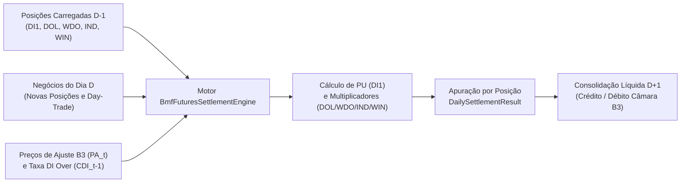

# Derivativos Listados BM&F — Ajuste Diário de Contratos Futuros (DI1, DOL, WDO, IND e WIN) (FL-032)

## 1. Visão Geral e Contexto Operacional na Câmara B3

No segmento de **Derivativos Listados (BM&F)** da B3, os contratos futuros contam com o mecanismo diário de mitigação de risco de crédito denominado **Ajuste Diário** (*Variation Margin*). Diferentemente do mercado a termo, em que o resultado financeiro é liquidado integralmente apenas no vencimento, nos contratos futuros todas as posições abertas (carregadas de $D-1$ ou abertas no próprio pregão $D$) e as operações encerradas no mesmo dia (*day-trade*) têm seus ganhos e perdas apurados diariamente contra o **Preço de Ajuste do Dia ($PA_t$ ou $PU_t$)** divulgado pela B3 após o encerramento da janela de *settlement* (*call de fechamento*).

A liquidação financeira resultante da soma algébrica dos ajustes diários de cada comitente ocorre em **$D+1$ (primeiro dia útil subsequente ao pregão $D$)**, compondo o saldo líquido multilateral do Membro de Compensação junto à Câmara B3 (integrado ao arquivo `IMBARQ004` de lançamentos financeiros e liquidado via `LDL0001` no SPB/STR).

Este documento especifica a modelagem matemática, regras de sentido de posição, convenções de arredondamento e arquitetura de cálculo determinístico para a frente **`FL-032`**, cobrindo as cinco principais famílias de futuros listados na B3:
- **`DI1`**: Futuro de Taxa Média de Depósitos Interfinanceiros de Um Dia.
- **`DOL`**: Futuro de Taxa de Câmbio de Reais por Dólar Comercial (Contrato Cheio).
- **`WDO`**: Futuro Míni de Taxa de Câmbio de Reais por Dólar Comercial (Minicontrato).
- **`IND`**: Futuro de Índice Bovespa (Contrato Cheio).
- **`WIN`**: Futuro Míni de Índice Bovespa (Minicontrato).

---

## 2. Especificações Contratuais por Família de Futuro

| Família | Ativo-Objeto | Cotação de Pregão | Tamanho do Contrato | Multiplicador Financeiro ($M$) por Ponto de PU/Preço | Sentido Financeiro (PU vs. Cotação) | Liquidação do Ajuste |
|---|---|---|---|---|---|---|
| **`DI1`** | Taxa DI de 1 dia (% a.a. base 252 DU) | Taxa efetiva anual (% a.a., até 3 casas decimais) e convertido em PU (pontos, 2 casas) | PU de 100.000 pontos no vencimento (R$ 1,00 por ponto) | $\text{R\$ } 1,00 / \text{ponto de PU}$ | **Invertido**: Comprado em Taxa = Vendido em PU | $D+1$ útil |
| **`DOL`** | Taxa de Câmbio R$/US$ (PTAX) | R$ por US$ 1.000,00 (até 2 ou 3 casas decimais) | US$ 50.000,00 (lote padrão de 5 contratos) | $\text{R\$ } 50,00 / \text{ponto de cotação por contrato}$ ($\frac{50.000}{1.000}$) | **Direto**: Comprado em Cotação = Comprado em Preço | $D+1$ útil |
| **`WDO`** | Taxa de Câmbio R$/US$ (PTAX) | R$ por US$ 1.000,00 | US$ 10.000,00 (20% do contrato padrão DOL) | $\text{R\$ } 10,00 / \text{ponto de cotação por contrato}$ ($\frac{10.000}{1.000}$) | **Direto**: Comprado em Cotação = Comprado em Preço | $D+1$ útil |
| **`IND`** | Índice Bovespa (Ibovespa) | Pontos de índice | Pontos do Ibovespa $\times \text{R\$ } 1,00$ | $\text{R\$ } 1,00 / \text{ponto de índice por contrato}$ | **Direto**: Comprado em Índice = Comprado em Preço | $D+1$ útil |
| **`WIN`** | Índice Bovespa (Ibovespa) | Pontos de índice | Pontos do Ibovespa $\times \text{R\$ } 0,20$ (20% do IND) | $\text{R\$ } 0,20 / \text{ponto de índice por contrato}$ | **Direto**: Comprado em Índice = Comprado em Preço | $D+1$ útil |

### 2.1. Convenção de Códigos de Vencimento B3 (Tickers)

Todo contrato futuro listado na B3 segue a estrutura `<FAMÍLIA><MÊS><ANO>` (ex.: `DI1F27`, `DOLZ26`, `WDOZ26`, `INDZ26`, `WINZ26`):
- **Prefixo (3 letras)**: Família do contrato (`DI1`, `DOL`, `WDO`, `IND`, `WIN`).
- **Letra de Mês (1 letra, padrão internacional CME/B3)**:
  - `F`: Janeiro | `G`: Fevereiro | `H`: Março | `J`: Abril | `K`: Maio | `M`: Junho
  - `N`: Julho | `Q`: Agosto | `U`: Setembro | `V`: Outubro | `X`: Novembro | `Z`: Dezembro
- **Sufixo de Ano (2 dígitos)**: Ano de vencimento (ex.: `26` para 2026, `27` para 2027).

---

## 3. Especificação Matemática do Cálculo de PU e Ajuste Diário

### 3.1. Futuro de DI de 1 Dia (`DI1`)

#### 3.1.1. Conversão de Taxa (% a.a.) em Preço Unitário ($PU$)

No contrato futuro de DI (`DI1`), os negócios são apregoados em **taxa de juro efetiva anual (% a.a.)**, base 252 dias úteis, mas o registro na câmara e o cálculo do ajuste diário são realizados em **Preço Unitário ($PU$)**, cujo valor nominal de resgate na data de vencimento é fixado em **100.000,00 pontos** (equivalente a R$ 100.000,00 por contrato).

Dado o número de dias úteis remanescentes ($DU$, contados inclusive a data de referência $t$ até o dia útil anterior ao vencimento) e a taxa anual $i$ (em percentual ao ano), o $PU$ é obtido pela equação:

$$PU(i, DU) = \text{round}_{2}\left( \frac{100.000}{\left(1 + \frac{i}{100}\right)^{\frac{DU}{252}}} \right)$$

> [!IMPORTANT]
> **Inversão de Sentido Operacional no `DI1`**:
> Como a taxa de juros $i$ está no denominador da equação do $PU$:
> - Quando a **taxa sobe** ($i_t > i_{t-1}$), o **$PU$ cai** ($PU_t < PU_{t-1}$).
> - O participante **Comprado em Taxa (`LONG_RATE` / `BUY`)** ganha com a alta de juros (queda de PU), portanto está **Vendido em PU (`SHORT_PU`)**.
> - O participante **Vendido em Taxa (`SHORT_RATE` / `SELL`)** ganha com a queda de juros (alta de PU), portanto está **Comprado em PU (`LONG_PU`)**.

#### 3.1.2. Atualização do PU de Ajuste Anterior ($PU_{t-1}^{corrigido}$)

Para posições carregadas do pregão anterior ($D-1$ para $D$), o Preço de Ajuste do dia anterior ($PA_{t-1}$) é capitalizado por 1 dia útil pela **Taxa DI de 1 dia ($CDI_{t-1}$)** apurada no dia anterior:

$$FC_t = \left(1 + \frac{CDI_{t-1}}{100}\right)^{\frac{1}{252}}$$

$$PA_{t-1}^{*} = \text{round}_{2}\left( PA_{t-1} \times FC_t \right)$$

*(Caso o preço de referência anterior já seja informado corrigido para a data $D$ ou $CDI_{t-1} = 0$, adota-se $PA_{t-1}^{*} = PA_{t-1}$).*

#### 3.1.3. Fórmulas de Ajuste Diário do `DI1`

Definindo o sinal em relação ao PU ($\sigma_{PU}$):
- Se **Comprado em Taxa (`BUY` / Vendido em PU)**: $\sigma_{PU} = -1$ (ou equivalentemente calcula-se $PA_t - PA_{t-1}^{*}$ com sinal negativo, isto é, $PA_{t-1}^{*} - PA_t$).
- Se **Vendido em Taxa (`SELL` / Comprado em PU)**: $\sigma_{PU} = +1$ (calcula-se $PA_t - PA_{t-1}^{*}$).

1. **Posição Carregada de $D-1$ (`CARRIED` / `OVERNIGHT`)**:
   $$\text{AD}_{\text{DI1, carregada}} = \sigma_{PU} \times \left( PA_t - PA_{t-1}^{*} \right) \times Q \times 1,00$$
   Explicitando por ponta em taxa:
   - **Comprado em Taxa (`BUY`)**: $\text{AD} = \left( PA_t - PA_{t-1}^{*} \right) \times (-1) \times Q = \left( PA_{t-1}^{*} - PA_t \right) \times Q$
   - **Vendido em Taxa (`SELL`)**: $\text{AD} = \left( PA_t - PA_{t-1}^{*} \right) \times Q$

2. **Posição Aberta no Dia $D$ e Mantida para $D+1$ (`NEW_POSITION`)**:
   Sendo $PU_{\text{op}}$ o PU calculado a partir da taxa da operação $i_{\text{op}}$ com o $DU$ do dia $D$:
   - **Comprado em Taxa (`BUY`)**: $\text{AD} = \left( PU_{\text{op}} - PA_t \right) \times Q$
   - **Vendido em Taxa (`SELL`)**: $\text{AD} = \left( PA_t - PU_{\text{op}} \right) \times Q$

3. **Operação de Day-Trade no Dia $D$ (`DAY_TRADE`)**:
   Sendo $PU_{\text{compra\_taxa}}$ o PU correspondente à taxa da operação de compra em taxa (venda de PU) e $PU_{\text{venda\_taxa}}$ o PU correspondente à taxa da operação de venda em taxa (compra de PU) no mesmo dia $D$:
   $$\text{AD}_{\text{DI1, day-trade}} = \left( PU_{\text{compra\_taxa}} - PU_{\text{venda\_taxa}} \right) \times Q \times 1,00$$
   *(Nota: se o participante comprou a uma taxa menor, pagou um $PU_{\text{compra\_taxa}}$ maior, e vendeu a uma taxa maior, recebeu um $PU_{\text{venda\_taxa}}$ menor, tendo ajuste positivo de $(PU_{\text{compra\_taxa}} - PU_{\text{venda\_taxa}}) \times Q$).*

---

### 3.2. Futuro de Dólar Comercial (`DOL` e `WDO`)

Os contratos futuros de Dólar Comercial são cotados em **Reais por US$ 1.000,00** (ex.: `5850.50` R$/US$ 1.000, equivalente a R$ 5,8505 por dólar).
- **`DOL` (Contrato Cheio)**: Valor nominal de **US$ 50.000,00** por contrato. Como a cotação é expressa por lote de US$ 1.000,00, cada 1,00 ponto na cotação representa:
  $$M_{\text{DOL}} = \frac{\text{US\$ } 50.000,00}{\text{US\$ } 1.000,00} = \text{R\$ } 50,00 \text{ por contrato}$$
- **`WDO` (Minicontrato)**: Valor nominal de **US$ 10.000,00** por contrato. Cada 1,00 ponto na cotação representa:
  $$M_{\text{WDO}} = \frac{\text{US\$ } 10.000,00}{\text{US\$ } 1.000,00} = \text{R\$ } 10,00 \text{ por contrato}$$

#### Fórmulas de Ajuste Diário (`DOL` e `WDO`)

Definindo o sinal direcional $\sigma \in \{+1 \text{ para Comprado/BUY}, -1 \text{ para Vendido/SELL}\}$ e $M \in \{50, 10\}$:

1. **Posição Carregada de $D-1$ (`CARRIED`)**:
   $$\text{AD} = \sigma \times \left( PA_t - PA_{t-1} \right) \times M \times Q$$
2. **Posição Aberta no Dia $D$ (`NEW_POSITION`)**:
   $$\text{AD} = \sigma \times \left( PA_t - P_{\text{op}} \right) \times M \times Q$$
3. **Day-Trade no Dia $D$ (`DAY_TRADE`)**:
   $$\text{AD}_{\text{DT}} = \left( P_{\text{venda}} - P_{\text{compra}} \right) \times M \times Q$$

---

### 3.3. Futuro de Índice Bovespa (`IND` e `WIN`)

Os contratos futuros de Ibovespa são cotados diretamente em **pontos de índice** (ex.: `130500` pontos).
- **`IND` (Contrato Cheio)**: Cada ponto de índice vale **$M_{\text{IND}} = \text{R\$ } 1,00$** por contrato.
- **`WIN` (Minicontrato)**: Cada ponto de índice vale **$M_{\text{WIN}} = \text{R\$ } 0,20$** por contrato.

#### Fórmulas de Ajuste Diário (`IND` e `WIN`)

Definindo $\sigma \in \{+1 \text{ para Comprado/BUY}, -1 \text{ para Vendido/SELL}\}$ e $M \in \{1,00;\; 0,20\}$:

1. **Posição Carregada de $D-1$ (`CARRIED`)**:
   $$\text{AD} = \sigma \times \left( PA_t - PA_{t-1} \right) \times M \times Q$$
2. **Posição Aberta no Dia $D$ (`NEW_POSITION`)**:
   $$\text{AD} = \sigma \times \left( PA_t - P_{\text{op}} \right) \times M \times Q$$
3. **Day-Trade no Dia $D$ (`DAY_TRADE`)**:
   $$\text{AD}_{\text{DT}} = \left( P_{\text{venda}} - P_{\text{compra}} \right) \times M \times Q$$

---

## 4. Fluxo de Apuração e Liquidação Financeira em $D+1$

### Regras de Arredondamento e Precisão Determinística
1. **Aritmética Decimal Estrita**: Todos os cálculos financeiros utilizam `decimal.Decimal` com arredondamento comercial padrão B3 (`ROUND_HALF_UP`).
2. **Arredondamento do PU (`DI1`)**: O Preço Unitário resultante da equação exponencial de desconto por $DU/252$ é arredondado para **2 casas decimais (`0.01`)** como padrão oficial de ajuste, suportando também modo de alta precisão (6 casas decimais) para batimentos analíticos de risco.
3. **Valor Financeiro do Ajuste (`settlement_amount_brl`)**: Expresso em Reais (`BRL`) com **2 casas decimais (`0.01`)**, onde valores positivos (`> 0`) representam **crédito a receber em $D+1$** e valores negativos (`< 0`) representam **débito a pagar em $D+1$**.
4. **Data de Liquidação Financeira (`settlement_date`)**: Calculada como o próximo dia útil ($D+1$) após a data do pregão de referência (`trade_date`).
