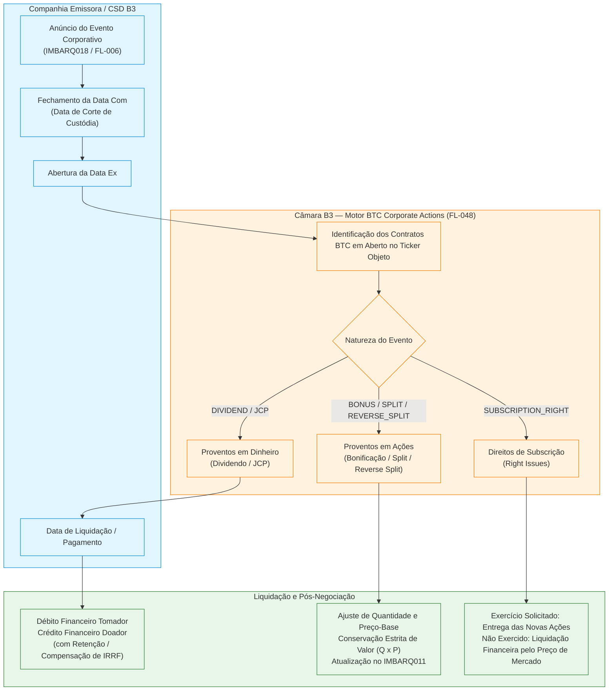
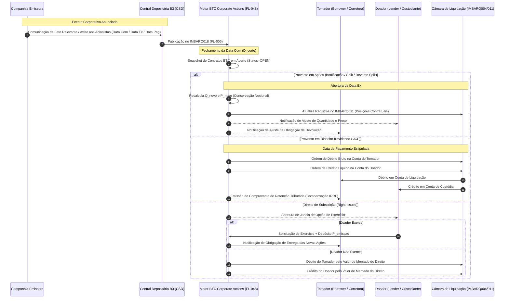

# Especificação Técnica — Tratamento de Eventos Corporativos e Repasse de Proventos em Contratos de Empréstimo de Ativos (BTC em Aberto) — B3 (FL-048)

## 1. Visão Geral e Princípios Regulatórios

No ambiente de liquidação e custódia da B3, o **Banco de Títulos CBLC (BTC)** opera como a contraparte central multilateral (CCP) garantidora dos contratos de empréstimo de ativos (ações ordinárias e preferenciais, cotas de ETF, BDRs e *Units*). Durante a vigência de um contrato de empréstimo de ativos, a titularidade jurídica imediata das ações é transferida ao Tomador (*Borrower*), permitindo que este as venda a descoberto (*short selling*) ou as transfira para liquidação física de negócios no mercado à vista ou de derivativos.

Entretanto, de acordo com o **Manual de Procedimentos Operacionais da Câmara B3 (Capítulo de Empréstimo de Ativos)** e a **Instrução Normativa RFB nº 1.585/2015 (Art. 13)**, o Doador (*Lender*) preserva **integralmente todos os direitos econômicos e patrimoniais** decorrentes da titularidade original dos valores mobiliários cedidos. 

Assim, quando uma companhia emissora delibera a distribuição de proventos ou alterações em seu capital social (eventos corporativos deliberados em Assembleia Geral ou Reunião do Conselho de Administração), a Câmara B3 realiza o **tratamento determinístico e compulsório de todos os contratos de BTC em aberto** que estavam vigentes no fechamento da **Data de Corte / Data Com** (*Record Date*).

---

## 2. Tipologia de Eventos Corporativos e Regras de Negócio da Câmara B3

A Câmara B3 classifica os eventos corporativos incidentes sobre posições de BTC em três grandes categorias operacionais:

1. **Proventos em Dinheiro (*Cash Events*)**: Dividendos e Juros sobre o Capital Próprio (JCP).
2. **Proventos em Ações (*Stock Events*)**: Bonificação em Ações (*Stock Bonus*), Desdobramento (*Forward Stock Split*) e Grupamento (*Reverse Stock Split*).
3. **Direitos de Subscrição (*Right Issues*)**: Subscrição de novas ações ordinárias ou preferenciais decorrentes de aumento de capital deliberado.

| Código B3 | Denominação Canônica | Classificação | Impacto no Contrato BTC | Liquidação Financeira |
|---|---|---|---|---|
| `DIVID` | Dividendo em Dinheiro | Provento em Dinheiro | Nenhum na quantidade/preço do contrato | Débito bruto no Tomador / Crédito integral no Doador na Data de Pagamento. Isento de IRRF. |
| `JCP` | Juros sobre Capital Próprio | Provento em Dinheiro | Nenhum na quantidade/preço do contrato | Débito bruto no Tomador / Crédito líquido no Doador na Data de Pagamento. Retenção de 15% de IRRF com direito a compensação tributária. |
| `BONIF` | Bonificação em Ações | Provento em Ações | Aumento compulsório da quantidade e redução proporcional do preço-base | Sem fluxo financeiro imediato. Conservação do nocional original: $Q_{\text{novo}} \times P_{\text{novo}} = Q_{\text{ant}} \times P_{\text{ant}}$. |
| `DESD` | Desdobramento (Split) | Provento em Ações | Multiplicação da quantidade e divisão do preço-base | Sem fluxo financeiro. Conservação exata de valor: $Q_{\text{novo}} \times P_{\text{novo}} = Q_{\text{ant}} \times P_{\text{ant}}$. |
| `AGRUP` | Grupamento (Reverse Split) | Provento em Ações | Redução da quantidade e multiplicação do preço-base | Sem fluxo financeiro para lotes inteiros. Liquidação financeira compulsória de frações residuais a preço de leilão B3. |
| `SUBSC` | Direito de Subscrição | Direitos e Obrigações | Opcional (solicitação de exercício) ou liquidação financeira de mercado | Exercício: Doador aporta preço de emissão e recebe ações. Não exercício: Tomador indeniza Doador pelo valor de mercado do direito. |

---

## 3. Proventos em Dinheiro: Mecânica Operacional e Compensação Tributária

### 3.1 Dividendo em Dinheiro (`DIVIDEND` / `DIVID`)
- **Regra de Direitos**: O Doador faz jus ao recebimento integral de **100% do valor do dividendo por ação** multiplicado pela quantidade total de ações cedidas no contrato em aberto na Data Com.
- **Tributação**: Conforme o Art. 10 da Lei Federal nº 9.249/1995, os dividendos declarados por companhias brasileiras são **isentos de Imposto de Renda Retido na Fonte (IRRF)** para pessoas físicas e jurídicas residentes no Brasil.
- **Mecânica de Liquidação**:
  $$\text{Valor Bruto} = Q_{\text{contrato}} \times V_{\text{provento}}$$
  $$\text{Alíquota IRRF} = 0,00\% \implies \text{IRRF} = R\$\;0,00$$
  $$\text{Débito do Tomador} = \text{Valor Bruto}$$
  $$\text{Crédito do Doador} = \text{Valor Bruto}$$
  O débito e o crédito ocorrem na **Data de Pagamento** definida pela Companhia Emissora, operacionalizada via liquidação financeira multilateral no subsistema de compensação da Câmara B3.

### 3.2 Juros sobre Capital Próprio (`JCP`) e Compensação de Crédito Tributário
- **Base Legal e Fiscal**: Art. 9º, § 7º da Lei nº 9.249/1995 e Art. 13 da Instrução Normativa RFB nº 1.585/2015.
- **Incidência de IRRF**: O JCP está sujeito à alíquota de **15% (quinze por cento)** de Imposto de Renda Retido na Fonte no momento de sua disponibilização pela companhia emissora (salvo beneficiários imunes/isentos expressamente qualificados).
- **Tratamento no Empréstimo BTC**:
  1. O Tomador recebe o débito financeiro pelo **valor bruto** do JCP:
     $$\text{Débito do Tomador} = Q_{\text{contrato}} \times V_{\text{JCP\_bruto}}$$
  2. O valor retido a título de IRRF é calculado pela Câmara B3:
     $$\text{IRRF Retido} = \text{round}(\text{Débito do Tomador} \times 15\%, 2)$$
  3. O Doador recebe o crédito pelo **valor líquido**:
     $$\text{Crédito Líquido do Doador} = \text{Débito do Tomador} - \text{IRRF Retido}$$
  4. **Compensação do Crédito Tributário (Receita Federal)**:
     - O Tomador obtém um **comprovante de crédito tributário compensável** (*Tax Withholding Voucher* / Informe de Rendimentos de Aluguel), comprovando o recolhimento do imposto na fonte decorrente do repasse de JCP em operação de empréstimo.
     - Este montante pode ser deduzido pelo Tomador na apuração de seu IRPJ/CSLL (ou compensado como antecipação de imposto devido sobre ganho de capital/operações financeiras).
     - Caso o Doador pertença a categoria tributária imune ou isenta (e.g., Fundos de Investimento regidos pela IN RFB 1.585/2015 ou Entidades Fechadas de Previdência Complementar), a Câmara credita o valor integral sem retenção, mediante cadastro societário prévio.

---

## 4. Proventos em Ações: Conservação Invariante de Valor Financeiro

Para proventos em ações deliberados pelas companhias emissoras, a Câmara B3 **não realiza movimentação financeira imediata**, mas sim um **ajuste matemático compulsório e simultâneo** nos contratos de empréstimo em aberto no encerramento da Data Com, passando a vigorar na abertura da **Data Ex**.

### 4.1 Princípio da Conservação Financeira
O valor financeiro de recompra do contrato de empréstimo é rigorosamente conservado:
$$V_{\text{contrato\_novo}} = Q_{\text{novo}} \times P_{\text{novo}} \equiv Q_{\text{antigo}} \times P_{\text{antigo}} = V_{\text{contrato\_antigo}}$$

### 4.2 Bonificação de Ações (`BONUS` / `BONIF`)
A companhia emissora incorpora reservas de lucros ou capital ao seu capital social, emitindo novas ações distribuídas gratuitamente aos acionistas na proporção estipulada pela Assembleia Geral (e.g., $10\% = 0,10$).

- **Fórmula de Quantidade**:
  $$Q_{\text{novo}} = \text{int}\left(Q_{\text{antigo}} \times (1 + \text{Fator}_{\text{bonif}})\right)$$
- **Fórmula de Preço-Base**:
  $$P_{\text{novo}} = \frac{P_{\text{antigo}}}{1 + \text{Fator}_{\text{bonif}}}$$
- **Exemplo**:
  - Contrato original: $1.000$ ações a $R\$\;33,00$ $\implies$ Nocional = $R\$\;33.000,00$.
  - Bonificação de $10\%$ ($\text{Fator} = 0,10$).
  - $Q_{\text{novo}} = 1.000 \times 1,10 = 1.100\text{ ações}$.
  - $P_{\text{novo}} = 33,00 / 1,10 = R\$\;30,00$.
  - Nocional ajustado: $1.100 \times 30,00 = R\$\;33.000,00$ (**Conservação Exata**).

### 4.3 Desdobramento de Ações / Split (`SPLIT` / `DESD`)
Aumento da quantidade de ações sem alteração do capital social (e.g., $1:3$, onde $1$ ação se desdobra em $3$ ações; $\text{Fator} = 3,0$).

- **Fórmula de Quantidade**:
  $$Q_{\text{novo}} = Q_{\text{antigo}} \times \text{Fator}_{\text{split}}$$
- **Fórmula de Preço-Base**:
  $$P_{\text{novo}} = \frac{P_{\text{antigo}}}{\text{Fator}_{\text{split}}}$$
- **Exemplo**:
  - Contrato original: $10.000$ ações a $R\$\;60,00$ $\implies$ Nocional = $R\$\;600.000,00$.
  - Desdobramento $1:3$ ($\text{Fator} = 3$).
  - $Q_{\text{novo}} = 10.000 \times 3 = 30.000\text{ ações}$.
  - $P_{\text{novo}} = 60,00 / 3 = R\$\;20,00$.
  - Nocional ajustado: $30.000 \times 20,00 = R\$\;600.000,00$ (**Conservação Exata**).

### 4.4 Grupamento de Ações / Reverse Split (`REVERSE_SPLIT` / `AGRUP`)
Redução da quantidade de ações em circulação visando elevar a cotação unitária (e.g., $10:1$, onde $10$ ações agrupam-se em $1$ ação; $\text{Razão} = 10$).

- **Fórmula de Quantidade Inteira**:
  $$Q_{\text{novo}} = \left\lfloor \frac{Q_{\text{antigo}}}{\text{Razão}_{\text{agrup}}} \right\rfloor$$
- **Fórmula de Preço-Base**:
  $$P_{\text{novo}} = P_{\text{antigo}} \times \text{Razão}_{\text{agrup}}$$
- **Tratamento de Frações Residuais de Ações**:
  Quando a quantidade original $Q_{\text{antigo}}$ não for múltiplo exato da razão de grupamento:
  $$\text{Ações Fracionárias} = Q_{\text{antigo}} \pmod{\text{Razão}_{\text{agrup}}}$$
  As frações são agrupadas no leilão de sobras da B3 e **liquidadas financeiramente em dinheiro**:
  $$\text{Compensação Financeira de Frações} = \text{Ações Fracionárias} \times P_{\text{antigo}}$$
  O Tomador é debitado financeiramente pelo valor da fração e o Doador creditado.

---

## 5. Direitos de Subscrição (`SUBSCRIPTION_RIGHT` / `SUBSC`)

Quando a companhia emissora aprova um aumento de capital com outorga de direitos de preferência para subscrição de novas ações (e.g., emissão de bônus ou ações a preço prefixado $P_{\text{emissao}}$ com proporção de subscrição $R_{\text{subs}}$):

1. **Geração dos Direitos de Subscrição**:
   - A quantidade de direitos atribuíveis ao Doador é calculada com base na posição do contrato em aberto na Data Com:
     $$\text{Direitos} = \lfloor Q_{\text{contrato}} \times R_{\text{subs}} \rfloor$$
2. **Janela de Exercício e Manifestação de Vontade**:
   - A B3 concede um prazo operacional (até a Data Limite de Exercício de Subscrição) para que o **Doador se manifeste expressamente** via sistema BTC se deseja ou não exercer os direitos.
3. **Cenário A: Doador Solicita o Exercício do Direito (`rights_exercised = True`)**:
   - O Doador transfere os recursos financeiros correspondentes ao preço de subscrição ($\text{Direitos} \times P_{\text{emissao}}$).
   - O Tomador é notificado pela Câmara B3 e fica **obrigado a subscrever as ações** junto à companhia e repassar as novas ações subscritas ao contrato de empréstimo (ou em nova custódia de devolução).
4. **Cenário B: Doador Não Manifesta Exercício ou Desiste (`rights_exercised = False`)**:
   - Na falta de solicitação de exercício, a B3 adota a **liquidação financeira compulsória do valor de mercado do direito de subscrição**.
   - O Tomador é debitado financeiramente pelo valor de cotação média do direito durante o período de negociação na B3:
     $$\text{Reembolso Financeiro} = \text{Direitos} \times P_{\text{mercado\_direito}}$$
   - O Doador recebe o crédito financeiro correspondente, garantindo a neutralidade patrimonial de sua posição original.

---

## 6. Fluxograma Temporal e Ciclo de Vida da Liquidação

---

## 7. Integração com Leiautes Oficiais da B3

O fluxo **FL-048** orquestra e referencia diretamente três demonstrativos oficiais da Câmara B3:
1. **`IMBARQ018` (FL-006)**: Fonte primária de anúncio dos eventos corporativos em data ex (código do evento, valor do provento, percentual, indicador de tributação e data com/ex/pagamento).
2. **`IMBARQ011` (FL-009 / FL-025)**: Atualização das posições contratuais de empréstimo (quantidade alugada, preço base e valor financeiro nocional recalculados após proventos em ações).
3. **`IMBARQ004` (FL-004)**: Extrato financeiro de liquidação multilateral para débitos e créditos decorrentes de proventos em dinheiro, liquidação de frações e direitos não exercidos.
