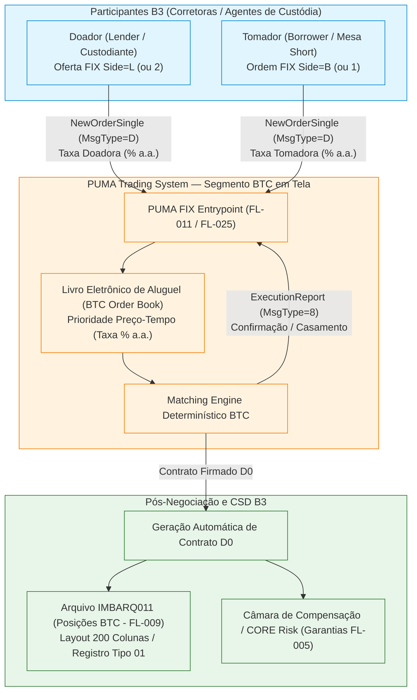

# Especificação Técnica do Empréstimo Eletrônico de Ativos (BTC em Tela) e Matching no PUMA Trading System — B3

## 1. Visão Geral e Contexto de Mercado (FL-025)

O **Banco de Títulos CBLC (BTC)** da B3 é o ambiente centralizado e multilateral de liquidação e custódia para operações de **empréstimo de ativos** (ações ordinárias e preferenciais, cotas de ETF, BDRs e units). Historicamente operado por meio de registros bilaterais direcionados (via agentes de custódia e balcão), a B3 expandiu e consolidou a modalidade de **Empréstimo Eletrônico de Ativos (BTC em Tela)** integrado ao **PUMA Trading System**.

No modelo de tela eletrônica (correspondente ao fluxo **FL-025** do Atlas de Integrações B3), investidores e mesas de operações podem submeter ofertas transparentes de doação (*Lender*) e ordens de tomada (*Borrower*) diretamente pelo protocolo **FIX (Financial Information eXchange)**. O motor de casamento (*Matching Engine*) do PUMA processa essas ordens de forma contínua, sob algoritmo estrito de **Preço-Tempo** (taxa pedida vs taxa ofertada), convertendo imediatamente os cruzamentos executados em **contratos de aluguel formalizados em D0**, consolidados no demonstrativo oficial **IMBARQ011**.

---

## 2. Modelo do Livro de Ofertas Eletrônico (BTC Order Book)

Diferente do mercado à vista de ações onde o preço é cotado em moeda corrente (R$), no livro de ofertas de BTC em tela o "preço" é expresso como a **Taxa de Remuneração Anual do Aluguel (% a.a.)**, convencionada com base no ano comercial de 252 dias úteis ou 360/365 dias corridos:

1. **Lado Doador (*Lender / Ask*)**:
   - Representa o proprietário dos ativos em custódia que disponibiliza seu lote para aluguel.
   - Especifica a **taxa mínima aceitável** (% a.a.).
   - Prioridade de melhor preço: **Menor taxa pedida** (*Lowest Rate*). Quanto menor a taxa exigida, mais atrativa é a oferta para o mercado tomador.

2. **Lado Tomador (*Borrower / Bid*)**:
   - Representa o investidor que necessita dos ativos (e.g., cobertura de venda a descoberto / *short selling*, estratégias de arbitragem ou liquidação física).
   - Especifica a **taxa máxima que aceita pagar** (% a.a.).
   - Prioridade de melhor preço: **Maior taxa oferecida** (*Highest Rate*). Quanto maior a taxa proposta, mais atrativa é a ordem para os doadores.

### 2.1 Critérios de Ordenação do Livro (Price-Time Priority)

Para cada ticker de ativo negociável (e.g., `PETR4`, `VALE3`, `B3SA3`), o livro mantém duas filas priorizadas:

| Lado da Ordem | Critério Primário | Critério Secundário | Racional Financeiro |
|---|---|---|---|
| **Doador (Lender / Ask)** | Taxa Ascendente (`rate ASC`) | Carimbo de Tempo (`timestamp FIFO`) | O doador mais competitivo (menor taxa exigida) encabeça o livro. Empates são decididos por quem chegou primeiro. |
| **Tomador (Borrower / Bid)** | Taxa Descendente (`rate DESC`) | Carimbo de Tempo (`timestamp FIFO`) | O tomador mais competitivo (maior taxa ofertada) encabeça o livro. Empates são decididos por quem chegou primeiro. |

---

## 3. Mensagens FIX Customizadas para Empréstimo de Ativos (PUMA FIX BTC)

A comunicação com o segmento eletrônico de BTC utiliza a infraestrutura FIX do PUMA Trading System com tags específicas de empréstimo de títulos (*Securities Lending Extension*).

### 3.1 Submissão de Ordem de Aluguel (`NewOrderSingle` — `MsgType=D`)

| Tag FIX | Nome do Campo | Tipo | Obrig | Descrição / Valores Aceitos |
|---|---|---|---|---|
| `8` | `BeginString` | String | S | Versão do protocolo FIX (`FIX.4.4` ou `FIXT.1.1`). |
| `9` | `BodyLength` | Int | S | Tamanho do corpo da mensagem. |
| `35` | `MsgType` | String | S | Tipo da mensagem: `D` (*NewOrderSingle*). |
| `11` | `ClOrdID` | String | S | Identificador único da ordem atribuído pelo participante. |
| `1` | `Account` | String/Int | S | Conta de custódia do investidor na B3. |
| `448` | `PartyID` | String/Int | S | Código de identificação da corretora / PN participante (e.g., `105`). |
| `55` | `Symbol` | String | S | Ticker do ativo objeto negociado (e.g., `PETR4`, `VALE3`). |
| `48` | `SecurityID` | String | S | Código ISIN internacional do ativo (e.g., `BRPETRACNPR6`). |
| `22` | `SecurityIDSource` | String | S | Fonte do identificador: `4` (ISIN). |
| `54` | `Side` | Char | S | Lado da operação: `1` = Tomador (*Borrower*), `2` = Doador (*Lender*). |
| `38` | `OrderQty` | Int | S | Quantidade total de ações a alugar (inteiro positivo). |
| `40` | `OrdType` | Char | S | Tipo de ordem: `2` = Limitada (respeita taxa estipulada). |
| `44` | `Price` | Price | S | Taxa anual do aluguel em % a.a. (e.g., `3.5000`). |
| `60` | `TransactTime` | UTCTimestamp | S | Carimbo de data/hora da emissão da ordem. |
| **`9001`** | **`LendingRate`** | Float/Decimal | S | Taxa expressa formalmente em percentual anual com 4 casas decimais. |
| **`9002`** | **`MinTermDays`** | Int | S | Prazo mínimo do contrato de aluguel em dias (e.g., `1`). |
| **`9003`** | **`MaxTermDays`** | Int | S | Prazo máximo do contrato de aluguel em dias (e.g., `30`). |
| **`9004`** | **`RenewalType`** | Char | S | Tipo de renovação: `1` = `AUTOMATIC` (Automática), `2` = `NON_AUTOMATIC` (Manual/Não Automática). |
| **`9005`** | **`Reversibility`** | Char | S | Reversibilidade: `T` (Tomador), `D` (Doador), `A` (Ambos), `N` (Não Reversível). |
| **`9006`** | **`BasePrice`** | Price | S | Preço de cotação à vista de referência em R$ para cálculo do nocional. |
| `10` | `CheckSum` | String | S | Checksum posicional FIX de 3 dígitos (módulo 256). |

### 3.2 Confirmação de Casamento (`ExecutionReport` — `MsgType=8`)

Quando uma ordem agressora cruza com uma ou mais ofertas passivas no livro de BTC, o PUMA emite mensagens `ExecutionReport` para ambas as contrapartes:
- `ExecType=1` (`PARTIAL_FILL`): Atendimento parcial do lote.
- `ExecType=2` (`FILL`): Atendimento integral da ordem.
- `LeavesQty` (Tag 151): Quantidade residual não executada que permanece ativa no livro.
- `CumQty` (Tag 14): Quantidade acumulada executada.
- `LastPx` (Tag 31): Taxa efetiva de casamento (% a.a.).
- `LastQty` (Tag 32): Lote executado no match instantâneo.
- `ContractID` (Tag 9007): Número definitivo do contrato BTC gerado na câmara.

---

## 4. Algoritmo de Correspondência (Matching Engine BTC)

O motor determinístico de matching do BTC opera sob os seguintes postulados:

### 4.1 Condição de Cruzamento de Taxas
Ocorre casamento se, e somente se, a taxa proposta pelo Tomador for maior ou igual à taxa exigida pelo Doador:
$$\text{Taxa}_{\text{Tomador}} \ge \text{Taxa}_{\text{Doador}}$$

Se $\text{Taxa}_{\text{Tomador}} < \text{Taxa}_{\text{Doador}}$, não há negócio; a ordem recém-chegada é inserida na fila correspondente do livro de ofertas.

### 4.2 Determinação da Taxa de Negócio (Regra da Ordem Passiva)
Em sistemas contínuos de negociação da B3 (leilão contínuo), prevalece o **Preço da Ordem Passiva** (*Resting Order Priority*):
- Se uma ordem agressora de tomada (*Borrower*) chega a mercado e consome uma oferta de doação pré-existente no livro, a taxa de fechamento do aluguel é a **taxa da ordem doadora passiva**.
- Se uma ordem agressora de doação (*Lender*) chega a mercado e cruza contra ordens tomadoras pré-existentes, a taxa de fechamento é a **taxa da ordem tomadora passiva**.

### 4.3 Divisão de Lotes e Matches Parciais
Se a quantidade demandada for diferente da quantidade ofertada no melhor nível de preço:
$$\text{Lote Executado} = \min(\text{LeavesQty}_{\text{agressora}}, \text{LeavesQty}_{\text{passiva}})$$
- A ordem de menor volume é completamente liquidada (`LeavesQty = 0`, `ExecType = FILL`).
- A ordem de maior volume sofre execução parcial (`LeavesQty = LeavesQty - Lote Executado`, `ExecType = PARTIAL_FILL`) e permanece no topo da fila se for a passiva, ou continua consumindo os níveis seguintes do livro se for a agressora.

### 4.4 Compatibilidade de Prazos (Term Overlap)
Para que o aluguel seja efetivado, os intervalos de prazo estipulados por ambas as partes devem possuir interseção não-nula:
$$\max(\text{MinTerm}_{\text{doador}}, \text{MinTerm}_{\text{tomador}}) \le \min(\text{MaxTerm}_{\text{doador}}, \text{MaxTerm}_{\text{tomador}})$$
O prazo acordado do contrato ($\text{TermDays}$) é fixado no valor compatível mais próximo:
$$\text{TermDays} = \max(\text{MinTerm}_{\text{doador}}, \text{MinTerm}_{\text{tomador}})$$

---

## 5. Fechamento em D0 e Geração Automática do Contrato IMBARQ011

A cada operação executada no motor eletrônico de BTC, o sistema de compensação da B3 formaliza o contrato de aluguel em D0. Este contrato é imediatamente exportado para a grade noturna e reflete no arquivo posicional **IMBARQ011** (Registro Tipo 01):

### 5.1 Fórmulas e Mapeamento de Campos IMBARQ011

| Campo IMBARQ011 | Posição | Formato | Regra de Cálculo / Origem |
|---|---|---|---|
| `tipo_registro` | 1..2 | `N(2)` | Fixo `01`. |
| `numero_contrato` | 3..17 | `N(15)` | Sequencial único do contrato gerado pela câmara BTC. |
| `codigo_participante_doador` | 18..25 | `N(8)` | Código da instituição / PN do Doador. |
| `conta_doador` | 26..37 | `N(12)` | Conta de custódia do Doador na B3. |
| `codigo_participante_tomador` | 38..45 | `N(8)` | Código da instituição / PN do Tomador. |
| `conta_tomador` | 46..57 | `N(12)` | Conta de custódia do Tomador na B3. |
| `codigo_negociacao` | 58..69 | `X(12)` | Ticker alinhado à esquerda (e.g., `PETR4       `). |
| `codigo_isin` | 70..81 | `X(12)` | Código ISIN internacional (e.g., `BRPETRACNPR6`). |
| `quantidade_alugada` | 82..96 | `N(15)` | Volume de ações casado na operação. |
| `taxa_aluguel` | 97..113 | `N(13)V4` | Taxa anual com 4 decimais implícitas. Ex.: 3.5000% $\to$ `00000000000035000`. |
| `data_abertura` | 114..121 | `D(8)` | Data do pregão em que ocorreu o match ($D_0$, `YYYYMMDD`). |
| `data_vencimento` | 122..129 | `D(8)` | $D_0 + \text{TermDays}$ (`YYYYMMDD`). |
| `tipo_reversibilidade` | 130..130 | `X(1)` | Indicador acordado (`T`, `D`, `A`, `N`). |
| `preco_base` | 131..145 | `N(13)V2` | Cotação de referência com 2 decimais implícitas. Ex.: R$ 38,50 $\to$ `000000000003850`. |
| `valor_contrato` | 146..162 | `N(15)V2` | Nocional: $\text{quantidade} \times \text{preco\_base}$ com 2 decimais implícitas. |
| `reservado` | 163..200 | `X(38)` | Filler preenchido com espaços em branco. |

---

## 6. Validações e Regras de Rejeição Mandatórias

O motor de empréstimo eletrônico valida rigorosamente os atributos de cada ordem submetida:
1. **Taxa Não Negativa**: Rejeição imediata se `rate < 0` (`ValueError: Taxa de aluguel não pode ser negativa`).
2. **Quantidade Inteira Positiva**: Rejeição imediata se `quantity <= 0` ou se a quantidade for fracionária (`ValueError: Quantidade deve ser um inteiro positivo`).
3. **Consistência de Prazos**: Rejeição se `min_term_days <= 0` ou se `min_term_days > max_term_days`.
4. **Segregação de Símbolos**: Ordens de tickers distintos (e.g. `PETR4` e `VALE3`) nunca cruzam entre si, permanecendo estritamente isoladas em seus respectivos livros.
