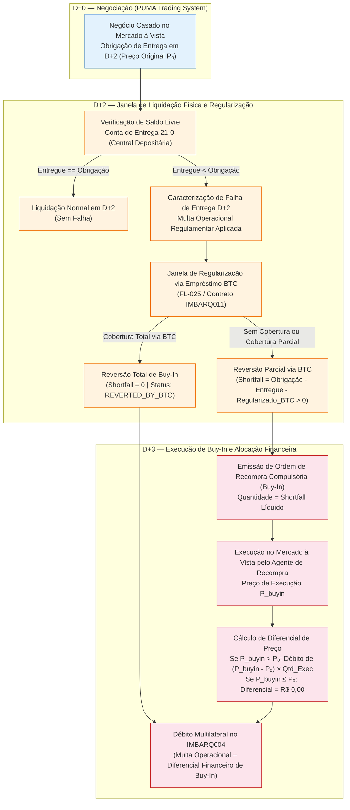

# Especificação Técnica de Gestão de Falha de Entrega D+2 e Execução de Recompra Compulsória (Buy-In) — Câmara B3 (FL-038)

## 1. Visão Geral e Contexto Operacional (FL-038)

No ciclo de liquidação multilateral líquida (*Multilateral Net Settlement*) do mercado à vista de renda variável (ações, ETFs, BDRs e Units) operado pela **Câmara B3**, a liquidação física e financeira ocorre em **D+2** (dois dias úteis após a data de negociação **D+0**).

Durante a janela de entrega de ativos em **D+2**, o Participante de Negociação Pleno (PNP) ou Agente de Custódia responsável pelo comitente vendedor deve disponibilizar a quantidade líquida vendida na **Conta de Entrega (Subconta 21-0)** junto à Central Depositária da B3. Quando se verifica **insuficiência de saldo livre** no encerramento da janela regulamentar de entrega em D+2, caracteriza-se a **Falha de Entrega de Ativos**, acionando o rito sancionatório e mitigatório previsto no **Manual de Procedimentos Operacionais (MPO) da Câmara B3**:

1. **Identificação de Insuficiência de Saldo Livre em D+2**: Apuração da quantidade não entregue na janela ordinária ($\text{Falha Inicial D+2} = \text{Obrigação} - \text{Entregue}$).
2. **Aplicação de Multa Operacional de Falha**: Incidência de multa regulamentar percentual sobre o volume financeiro não entregue pelo participante vendedor inadimplente.
3. **Janela de Regularização via Empréstimo BTC (Reversão Parcial ou Total)**: Oportunidade de cobertura da pendência física mediante contratação de empréstimo de ativos no **Banco de Títulos CBLC (BTC — FL-025 / IMBARQ011)** antes da execução da recompra em mercado.
4. **Emissão de Ordem de Recompra Compulsória (*Buy-In*) em D+3**: Para o saldo residual líquido não regularizado ($\text{Shortfall}$), a Câmara B3 emite ordem compulsória de recompra em **D+3** para recompor a entrega ao comprador prejudicado.
5. **Alocação do Diferencial de Preço (*Buy-In Price Differential*)**: Caso o preço de execução da recompra em D+3 supere o preço original da venda de D+0, o diferencial financeiro adverso é integralmente debitado do vendedor em falha no arquivo de compensação financeira (`IMBARQ004`).

---

## 2. Fórmulas Determinísticas e Regras de Negócio da Câmara B3

### 2.1 Apuração da Quantidade Pendente Líquida (*Shortfall*)

Para cada obrigação de entrega associada a uma operação de venda no mercado à vista, a quantidade pendente líquida sujeita à execução de recompra compulsória (*Buy-In*) é determinada pela identidade estrita:

$$\text{Shortfall} = \text{Obrigação} - \text{Entregue} - \text{Regularizado\_BTC}$$

Onde:
- $\text{Obrigação}$ (`obligated_quantity`): Quantidade total de ativos vendida em D+0 cuja entrega é exigível em D+2 ($\text{Obrigação} > 0$).
- $\text{Entregue}$ (`delivered_quantity`): Quantidade efetivamente disponível e entregue na Conta de Entrega (21-0) até o corte operacional de D+2 ($0 \le \text{Entregue} \le \text{Obrigação}$).
- $\text{Falha Inicial D+2}$ (`initial_failure_quantity`): Quantidade em falha no fechamento da janela ordinária de D+2:
  $$\text{Falha Inicial D+2} = \text{Obrigação} - \text{Entregue}$$
- $\text{Regularizado\_BTC}$ (`btc_regularized_quantity`): Quantidade coberta pelo vendedor inadimplente mediante tomada de empréstimo de ativos no BTC dentro da janela de regularização ($0 \le \text{Regularizado\_BTC} \le \text{Falha Inicial D+2}$).

> [!IMPORTANT]
> A soma $\text{Entregue} + \text{Regularizado\_BTC}$ jamais pode ultrapassar $\text{Obrigação}$. Qualquer tentativa de alocar regularização via BTC superior ao saldo em falha ($\text{Regularizado\_BTC} > \text{Obrigação} - \text{Entregue}$) constitui erro de validação operacional (`ExcessRegularizationError`).

---

### 2.2 Multa Operacional Regulamentar de Falha de Entrega

A não entrega dos ativos na janela regulamentar de D+2 enseja a aplicação automática de **Multa Operacional de Falha** pela Câmara B3, independentemente de posterior regularização via BTC para evitar a recompra no mercado:

$$\text{Volume Financeiro em Falha D+2} = (\text{Obrigação} - \text{Entregue}) \times P_{\text{venda}}$$

$$\text{Multa Calculada} = \text{round}\left(\text{Volume Financeiro em Falha D+2} \times \frac{\text{Alíquota}_{\text{multa}}(\%)}{100},\ 2\right)$$

$$\text{Multa Operacional Final} = \max\left(\text{Piso Regulamentar},\ \text{Multa Calculada}\right)$$

- **Alíquota Padrão de Referência (`penalty_rate_pct`)**: `0,50%` (`0.005`) sobre o volume financeiro não entregue em D+2.
- **Arredondamento**: `ROUND_HALF_UP` na segunda casa decimal (`R$ 0,01`).

---

### 2.3 Execução de Buy-In em D+3 e Alocação Assimétrica do Diferencial de Preço

Caso persista saldo descoberto após a janela de regularização via BTC ($\text{Shortfall} > 0$), a Câmara B3 emite a **Ordem de Recompra Compulsória (*Buy-In*)** em **D+3** para a quantidade exata do $\text{Shortfall}$.

Quando a ordem de Buy-In é executada (integral ou parcialmente) ao preço de recompra $P_{\text{buyin}}$ para uma quantidade executada $Q_{\text{exec}} \le \text{Shortfall}$, aplica-se a regra de **alocação assimétrica de diferencial de preço**:

1. **Cenário Adverso ($P_{\text{buyin}} > P_{\text{venda}}$)**:
   - O ativo encareceu entre D+0 e a execução da recompra em D+3.
   - O vendedor inadimplente arca integralmente com o sobrecusto de recompra:
     $$\Delta P_{\text{unit}} = P_{\text{buyin}} - P_{\text{venda}}$$
     $$\text{Diferencial Financeiro Debitado} = \text{round}\left(Q_{\text{exec}} \times (P_{\text{buyin}} - P_{\text{venda}}),\ 2\right)$$

2. **Cenário Favorável ou Neutro ($P_{\text{buyin}} \le P_{\text{venda}}$)**:
   - O preço de recompra em D+3 foi igual ou inferior ao preço original da venda em D+0.
   - Conforme o MPO da Câmara B3, **o vendedor inadimplente não faz jus a eventual ganho financeiro decorrente de queda de preço do ativo cuja entrega ele próprio falhou em honrar**:
     $$\Delta P_{\text{unit}} = \text{R\$ } 0,00$$
     $$\text{Diferencial Financeiro Debitado} = \text{R\$ } 0,00$$
   - A diferença positiva $(P_{\text{venda}} - P_{\text{buyin}}) \times Q_{\text{exec}}$ é registrada apenas para trilha de auditoria como `favorable_price_spread_ignored_brl`.

3. **Débito Total Imputado ao Participante Vendedor em Falha**:
   $$\text{Total Debitado do Vendedor} = \text{Multa Operacional Final} + \text{Diferencial Financeiro Debitado}$$

---

## 3. Máquina de Estados do Ciclo de Falha e Buy-In (`FailureStatus`)

| Código de Status (`FailureStatus`) | Etapa Operacional | Condição Determinística |
|---|---|---|
| `IDENTIFIED_D2` | Fechamento D+2 | $\text{Entregue} < \text{Obrigação}$ e $\text{Regularizado\_BTC} = 0$, antes da emissão da ordem de Buy-In em D+3. |
| `PARTIALLY_REGULARIZED_BTC` | Janela BTC (D+2/D+3) | $0 < \text{Regularizado\_BTC} < (\text{Obrigação} - \text{Entregue})$, restando $\text{Shortfall} > 0$ para Buy-In. |
| `REVERTED_BY_BTC` | Janela BTC (D+2/D+3) | $\text{Regularizado\_BTC} = (\text{Obrigação} - \text{Entregue}) \implies \text{Shortfall} = 0$. Ordem de Buy-In revertida/cancelada integralmente. |
| `BUYIN_ISSUED_D3` | Abertura D+3 | Ordem de recompra compulsória emitida pela Câmara B3 para $\text{Shortfall} > 0$, aguardando execução no PUMA. |
| `BUYIN_PARTIALLY_EXECUTED` | Pregão D+3 | Recompra executada parcialmente ($0 < Q_{\text{exec}} < \text{Shortfall}$), mantendo saldo remanescente em aberto. |
| `BUYIN_EXECUTED` | Pós-Pregão D+3 | Recompra integralmente executada ($Q_{\text{exec}} = \text{Shortfall} > 0$) e diferencial financeiro apurado. |

---

## 4. Especificação dos Registros de Domínio e Integração Pós-Negociação

### 4.1 Registro de Falha de Entrega (`DeliveryFailureRecord`)

| Campo | Tipo | Obrigatório | Descrição Técnica |
|---|---|---|---|
| `failure_id` | `str` | Sim | Identificador único do evento de falha na Câmara B3 (ex.: `FAIL-20261103-001`). |
| `trade_id` | `str` | Sim | Identificador do negócio original casado no PUMA em D+0. |
| `participant_code` | `str` | Sim | Código de 5 dígitos do participante vendedor inadimplente (PNP/Custodiante). |
| `seller_account` | `str` | Sim | Conta de custódia do comitente vendedor em falha. |
| `buyer_participant_code` | `str` | Sim | Código do participante comprador credor da entrega física. |
| `buyer_account` | `str` | Sim | Conta de custódia do comprador. |
| `ticker` | `str` | Sim | Código de negociação do ativo objeto (ex.: `PETR4`, `VALE3`, `ITUB4`). |
| `isin` | `str` | Sim | Código ISIN de 12 caracteres (ex.: `BRPETRACNPR6`). |
| `trade_date` | `date` | Sim | Data da operação original (D+0). |
| `settlement_date` | `date` | Sim | Data de liquidação originalmente contratada (D+2). |
| `buyin_date` | `date` | Sim | Data de emissão/execução da ordem de Buy-In (D+3). |
| `obligated_quantity` | `int` | Sim | Quantidade total vendida com obrigação de entrega em D+2. |
| `delivered_quantity` | `int` | Sim | Quantidade efetivamente entregue na Conta de Entrega (21-0) em D+2. |
| `btc_regularized_quantity` | `int` | Sim | Quantidade regularizada via empréstimo BTC na janela de regularização. |
| `original_sale_price` | `Decimal` | Sim | Preço unitário original da venda em D+0 (R$). |
| `penalty_rate_pct` | `Decimal` | Sim | Alíquota percentual da multa operacional de falha (padrão `0.50`). |
| `buyin_execution_price` | `Decimal \| None` | Não | Preço unitário de execução da recompra compulsória em D+3 (R$). |
| `buyin_executed_quantity` | `int \| None` | Não | Quantidade executada no Buy-In em D+3. |
| `btc_contract_id` | `str \| None` | Não | Número do contrato BTC (`IMBARQ011`) vinculado à regularização física. |

### 4.2 Reflexos nos Arquivos Posicionais IMBARQ da Câmara B3

| Arquivo B3 | Fluxo Atlas | Reflexo Contábil e Operacional da Falha / Buy-In |
|---|---|---|
| **IMBARQ013** | FL-007 (Movimentações de Custódia) | Registra a entrega parcial na subconta `21-0` em D+2 e a transferência de regularização proveniente de empréstimo BTC ou liquidação do Buy-In em D+3. |
| **IMBARQ011** | FL-009 (Posições de Empréstimo BTC) | Consolida o contrato de aluguel tomador firmado na janela de regularização (`btc_contract_id`) que abate parcial ou totalmente o `Shortfall`. |
| **IMBARQ004** | FL-003 (Compensação Financeira) | Lança a rubrica de débito de **Multa Operacional de Falha de Entrega** e o débito do **Diferencial Financeiro de Recompra (*Buy-In*)** na janela multilateral do participante vendedor inadimplente. |

---

## 5. Casos de Teste de Referência (`fixtures/buyin_settlement_failures.json`)

| Caso (`failure_id`) | Ativo | Obrigação | Entregue D+2 | Regularizado BTC | Shortfall (Buy-In) | Preço Venda ($P_0$) | Preço Buy-In ($P_{\text{buyin}}$) | Multa Operacional (`0,50%`) | Diferencial Debitado | Total Debitado | Status Final |
|---|---|---:|---:|---:|---:|---:|---:|---:|---:|---:|---|
| `FAIL-20261103-001` | `PETR4` | 10.000 | 4.000 | 2.000 | **4.000** | R$ 36,00 | R$ 38,50 | R$ 1.080,00 | R$ 10.000,00 | **R$ 11.080,00** | `BUYIN_EXECUTED` |
| `FAIL-20261103-002` | `VALE3` | 5.000 | 0 | 5.000 | **0** | R$ 62,00 | — | R$ 1.550,00 | R$ 0,00 | **R$ 1.550,00** | `REVERTED_BY_BTC` |
| `FAIL-20261103-003` | `ITUB4` | 8.000 | 3.000 | 0 | **5.000** | R$ 34,00 | R$ 32,80 | R$ 850,00 | R$ 0,00 | **R$ 850,00** | `BUYIN_EXECUTED` |
| `FAIL-20261103-004` | `B3SA3` | 12.000 | 2.000 | 3.000 | **7.000** (Exec: 4.000) | R$ 11,00 | R$ 12,25 | R$ 550,00 | R$ 5.000,00 | **R$ 5.550,00** | `BUYIN_PARTIALLY_EXECUTED` |
