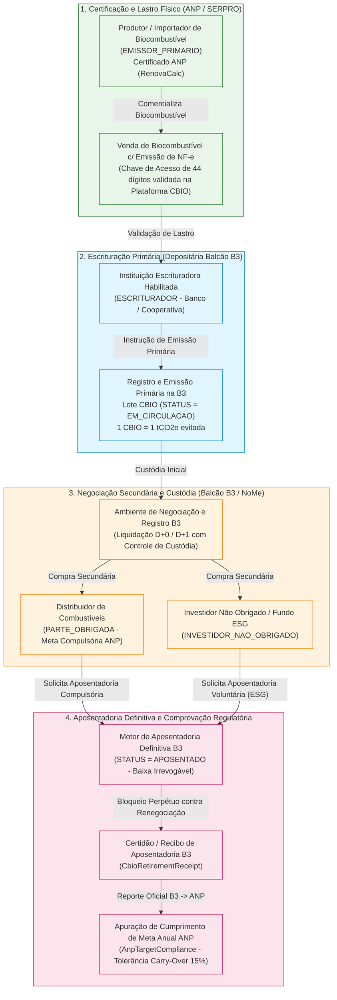
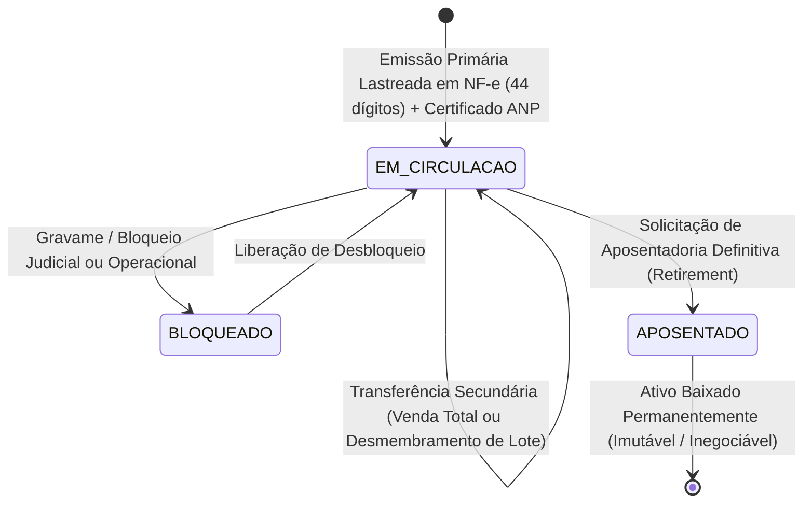

# Especificação Técnica de Créditos de Descarbonização (CBIO / RenovaBio), Energia e Commodities Ambientais na B3 (FL-036)

## 1. Visão Geral e Arcabouço Regulatório (RenovaBio — Lei nº 13.576/2017)

A **Política Nacional de Biocombustíveis (RenovaBio)**, instituída pela **Lei nº 13.576, de 26 de dezembro de 2017**, regulamentada pelo **Decreto nº 9.888/2019** e pelas Resoluções da **ANP (Agência Nacional do Petróleo, Gás Natural e Biocombustíveis — Res. ANP nº 758/2018 e Res. ANP nº 802/2019)**, além da **Portaria MME nº 419/2019** e diretrizes do **CNPE (Conselho Nacional de Política Energética)**, estabeleceu o mercado regulado brasileiro de descarbonização da matriz de transportes.

Na infraestrutura de mercado da **B3 (Brasil, Bolsa, Balcão)** — depositária central e ambiente oficial de registro, negociação e liquidação no **Balcão B3 (NoMe)** — o fluxo **FL-036** implementa o ciclo de vida completo do **Crédito de Descarbonização (CBIO)**:

- **Definição e Lastro Físico-Ambiental**: Cada **1 CBIO** corresponde exatamente a **1 tonelada de dióxido de carbono equivalente ($\text{1 tCO}_2\text{e}$)** de emissões de gases de efeito estufa (GEE) evitadas pela produção e comercialização de biocombustíveis certificados (etanol hidratado, etanol anidro, biodiesel, biometano e bioquerosene de aviação / SAF) em comparação ao seu substituto fóssil equivalente (gasolina A, óleo diesel A, gás natural ou querosene de aviação).
- **Natureza Escritural e Perenidade**: O CBIO é um ativo ambiental escritural, fungível para fins de cumprimento de meta anual, desprovido de data de vencimento (*sem prazo de expiração*), permanecendo válido em custódia na B3 até que ocorra o evento irreversível de sua **Aposentadoria Definitiva (*Retirement*)**.
- **Regra de Ouro (Prevenção de Dupla Contagem — *Anti-Double Counting*)**: Uma vez submetido à **Aposentadoria** no sistema da B3, o CBIO é **retirado permanentemente de circulação** (`STATUS = APOSENTADO`). Sob nenhuma hipótese um CBIO aposentado pode voltar a ser negociado no mercado secundário, transferido para outro titular, dado em garantia ou reutilizado em anos-meta subsequentes.

---

## 2. Participantes do Mercado de CBIO (`CbioParticipantRole`)

O ecossistema eletrônico do CBIO na B3 segrega os agentes conforme suas atribuições e permissões operacionais previstas na Lei nº 13.576/2017 e na Portaria MME nº 419/2019:

| Papel (`CbioParticipantRole`) | Base Legal e Regulatória | Função na Infraestrutura B3 | Permissões de Custódia e Ciclo de Vida |
|---|---|---|---|
| **`EMISSOR_PRIMARIO`** (*Produtor ou Importador de Biocombustível*) | Art. 6º, VI da Lei 13.576/2017 e Res. ANP 758/2018 | Usina produtora ou importador detentor do *Certificado da Produção Eficiente de Biocombustíveis* emitido por firma inspetora acreditada pela ANP. | Origina o lastro via Notas Fiscais Eletrônicas (NF-e); recebe os CBIOs em sua conta de custódia inicial após escrituração e realiza a venda inicial no Balcão B3. |
| **`ESCRITURADOR`** (*Instituição Financeira ou Cooperativa Escrituradora*) | Art. 6º, VIII da Lei 13.576/2017 e Portaria MME 419/2019 | Banco ou instituição autorizada pelo BACEN contratada pelo emissor primário para escriturar os CBIOs junto à B3 mediante validação das NF-e na Plataforma CBIO (SERPRO/ANP). | Submete instruções de emissão primária na B3 em nome do `EMISSOR_PRIMARIO` e mantém o controle cadastral da escrituração. |
| **`PARTE_OBRIGADA`** (*Distribuidor de Combustíveis*) | Art. 7º e Art. 10 da Lei 13.576/2017 e Res. ANP 802/2019 | Distribuidor de combustíveis líquidos/fósseis autorizado pela ANP com participação de mercado sujeita a metas compulsórias anuais individuais de descarbonização. | Adquire CBIOs no mercado secundário da B3 e solicita sua **Aposentadoria Definitiva** até o prazo legal para comprovar o atendimento da sua meta anual perante a ANP. |
| **`INVESTIDOR_NAO_OBRIGADO`** (*Investidor Institucional, Corporativo ou Pessoa Física*) | Art. 15 da Lei 13.576/2017 | Pessoas físicas, empresas não obrigadas, fundos de investimento ESG, *traders* de carbono e investidores não residentes que atuam na formação de liquidez ou neutralização voluntária. | Pode comprar e vender CBIOs no mercado secundário ou solicitar a **Aposentadoria Definitiva Voluntária** para fins de compensação voluntária de pegada de carbono (*carbon offsetting*). |

---

## 3. Estados do Ativo (`CbioStatus`) e Regras de Transição

Todo lote ou sub-lote de CBIO registrado na depositária da B3 obedece a uma máquina de estados determinística e unidirecional no momento da aposentadoria:

| Status (`CbioStatus`) | Descrição Operacional na Depositária B3 | Elegível à Negociação Secundária? | Elegível à Aposentadoria? | Contabiliza para Meta ANP? |
|---|---|---|---|---|
| **`EM_CIRCULACAO`** | CBIO escriturado, válido e livre na conta de custódia do seu detentor atual. | **Sim** | **Sim** | **Não** *(apenas ativos efetivamente aposentados abatem a meta compulsória)* |
| **`BLOQUEADO`** | CBIO temporariamente indisponível por ordem judicial, bloqueio regulatório ANP ou pendência de liquidação. | **Não** | **Não** | **Não** |
| **`APOSENTADO`** | CBIO retirado permanentemente de circulação a pedido do titular. Estado terminal e irrevogável. | **Não (Bloqueio Absoluto)** | **Não (Prevenção de Dupla Contagem)** | **Sim** *(gera Certidão Oficial de Aposentadoria B3)* |

---

## 4. Modelagem Matemática, Invariantes de Conservação e Cumprimento de Meta ANP

### 4.1 Geração do Lastro Primário (Fator ANP / RenovaCalc)
Na etapa de certificação junto à ANP, cada unidade produtora recebe uma **Nota de Eficiência Energético-Ambiental ($N_{\text{EEA}}$)** expressa em $\text{gCO}_2\text{e/MJ}$, calculada pela diferença entre a intensidade de carbono do combustível fóssil substituto e a intensidade de carbono do biocombustível no ciclo de vida (*Well-to-Wheel*). A partir da $N_{\text{EEA}}$ e da fração de volume elegível, a ANP publica o **Fator para Emissão de CBIO ($f_{\text{CBIO}}$)**:

$$Q_{\text{CBIO}} = \left\lfloor V_{\text{elegível}} \times f_{\text{CBIO}} \right\rfloor$$

onde a quantidade escriturada na B3 é sempre um número **inteiro positivo** de CBIOs ($\ge 1$), vinculado univocamente à chave de acesso de **44 dígitos numéricos** da NF-e de venda do biocombustível e ao código do Certificado da Produção Eficiente da ANP.

### 4.2 Invariante de Conservação Estrita de Custódia
Em qualquer instante $t$ do processamento na Plataforma CBIO da B3, a soma de todos os CBIOs emitidos primariamente pelos escrituradores deve ser exatamente igual à soma dos CBIOs ativos (em circulação ou bloqueados) mais os CBIOs aposentados definitivamente:

$$\sum_{i \in \text{Emissões}} Q_{\text{Emitida}, i} = \sum_{j \in \text{Lotes}} Q_{\text{Circulação}, j} + \sum_{k \in \text{Recibos}} Q_{\text{Aposentada}, k}$$

Para cada lote individual $b$:
$$Q_{\text{Emitida}}(b) = Q_{\text{Circulação}}(b) + Q_{\text{Aposentada}}(b) + Q_{\text{Transferida}}(b)$$

Qualquer discrepância viola a integridade da depositária central e dispara `CbioConservationError`.

### 4.3 Apuração de Cumprimento de Meta Compulsória ANP (`AnpTargetCompliance`)
Seja $M_d$ a meta individual compulsória líquida de CBIOs atribuída pela ANP ao distribuidor de combustíveis $d$ (`PARTE_OBRIGADA`) para o ano-meta $A$, e seja $R_d$ o total de CBIOs **efetivamente aposentados** por $d$ vinculados ao ano-meta $A$:

1. **Percentual de Cumprimento ($\text{Pct}_d$)**:
   $$\text{Pct}_d = \text{round}\left( \frac{R_d}{M_d} \times 100,\ 2 \right)$$
   *(Nota crítica: CBIOs mantidos na carteira do distribuidor com status `EM_CIRCULACAO` são reportados como `circulating_held_cbios`, mas **não** entram no numerador $R_d$ enquanto não forem aposentados).*

2. **Déficit e Excedente Anual**:
   $$\text{Déficit}_d = \max(0,\ M_d - R_d), \qquad \text{Excedente}_d = \max(0,\ R_d - M_d)$$

3. **Regra de Tolerância de Carregamento (*Carry-Over* de até 15% — Art. 10, § 2º da Lei 13.576/2017)**:
   - A legislação permite que até **15% (quinze por cento)** da meta individual de um ano seja comprovada no ano subsequente, desde que o distribuidor atinja no mínimo **85,00%** de cumprimento no ano corrente:
     $$\text{Cumprimento Integral} \iff R_d \ge M_d \quad (\text{Pct}_d \ge 100,00\%)$$
     $$\text{Dentro da Tolerância de Carry-Over (15\%)} \iff 85,00\% \le \text{Pct}_d < 100,00\%$$
     $$\text{Inadimplência Regulatória (Sujeito a Multa ANP)} \iff \text{Pct}_d < 85,00\%$$

4. **Estimativa de Multa Regulatória por Descumprimento (Art. 9º da Lei 13.576/2017 e Decreto 9.888/2019)**:
   - O descumprimento da meta (sem prejuízo da obrigação de aposentar os CBIOs faltantes) sujeita o distribuidor a multa proporcional à quantidade de CBIOs descumprida, limitada a até R$ 50.000.000,00 (ou piso de R$ 100.000,00), calculada sobre o déficit não coberto pela tolerância (ou sobre o déficit total quando $\text{Pct}_d < 85\%$) multiplicado pelo valor de referência da multa por CBIO não aposentado.

---

## 5. Estrutura do Lote de Processamento JSON (`fixtures/cbio_retirement_batch.json`)

O arquivo de lote unificado contém quatro seções determinísticas processadas sequencialmente pelo motor `CbioPlatformEngine`:

1. `primary_issuances`: Instruções de escrituração primária lastreadas em NF-e (44 dígitos) e Certificado ANP.
2. `secondary_trades`: Operações de compra e venda no Balcão B3 (suportando transferência integral de lote ou desmembramento parcial com rastreabilidade ao lote/NF-e de origem).
3. `retirement_instructions`: Pedidos de aposentadoria definitiva (*retirement*) por distribuidores obrigados (`PARTE_OBRIGADA`) e investidores voluntários (`INVESTIDOR_NAO_OBRIGADO`).
4. `anp_mandatory_targets`: Metas compulsórias individuais publicadas pela ANP por CNPJ de distribuidora para apuração de conformidade.

### 5.1 Dicionário de Campos Principais

| Bloco | Campo | Tipo | Obrigatoriedade | Regra de Validação |
|---|---|---|---|---|
| `primary_issuances[]` | `batch_id` | `string` | Sim | Identificador único do lote escriturado (ex: `CBIO-2026-0001`). |
| `primary_issuances[]` | `issuer_id` / `issuer_cnpj` | `string` | Sim | Identificador e CNPJ (14 dígitos) da usina `EMISSOR_PRIMARIO`. |
| `primary_issuances[]` | `bookkeeper_id` | `string` | Sim | Instituição financeira `ESCRITURADOR` habilitada na B3. |
| `primary_issuances[]` | `anp_certificate_code` | `string` | Sim | Código do Certificado da Produção Eficiente de Biocombustíveis na ANP. |
| `primary_issuances[]` | `nfe_key` | `string` | Sim | Chave de acesso da NF-e com exatamente **44 dígitos numéricos**. |
| `primary_issuances[]` | `biofuel_type` | `string` | Sim | `ETANOL_HIDRATADO`, `ETANOL_ANIDRO`, `BIODIESEL`, `BIOMETANO` ou `BIOQUEROSENE_SAF`. |
| `primary_issuances[]` | `quantity` | `integer` | Sim | Quantidade inteira de CBIOs escriturados ($> 0$). |
| `secondary_trades[]` | `trade_id` | `string` | Sim | Identificador único do negócio no Balcão B3. |
| `secondary_trades[]` | `batch_id` | `string` | Sim | Lote de origem em custódia do vendedor (deve estar `EM_CIRCULACAO`). |
| `secondary_trades[]` | `new_batch_id` | `string` | Condicional | Identificador do novo lote desmembrado caso a venda seja parcial. |
| `secondary_trades[]` | `quantity` | `integer` | Sim | Quantidade negociada ($0 < q \le Q_{\text{circulação}}$). |
| `secondary_trades[]` | `unit_price_brl` | `string/decimal` | Sim | Preço unitário do CBIO em R$ ($> 0$, 2 casas decimais). |
| `retirement_instructions[]` | `instruction_id` | `string` | Sim | Identificador da instrução de aposentadoria. |
| `retirement_instructions[]` | `batch_id` | `string` | Sim | Lote a ser aposentado (deve estar `EM_CIRCULACAO` e pertencer ao solicitante). |
| `retirement_instructions[]` | `quantity` | `integer` | Sim | Quantidade a aposentar definitivamente ($0 < q \le Q_{\text{circulação}}$). |
| `retirement_instructions[]` | `compliance_year` | `integer` | Sim | Ano-meta de referência para abatimento na ANP ou inventário GEE (ex: `2026`). |
| `anp_mandatory_targets[]` | `distributor_id` | `string` | Sim | Identificador da distribuidora (`PARTE_OBRIGADA`). |
| `anp_mandatory_targets[]` | `mandatory_target_cbios` | `integer` | Sim | Meta individual líquida estipulada pela ANP ($> 0$). |

---

## 6. Catálogo de Exceções e Regras de Bloqueio Determinístico

| Exceção Python (`src/cbio_carbon_energy.py`) | Condição de Disparo | Comportamento Esperado |
|---|---|---|
| `CbioRetiredAssetError` | Tentativa de negociar no mercado secundário ou aposentar novamente um lote cujo status já é `APOSENTADO`. | Bloqueio imediato da instrução; preservação inalterada do estado de custódia (Prevenção de Dupla Contagem). |
| `CbioInsufficientBalanceError` | Tentativa de transferir ou aposentar quantidade superior ao saldo `circulating_quantity` do lote ou titular divergente. | Rejeição da operação antes de qualquer mutação de saldo. |
| `CbioValidationError` | Chave de NF-e diferente de 44 dígitos numéricos, CNPJ inválido, certificado ANP ausente, papel de participante incompatível ou quantidade $\le 0$. | Rejeição cadastral determinística. |
| `CbioConservationError` | Violação da identidade $\text{Emitidos} = \text{Em\_Circulacao} + \text{Aposentados}$. | Falha crítica de auditoria de integridade do livro. |
