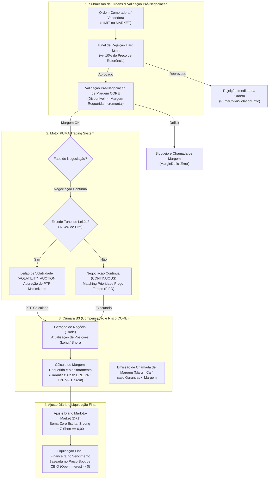

# Especificação Técnica do Contrato Futuro de Crédito de Descarbonização (CBIO / CBI) no PUMA Trading System e Câmara B3 (FL-086)

## 1. Visão Geral e Arcabouço Regulatório

O fluxo **FL-086** implementa a modelagem contratual, o motor de negociação eletrônica com túneis dinâmicos no **PUMA Trading System**, a gestão de margem de garantia de risco **CORE** e a apuração de **Ajuste Diário (Mark-to-Market)** e **Liquidação Financeira Final** para os **Contratos Futuros de Crédito de Descarbonização (Código de Negociação: CBI)** na **B3 (Brasil, Bolsa, Balcão)**.

O instrumento fundamenta-se nos seguintes pilares legais e regulatórios:
- **Lei Federal nº 13.576/2017 (RenovaBio)**: Institui a Política Nacional de Biocombustíveis e cria os Créditos de Descarbonização (CBIOs);
- **Decreto Presidencial nº 9.888/2019** e **Portaria MME nº 419/2019**: Regulamentação dos leilões e metas compulsórias anuais;
- **Manual de Negociação do PUMA Trading System da B3**: Regras de pré-abertura, túneis de negociação, leilões de volatilidade e matching determinístico FIFO;
- **Manual de Risco e Garantias da Câmara B3 (CORE)**: Critérios de cálculo de margem em risco, matriz de haircuts para garantias em Títulos Públicos Federais e chamadas de margem;
- **Manual de Procedimentos Operacionais de Derivativos Listados da Câmara B3**: Apuração de ajustes diários em D+1 e liquidação financeira final vinculada ao mercado à vista (Spot) de CBIO no Balcão B3.

---

## 2. Características Padronizadas do Contrato Futuro de CBIO (`CBI`)

| Parâmetro Contratual | Especificação B3 |
| :--- | :--- |
| **Código de Negociação (Ticker)** | `CBI<Mês><Ano>` (ex: `CBIZ24`, `CBIF25`, `CBIZ26`) |
| **Objeto de Negociação** | Crédito de Descarbonização (CBIO), emitido na forma da Lei 13.576/2017 |
| **Tamanho do Contrato (Multiplicador)** | **100 CBIOs** por contrato (1 contrato = 100 tCO2e evitadas) |
| **Cotação** | Reais (R$) por CBIO com 2 casas decimais |
| **Variação Mínima de Apreçamento (Tick Size)** | **R$ 0,01 por CBIO** (equivalente a R$ 1,00 por contrato) |
| **Valor Nocional do Contrato** | $\text{Preço} \times 100 \times \text{Quantidade}$ |
| **Meses de Vencimento** | Mensal: F (Jan), G (Fev), H (Mar), J (Abr), K (Mai), M (Jun), N (Jul), Q (Ago), U (Set), V (Out), X (Nov), Z (Dez) |
| **Tipo de Liquidação no Vencimento** | **Exclusivamente Financeira** (sem entrega física de títulos CBIO) |
| **Preço de Liquidação Final ($P_{final}$)** | Preço oficial de fechamento / média ponderada do mercado à vista de CBIO apurado na B3 na data de expiração |

---

## 3. Arquitetura Operacional do PUMA Trading System

---

## 4. Invariantes Formais de Conservação e Auditoria

1. **Lei 64 / LAW-086 — Conservação Soma-Zero no Ajuste Diário (Mark-to-Market D+1)**:
   $$\sum \text{Ajuste\_Compradores} + \sum \text{Ajuste\_Vendedores} = 0,00$$
   Nenhum centavo de variação diária é criado ou destruído pela Câmara B3.

2. **Lei 64 / LAW-087 — Paridade Estrita de Posições e Open Interest**:
   $$\sum \text{Posições\_Compradas} = \sum \text{Posições\_Vendidas} = \text{Open\_Interest\_Total}$$
   A cada instante, a quantidade agregada de contratos comprados em aberto coincide rigorosamente com os contratos vendidos.

3. **Lei 64 / LAW-088 — Conservação Soma-Zero e Extinção de Open Interest na Liquidação Final**:
   $$\sum \text{P\&L Final Compradores} + \sum \text{P\&L Final Vendedores} = 0,00 \quad \text{e} \quad \text{Open Interest} \to 0$$
   No vencimento financeiro baseado no mercado spot de CBIO, todas as posições em aberto são baixadas integralmente.

4. **Inviolabilidade do Túnel de Rejeição PUMA (Hard Limit Collar)**:
   Nenhuma oferta é acolhida nem executada fora dos limites máximos permitidos ($[P_{ref} \times (1 - \text{collar}), P_{ref} \times (1 + \text{collar})]$).
