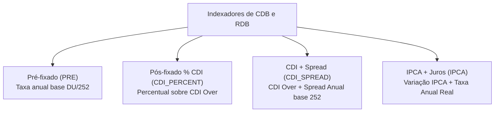
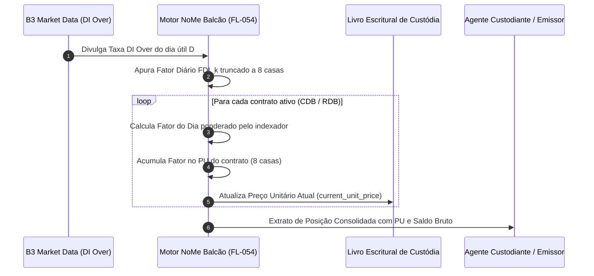
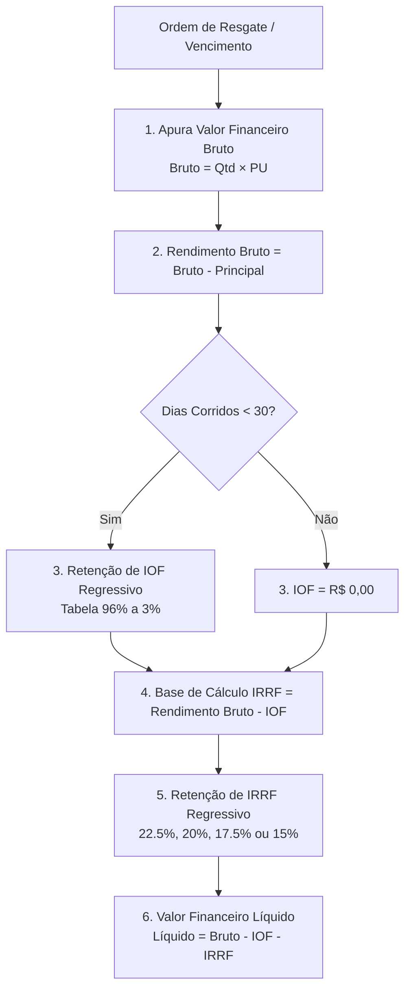

# Balcão NoMe B3 — Registro, Atualização Diária de PU e Liquidação de CDBs e RDBs (FL-054)

## 1. Visão Geral e Contexto Regulatório

Os **Certificados de Depósito Bancário (CDB)** e os **Recibos de Depósito Bancário (RDB)** constituem os instrumentos fundamentais de captação de recursos a prazo e estruturação de *funding* das instituições financeiras integrantes do Sistema Financeiro Nacional (SFN).

No âmbito da infraestrutura de mercado da **B3 — Brasil, Bolsa, Balcão**, o registro, a custódia, o controle escritural, a atualização diária de Preço Unitário (PU) e a liquidação financeira de CDBs e RDBs são processados na plataforma **NoMe (Novo Mercado de Balcão)**, em conformidade com:
- **Resolução CMN nº 5.036/2022**: Consolida as normas sobre a emissão de Certificados de Depósito Bancário e Recibos de Depósito Bancário por instituições autorizadas pelo Banco Central do Brasil (Bancos Comerciais, Bancos de Investimento, Bancos Múltiplos com carteira comercial ou de investimento, e Sociedades de Crédito, Financiamento e Investimento - Financeiras para RDB).
- **Lei nº 4.728/1965**: Disciplina o mercado de capitais e estabelece os parâmetros jurídicos de emissão de títulos de crédito bancário.
- **Lei nº 11.033/2004 (Art. 1º)**: Institui o regime de tributação regressiva do Imposto de Renda Retido na Fonte (IRRF) sobre rendimentos de renda fixa decorrentes de aplicações financeiras.
- **Decreto nº 6.306/2007 (Art. 32)**: Regulamenta a cobrança regressiva do Imposto sobre Operações Financeiras (IOF) para resgates ou liquidações efetuados com prazo inferior a 30 dias corridos.
- **Regulamento e Manuais de Operações do Balcão B3 (NoMe Renda Fixa Privada)**: Determina as especificações de mensageria, convenção de cálculo em dias úteis ($DU/252$), truncamento/arredondamento oficial de fatores diários do DI over e regras de batimento bilateral e liquidação de balcão.

---

## 2. Diferenças Estruturais: CDB vs. RDB

Embora ambos sejam títulos nominativos representativos de depósito a prazo remunerado emitidos por instituições financeiras com cobertura do **Fundo Garantidor de Créditos (FGC)** (até o limite de R$ 250.000,00 por CPF/CNPJ e conglomerado financeiro, respeitado o teto especial de R$ 1.000.000,00 a cada 4 anos), apresentam distinções jurídicas e operacionais críticas no NoMe Balcão:

| Atributo | Certificado de Depósito Bancário (CDB) | Recibo de Depósito Bancário (RDB) |
|---|---|---|
| **Classificação CMN** | Título de crédito causal nominativo e transferível. | Título representativo de depósito a prazo, nominativo, intransferível e inalienável. |
| **Negociabilidade Secundária** | **Sim**. Pode ser livremente cedido ou negociado no mercado secundário de balcão NoMe via endosso em preto. | **Não**. É inalienável e intransferível no mercado secundário. Não admite circulação entre terceiros investidores. |
| **Resgate Antecipado** | Permitido caso pactuado no contrato (com ou sem liquidez diária), diretamente com o emissor ou via cessão em balcão. | Permitido apenas caso haja previsão expressa em contrato para liquidação antecipada junto à instituição emitente originária. |
| **Instituições Emissoras** | Bancos Comerciais, Múltiplos, de Investimento e BNDES. | Bancos Comerciais, Múltiplos, de Investimento, BNDES e Sociedades de Crédito, Financiamento e Investimento (Financeiras). |
| **Ambiente NoMe B3** | Suporta Registro de Emissão, Transferência de Custódia, Negociação Secundária e Liquidação. | Suporta Registro de Emissão, Atualização Escritural e Liquidação Bilateral exclusiva com o emissor. |

---

## 3. Matriz de Indexadores Suportados

O motor de escrituração e liquidação processa 4 classes de indexadores financeiros:



### 3.1. Pré-fixado (`PRE`)
Remuneração calculada por taxa prefixada expressa ao ano, sob convenção exponencial de dias úteis sobre 252:

$$PU_t = PU_0 \times \left(1 + \frac{\text{Taxa}_{aa}}{100}\right)^{\frac{DU}{252}}$$

Onde:
- $PU_0$: Preço Unitário de emissão (nominal inicial, usualmente R$ 1.000,00000000).
- $\text{Taxa}_{aa}$: Taxa prefixada pactuada expressa em percentual ao ano.
- $DU$: Quantidade de dias úteis transcorridos entre a data de emissão e a data de avaliação/resgate.

### 3.2. Pós-fixado em Percentual do CDI (`CDI_PERCENT`)
Remuneração vinculada à variação diária da Taxa DI Over anual divulgada pela B3, ponderada pelo percentual pactuado (ex: 100%, 105%, 112% do CDI):

1. **Fator Diário da Taxa DI ($FDI_k$)**:
   $$FDI_k = \left(1 + \frac{DI_k}{100}\right)^{\frac{1}{252}}$$
   *Arredondado a 8 casas decimais conforme padrão B3/Cetip.*

2. **Taxa Diária Efetiva do Ativo ($T_k$)**:
   $$T_k = (FDI_k - 1) \times \left(\frac{\%CDI}{100}\right)$$

3. **Fator Diário Remunerado ($Fator_k$)**:
   $$Fator_k = 1 + T_k$$
   *Truncado/arredondado a 8 casas decimais.*

4. **Fator Acumulado ($F_{acum}$)**:
   $$F_{acum} = \prod_{k=1}^{DU} Fator_k$$

5. **Preço Unitário Atualizado ($PU_t$)**:
   $$PU_t = PU_0 \times F_{acum}$$

### 3.3. CDI + Spread (`CDI_SPREAD`)
Combina a variação acumulada do CDI com uma taxa prefixada adicional de *spread* anual base 252 (ex: CDI + 1.50% a.a.):

$$F_{spread} = \left(1 + \frac{\text{Spread}_{aa}}{100}\right)^{\frac{DU}{252}}$$

$$PU_t = PU_0 \times F_{cdi\_acum} \times F_{spread}$$

### 3.4. IPCA + Juros (`IPCA`)
Instrumento indexado à inflação medida pelo IBGE com taxa de juros reais ao ano:

$$PU_t = PU_0 \times \left(\frac{\text{IPCA}_t}{\text{IPCA}_0}\right) \times \left(1 + \frac{\text{Spread}_{aa}}{100}\right)^{\frac{DU}{252}}$$

- **Modalidade Bullet (No Vencimento)**: Correção monetária integral e juros acumulados pagos exclusivamente na liquidação de vencimento ou resgate antecipado.
- **Modalidade com Juros Semestrais**: Apuração periódica de cupons de juros a cada 126 dias úteis, com liquidação financeira intermediária do cupom e retenção de IRRF no respectivo evento societário.

---

## 4. Curva de Precificação e Atualização Diária de PU

A câmara B3 divulga diariamente, após o fechamento da sessão de compensação e liquidação (por volta das 18h00), a **Taxa Média DI Over** oficial. O motor de registro do NoMe Balcão executa o seguinte ciclo diário:



---

## 5. Regime Tributário Regressivo (IOF e IRRF)

A apuração tributária de CDBs e RDBs é determinística, aplicada automaticamente na fonte pela instituição pagadora/custodiante sob fiscalização da Receita Federal do Brasil (RFB).



### 5.1. Tabela Regressiva de IOF (Decreto nº 6.306/2007)
Incide **exclusivamente sobre o Rendimento Bruto** para resgates efetuados com prazo em **dias corridos ($DC$)** inferior a 30 dias:

| Dia Corrido ($DC$) | Alíquota IOF | Dia Corrido ($DC$) | Alíquota IOF | Dia Corrido ($DC$) | Alíquota IOF |
|:---:|:---:|:---:|:---:|:---:|:---:|
| **1** | 96% | **11** | 63% | **21** | 30% |
| **2** | 93% | **12** | 60% | **22** | 26% |
| **3** | 90% | **13** | 56% | **23** | 23% |
| **4** | 86% | **14** | 53% | **24** | 20% |
| **5** | 83% | **15** | 50% | **25** | 16% |
| **6** | 80% | **16** | 46% | **26** | 13% |
| **7** | 76% | **17** | 43% | **27** | 10% |
| **8** | 73% | **18** | 40% | **28** | 6% |
| **9** | 70% | **19** | 36% | **29** | 3% |
| **10** | 66% | **20** | 33% | **$\ge$ 30** | **0% (Isento)** |

$$\text{IOF} = \text{round}\left(\text{Rendimento Bruto} \times \frac{\text{Alíquota IOF}}{100}, 2\right)$$

### 5.2. Tabela Regressiva de IRRF (Lei nº 11.033/2004)
Incide sobre a base líquida de IOF ($\text{Base IRRF} = \text{Rendimento Bruto} - \text{IOF}$), conforme o prazo total decorrido em dias corridos desde a aplicação:

| Prazo Decorrido (Dias Corridos) | Alíquota IRRF |
|---|---|
| **Até 180 dias** | 22,5% |
| **De 181 a 360 dias** | 20,0% |
| **De 361 a 720 dias** | 17,5% |
| **Acima de 720 dias** | 15,0% |

$$\text{IRRF} = \text{round}\left(\text{Base IRRF} \times \frac{\text{Alíquota IRRF}}{100}, 2\right)$$

---

## 6. Ciclo de Liquidação e Leis Formais de Conservação

### 6.1. Modalidades de Liquidação
1. **Liquidação por Vencimento (`TOTAL_MATURITY`)**:
   - Liquidada no dia de vencimento contratual ($Data \ge DataVencimento$).
   - O saldo remanescente em quantidade do contrato torna-se zero ($Q_{remanescente} = 0$) e o contrato transiciona para o status `SETTLED`.
2. **Resgate Antecipado Total (`EARLY_TOTAL`)**:
   - Liquidada antes do vencimento ($Data < DataVencimento$), resgatando 100% da quantidade disponível. O status transiciona para `SETTLED`.
3. **Resgate Antecipado Parcial (`EARLY_PARTIAL`)**:
   - Liquidada antes do vencimento com $Q_{resgate} < Q_{disponivel}$.
   - O contrato permanece `PARTIALLY_REDEEMED`, mantendo o saldo remanescente de quantidade ($Q_{novo} = Q_{anterior} - Q_{resgate}$) e acumulando PU sobre o principal residual.

### 6.2. Leis Formais de Conservação Financeira
Toda liquidação executada pelo motor `CdbRdbRegistryEngine` deve satisfazer rigorosamente as seguintes igualdades contábeis:

$$\text{Valor Bruto} = \text{Principal Resgatado} + \text{Rendimento Bruto}$$

$$\text{Total Tributos Retidos} = \text{IOF} + \text{IRRF}$$

$$\text{Rendimento Líquido} = \text{Rendimento Bruto} - \text{Total Tributos Retidos}$$

$$\text{Valor Líquido Creditado} = \text{Valor Bruto} - \text{IOF} - \text{IRRF} = \text{Principal Resgatado} + \text{Rendimento Líquido}$$

---

## 7. Estrutura de Mensageria e Dados

### 7.1. Registro de Contrato de CDB / RDB
```json
{
  "contract_id": "CDB-ITAU-2024-001",
  "security_type": "CDB",
  "issuer_name": "BANCO ITAU UNIBANCO S.A.",
  "issuer_ispb": "60701190",
  "custody_account": "100234-5",
  "investor_id": "32.145.890/0001-44",
  "issue_date": "2024-01-02",
  "maturity_date": "2026-01-22",
  "initial_quantity": 100,
  "initial_unit_price": "1000.00000000",
  "indexer_type": "PRE",
  "annual_rate": "12.0000"
}
```

### 7.2. Recibo de Liquidação e Tributação
```json
{
  "receipt_id": "REC-CDB-20240117-0001",
  "contract_id": "CDB-ITAU-2024-001",
  "settlement_type": "EARLY_TOTAL",
  "settlement_date": "2024-01-17",
  "calendar_days": 15,
  "business_days": 11,
  "redeemed_quantity": 100,
  "remaining_quantity": 0,
  "unit_price": "1005.00741000",
  "principal_amount": "100000.00",
  "gross_amount": "100500.74",
  "tax_breakdown": {
    "calendar_days": 15,
    "gross_yield": "500.74",
    "iof_rate": "50.00",
    "iof_amount": "250.37",
    "irrf_base": "250.37",
    "irrf_rate": "22.50",
    "irrf_amount": "56.33",
    "total_tax": "306.70",
    "net_yield": "194.04"
  },
  "net_amount": "100194.04"
}
```
