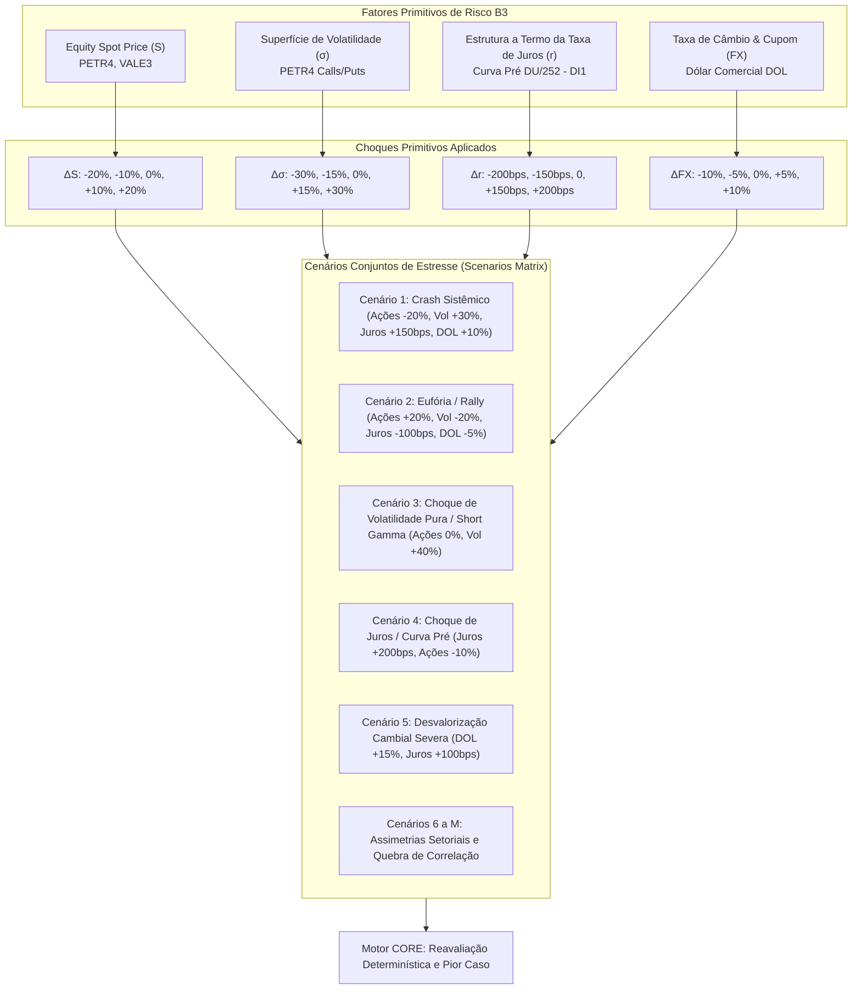
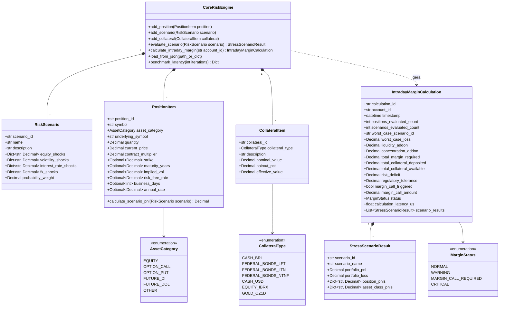

# Especificação Técnica da Metodologia CORE da B3 — Cálculo e Monitoramento de Margem Intradiária (FL-050)

## 1. Visão Geral e Fundamentação Regulatória

No ecossistema da **B3 S.A. – Brasil, Bolsa, Balcão**, a **Câmara B3** atua como Contraparte Central (CCP - *Central Counterparty*) para todos os mercados de ações, derivativos listados, balcão organizado e renda fixa. Como CCP sistemicamente importante, a integridade financeira e a resiliência do mercado de capitais brasileiro dependem do sistema **CORE (Closeout Risk Evaluation)**.

O modelo **CORE** é o algoritmo proprietário da B3 para cálculo de margem e apuração de risco de liquidação (*closeout loss*). Diferente de modelos legados baseados em parâmetros estáticos de margem por contrato (como o antigo SPAN) ou abordagens paramétricas de VaR (Value-at-Risk), o CORE fundamenta-se na **avaliação integral de perdas em cenários extremos e plausíveis de estresse** (*full repricing under stress scenarios*), incorporando o efeito portfólio multilateral e a convexidade de derivativos não lineares.

A governança do monitoramento e cálculo de margem intradiária é regida pelos seguintes marcos regulatórios:
- **Princípios para Infraestruturas do Mercado Financeiro (CPMI-IOSCO PFMI)**: Em especial o **Princípio 4 (Risco de Crédito)** e o **Princípio 6 (Margens)**, que exigem que uma CCP mantenha recursos financeiros suficientes para cobrir exposições sob ampla gama de cenários de estresse, com chamadas de margem intradiárias sempre que a volatilidade ou novas posições elevem o risco além dos limites de tolerância.
- **Resolução CMN nº 2.882/2001 e Circular BCB nº 3.057/2001**: Estabelecem os requisitos para sistemas de liquidação e compensação que atuam como contraparte central no Sistema de Pagamentos Brasileiro (SPB).
- **Regulamento de Operações e Manual de Procedimentos Operacionais de Risco da Câmara B3**: Determinam as rotinas de cálculo contínuo em tempo real, os tipos de garantias aceitas, os fatores primitivos de risco, a matriz de cenários e os gatilhos formais de chamada de margem intradiária (*Intraday Margin Calls*).

```
+--------------------------------------------------------------------------------------------------------------------------+
|                                  ARQUITETURA DE CÁLCULO E MONITORAMENTO DE MARGEM CORE B3                                |
+--------------------------------------------------------------------------------------------------------------------------+
|                                                                                                                          |
|  ESTEIRA DE NEGOCIAÇÃO E PÓS-NEGOCIAÇÃO EM TEMPO REAL                                                                    |
|  [ PUMA Trading System ] -----> [ Trade Capture / Drop Copy ] -----> [ Livro de Posições em Aberto por Conta / PNP ]     |
|                                                                                                  |                       |
|                                                                                                  v                       |
|  +--------------------------------------------------------------------------------------------------------------------+  |
|  | MOTOR DE RISCO CORE B3 (FL-050)                                                                                    |  |
|  |                                                                                                                    |  |
|  |  1. MATRIZ DE CENÁRIOS PRIMITIVOS DE RISCO:                                                                        |  |
|  |     - Choques de Preço à Vista (Equity Spot): +/- 10%, +/- 20%                                                      |  |
|  |     - Choques de Volatilidade Implícita (Vega Risk): +/- 15%, +/- 30%                                              |  |
|  |     - Choques de Vértices da Curva Pré DU/252 (DI1): +/- 75 bps, +/- 150 bps, +/- 200 bps                          |  |
|  |     - Choques Cambiais e Cupom Cambial (DOL): +/- 5%, +/- 10%                                                      |  |
|  |                                                                                                                    |  |
|  |  2. REAVALIAÇÃO INTEGRAL DA CARTEIRA (FULL REPRICING MULTI-ATIVO):                                                 |  |
|  |     - Ações: Delta V = Q * S0 * Delta_S                                                                            |  |
|  |     - Opções: Precificação BSM sob choque conjunto (S_cenario, Vol_cenario)                                        |  |
|  |     - Futuro DI1: Reavaliação de PU = 100.000 / (1 + r_cenario)^(DU/252)                                           |  |
|  |     - Futuro DOL: Reavaliação Delta V = Q * Delta_P * 50                                                           |  |
|  |                                                                                                                    |  |
|  |  3. EFEITO PORTFÓLIO E COMPENSAÇÃO MULTILATERAL (NETTING):                                                         |  |
|  |     - Agregação por cenário k: PnL_k = Somatório(Delta_V_i,k)                                                      |  |
|  |     - Perda no cenário k: Loss_k = max(0, -PnL_k)                                                                  |  |
|  |                                                                                                                    |  |
|  |  4. APURAÇÃO DO WORST-CASE CLOSEOUT LOSS E MARGEM REQUERIDA:                                                       |  |
|  |     - Pior Perda de Liquidação: WCL = max_k (Loss_k)                                                               |  |
|  |     - Margem Requerida: Margin_req = WCL + Addons (Liquidez + Concentração)                                         |  |
|  |                                                                                                                    |  |
|  |  5. CONFRONTO COM COLATERAL E DISPARO DE CHAMADA DE MARGEM:                                                        |  |
|  |     - Colateral Elegível com Haircuts: Dinheiro BRL (0%), TPF (2-3%), USD (10%), Ações (20%)                       |  |
|  |     - Déficit Projetado: Deficit = Margin_req - Colateral_Disponivel                                               |  |
|  |     - Gatilho Intradiário: Se Deficit > Tolerancia_Regulamentar ==> DISPARA INTRADAY MARGIN CALL                     |  |
|  +--------------------------------------------------------------------------------------------------------------------+  |
|                                                      |                                                                   |
|                                                      v                                                                   |
|                             +--------------------------------------------------+                                         |
|                             | AÇÕES DE SALVAGUARDA E LIQUIDAÇÃO INTRADIÁRIA     |                                         |
|                             | - Notificação formal IMBARQ014 ao PNP / Custodiante|                                         |
|                             | - Janela de aporte regulamentar (D+0, 60-90 min)  |                                         |
|                             | - Se não atendida: Trava de novas ordens / Closeout|                                         |
|                             +--------------------------------------------------+                                         |
|                                                                                                                          |
+--------------------------------------------------------------------------------------------------------------------------+
```

---

## 2. Matriz de Cenários Primitivos de Risco (Primitive Risk Scenarios)

O CORE não assume distribuições normais de probabilidade para estimar perdas extremas; em vez disso, define uma **matriz discreta de cenários de estresse conjuntos**, que submete todas as posições da carteira a movimentos severos e simultâneos nos fatores de risco fundamentais:



### 2.1. Fatores Primitivos e Modelagem Matemática

#### Ações à Vista (Equities)
Para uma posição de $Q_i$ ações ao preço à vista atual $S_{0,i}$:
$$\Delta V_{i}(s) = Q_i \cdot S_{0,i} \cdot \Delta S_i(s)$$
Onde $\Delta S_i(s) \in \{-0.20, -0.10, -0.05, 0.00, +0.05, +0.10, +0.20\}$.

#### Opções sobre Ações (Equity Options)
A B3 utiliza reavaliação integral baseada no modelo de Black-Scholes-Merton (Black-76 para futuros e BSM para ações com dividendos contínuos discretizados):
$$d_1 = \frac{\ln\left(\frac{S(s)}{K}\right) + \left(r(s) + \frac{\sigma(s)^2}{2}\right) T}{\sigma(s) \sqrt{T}}, \quad d_2 = d_1 - \sigma(s) \sqrt{T}$$

Para uma Call de compra:
$$C(s) = S(s) N(d_1) - K e^{-r(s) T} N(d_2)$$
Para uma Put de venda:
$$P(s) = K e^{-r(s) T} N(-d_2) - S(s) N(-d_1)$$

A variação de valor da posição de $Q_j$ opções sob o cenário $s$ é:
$$\Delta V_j(s) = Q_j \cdot [Premium_j(s) - Premium_{j,0}]$$
Esta modelagem captura perfeitamente o efeito de **Delta** (direcional), **Gama** (curvatura/convexidade), **Vega** (sensibilidade à volatilidade) e **Rho** (juros).

#### Futuros de DI de 1 Dia (DI1)
O contrato de DI1 é cotado pela taxa de juros pré-fixada anual base 252 dias úteis ($r$). O Preço Unitário (PU) no cenário de estresse é calculado por:
$$PU(s) = \frac{100.000}{\left(1 + r_0 + \Delta r(s)\right)^{\frac{DU}{252}}}$$
Como a convenção de mercado estabelece que o comprador de DI1 ganha com a queda da taxa (aumento do PU), o resultado financeiro da posição de $Q_k$ contratos é:
$$\Delta V_k(s) = Q_k \cdot [PU(s) - PU_0]$$

#### Futuros de Dólar Comercial (DOL)
O contrato futuro de dólar é cotado em pontos de Real por USD 1.000, com tamanho de contrato de USD 50.000 (multiplicador de 50):
$$\Delta V_m(s) = Q_m \cdot [P_0 \cdot \Delta FX(s)] \cdot 50$$

---

## 3. Efeito Portfólio e Compensação Multilateral

A principal vantagem de capital do modelo CORE em relação a sistemas de margens isoladas é a **compensação multilateral (netting) orientada a cenários**:

### 3.1. Compensação Intragrupo / Mesmo Ativo Objeto (Underlying Offsetting)
Quando um participante detém simultaneamente posições compradas no ativo à vista (ex: 10.000 PETR4) e posições derivativas que oferecem hedge (ex: 10.000 Puts compradas ou 10.000 Calls vendidas), o motor CORE apura o PnL somado no mesmo cenário $s$:
$$PnL_{PETR4}(s) = \Delta V_{Stock}(s) + \sum_{j} \Delta V_{Option,j}(s)$$
Em um cenário de queda extrema de 20%, a perda das ações é diretamente amortecida pelo ganho das opções de venda (Puts), resultando em uma demanda de margem proporcional ao **risco residual líquido**.

### 3.2. Agregação Cross-Asset e Quebra de Correlação
Entre classes distintas de ativos (ex: PETR4 vs VALE3, ou DI1 vs Dólar):
- O motor CORE avalia cenários onde ambos os ativos se movem de forma correlacionada (ex: voo para a qualidade / flight-to-safety, onde bolsa cai e dólar sobe).
- Adicionalmente, o motor aplica cenários de **assimetria ou descolamento** (onde a correlação histórica se rompe, ex: PETR4 cai 20% enquanto VALE3 sobe 5%), garantindo que posições de arbitragem ou pairs trading não fiquem sub-marginais caso a correlação colapse.

### 3.3. Add-ons Regulatórios de Liquidez e Concentração
Além da perda no pior cenário ($WCL$), o CORE calcula parcelas adicionais de risco:
1. **Liquidity Add-on ($Addon_{liq}$)**: Penalidade incidente quando o volume da posição do investidor supera uma fatia substancial do Volume Médio Diário negociado no mercado (ADTV), representando o custo de impacto de mercado para liquidar a posição no horizonte de closeout.
2. **Concentration Add-on ($Addon_{conc}$)**: Sobretaxa aplicada quando uma única empresa, conglomerado ou fator de risco absorve mais de 50% do capital ou garantia total da conta.

A Margem Requerida Total da conta é definida por:
$$Margin_{required} = WCL + Addon_{liq} + Addon_{conc}$$

---

## 4. Gestão de Colaterais e Gatilho de Chamada de Margem Intradiária

### 4.1. Cesta de Garantias Elegíveis e Haircuts
A Câmara B3 aceita uma ampla gama de ativos como garantia para cobertura de risco, aplicando descontos regulatórios (*haircuts*) sobre o valor de mercado para salvaguardar contra volatilidade e iliquidez no momento de execução:

| Tipo de Garantia | Código / Instrumento | Haircut B3 Padrão | Justificativa Regulatória |
| :--- | :--- | :--- | :--- |
| **Dinheiro em Moeda Nacional** | `CASH_BRL` | **0.0%** | Liquidez imediata no SPB |
| **Títulos Públicos Federais (LFT)** | `FEDERAL_BONDS_LFT` | **2.0%** | Baixo risco soberano pós-fixado |
| **Títulos Públicos Federais (LTN/NTN-F)** | `FEDERAL_BONDS_LTN` | **3.5%** | Risco de taxa de juros pré-fixada |
| **Moeda Estrangeira (USD em NY)** | `CASH_USD` | **10.0%** | Risco de volatilidade cambial e fuso horário |
| **Ações Elegíveis IBrX-100** | `EQUITY_IBRX` | **20.0%** | Volatilidade de renda variável e liquidação D+2 |
| **Ouro Físico em Custódia B3** | `GOLD_OZ1D` | **10.0%** | Volatilidade de commodity |

O colateral total disponível ajustado por haircut é:
$$Collateral_{available} = \sum_{j} NominalValue_j \cdot (1 - Haircut_j)$$

### 4.2. Algoritmo de Decisão do Gatilho de Chamada de Margem (*Intraday Margin Call*)

A apuração contínua do déficit de risco é executada a cada negócio ou variação de preço:
$$Deficit = \max\left(0, Margin_{required} - Collateral_{available}\right)$$

A B3 estabelece uma **tolerância regulamentar intradiária** ($\tau_{reg}$), expressa como um percentual da margem requerida (tipicamente 5%) ou um valor fixo em reais, permitindo que pequenas oscilações de ruído no mercado não disparem chamadas burocráticas desnecessárias:

```
                  +---------------------------------------------------+
                  |   CÁLCULO INTRADIÁRIO: Deficit vs. Tolerância     |
                  +---------------------------------------------------+
                                            |
                         +------------------+------------------+
                         |                                     |
                Deficit <= Tolerancia                 Deficit > Tolerancia
                         |                                     |
               +---------+---------+                 +---------+---------+
               |                   |                 |                   |
          Deficit == 0       Deficit > 0        Deficit <= Limite   Deficit > Limite
               |                   |                 Crítico             Crítico
               v                   v                 v                   v
           [ NORMAL ]         [ WARNING ]     [ MARGIN CALL ]     [ CRITICAL CALL ]
         (Totalmente       (Alerta Preventivo,  (Chamada Formal    (Chamada Imediata,
          coberto)         sem envio de SPB)     Janela 60-90min)    Trava de Ordens)
```

1. **Estado `NORMAL`**: $Deficit = 0$. As garantias cobrem integralmente o pior caso de estresse.
2. **Estado `WARNING`**: $0 < Deficit \le \tau_{reg}$. Alerta de proximidade de limite para a mesa de risco do participante.
3. **Estado `MARGIN_CALL_REQUIRED`**: $Deficit > \tau_{reg}$. A Câmara gera formalmente uma chamada de margem adicional. É emitida notificação IMBARQ014 e requisição de transferência de fundos no SPB (mensagem `LDL0001` ou custódia de títulos). O participante dispõe da janela regulamentar intradiária (60 a 90 minutos) para aporte.
4. **Estado `CRITICAL`**: $Deficit > 1.5 \times Collateral_{available}$ ou déficit absoluto de alta monta. Risco de insolvência iminente; aciona cancelamento de ofertas abertas aumentadoras de risco e suspensão de novas posições no gateway DMA (mecanismo *Kill-Switch* e pré-closeout).

---

## 5. Estrutura de Classes e Diagrama de Entidades

A implementação do motor (`src/core_intraday_margin.py`) é estruturada estritamente com a biblioteca padrão do Python (`dataclasses`, `Decimal`, `datetime`, `enum`, `json`):



---

## 6. Métricas de Desempenho e Requisitos de Latência

Como a Câmara B3 monitora dezenas de milhares de carteiras de participantes simultaneamente e os intermediários (PNPs) executam a apuração intradiária para conferência de limites operacionais em tempo real:
- **Tempo de Execução P99**: $< 1.000\ \mu s$ (sub-milissegundo para carteiras padrão multi-ativo).
- **Tempo Médio de Apuração**: $< 100\ \mu s$ por carteira.
- **Precisão Numérica**: Aritmética decimal de ponto fixo (`Decimal`) com arredondamento regulamentar `ROUND_HALF_UP` a 2 casas decimais monetárias (BRL centavos) e taxas a 4 e 6 casas decimais.
- **Determinismo**: Zero variação de cálculo em função de estado global, garantindo perfeita reprodutibilidade para auditoria da BSM e do Banco Central.
