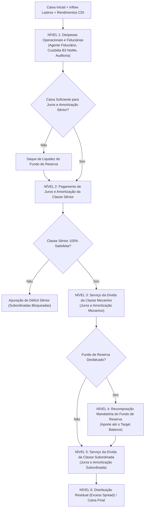

# Especificação Técnica — Emissão, Securitização e Fundo de Reserva de CRA e CRI no Balcão NoMe B3 (FL-062)

---

## 1. Visão Geral e Arcabouço Regulatório

O fluxo **`FL-062` — Emissão, Securitização e Fundo de Reserva de CRA e CRI** materializa o modelo determinístico, operacional e contábil da **B3 (Brasil, Bolsa, Balcão)** para a estruturação, registro, escrituração em custódia fiduciária e liquidação periódica de **Certificados de Recebíveis do Agronegócio (CRA)** e **Certificados de Recebíveis Imobiliários (CRI)** no ambiente **NoMe (Novo Mercado de Balcão)**.

A modelagem é rigorosamente balizada pelo ordenamento legal brasileiro e pela regulação dos mercados de capitais:

1. **Lei nº 11.076/2004 (Títulos do Agronegócio)**:
   - Institui os **Certificados de Recebíveis do Agronegócio (CRA)** (artigos 23 a 42), de emissão privativa de Companhias Securitizadoras de Direitos Creditórios do Agronegócio.
   - Disciplina a constituição do **Regime Fiduciário / Patrimônio Separado** (art. 36 e seguintes), garantindo que os direitos creditórios integrantes do lastro, garantias e fundos de reserva constituam patrimônio autônomo, incomunicável com o patrimônio comum da securitizadora, insuscetível de arresto, sequestro, penhora ou arrecadação pela massa falida da emissora.
2. **Lei nº 9.514/1997 (Sistema de Financiamento Imobiliário - SFI)**:
   - Institui os **Certificados de Recebíveis Imobiliários (CRI)** (artigos 6º a 16) emitidos por securitizadoras imobiliárias, lastreados em créditos imobiliários decorrentes de alienação fiduciária, financiamento habitacional (SFH/SFI), locações comerciais atípicas (*Built to Suit* - BTS) ou cédulas de crédito imobiliário (**CCI**, Lei 10.931/2004).
   - Consolida a incomunicabilidade fiduciária perante a decretação de falência ou recuperação judicial da securitizadora.
3. **Lei nº 14.430/2022 (Marco Legal da Securitização)**:
   - Unifica as regras gerais da atividade de securitização no Brasil, autorizando a emissão em classes e séries distintas (Sênior, Mezanino, Subordinada Júnior), consolidação de fundos de liquidez e rotatividade de lastros.
4. **Resolução CVM nº 60/2021**:
   - Estabelece as normas para registro e funcionamento de companhias securitizadoras perante a Comissão de Valores Mobiliários (CVM), deveres de divulgação de relatórios de lastro, auditoria independente e atuação do **Agente Fiduciário**.
5. **Resolução CMN nº 5.118/2024**:
   - Reforça os critérios de elegibilidade de lastro, determinando conexão causal direta com a atividade agrícola ou imobiliária e vedando o desvio de finalidade ou títulos híbridos sem lastro genuíno.
6. **Lei nº 11.033/2004 e Lei nº 11.076/2004**:
   - Assegura isenção de Imposto de Renda Retido na Fonte (IRRF) para pessoas físicas residentes no Brasil e investidores não-residentes (INR) nas remunerações e amortizações de CRA e CRI.

---

## 2. Arquitetura Estrutural da Securitização no Balcão NoMe B3

O ecossistema de securitização congrega o Originador do crédito (produtor rural ou incorporadora imobiliária), a Securitizadora, o Agente Fiduciário independente e os Investidores em diferentes classes de risco.

```
+-----------------------------------------------------------------------------------------------------------------------+
|                       ARQUITETURA DE SECURITIZAÇÃO DE CRA E CRI NO BALCÃO NOME B3 (FL-062)                            |
+-----------------------------------------------------------------------------------------------------------------------+
|                                                                                                                       |
|   +------------------------------------+                               +------------------------------------------+   |
|   |         ORIGINADORES / DEVEDORES   |                               |       AGENTE FIDUCIÁRIO (TRUSTEE)        |   |
|   |   - Produtores Rurais (Soja/Milho) |                               |       (DTVM Homologada CVM / B3)         |   |
|   |   - Adquirentes Imóveis / Locatários|                              |       - Guarda Fiduciária                |   |
|   +------------------------------------+                               |       - Auditoria Mensal de Lastro       |   |
|                     |                                                  +------------------------------------------+   |
|                     | [Cessão de Direitos Creditórios /                                      |                        |
|                     |  Emissão de CPR Física/Financeira ou CCI]                              | [Fiscalização e        |
|                     v                                                                        |  Averbação NoMe]       |
|   +------------------------------------------------------------------------------------------v--------------------+   |
|   |              PATRIMÔNIO DE AFETAÇÃO SEPARADO (REGIME FIDUCIÁRIO - LEIS 11.076/04 E 9.514/97)                  |   |
|   |              - Incomunicabilidade Concursal (Blindagem contra falência da Securitizadora)                     |   |
|   |              - Subconta Fiduciária Segregada na Central Depositária B3                                        |   |
|   |                                                                                                               |   |
|   |   +---------------------------------------+                     +-----------------------------------------+   |
|   |   |        CARTEIRA DE LASTRO             |                     |       FUNDO DE RESERVA DE LIQUIDEZ      |   |
|   |   |   - Pool de CPRs (Agronegócio)        |                     |       (CASH RESERVE FUND)               |   |
|   |   |   - Pool de CCIs com Alienação Fiduciária                   |       - Target: 5% a 10% Saldo Sênior   |   |
|   |   |   - Amortização SAC / Price / Bullet  |                     |       - Liquidez Imediata em CDI        |   |
|   |   +---------------------------------------+                     +-----------------------------------------+   |
|   +---------------------------------------------------------------------------------------------------------------+   |
|                     |                                                                                                 |
|                     | [Cascata Periódica de Pagamentos - Payment Waterfall]                                           |
|                     v                                                                                                 |
|   +---------------------------------------------------------------------------------------------------------------+   |
|   |                            ESTRUTURAÇÃO EM TRANCHES DE CERTIFICADOS B3                                        |   |
|   |                                                                                                               |   |
|   |   +-------------------------------------+  +--------------------------------+  +--------------------------+   |
|   |   |         CLASSE SÊNIOR               |  |       CLASSE MEZANINO          |  |  CLASSE SUBORDINADA      |   |
|   |   |   - Prioridade Absoluta             |  |   - Subordinada à Sênior       |  |  (JÚNIOR / FIRST LOSS)   |   |
|   |   |   - Acesso ao Fundo de Reserva      |  |   - Preferencial à Subordinada |  |  - Absorve 1ª Perda      |   |
|   |   |   - Baixo Risco de Crédito (AAA)    |  |   - Risco Intermediário        |  |  - Remuneração Residual  |   |
|   |   +-------------------------------------+  +--------------------------------+  +--------------------------+   |
|   +---------------------------------------------------------------------------------------------------------------+   |
|                     |                                  |                                       |                      |
|                     v                                  v                                       v                      |
|             INVESTIDORES SÊNIOR              INVESTIDORES MEZANINO                  ORIGINADOR / EQUITY               |
|             (Varejo / FII / Fiagro)          (Institucionais / FoFs)                (Retenção Obrigatória CVM)        |
+-----------------------------------------------------------------------------------------------------------------------+
```

---

## 3. Composição de Lastros e Validação de Elegibilidade

A legislação e as Resoluções CVM 60/21 e CMN 5.118/24 vedam expressamente a mistura de lastros não característicos:

### 3.1 Lastros Agropecuários Elegíveis para CRA (`SecuritizationType.CRA`)
- **`CPR_FINANCEIRA`**: Cédula de Produto Rural com liquidação financeira registrada no NoMe Agro B3 (Lei 8.929/94 e Lei 11.076/04).
- **`CPR_FISICA`**: Cédula com promessa de entrega física de mercadorias com garantias reais averbadas.
- **`CDCA`**: Certificado de Direitos Creditórios do Agronegócio emitido por cooperativas agropecuárias.
- **`DUPLICATA_RURAL`** e **`CONTRATO_AGRO`**: Contratos bilaterais de fornecimento de insumos ou compra de safras futuras.

### 3.2 Lastros Imobiliários Elegíveis para CRI (`SecuritizationType.CRI`)
- **`CCI`**: Cédula de Crédito Imobiliário integral ou fracionária, com garantia de alienação fiduciária registrada no Registro de Imóveis (RGI).
- **`FINANCIAMENTO_HABITACIONAL`**: Contratos de mútuo bancário com garantia hipotecária ou alienação fiduciária no SFH/SFI.
- **`LOCACAO_ATIPICA_BTS`**: Contratos de locação comercial na modalidade *Built to Suit* com renúncia de revisão de aluguel.
- **`CONTRATO_COMPRA_VENDA`**: Recebíveis de parcelamento de loteamentos e incorporações residenciais.
- **`DEBENTURE_IMOBILIARIA`**: Debêntures simples com destinação exclusiva para desenvolvimento imobiliário.

> [!IMPORTANT]
> **Veto Regulatório a Lastros Cruzados**: Qualquer tentativa de cadastrar um ativo imobiliário (`CCI`, `BTS`) em um CRA, ou um ativo do agronegócio (`CPR`) em um CRI dispara imediatamente `SecuritizationValidationError`, preservando a taxonomia jurídica e tributária do título.

---

## 4. O Fundo de Reserva de Liquidez (Cash Reserve Fund)

O Fundo de Reserva de Liquidez é um mecanismo mandatício ou contratual de reforço de crédito (*Credit Enhancement*) mantido em conta de custódia vinculada ao patrimônio fiduciário na B3.

### 4.1 Parâmetros e Governança
- **Saldo Alvo (`target_balance`)**: Fixado em percentual do saldo devedor das tranches preferenciais (geralmente entre 5% e 10% do saldo sênior) ou em número fixo de meses do serviço da dívida.
- **Saldo Atual (`current_balance`)**: Disponibilidade líquida alocada em títulos pós-fixados indexados a 100% do CDI/Selic.
- **Piso Mínimo (`minimum_floor`)**: Nível crítico abaixo do qual é disparado alarme operacional de defasagem de garantia fiduciária.
- **Defasagem (`deficit_amount`)**:
  $$\text{Déficit da Reserva} = \max(0, \text{Target Balance} - \text{Current Balance})$$

### 4.2 Dinâmica de Saque e Recomposição
1. **Acionamento do Saque (`draw`)**: Ocorre de forma automática quando a arrecadação dos lastros no período for insuficiente para cobrir as despesas fiduciárias e o serviço da dívida (juros e amortização programada) da Classe Sênior.
2. **Recomposição Mandatória (`deposit`)**: Havendo posterior regularização de recebíveis ou geração de excedente financeiro (*Excess Spread*), o caixa livre do patrimônio separado deve ser integralmente canalizado para repor o Fundo de Reserva até a sua meta contratual (`target_balance`), **antes de qualquer repasse para a Classe Subordinada**.
3. **Desmobilização no Vencimento Final (`unwind_reserve_at_maturity`)**: Uma vez amortizada 100% da Classe Sênior e Mezanino, o saldo remanescente do fundo de reserva é transferido ao caixa livre e liquidado em benefício da Classe Subordinada, promovendo o encerramento regular do patrimônio separado (art. 10 da Lei 9.514/97).

---

## 5. Cascata Periódica de Pagamentos (Payment Waterfall)

Em cada data de liquidação na grade noturna ou mensal do Balcão NoMe B3, o motor determinístico executa os desembolsos de acordo com a seguinte ordem rigorosa de prelazia:



### 5.1 Regra de Ouro da Inviolabilidade Subordinada (Water-Tight Priority)
$$\text{Pagamento Subordinada} = \begin{cases} 0, & \text{se } \text{Déficit Sênior} > 0 \text{ ou } \text{Déficit Reserva} > 0 \\ \min(\text{Caixa Disponível}, \text{Serviço Subordinada}), & \text{caso contrário} \end{cases}$$

Nenhum centavo de juros ou amortização de principal pode fluir para os titulares da Classe Subordinada enquanto persistir qualquer centavo de déficit de juros da Classe Sênior ou enquanto o Fundo de Reserva de Liquidez estiver abaixo de sua meta regulamentar.

---

## 6. Mecanismo de Absorção de Perdas (First-Loss Piece)

Quando um devedor de CPR ou CCI entra em default definitivo e o ativo é baixado (*Write-off*), a perda financeira total (Saldo Devedor + Juros Acumulados) é absorvida hierarquicamente:

1. **Camada 1 (Primeira Perda)**: Absorvida pela **Classe Subordinada**, reduzindo seu saldo devedor e seu Preço Unitário (PU).
2. **Camada 2 (Segunda Perda)**: Se a perda superar 100% da Classe Subordinada, a Subordinada vai a zero, e o excedente consome a **Classe Mezanino**.
3. **Camada 3 (Terceira Perda)**: Se a perda superar a Subordinada e o Mezanino, atinge a **Classe Sênior**.

### Invariante de Redução Proporcional do PU
Para cada tranche $T$ afetada por uma perda absorvida $L_{\text{absorbed}}$:
$$\text{Saldo Devedor}_{\text{novo}} = \text{Saldo Devedor}_{\text{anterior}} - L_{\text{absorbed}}$$
$$\text{PU}_{\text{novo}} = \frac{\text{Saldo Devedor}_{\text{novo}}}{\text{Quantidade de Títulos}}$$

---

## 7. As 5 Invariantes Formais de Securitização da B3

O motor `src/securitization_cra_cri.py` garante e prova matematicamente 5 leis de conservação financeira:

1. **Lei 1: Conservação Contábil Multilateral do Waterfall**:
   $$\text{Entradas Totais} = \text{Caixa Inicial} + \text{Inflows de Lastro} + \text{Rendimento Caixa} + \text{Saques da Reserva}$$
   $$\text{Saídas Totais} = \text{Despesas} + \text{Sênior Pago} + \text{Mezanino Pago} + \text{Aportes Reserva} + \text{Subordinada Paga} + \text{Residual} + \text{Caixa Final}$$
   $$\text{Entradas Totais} \equiv \text{Saídas Totais} \quad \land \quad \text{Caixa Final} \ge 0$$
2. **Lei 2: Inviolabilidade da Subordinação (Water-Tightness)**:
   Se $\text{Déficit Sênior} > 0$ ou $\text{Reserva Atual} < \text{Reserva Target}$, então $\text{Subordinada Paga} \equiv 0{,}00$.
3. **Lei 3: Proteção Estrita de Primeira Perda (First-Loss)**:
   Se $\text{Perda de Lastro} \le \text{Saldo Subordinada}$, o Saldo Sênior permanece rigorosamente inalterado ($\Delta \text{Sênior} = 0$).
4. **Lei 4: Conservação de Quantidade e Preço Unitário**:
   $$\text{Saldo Devedor Tranche} \equiv \text{round\_cents}(\text{Quantidade} \times \text{PU Atualizado})$$
5. **Lei 5: Segregação Fiduciária e Cobertura Mínima**:
   $$\sum \text{Lastros Adimplentes/Atraso} + \text{Fundo de Reserva} + \text{Caixa Segregado} \ge \text{Passivo Sênior}$$

---

## 8. Especificação dos Cenários de Teste Sintéticos (`fixtures/cra_cri_securitization.json`)

A fixture oficial homologada disponibiliza 5 emissões paradigmáticas cobrindo todas as dinâmicas de mercado:

| ID da Emissão | Tipo | Lei | Tranches | Lastros | Dinâmica do Cenário |
|---|---|---|---|---|---|
| `CRA-AGRO-2026-001` | CRA | 11.076/04 | Sênior (80M) + Subordinada (20M) | Pool de CPRs de Soja, Milho e Algodão (105M) | Fluxo regular de safra, adimplência plena, pagamento integral sênior e subordinada, conservação contábil 100%. |
| `CRI-IMOB-2026-002` | CRI | 9.514/97 | Sênior (50M) + Subordinada (10M) | Pool de CCIs com Alienação Fiduciária (63M) | Atraso temporário de CCI comercial provocando saque de liquidez do Fundo de Reserva; bloqueio de proventos à Subordinada. |
| `CRI-BTS-MEZZANINE-2026-003` | CRI | 9.514/97 | Sênior (60M) + Mezanino (20M) + Subordinada (20M) | Contratos Built to Suit e CCIs Logísticas (110M) | Estrutura de 3 tranches; prova de prioridade Mezanino sobre Subordinada e Sênior sobre Mezanino. |
| `CRA-DEFAULT-WRITE-OFF-2026-004` | CRA | 11.076/04 | Sênior (40M) + Subordinada (10M) | CPRs de Café, Cana e Citros (51M) | Inadimplência definitiva de R$ 6M de CPR absorvida 100% pela tranche Subordinada; Sênior permanece intacta. |
| `CRI-MATURITY-RESERVE-UNWIND-2026-005` | CRI | 9.514/97 | Sênior (5M) + Subordinada (2M) | CCIs em fase final de amortização | Vencimento final, quitação de saldo sênior, desmobilização do Fundo de Reserva e liquidação do patrimônio fiduciário. |

---

## 9. Métricas de Monitoramento e Relações de Cobertura

O motor disponibiliza duas métricas centrais para auditoria contínua do Agente Fiduciário e publicação de relatórios CVM 60:

1. **Razão de Sobrecolateralização (Overcollateralization Ratio - OC)**:
   $$\text{OC Ratio} = \frac{\text{Saldo dos Lastros Ativos} + \text{Fundo de Reserva} + \text{Caixa Segregado}}{\text{Saldo Devedor da Classe Sênior}}$$
2. **Índice de Subordinação (Subordination Ratio)**:
   $$\text{Subordination Ratio} = \frac{\text{Saldo da Classe Subordinada}}{\text{Saldo Total de Certificados Emitidos}}$$
