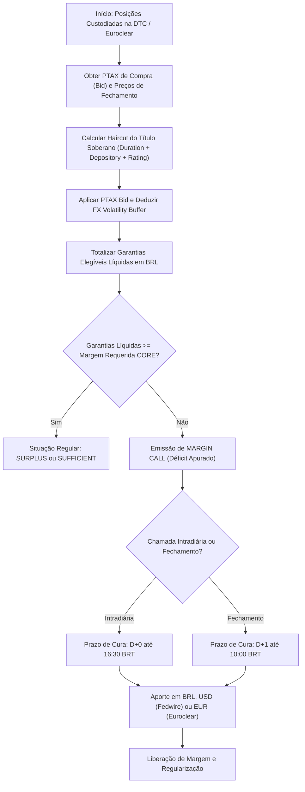

# Especificação Técnica: Gestão de Garantias Transfronteiriças via Euroclear e DTC (FL-067)

## 1. Visão Geral e Contexto Regulatório

A **Câmara B3** atua como Contraparte Central (CCP — *Central Counterparty*) para todos os mercados de derivativos, ações, renda fixa privada e pública, e empréstimo de ativos no Brasil. Para mitigar o risco de crédito de contraparte em conformidade com as recomendações internacionais do **CPMI-IOSCO PFMI** (*Principles for Financial Market Infrastructures*, especificamente o **Princípio 5: Colaterais** e o **Princípio 17: Risco Operacional e Custódia**), a B3 provê aos investidores e participantes internacionais mecanismos eficientes para o aporte de garantias soberanas mantidas em Centrais Depositárias Internacionais (ICSDs e CSDs estrangeiras).

O fluxo **FL-067: Gestão de Garantias Transfronteiriças** implementa a esteira integrada de recepção, validação, avaliação a valor de mercado (*mark-to-market*), haircuts regulatórios multinível, conversão cambial conservadora via PTAX, buffer de volatilidade cambial e apuração contínua de margem para ativos soberanos custodiados na:
1. **Depository Trust Company (DTC / DTCC)** (Nova York, Estados Unidos): Custodiante central norte-americana para *US Treasuries* (T-Bills, T-Notes e T-Bonds), integrada via contas participantes diretas e liquidação *Fedwire Securities* do Federal Reserve.
2. **Euroclear Bank** (Bruxelas, Bélgica): Depositária Central Internacional (*International Central Securities Depository* — ICSD), operando através de contas segregadas e serviços de gestão tripartite de garantias (*Triparty Collateral Management / Autocollateralisation*), admitindo títulos soberanos da República Federal da Alemanha (*German Bunds, Bobls e Bubills*) e outros títulos soberanos G10 de elevada qualidade creditícia.

---

## 2. Instrumentos Soberanos Elegíveis e Metodologia de Custódia

| Código de Ativo | Tipo de Instrumento | Emissor Soberano | Moeda | Local de Custódia | Canal de Liquidação |
|---|---|---|---|---|---|
| `US_TREASURY_BILL` | US Treasury Bill (< 1 ano) | Estados Unidos (`US`) | USD | DTC (DTCC NY) | Transferência FOP (*Free of Payment*) via DTC Participant Account. |
| `US_TREASURY_NOTE` | US Treasury Note (1 a 10 anos)| Estados Unidos (`US`) | USD | DTC (DTCC NY) | Transferência FOP via DTC / Fedwire Securities. |
| `US_TREASURY_BOND` | US Treasury Bond (> 10 anos) | Estados Unidos (`US`) | USD | DTC / Euroclear | Transferência FOP / Triparty Collateral Instruction. |
| `GERMAN_BUBILL` | Bubill (< 1 ano, cupom zero) | Alemanha (`DE`) | EUR | Euroclear Bank | Instrução Triparty / SWIFT MT542 na Euroclear Brussels. |
| `GERMAN_BOBL` | Bobl (Bundesobligationen, ~5 anos)| Alemanha (`DE`) | EUR | Euroclear Bank | Instrução Triparty / SWIFT MT542 na Euroclear Brussels. |
| `GERMAN_BUND` | Bund (Bundesanleihen, 10 a 30 anos)| Alemanha (`DE`) | EUR | Euroclear Bank | Instrução Triparty / SWIFT MT542 na Euroclear Brussels. |
| `UK_GILT` | UK Conventional Gilt | Reino Unido (`UK`) | GBP | Euroclear Bank | Instrução Triparty / CREST link na Euroclear. |

### 2.1 Requisitos Estritos de Elegibilidade
1. **Qualidade Creditícia Soberana**:
   - Apenas títulos de dívida soberana com rating de crédito igual ou superior a **BBB-** (mínimo grau de investimento) pelas agências Fitch, Moody's ou S&P são elegíveis.
   - Ativos de emissores em grau especulativo (< BBB-) sofrem rejeição imediata (`IneligibleSovereignError`), com valor líquido de garantia zerado.
2. **Filtro de Sanções Financeiras Internacionais**:
   - Moedas ou jurisdições sob sanções internacionais emitidas pela OFAC ou Conselho de Segurança da ONU (`RUB`, `IRR`, `KPW`, `SYR`, `VEF`, `CUP`, `BYN`) sofrem bloqueio mandatório e rejeição com código de erro `BlockedCurrencyError`.
3. **Maturidade Residual**:
   - Títulos devem ter prazo residual superior a 3 dias úteis até a data de vencimento final.
4. **Precificação Transparente**:
   - Exigência de cotação pública de fechamento (*dirty price*) apurada em provedores de mercado homologados (Bloomberg, Refinitiv ou Federal Reserve H.15 / Bundesbank).

---

## 3. Conversão Cambial Multimoeda via PTAX

O sistema de mensuração de risco **CORE B3** unifica todos os requerimentos de margem em **Reais (BRL)**. Desta forma, ativos cotados em moeda estrangeira (USD, EUR, GBP) devem ser convertidos deterministicamente.

### 3.1 Princípio do Conservadorismo Prudencial da CCP
O Banco Central do Brasil (BACEN) divulga quatro boletins diários de taxas de câmbio PTAX, consolidando no final da tarde o Boletim de Fechamento com:
- **Taxa de Compra (*Bid Rate*)**: Taxa pela qual os bancos compram moeda estrangeira.
- **Taxa de Venda (*Ask Rate*)**: Taxa pela qual os bancos vendem moeda estrangeira.
- **Taxa Intermediária (*Mid Rate*)**: Média aritmética entre compra e venda.

> [!IMPORTANT]
> A Câmara B3 adota estritamente a **PTAX de Compra (*Bid Rate*)** na avaliação de garantias em moeda estrangeira. Caso ocorra inadimplência do participante, a CCP liquidará o ativo e venderá a moeda estrangeira no mercado interbancário para obter Reais (BRL) pela taxa de compra, garantindo que o valor avaliado reflita o valor realizável de liquidação forçada.

### 3.2 Paridade Triangular e Cotações Cruzadas
Para validação de consistência entre cotações cruzadas (ex: EUR/USD), a taxa sintética calculada deve respeitar a paridade das cotações diretas BACEN com tolerância máxima de arredondamento:

$$\text{CrossRate}(EUR/USD) = \frac{\text{PTAX}_{mid}(EUR/BRL)}{\text{PTAX}_{mid}(USD/BRL)}$$

$$\left| \text{PTAX}_{mid}(EUR/BRL) - \left(\text{CrossRate}(EUR/USD) \times \text{PTAX}_{mid}(USD/BRL)\right) \right| \le 0.05$$

---

## 4. Matriz de Haircuts de Títulos Soberanos

O deságio de avaliação do título soberano ($H_{bond}$) é composto aditivamente por três componentes independentes:

$$H_{bond} = H_{base}(issuer, tenor) + H_{depository} + H_{credit}$$

### 4.1 Escadinha de Haircut Base por Prazo Residual (*Tenor Buckets*)
A duration e o risco de oscilação da taxa de juros do país emissor exigem deságios crescentes com o prazo residual até o vencimento:

| Tenor Bucket | Prazo Residual ($T$) | US Treasuries (USD) | German Bunds (EUR) | UK Gilts (GBP) |
|---|---|---|---|---|
| `UP_TO_1Y` | $T \le 1.0$ ano | **1.00%** | **1.00%** | **1.50%** |
| `FROM_1Y_TO_3Y` | $1.0 < T \le 3.0$ anos | **2.00%** | **2.00%** | **2.50%** |
| `FROM_3Y_TO_5Y` | $3.0 < T \le 5.0$ anos | **3.50%** | **3.50%** | **4.00%** |
| `FROM_5Y_TO_10Y` | $5.0 < T \le 10.0$ anos | **5.00%** | **5.00%** | **6.00%** |
| `OVER_10Y` | $T > 10.0$ anos | **8.00%** | **8.00%** | **9.00%** |

### 4.2 Adicional de Depositária Internacional ($H_{depository}$)
Absorve custos de liquidação transfronteiriça, fusos horários de custódia e eventuais tarifas de transferência CSD-to-CSD:
- **DTC (DTCC Nova York)**: **+0.20%**
- **Euroclear Bank (Bruxelas)**: **+0.25%**
- **Clearstream Banking**: **+0.25%**

### 4.3 Adicional de Rating de Crédito Soberano ($H_{credit}$)
Ajusta o deságio caso a dívida soberana do emissor sofra rebaixamento na escala de rating:
- **AAA / AA+**: **+0.00%** (Isento)
- **AA / AA-**: **+0.50%**
- **A+ / A / A-**: **+1.50%**
- **BBB+ / BBB / BBB-**: **+3.00%** (Limite mínimo de investimento)
- **Abaixo de BBB-**: **Rejeição Imediata** (`IneligibleSovereignError`)

---

## 5. Buffer de Volatilidade Cambial (FX Volatility Buffer)

### 5.1 Racionalidade de Risco
A exigência de garantia calculada pelo sistema CORE é denominada em Reais (BRL). Se o participante deposita títulos em moeda estrangeira (USD, EUR, GBP), a câmara fica exposta ao risco de desvalorização dessa moeda frente ao Real durante o período necessário para decretar o default, executar o colateral na depositária internacional e converter os recursos em BRL (janela de close-out $h = 2$ dias úteis).

### 5.2 Modelo Paramétrico com Piso Regulatório
O **Buffer de Volatilidade Cambial** ($Buffer_{fx}$) é formulado matematicamente com nível de confiança estatístico de 99% ($z = 2.33$):

$$Buffer_{calc} = z_{99\%} \times \sigma_{daily\_fx} \times \sqrt{h}$$

$$Buffer_{fx} = \max\left(\text{Piso Regulatório Mínimo}, Buffer_{calc}\right)$$

| Moeda | Volatilidade Diária ($\sigma_{daily}$) | Horizonte ($h$) | $Buffer_{calc}$ (99%) | Piso Mínimo Regulatório | Buffer Efetivo Aplicado |
|---|---|---|---|---|---|
| **USD** | 1.20% | 2 dias | 3.95% | **5.00%** | **5.00%** |
| **EUR** | 1.40% | 2 dias | 4.61% | **6.00%** | **6.00%** |
| **GBP** | 1.60% | 2 dias | 5.27% | **7.00%** | **7.00%** |

> [!NOTE]
> Em cenários de estresse agudo onde a volatilidade cambial diária supera os parâmetros históricos (ex: $\sigma_{USD} \ge 3.0\%$), a parcela paramétrica $Buffer_{calc}$ assume valor superior ao piso (ex: 9.89%), expandindo dinamicamente a proteção da CCP.

### 5.3 Equação de Avaliação Líquida da Garantia
Para cada posição de título soberano internacional $i$:

1. **Valor Bruto em Moeda Original**:
   $$V_{gross\_fx}^{(i)} = \text{Quantidade}^{(i)} \times \text{Preço Unitário}^{(i)}$$

2. **Dedução do Haircut do Título**:
   $$V_{post\_haircut\_fx}^{(i)} = V_{gross\_fx}^{(i)} \times (1 - H_{bond}^{(i)})$$

3. **Conversão Conservadora em BRL (PTAX Bid)**:
   $$V_{conv\_brl}^{(i)} = V_{post\_haircut\_fx}^{(i)} \times PTAX_{bid}$$

4. **Aplicação do Buffer de Volatilidade Cambial**:
   $$D_{buffer\_brl}^{(i)} = V_{conv\_brl}^{(i)} \times Buffer_{fx}$$
   $$V_{net\_eligible\_brl}^{(i)} = V_{conv\_brl}^{(i)} - D_{buffer\_brl}^{(i)} = V_{gross\_fx}^{(i)} \times (1 - H_{bond}^{(i)}) \times PTAX_{bid} \times (1 - Buffer_{fx})$$

---

## 6. Apuração de Margem e Workflow de Margin Call

### 6.1 Trava de Segurança na Desoneração (Safe-Release Guardrail)
Quando um participante solicita o desbloqueio/devolução de parte de seus títulos mantidos no exterior, o motor executa uma simulação síncrona:
$$\sum V_{net\_remanescente} \ge M_{requerida}$$
Se a liberação pretendida resultar em déficit de margem, o sistema aborta a operação atipicamente e dispara `MarginReleaseViolationError`, preservando a integridade da câmara.

---

## 7. Leis Formais de Conservação e Invariantes Comprovadas

| Lei Formal | Descrição Matemática | Garantia de Risco |
|---|---|---|
| **Lei 1: Não-Negatividade e Limitação Superior** | $0 \le V_{net\_eligible\_brl} \le V_{gross\_brl}$ | O valor aceito nunca é negativo e nunca supera o valor bruto de mercado convertido. |
| **Lei 2: Monotonicidade da Matriz de Tenor** | $T_1 \le T_2 \implies H(T_1) \le H(T_2)$ | Títulos mais longos possuem deságio estritamente não-decrescente. |
| **Lei 3: Co-domínio Bounded [0, 1)** | $0 \le H_{bond} < 1.0$ e $0 \le Buffer_{fx} < 1.0$ | Impossibilidade matemática de deságios negativos ou confisco integral. |
| **Lei 4: Paridade Cambial Triangular** | $\left| \text{PTAX}_{EUR} - (\text{Cross}_{EUR/USD} \times \text{PTAX}_{USD}) \right| \le 0.05$ | Consistência de arbitragem entre moedas conversíveis. |
| **Lei 5: Determinismo e Monotonicidade de Margem** | $\frac{\partial \Delta M}{\partial M_{req}} \ge 0, \quad \frac{\partial \Delta M}{\partial PTAX} \le 0$ | Aumento de margem requerida nunca reduz o déficit apurado. |
| **Lei 6: Conservação de Custódia Transfronteiriça** | $\sum Q_{interno} = \sum Q_{extrato\_dtc/euroclear}$ | Nenhuma unidade de título soberano é duplicada ou extraviada entre as centrais. |
| **Lei 7: Trava Anti-Déficit de Desoneração** | $\Delta M_{pos\_liberacao} > 0 \implies \text{REJEIÇÃO}$ | Nenhuma liberação de colateral pode gerar descolateralização. |
| **Lei 8: Rejeição Estrita de Sanções e Especulativos** | $\text{Rating} < \text{BBB-} \lor \text{Moeda} \in \text{Sanções} \implies V_{net} = 0$ | Blindagem jurídica e institucional da CCP contra ativos tóxicos. |

---

## 8. Interfaces e Componentes do Módulo

- **Módulo Python**: `src/cross_border_collateral.py`
- **Fixture Sintética**: `fixtures/cross_border_collateral.json`
- **Suíte de Testes**: `tests/test_cross_border_collateral.py`
- **Verificador de Invariantes**: Integrado ao pipeline central `scripts/verify_invariants.py`
