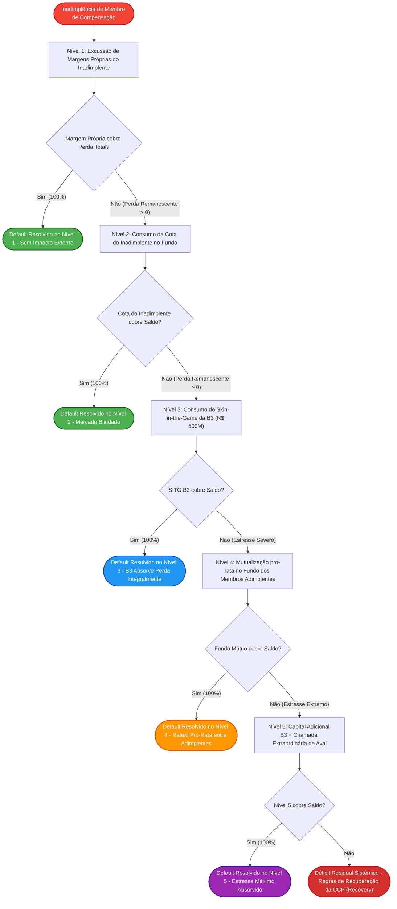

# Especificação Técnica da Estrutura de Salvaguardas e Cascata de Inadimplência da Câmara B3 (FL-055)
## Princípios CPMI-IOSCO para Infraestruturas do Mercado Financeiro (PFMI 4 e 7), Lei nº 10.214/2001 e Regulamento da Câmara B3

---

## 1. Visão Geral e Fundamentação Regulatória

No papel de **Contraparte Central (CCP - *Central Counterparty*)**, a **Câmara B3** interpõe-se entre compradores e vendedores nos mercados de ações, derivativos listados, balcão organizado, câmbio pronto e renda fixa privada e pública, tornando-se compradora de todo vendedor e vendedora de todo comprador. Essa garantia multilateral assegura a estabilidade e a liquidez do Sistema Financeiro Nacional (SFN), blindando o mercado contra o risco de contágio sistêmico.

A estrutura de gestão de risco de inadimplência da Câmara B3 é regida pelas seguintes bases regulatórias e legais:

1. **Lei Federal nº 10.214/2001 (Compensação e Liquidação no SPB)**:
   - **Art. 2º ao 5º**: Estabelece a irrevogabilidade e a definitividade dos pagamentos e liquidações multilaterais processadas nas câmaras autorizadas pelo Banco Central do Brasil (BACEN).
   - **Art. 4º**: Consagra a **segregação patrimonial e inoponibilidade** dos ativos, garantias e margens depositadas na câmara em face de qualquer processo de falência, insolvência civil ou intervenção/liquidação extrajudicial decretada contra o participante inadimplente.
2. **Princípios CPMI-IOSCO para Infraestruturas do Mercado Financeiro (PFMI - *Principles for Financial Market Infrastructures*)**:
   - **Princípio 4 (Risco de Crédito)**: Determina que a CCP deve manter recursos financeiros dedicados suficientes para cobrir com alto grau de confiança as obrigações de liquidação decorrentes do default dos dois maiores participantes e suas coligadas em termos de exposição agregada de risco (critério internacional **Cover 2**).
   - **Princípio 7 (Risco de Liquidez)**: Exige que a CCP mantenha recursos líquidos e mecanismos imediatos de monetização de colaterais em D0 para honrar todas as liquidações financeiras multilaterais sem interrupção.
3. **Regulamento da Câmara B3 (Capítulo VII — Salvaguardas Financeiras e Tratamento de Inadimplência)** e **Manual de Risco CORE (*Closeout and Risk Engine*)**:
   - Disciplina a sequência cronológica e determinística de absorção de perdas em múltiplos patamares escalonados — denominada **Cascata de Inadimplência (*Default Waterfall*)**.

```
+-------------------------------------------------------------------------------------------------------------------------------+
|                                    CASCATA DE INADIMPLÊNCIA DA CÂMARA B3 — CPMI-IOSCO (FL-055)                                 |
+-------------------------------------------------------------------------------------------------------------------------------+
|                                                                                                                               |
|   [ EVENTO DE DEFAULT ] ---> Membro de Compensação Inadimplente (Falta de liquidação financeira ou margem intraday)          |
|                                                                                                                               |
|         |                                                                                                                     |
|         v                                                                                                                     |
|   +-----------------------------------------------------------------------------------------------------------------------+   |
|   | NÍVEL 1: MARGEM E GARANTIAS PRÓPRIAS DO PARTICIPANTE INADIMPLENTE                                                      |   |
|   | Colateral Próprio do Membro (Títulos Públicos, Ações elegíveis, Moeda Soberana BRL/USD, Fiança Bancária)               |   |
|   +-----------------------------------------------------------------------------------------------------------------------+   |
|         |                                                                                                                     |
|         +---> Se Garantias >= Perda Bruta: DEFAULT RESOLVIDO 100% (Recursos de terceiros blindados)                           |
|         |                                                                                                                     |
|         v Se Perda Remanescente > 0                                                                                           |
|   +-----------------------------------------------------------------------------------------------------------------------+   |
|   | NÍVEL 2: CONTRIBUIÇÃO DO INADIMPLENTE AO FUNDO DE LIQUIDAÇÃO DA CÂMARA                                                |   |
|   | Cota Ordinária compulsória depositada pelo próprio membro de compensação inadimplente no Fundo de Liquidação B3       |   |
|   +-----------------------------------------------------------------------------------------------------------------------+   |
|         |                                                                                                                     |
|         +---> Se Cota Inadimplente >= Saldo da Perda: DEFAULT RESOLVIDO (Recursos de terceiros blindados)                     |
|         |                                                                                                                     |
|         v Se Perda Remanescente > 0                                                                                           |
|   +-----------------------------------------------------------------------------------------------------------------------+   |
|   | NÍVEL 3: CAPITAL PRÓPRIO DA B3 DEDICADO AO RISCO (SKIN-IN-THE-GAME / SITG PRÉ-MUTUALIZADO)                           |   |
|   | Patrimônio Próprio da B3 alocado compulsoriamente antes de atingir os participantes não-inadimplentes (ex: R$ 500 Mi) |   |
|   +-----------------------------------------------------------------------------------------------------------------------+   |
|         |                                                                                                                     |
|         +---> Se SITG B3 >= Saldo da Perda: DEFAULT ABSORVIDO PELA B3 (Membros Adimplentes Intocados)                         |
|         |                                                                                                                     |
|         v Se Perda Remanescente > 0 (Estresse Severo Sistêmico)                                                               |
|   +-----------------------------------------------------------------------------------------------------------------------+   |
|   | NÍVEL 4: FUNDO DE LIQUIDAÇÃO MÚTUO — MEMBROS DE COMPENSAÇÃO ADIMPLENTES                                               |   |
|   | Rateio pro-rata entre as cotas dos Membros de Compensação Adimplentes conforme peso de risco e contribuição ordinária  |   |
|   +-----------------------------------------------------------------------------------------------------------------------+   |
|         |                                                                                                                     |
|         +---> Se Cotas Mútuas >= Saldo da Perda: DEFAULT RESOLVIDO COM MUTUALIZAÇÃO SETORIAL                                  |
|         |                                                                                                                     |
|         v Se Perda Remanescente > 0 (Cenário Extremo Catastrófico além do Cover 2)                                            |
|   +-----------------------------------------------------------------------------------------------------------------------+   |
|   | NÍVEL 5: CAPITAL ADICIONAL DA B3 E CHAMADA EXTRAORDINÁRIA DE AVAL AOS ADIMPLENTES                                     |   |
|   | SITG Complementar B3 + Assessment Calls (limitadas ao teto estatutário de até 100% ou 200% da cota ordinária)        |   |
|   +-----------------------------------------------------------------------------------------------------------------------+   |
|         |                                                                                                                     |
|         v                                                                                                                     |
|   [ INVARIANTE FORMAL DE CONSERVAÇÃO: Perda_Total == Soma(Recursos_Consumidos_Níveis_1_a_5) + Déficit_Residual_Se_Houvesse ]  |
|                                                                                                                               |
+-------------------------------------------------------------------------------------------------------------------------------+
```

---

## 2. Estrutura Detalhada dos 5 Níveis de Salvaguardas

A hierarquia da cascata estabelece incentivos econômicos rigorosamente alinhados: o poluidor-pagador é punido primeiro (Níveis 1 e 2), a administradora da infraestrutura arrisca seu próprio capital para mitigar o risco moral antes de atingir o mercado (Nível 3), e somente em estresse extremo o mecanismo de garantia mútua setorial é mobilizado (Níveis 4 e 5).

### Nível 1: Margem e Garantias Próprias do Participante Inadimplente (`LEVEL_1_DEFAULTER_MARGINS`)
- **Composição**: Margens de garantia iniciais e adicionais depositadas pelo Membro de Compensação inadimplente em suas contas próprias e de clientes devedores, mantidas em custódia na B3 sob as contas de liquidação e salvaguarda (IMBARQ014 / SLC).
- **Tipos de Ativos Elegíveis**: Moeda corrente nacional (BRL via conta de liquidação no BACEN/SELIC), Títulos Públicos Federais (LTN, LFT, NTN-B, NTN-F avaliados com *haircut* prudencial), Ações elegíveis do índice IBOVESPA/IBrX-100 com corte de liquidez, Ouro físico ativo financeiro, e Cartas de Fiança Bancária emitidas por bancos de primeira linha.
- **Excussão**: Automática e imediata em D0 pela Câmara B3. Os ativos são liquidados a mercado (*close-out* e leilões de encerramento) ou transferidos para a conta de liquidação para cobrir o saldo devedor.

### Nível 2: Contribuição do Inadimplente ao Fundo de Liquidação da Câmara (`LEVEL_2_DEFAULTER_FUND_CONTRIBUTION`)
- **Composição**: Cota individual ordinária depositada pelo próprio membro de compensação inadimplente no Fundo de Liquidação da Câmara B3.
- **Propósito**: Executar a totalidade do aporte pré-financiado do participante faltoso antes de qualquer mobilização de recursos de outros membros ou da própria infraestrutura.
- **Efeito Regulamentar**: A cota do faltoso é integralmente retida e expropriada para abater a perda.

### Nível 3: Capital Próprio da B3 Dedicado ao Risco — *Skin-in-the-Game* (`LEVEL_3_B3_SKIN_IN_THE_GAME`)
- **Composição**: Recursos próprios da B3 alocados em caráter irrevogável e prioritário para absorção de perdas decorrentes de default, mantidos em ativos de altíssima liquidez e baixo risco de mercado (ex.: Títulos Públicos pós-fixados ou depósitos no Banco Central).
- **Montante Estatutário**: Fixado pelo Conselho de Administração da B3 e revisado periodicamente conforme as diretrizes do CPMI-IOSCO (ex.: R$ 500.000.000,00).
- **Função Econômica**: Alinhar os incentivos da contraparte central à excelência dos modelos de risco (CORE/Value-at-Risk), eliminando o risco moral (*moral hazard*) de relaxar exigências de margem às custas dos membros adimplentes.

### Nível 4: Fundo de Liquidação Mútuo — Cotas dos Membros Adimplentes (`LEVEL_4_MUTUALIZED_DEFAULT_FUND`)
- **Composição**: Pool mutualizado composto pelas cotas ordinárias pré-financiadas depositadas pelos **Membros de Compensação Não-Inadimplentes (Adimplentes)**.
- **Mecanismo de Rateio (*Pro-Rata Rule*)**:
  - A perda que ultrapassar os Níveis 1 a 3 é repartida entre todos os membros adimplentes na proporção de sua contribuição ordinária relativa ao fundo mútuo ou de sua participação na exposição de risco global apurada pela câmara.
  - **Fórmula Formal de Rateio**:
    $$\text{Rateio}_i = \min\left(\text{Cota}_i, \text{Perda\_Restante} \times \frac{\text{Cota}_i}{\sum_{k \in \text{Adimplentes}} \text{Cota}_k}\right)$$
  - **Ajuste de Centavos**: Resolução determinística de frações de centavos financeiros (*rounding remainder*) atribuída com precisão decimal, evitando distorções contábeis.

### Nível 5: Capital Adicional da B3 e Chamada Extraordinária de Aval (`LEVEL_5_ADDITIONAL_B3_ASSESSMENT_CALLS`)
- **Composição**: Segunda camada de recursos próprios da B3 (*Second SITG Tranche*) combinada com a faculdade regulamentar de emitir **Chamadas de Aval Extraordinárias (*Assessment Calls*)** aos membros adimplentes.
- **Teto Regulamentar (*Assessment Cap*)**:
  - Para evitar exposição ilimitada e risco de contágio descontrolado, a chamada extraordinária de cada membro adimplente é estritamente limitada a um teto percentual sobre sua cota ordinária original (ex.: até 100% ou 200% da cota ordinária).
- **Prazo de Recomposição**: Conforme regulamento, se ativado o Nível 5, os membros adimplentes devem honrar o aporte em até 1 dia útil (D+1), e a recomposição do fundo pleno deve ocorrer em até 5 dias úteis.

---

## 3. Diagrama Sequencial de Execução da Cascata



---

## 4. Invariante Financeira da Cascata e Conservação Matemática

O processamento da cascata é submetido a uma prova formal de conservação matemática contábil:

$$\text{Perda\_Total} \equiv \sum_{l=1}^{5} \text{Recurso\_Consumido}(l) + \text{Déficit\_Residual}$$

Em qualquer cenário de resolução regular:
1. $\text{Déficit\_Residual} = 0$.
2. Para cada nível $l$:
   $$\text{Recurso\_Consumido}(l) = \min\left(\text{Recurso\_Disponível}(l), \text{Saldo\_Perda\_Entrada}(l)\right)$$
   $$\text{Recurso\_Excedente}(l) = \text{Recurso\_Disponível}(l) - \text{Recurso\_Consumido}(l)$$
   $$\text{Saldo\_Perda\_Saída}(l) = \text{Saldo\_Perda\_Entrada}(l) - \text{Recurso\_Consumido}(l)$$
3. **Conservação Individual no Nível 4 e Nível 5**:
   $$\sum_{i \in \text{Adimplentes}} \text{Impacto}_i \equiv \text{Recurso\_Consumido}(\text{Nível})$$
   Garantia à precisão de centavos sem arredondamento truncado (*zero leakage*).

---

## 5. Matriz de Cenários de Estresse Homologados

| Identificador do Cenário | Perfil de Default | Membro Inadimplente | Perda Bruta | Nível Máximo Atingido | Impacto em Membros Adimplentes | Resultado Operacional |
| :--- | :--- | :--- | :--- | :--- | :--- | :--- |
| **`SCENARIO_SMALL_DEFAULT`** | Pequeno Descolamento Operacional | `MC-00105` (XP CCTVM) | R$ 120.000.000,00 | **Nível 1** | R$ 0,00 (Blindagem Total) | Absorvido pelas garantias do faltoso (Excedente de R$ 180M retornado/preservado). |
| **`SCENARIO_MEDIUM_DEFAULT`** | Médio Default (Quebra de Mesa Prop) | `MC-00033` (Santander CCTVM) | R$ 480.000.000,00 | **Nível 3** | R$ 0,00 (Blindagem Total) | Consome N1 (R$ 250M), N2 (R$ 70M) e R$ 160M do SITG B3 (N3). Adimplentes 100% preservados. |
| **`SCENARIO_SEVERE_SYSTEMIC_DEFAULT`** | Severo Sistêmico (Pânico / Flash Crash) | `MC-00088` (BTG Pactual CTVM) | R$ 1.600.000.000,00 | **Nível 4** | R$ 600.000.000,00 (Rateio Pro-Rata) | Consome N1 (R$ 400M), N2 (R$ 100M), N3 (R$ 500M SITG B3) e R$ 600M do Fundo Mútuo N4. |
| **`SCENARIO_EXTREME_CATASTROPHIC`** | Catastrófico além do Cover 2 | `MC-00237` (Bradesco BBI CTVM) | R$ 2.450.000.000,00 | **Nível 5** | R$ 800M (N4) + R$ 400M (Assessment N5) | Exaure N1 a N4 e aciona N5 com R$ 250M SITG Adicional B3 e R$ 400M em chamadas extraordinárias de aval. |

---

## 6. Cronograma Operacional e Prazos Regulamentares

```
D0 - 08:30 às 10:00 | Constatação de inadimplência na janela do SPB (falta de aporte de liquidação multilateral).
D0 - 10:15          | Comitê de Risco B3 declara formalmente o Default; corte de conexões PUMA/DMA do membro faltoso.
D0 - 10:30 às 11:30 | Excussão de Margens Próprias (Nível 1) e Confisco da Cota Ordinária no Fundo (Nível 2).
D0 - 12:00          | Mobilização do Skin-in-the-Game pré-mutualizado B3 (Nível 3).
D0 - 13:00          | Se necessário, apuração e execução do débito pro-rata no Fundo Mútuo dos Adimplentes (Nível 4).
D0 - 14:00          | Liquidação financeira multilateral honrada pelo SPB sem descontinuidade para o mercado.
D+1 - 10:00         | Liquidação das Chamadas Extraordinárias de Aval (Nível 5), caso ativadas.
D+5                 | Recomposição integral dos patamares estatutários das salvaguardas e Fundo de Liquidação B3.
```
