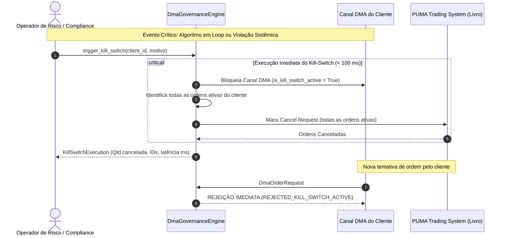

# Especificação Técnica de Governança de Provedores de DMA e Filtros Pré-Trade B3 (FL-045)

## 1. Visão Geral e Fundamentação Regulatória

No ecossistema de negociação eletrônica da **B3 S.A. – Brasil, Bolsa, Balcão**, o **Direct Market Access (DMA)** viabiliza que clientes institucionais, algoritmos automatizados e investidores de varejo enviem ordens diretamente para o ambiente de negociação da bolsa (**PUMA Trading System**). 

A governança desse acesso é estritamente regulamentada pela **Resolução CVM nº 35, de 26 de maio de 2021** (que revogou e substituiu a Instrução CVM nº 505/2011), pelo **Manual de Procedimentos Operacionais de Negociação da B3**, pelas **Regras de Acesso e Conectividade da B3** e pelas diretrizes de supervisão da **BSM Supervisão de Mercados**.

O preceito fundamental da Resolução CVM 35 estabelece a **responsabilidade indelegável do intermediário (Corretora / Participante de Negociação Pleno - PNP)**. Mesmo nas modalidades onde o cliente usufrui de canais de ultrabaixa latência (como co-location), a custódia, o risco, as ordens e a integridade sistêmica permanecem sob total titularidade e controle do intermediário credenciado.

```
+------------------------------------------------------------------------------------------------------------------------+
|                                    ARQUITETURA GERAL DE GOVERNANÇA DMA NA B3 (FL-045)                                   |
+------------------------------------------------------------------------------------------------------------------------+
|                                                                                                                        |
|   +-------------------+  +-------------------+  +--------------------------+  +------------------------------------+   |
|   |   CLIENTE DMA 1   |  |   CLIENTE DMA 2   |  |      CLIENTE DMA 3       |  |           CLIENTE DMA 4            |   |
|   |  Home Broker/Web  |  | Broker Algorithms |  | Servidor Próprio Cliente |  | Co-location B3 (Santana Parnaíba) |   |
|   +-------------------+  +-------------------+  +--------------------------+  +------------------------------------+   |
|             |                      |                          |                                  |                     |
|             v                      v                          |                                  |                     |
|     [ OMS Corretora ]      [ Servidor Algo ]                  |                                  |                     |
|             |                      |                          |                                  |                     |
|             \----------------------/                          |                                  |                     |
|                        |                                      |                                  |                     |
|                        +-----------------------+              |                                  |                     |
|                                                v              v                                  v                     |
|                        +---------------------------------------------------------------------------------+             |
|                        |             GATEWAY DE RISCO PRÉ-TRADE EXCLUSIVO DA CORRETORA (FL-045)          |             |
|                        |                                                                                 |             |
|                        |   1. Kill-Switch Check         2. Throttling / Rate-Limiter (Sliding Window)    |             |
|                        |   3. Verificação Modelo DMA    4. Max Order Quantity (Lote Máximo)              |             |
|                        |   5. Max Order Value (R$)      6. Túnel de Preço Rejeição (% vs Ref)            |             |
|                        |   7. Posição Máxima Descoberta intradiária (Short-Selling Control)              |             |
|                        +---------------------------------------------------------------------------------+             |
|                                                |                                                                       |
|                               +----------------+----------------+                                                     |
|                               | Aprovada                        | Rejeitada / Bloqueada                                 |
|                               v                                 v                                                     |
|             +------------------------------------+    +------------------------------------+                          |
|             |  PUMA Trading System (Matching)    |    |  Rejeição Imediata ao Cliente      |                          |
|             |  FIX 4.4 / FIX 5.0 SP2 / SBE       |    |  + Notificação Drop Copy Corretora |                          |
|             +------------------------------------+    +------------------------------------+                          |
|                                                                                                                        |
+------------------------------------------------------------------------------------------------------------------------+
```

---

## 2. Especificação Técnica dos 4 Modelos de DMA da B3

A B3 classifica e homologa quatro modalidades distintas de acesso direto, cada qual desenhada para perfis específicos de participantes, topologias de conectividade e requisitos de latência:

```mermaid
flowchart TD
    subgraph ModelosDMA ["Modelos de Acesso Direto ao Mercado (DMA B3)"]
        direction TB
        
        subgraph DMA1 ["DMA 1: Tradicional (Broker Infrastructure)"]
            D1_Cli["Cliente (Web / Mobile / Desktop)"] -->|Internet / VPN| D1_OMS["OMS / Home Broker Corretora"]
            D1_OMS -->|Validação Risco Pré-Trade| D1_GW["Gateway B3 Corretora"]
            D1_GW -->|FIX 4.4 / 5.0 SP2| PUMA_1["PUMA Entrypoint"]
        end
        
        subgraph DMA2 ["DMA 2: Via Algoritmo (Broker Algo)"]
            D2_Cli["Gestora / Mesa / Cliente"] -->|Parametrização| D2_Algo["Servidor de Algoritmos (Corretora)"]
            D2_Algo -->|Ordens Geradas (TWAP/VWAP)| D2_Risk["Gateway de Risco Pré-Trade"]
            D2_Risk -->|SBE / FIX| PUMA_2["PUMA Entrypoint"]
        end
        
        subgraph DMA3 ["DMA 3: Direct to Exchange"]
            D3_Cli["Servidor Cliente (Extranet / Link Dedicado)"] -->|FIX / SBE| D3_Risk["Gateway de Risco Corretora (Inline)"]
            D3_Risk -->|Aprovada| PUMA_3["PUMA Entrypoint"]
        end
        
        subgraph DMA4 ["DMA 4: Co-location Santana de Parnaíba"]
            D4_Cli["Servidor Cliente (Rack Data Center B3)"] -->|Fibra 10G/40G Cross-Connect| D4_Risk["Gateway Risco Corretora (Local SP)"]
            D4_Risk -->|SBE Little-Endian < 50µs| PUMA_4["PUMA Matching Engine"]
        end
    end
```

### 2.1 Modelo DMA 1 — Tradicional (Infraestrutura da Corretora)
* **Definição**: Modalidade clássica na qual o investidor se conecta diretamente às plataformas e interfaces fornecidas pela Corretora (Home Broker, plataformas web, terminais desktop proprietários ou aplicações móveis).
* **Topologia**:
  $$\text{Cliente} \xrightarrow{\text{HTTPS / WebSockets}} \text{Front-end Corretora} \xrightarrow{} \text{OMS Corretora} \xrightarrow{} \text{Gateway de Risco} \xrightarrow{\text{FIX 4.4 / 5.0 SP2}} \text{PUMA B3}$$
* **Características**:
  - O controle da ordem e de sua sessão lógica pertence integralmente ao Order Management System (OMS) da corretora.
  - A validação de limites ocorre no OMS antes da montagem e transmissão da mensagem FIX para a bolsa.
  - Latência típica ponta-a-ponta: **5 ms a 50 ms**.
  - Indicado para investidores de varejo, pessoas físicas, clientes institucionais discricionários e bancas de *wealth management*.

### 2.2 Modelo DMA 2 — Via Algoritmo (*Broker Algo*)
* **Definição**: Ordens são originadas, fatiadas ou roteadas por algoritmos de negociação proprietários da Corretora ou desenvolvidos por fornecedores de software certificados, hospedados dentro do data center e infraestrutura da Corretora.
* **Topologia**:
  $$\text{Cliente / Gestor} \xrightarrow{\text{FIX Tag 847 / API}} \text{Algo Engine (Corretora)} \xrightarrow{\text{Slices / Child Orders}} \text{Gateway de Risco} \xrightarrow{\text{FIX / SBE}} \text{PUMA B3}$$
* **Características**:
  - Algoritmos clássicos de execução institucional: TWAP (*Time-Weighted Average Price*), VWAP (*Volume-Weighted Average Price*), POV (*Percentage of Volume*), Implementation Shortfall, Iceberg / Reserva Oculta, Snipers.
  - A Corretora é responsável pela homologação, calibração e salvaguardas dos algoritmos contra loops infinitos e disparos em cascata.
  - Latência típica: **1 ms a 5 ms**.
  - Indicado para fundos institucionais de ações (long-only, hedge funds) que demandam minimização de impacto de mercado em grandes ordens.

### 2.3 Modelo DMA 3 — Acesso Direto com Risco Prévio (*Direct to Exchange*)
* **Definição**: Conexão lógica direta entre a infraestrutura do cliente (servidores próprios do cliente fora do data center da B3) e o PUMA Trading System da B3, passando **obrigatoriamente por um Gateway de Risco pré-trade sob controle exclusivo da Corretora**.
* **Topologia**:
  $$\text{Servidor Cliente (Datacenter Externo)} \xrightarrow{\text{Link MPLS / Extranet B3}} \text{Gateway de Risco (Corretora)} \xrightarrow{\text{Sub-milissegundo}} \text{PUMA Entrypoint}$$
* **Características**:
  - O cliente desenvolve seu próprio software de negociação (OMS/EMS próprio).
  - O fluxo de mensagens atravessa o Gateway de Risco pré-trade da Corretora antes de alcançar o livro de ofertas da B3.
  - O Gateway de Risco tem autoridade total para rejeitar mensagens ou interromper o canal, sem qualquer interferência do cliente.
  - Latência típica: **500 µs a 2 ms**.
  - Indicado para fundos quantitativos, gestoras globais com ordens proprietárias e *proprietary trading desks*.

### 2.4 Modelo DMA 4 — *Co-location* B3 (Santana de Parnaíba)
* **Definição**: Servidores do cliente e do intermediário instalados fisicamente dentro do Data Center principal da B3 em **Santana de Parnaíba - SP**. Proporciona máxima velocidade e ultrabaixa latência através de cabeamento estruturado (*cross-connect* de fibra óptica de 10 Gbps ou 40 Gbps).
* **Topologia**:
  $$\text{Rack Cliente (DC Santana de Parnaíba)} \xrightarrow{\text{Cross-Connect Fibra}} \text{Gateway Risco Corretora (DC B3)} \xrightarrow{\text{Kernel Bypass / FPGA}} \text{PUMA Matching Engine}$$
* **Características**:
  - Utilização mandatória de protocolos binários de alto desempenho (**PUMA SBE - Simple Binary Encoding**) com *kernel bypass* (Solarflare Onload / DPDK) ou aceleração em hardware FPGA.
  - A passagem pelo Gateway de Risco da Corretora continua sendo **mandatória e inline**, devendo o gateway estar hospedado no mesmo data center com latência de avaliação estritamente controlada em microssegundos ($\le 50\ \mu\text{s}$).
  - Latência típica de trânsito: **15 µs a 150 µs**.
  - Indicado para *High-Frequency Trading* (HFT), Formadores de Mercado (*Market Makers*) regulados e estratégias de arbitragem estatística e latência determinística.

---

## 3. Matriz Comparativa dos 4 Modelos de DMA

| Parâmetro | DMA 1 (Tradicional) | DMA 2 (Broker Algo) | DMA 3 (Direct to Exchange) | DMA 4 (Co-location B3) |
| :--- | :--- | :--- | :--- | :--- |
| **Hospedagem do Cliente** | Remoto (Internet / App) | Remoto (API / FIX) | Data Center do Cliente | Data Center B3 (Santana de Parnaíba) |
| **Origem da Ordem** | Interface Corretora | Algoritmo na Corretora | Software do Cliente | Servidor Dedicado do Cliente no DC B3 |
| **Localização do Gateway de Risco** | No OMS da Corretora | No ambiente Algo / Corretora | Inline entre Cliente e B3 | No ambiente de Co-location da B3 |
| **Protocolo Típico** | HTTPS / WebSockets / FIX | FIX 4.4 / FIX 5.0 SP2 | FIX / SBE | PUMA SBE Little-Endian / FIX |
| **Faixa de Latência Típica** | 5 ms – 50 ms | 1 ms – 5 ms | 500 µs – 2 ms | 15 µs – 150 µs |
| **Taxa Típica de Mensagens** | Baixa (< 50 msg/s) | Média (50 – 500 msg/s) | Alta (500 – 5.000 msg/s) | Altíssima (> 10.000 msg/s) |
| **Público Alvo Principal** | Varejo e Wealth | Fundos e Mesas Institucionais | Hedges e Quants Estrangeiros | HFT e Formadores de Mercado |
| **Controle de Risco Pré-Trade** | Mandatório Corretora | Mandatório Corretora | Mandatório Corretora | Mandatório Corretora (Local DC) |

---

## 4. Filtros Pré-Trade Mandatórios (CVM 35 Art. 3º e Manual B3)

A Resolução CVM 35, em consonância com as normas operacionais da B3, exige que todos os intermediários implementem e mantenham ativos controles pré-negociais parametrizados por cliente e conta, capazes de atuar preventivamente antes da aceitação ou encaminhamento de qualquer oferta.

```mermaid
flowchart LR
    OrdemIn["Ordem Recebida\n(DmaOrderRequest)"] --> F_KS{"1. Kill-Switch\nAtivo?"}
    
    F_KS -->|Sim (Bloqueado)| RejKS["Rejeição: CANAL BLOQUEADO\n(REJECTED_KILL_SWITCH_ACTIVE)"]
    F_KS -->|Não| F_Throttling{"2. Throttling\n(Sliding Window)?"}
    
    F_Throttling -->|Excedeu msg/s| RejThrottling["Rejeição: TAXA EXCEDIDA\n(REJECTED_THROTTLING_LIMIT_EXCEEDED)"]
    F_Throttling -->|OK| F_Model{"3. Compatibilidade\nModelo DMA?"}
    
    F_Model -->|Divergente| RejModel["Rejeição: MODELO INCOMPATÍVEL\n(REJECTED_DMA_MODEL_MISMATCH)"]
    F_Model -->|OK| F_Qty{"4. Quantidade Máx\npor Ordem?"}
    
    F_Qty -->|Qtd > MaxQty| RejQty["Rejeição: LOTE MÁXIMO\n(REJECTED_MAX_ORDER_QUANTITY_EXCEEDED)"]
    F_Qty -->|OK| F_Val{"5. Valor Máx\npor Ordem (R$)?"}
    
    F_Val -->|Valor > MaxVal| RejVal["Rejeição: FINANCEIRO MÁXIMO\n(REJECTED_MAX_ORDER_VALUE_EXCEEDED)"]
    F_Val -->|OK| F_Price{"6. Túnel de Preço\n(% vs Ref)?"}
    
    F_Price -->|Fora do Túnel| RejPrice["Rejeição: TÚNEL DE PREÇO\n(REJECTED_PRICE_TUNNEL_EXCEEDED)"]
    F_Price -->|OK| F_Short{"7. Venda Descoberta\n(Posição Curta)?"}
    
    F_Short -->|Excedeu Limite| RejShort["Rejeição: POSIÇÃO DESCOBERTA\n(REJECTED_UNCOVERED_POSITION_EXCEEDED)"]
    F_Short -->|OK| Appr["Aprovada!\nEncaminhar ao PUMA Matching"]
```

### 4.1 Limite de Valor Financeiro Máximo por Ordem (`max_order_value`)
* **Regra**: Nenhuma ordem individual pode exceder o valor financeiro máximo parametrizado para o cliente:
  $$\text{Valor da Ordem} = \text{Quantidade} \times \text{Preço} \le \text{Max Order Value}$$
* **Objetivo**: Evitar erros operacionais críticos (*fat-finger*) que possam consumir montantes desproporcionais de liquidez ou gerar impacto artificial no livro.
* **Ação**: Rejeição imediata (`REJECTED_MAX_ORDER_VALUE_EXCEEDED`).

### 4.2 Limite de Quantidade Máxima por Ordem (`max_order_qty`)
* **Regra**: O lote submetido não pode ser superior ao teto contratual e operacional do cliente:
  $$\text{Quantidade da Ordem} \le \text{Max Order Quantity}$$
* **Objetivo**: Bloquear inserção de lotes aberrantes (ex.: 10.000.000 de ações em vez de 10.000).
* **Ação**: Rejeição imediata (`REJECTED_MAX_ORDER_QUANTITY_EXCEEDED`).

### 4.3 Túnel de Preço Rejeição (`price_tunnel_pct` / *Price Bands*)
* **Regra**: A oferta não pode desviar do preço de referência de mercado ($P_{\text{ref}}$) além da banda percentual configurada para o cliente:
  $$\frac{|P_{\text{ordem}} - P_{\text{ref}}|}{P_{\text{ref}}} \le \text{Price Tunnel Pct}$$
* **Preço de Referência**: O último negócio registrado (LTP - *Last Traded Price*) ou, na abertura, o preço de fechamento/ajuste anterior.
* **Ação**: Rejeição sumária (`REJECTED_PRICE_TUNNEL_EXCEEDED`) impedindo que a oferta atinja o livro central.

### 4.4 Controle de Posição Máxima Descoberta Intradiária (`max_uncovered_position`)
* **Regra**: Nas ofertas de venda ($\text{Side} = \text{SELL}$), o motor calcula o saldo de custódia disponível e as ordens de venda ativas não executadas. Se a quantidade vendida projetada superar a custódia do cliente, a parcela descoberta não pode exceder o limite de venda a descoberto autorizado:
  $$\text{Venda Descoberta Projetada} = \max\left(0, \text{Vendas Pendentes} + \text{Qtd Nova Venda} - \text{Custódia}\right) \le \text{Max Uncovered Position}$$
* **Objetivo**: Cumprir a regulamentação de vedação a *naked short selling* sem limites de garantia ou de tomada de aluguel BTC pré-acordado.
* **Ação**: Rejeição imediata (`REJECTED_UNCOVERED_POSITION_EXCEEDED`).

### 4.5 Trava de Taxa de Mensagens / *Throttling* (`max_msg_per_second`)
* **Regra**: Monitoramento da taxa de submissão de mensagens em janela temporal deslizante (*sliding window*) de **1,0 segundo**:
  $$\text{Contagem de Mensagens no intervalo } [t - 1.0\text{s}, t] < \text{Max Msg Per Second}$$
* **Objetivo**: Proteger o gateway de risco e os componentes do PUMA contra tempestades de mensagens (*message floods*) decorrentes de falhas em algoritmos ou ataques de negação de serviço.
* **Ação**: Rejeição imediata por *rate limit* (`REJECTED_THROTTLING_LIMIT_EXCEEDED`).

---

## 5. Mecanismo de Kill-Switch Mandatório

O **Kill-Switch** é o dispositivo de contingência operacional mais crítico de uma infraestrutura de negociação eletrônica, exigido pela CVM 35 e pelo comitê de risco da B3.



### 5.1 Requisitos Não Funcionais do Kill-Switch
1. **Latência de Acionamento Sub-100ms**: O desarme e bloqueio total do canal, acompanhado da emissão do cancelamento massivo (*Mass Cancel*), deve ser concluído em **tempo estritamente inferior a 100 milissegundos**.
2. **Atomicidade e Idempotência**: Uma vez acionado, o estado de bloqueio é persistido em memória no caminho quente (*hot path*), de modo que qualquer nova ordem subsequente seja descartada imediatamente com custo de processamento inferior a 1 microssegundo.
3. **Cancelamento Massivo Determinístico**: Todas as ordens registradas no estado `ACTIVE` para aquele cliente são canceladas, liberando o livro de ofertas da B3 e restaurando a integridade do mercado.
4. **Trilha de Auditoria BSM**: Cada disparo e cada restabelecimento do Kill-Switch registra carimbo de tempo em alta precisão, operador responsável e justificativa de conformidade.

---

## 6. Modelos de Dados e Estrutura JSON

### 6.1 Cadastro de Configuração de Cliente DMA (`DmaClientConfig`)
```json
{
  "client_id": "CLI_DMA3_INST_01",
  "account": "543210",
  "participant_code": 88,
  "dma_model": "DMA_3",
  "max_order_value": "5000000.00",
  "max_order_qty": 50000,
  "price_tunnel_pct": "0.05",
  "max_uncovered_position": 10000,
  "max_msg_per_second": 250,
  "is_active": true,
  "is_kill_switch_active": false,
  "custody": {
    "PETR4": 15000,
    "VALE3": 8000
  }
}
```

### 6.2 Requisição de Ordem DMA (`DmaOrderRequest`)
```json
{
  "order_id": "ORD-20261103-0001",
  "client_id": "CLI_DMA3_INST_01",
  "symbol": "PETR4",
  "side": "BUY",
  "quantity": 1000,
  "price": "38.50",
  "timestamp": "2026-11-03T10:30:00.000000Z",
  "dma_model": "DMA_3",
  "account": "543210"
}
```

### 6.3 Resultado da Avaliação de Risco Pré-Trade (`DmaRiskEvaluationResult`)
```json
{
  "order_id": "ORD-20261103-0001",
  "client_id": "CLI_DMA3_INST_01",
  "approved": true,
  "reason_code": "APPROVED",
  "message": "Ordem aprovada nos filtros pré-trade de governança DMA B3.",
  "evaluation_latency_us": 14.8,
  "timestamp": "2026-11-03T10:30:00.000015Z",
  "dma_model": "DMA_3",
  "details": {
    "order_value": "38500.00",
    "quantity": 1000,
    "price_deviation_pct": "0.0132"
  }
}
```

### 6.4 Relatório de Execução de Kill-Switch (`KillSwitchExecution`)
```json
{
  "client_id": "CLI_DMA3_INST_01",
  "trigger_timestamp": "2026-11-03T10:45:00.123456Z",
  "executed_by": "BROKER_RISK_GATEWAY",
  "reason": "Disparo manual por anomalia de cotação ou rompimento de limite global.",
  "canceled_orders_count": 4,
  "canceled_order_ids": [
    "ORD-20261103-0001",
    "ORD-20261103-0002",
    "ORD-20261103-0003",
    "ORD-20261103-0004"
  ],
  "channel_blocked": true,
  "latency_ms": 1.25
}
```

---

## 7. Conformidade e Trilha de Auditoria

Conforme exigido pelo art. 3º da Resolução CVM 35 e pelos acordos operacionais da B3 com os Participantes de Negociação Pleno (PNP):
1. **Retenção de Dados**: Todas as decisões de aprovação, rejeição, bloqueio por throttling e disparos de Kill-Switch devem ser gravadas em mídia não regravável (*WORM - Write Once, Read Many*) e mantidas à disposição da CVM e da BSM por no mínimo 5 (cinco) anos.
2. **Revisão de Parâmetros**: Os limites de valor, quantidade, preço e taxa de mensagens devem ser revisados no mínimo anualmente ou sempre que houver alteração material no perfil patrimonial do cliente.
3. **Segregação de Funções**: A parametrização dos filtros pré-trade e o acesso às credenciais de rearme do Kill-Switch são prerrogativas exclusivas das diretorias de Risco e Compliance da Corretora, vedado qualquer acesso ou modificação por parte das mesas de operações ou do próprio cliente.
