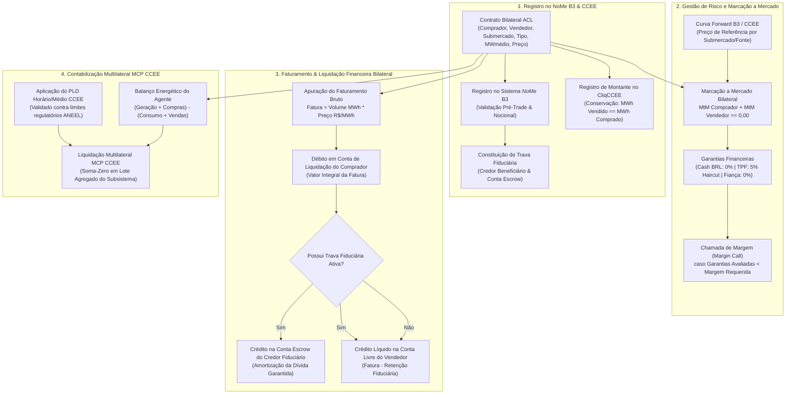

# Especificação Técnica — Registro, Marcação a Mercado, Custódia e Liquidação Financeira de Energia Elétrica ACL (NoMe B3 & CCEE) (FL-087)

---

## 1. Visão Geral e Arcabouço Regulatório

O fluxo **`FL-087` — Comercialização de Energia Elétrica no Ambiente de Contratação Livre (ACL)** modela o motor operacional, regulatório e de compensação financeira para o registro de contratos bilaterais de compra e venda de energia no sistema de balcão **NoMe da B3**, sua respectiva contabilização na **Câmara de Comercialização de Energia Elétrica (CCEE)**, a apuração de **Marcação a Mercado (Mark-to-Market - MtM)**, a constituição e execução de **Trava Fiduciária de Recebíveis de Energia**, e a liquidação financeira bilateral e multilateral (Mercado de Curto Prazo - MCP).

O módulo apoia-se no arcabouço normativo setorial:

1. **Lei Federal nº 10.848/2004 e Decreto Presidencial nº 5.163/2004**:
   - Marco Legal da Comercialização de Energia Elétrica no Brasil, estruturando o Ambiente de Contratação Livre (ACL) e o Ambiente de Contratação Regulada (ACR).
2. **Resoluções Normativas da ANEEL (Agência Nacional de Energia Elétrica)**:
   - Procedimentos de Regulação Tarifária (PRORET) e Procedimentos de Comercialização de Energia Elétrica (PdC);
   - Definição dos limites anuais de preço: **PLD Mínimo ($PLD_{min}$)** e **PLD Máximo ($PLD_{max}$)** estrutural e horário;
   - Regimes de incentivo e descontos na TUSD/TUST para fontes de energia incentivadas (50% e 100%).
3. **Regras e Procedimentos de Comercialização da CCEE**:
   - Registro de montantes de energia (MWmédio e MWh) no CliqCCEE / SCDE;
   - Apuração do Preço de Liquidação das Diferenças (PLD) por submercado e por hora;
   - Contabilização e liquidação financeira multilateral do Mercado de Curto Prazo (MCP).
4. **Manual de Operações e Registro do Balcão NoMe B3 (Sistema de Registro de Balcão de Energia Elétrica)**:
   - Registro bilateral eletrônico de contratos físicos e derivativos de balcão;
   - Registro de gravames, ônus e **Cessão Fiduciária de Direitos Creditórios (Trava Fiduciária de Recebíveis)** decorrentes da venda de energia;
   - Gestão de risco de contraparte, garantias financeiras vinculadas (CASH, TPF com haircut regulatório, Fiança Bancária) e liquidação financeira bilateral.

---

## 2. Modelagem Contratual e Parâmetros Padronizados

| Parâmetro | Descrição e Especificação Operacional |
| :--- | :--- |
| **Ambiente de Negociação** | Ambiente de Contratação Livre (ACL) registrado no Sistema Balcão NoMe B3 |
| **Tipos de Energia / Lastro** | **CONV** (Convencional - 0% desconto TUSD)<br>**I50** (Incentivada 50% desconto TUSD/TUST: Solar, Eólica, PCH, Biomassa)<br>**I100** (Incentivada 100% desconto TUSD/TUST) |
| **Submercados Elétricos (SIN)** | **SE/CO** (Sudeste / Centro-Oeste)<br>**S** (Sul)<br>**NE** (Nordeste)<br>**N** (Norte) |
| **Unidade de Potência / Montante** | **MWmédio (Megawatt-médio)** com precisão de 4 casas decimais |
| **Conversão Física de Energia** | $\text{Volume (MWh)} = \text{MWmédio} \times \text{Horas do Período/Mês}$ |
| **Horas do Período** | $24 \times \text{Dias do Mês Civil}$ (744h em meses de 31 dias; 720h em meses de 30 dias; 672h/696h em fevereiro) |
| **Cotação de Preço** | Reais por Megawatt-hora (**R\$/MWh**) com 2 casas decimais |
| **Valor Nocional Contratado** | $\text{Nocional (R\$)} = \text{Volume (MWh)} \times \text{Preço Contratado (R\$/MWh)}$ |
| **Modalidade de Entrega** | **FLAT** (potência constante) ou **MODULATED** (perfil horário/patamares de carga) |
| **Trava Fiduciária de Recebíveis** | Registro de cessão fiduciária no NoMe B3 para conta escrow de instituição credora garantida |

---

## 3. Arquitetura Operacional e Fluxo de Liquidação



---

## 4. Invariantes Formais de Conservação e Auditoria

O fluxo implementa quatro leis de conservação matemática e integridade regulatória auditadas via `verify_invariants()`:

### Lei 65 / `LAW-089` — Conservação Estrita de Energia Elétrica Bilateral
$$\sum \text{MWh Vendido} = \sum \text{MWh Comprado}$$
Em todo contrato bilateral no ACL, cada megawatt-hora de energia contratado pelo vendedor deve coincidir estritamente com o volume recebido pelo comprador. Nenhuma quantidade de energia física pode ser criada, suprimida ou perdida no registro bilateral.

### Lei 66 / `LAW-090` — Conservação Soma-Zero na Liquidação Financeira
$$\text{Débito Comprador} = \text{Crédito Líquido Vendedor} + \text{Retenção Fiduciária Conta Escrow}$$
$$\text{Fluxo Líquido Total} = \text{Créditos} - \text{Débitos} = 0,00 \text{ R\$}$$
A liquidação bilateral no Balcão NoMe B3 preserva conservação financeira estrita centavo a centavo. Se houver trava fiduciária de recebíveis constituída, a receita de venda do gerador/comercializador é segregada e canalizada diretamente para a conta escrow do credor garantido, creditando-se apenas o valor remanescente ao vendedor.

### Lei 67 / `LAW-091` — Não-Negatividade de Montantes Físicos e Preços
$$\text{MWmédio} \ge 0, \quad \text{Horas} > 0, \quad \text{Volume (MWh)} \ge 0, \quad \text{Preço (R\$/MWh)} \ge 0, \quad PLD_{min} \le PLD \le PLD_{max}$$
Potências elétricas, volumes faturados e preços unitários contratuais e de mercado são estritamente não-negativos. O Preço de Liquidação das Diferenças (PLD) horário e médio é auditado contra os limites regulatórios da ANEEL.

### Lei 68 / `LAW-092` — Limite de Trava Fiduciária de Recebíveis
$$\text{Valor da Dívida Garantida Travada} \le \text{Valor Nocional Total do Contrato}$$
Nenhum contrato pode ter gravames ou cessões fiduciárias constituídas em montante superior ao valor total a receber pactuado no instrumento de venda de energia.

---

## 5. Estrutura de Arquivos e Execução de Testes

| Componente | Caminho | Descrição |
| :--- | :--- | :--- |
| **Módulo Core** | `src/electric_power_trading_ccee.py` | Motor de contratos, PLD, garantias, MtM e liquidação NoMe/CCEE |
| **Invariantes Globais** | `src/invariants.py` | Leis LAW-089, LAW-090, LAW-091 e LAW-092 |
| **Fixture de Dados** | `fixtures/electric_power_trading_ccee.json` | Cenário realista com 4 contratos, 4 submercados, travas e MCP |
| **Bateria de Testes** | `tests/test_electric_power_trading_ccee.py` | 21 testes unitários cobrindo 100% das regras e invariantes |
| **Exportações Core** | `src/__init__.py` | Exportações padronizadas no pacote global do Atlas B3 |

### Execução dos Testes Unitários

```bash
python3 -m unittest tests/test_electric_power_trading_ccee.py
```
