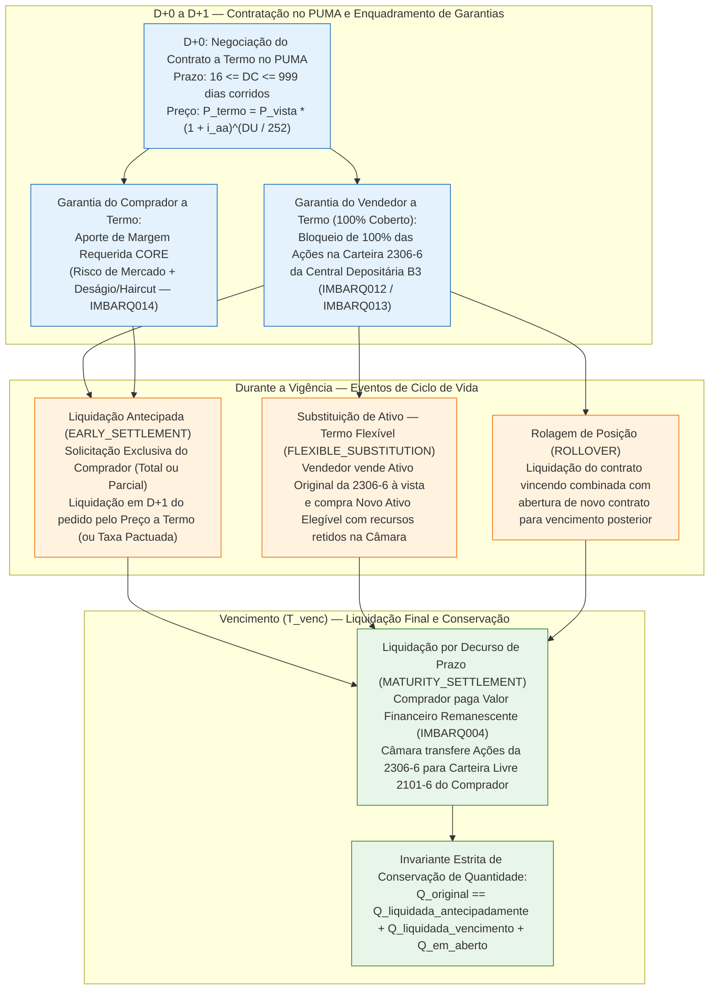

# Especificação Técnica do Mercado a Termo de Ações na Câmara B3 — Termo Tradicional (em Reais), Termo em Pontos, Termo Flexível, Cobertura 2306-6 e Liquidação Antecipada (FL-041)

## 1. Visão Geral e Contexto Operacional (FL-041)

O **Mercado a Termo de Ações** operado no **PUMA Trading System** e compensado pela **Câmara B3** consiste na compra ou venda de uma determinada quantidade de ações (ou *Units*, ETFs e BDRs elegíveis) a um preço preestabelecido (**Preço a Termo**), para liquidação física e financeira em uma data futura acordada entre as partes (**Vencimento**).

De acordo com o **Manual de Procedimentos Operacionais (MPO) da Câmara B3** e o **Regulamento de Operações do Segmento Listado**, o contrato a termo articula quatro pilares operacionais determinísticos:
1. **Prazos Regulamentares Estritos**: Prazo mínimo de **16 dias corridos** ($\text{DC}_{\min} = 16$) e prazo máximo de **999 dias corridos** ($\text{DC}_{\max} = 999$) contados entre a data de contratação ($D+0$) e a data de vencimento ($T_{\text{venc}}$).
2. **Formação Exponencial do Preço a Termo (`DU/252`)**: O preço unitário a termo incorpora ao preço à vista de referência ($P_{\text{vista}}$) a taxa de juros prefixada anual ($i_{\text{aa}}$) capitalizada pelo número de dias úteis ($\text{DU}$) na base de **252 dias úteis por ano**.
3. **Estrutura Bilateral de Garantias Assimétricas**:
   - **Vendedor a Termo (Financiador)**: Deposita **100% da quantidade de ações-objeto** na **Carteira de Cobertura `2306-6`** da Central Depositária B3 (cobertura integral que isenta o vendedor de chamada de margem de risco sobre o contrato).
   - **Comprador a Termo (Tomador)**: Aporta **Margem de Garantia Requerida pelo motor CORE (*Closeout Risk Evaluation*)**, dimensionada para cobrir o risco de mercado de desvalorização da ação e o deságio (*haircut*) do ativo-objeto até o vencimento.
4. **Eventos de Ciclo de Vida e Conservação Estrita de Quantidades**: Liquidação por decurso de prazo no vencimento (`MATURITY_SETTLEMENT`), liquidação antecipada total ou parcial por solicitação exclusiva do comprador (`EARLY_SETTLEMENT`), substituição de ativo-objeto na carteira de cobertura em contratos de **Termo Flexível** (`FLEXIBLE_SUBSTITUTION`) e rolagem (`ROLLOVER`).

---

## 2. Modalidades de Contratos a Termo na B3 (`ForwardModality`)

A Câmara B3 disponibiliza três modalidades operacionais de contrato a termo de ações, diferenciadas pelo indexador de referência e pela flexibilidade de substituição do ativo-objeto na carteira de cobertura:

| Modalidade (`ForwardModality`) | Código Operacional B3 | Moeda / Referência de Cotação | Substituição do Ativo-Objeto pelo Vendedor | Regra de Liquidação e Cobertura |
| :--- | :---: | :---: | :---: | :--- |
| **Termo Tradicional em Reais** (`TRADITIONAL_BRL`) | `TERMO_REAIS` | Real (`BRL` — Taxa Prefixada $i_{\text{aa}}$ base `DU/252`) | Não permitida (ativo-objeto fixo até o vencimento) | Preço a termo fixo em `BRL`; cobertura de 100% na carteira `2306-6` com a ação original. |
| **Termo em Pontos** (`IN_POINTS`) | `TERMO_PONTOS` | Pontos de Índice ou Taxa de Câmbio (`PTAX USD` / `IGP-M` / `IPCA`) | Não permitida | Preço negociado em pontos; conversão diária e na liquidação multiplicando a quantidade de pontos pelo valor do ponto (cotação do indexador/câmbio de referência). |
| **Termo Flexível** (`FLEXIBLE`) | `TERMO_FLEXIVEL` | Real (`BRL` — Taxa Prefixada $i_{\text{aa}}$ base `DU/252`) | **Permitida** (mediante venda à vista do ativo original e compra de novo ativo elegível) | Permite ao vendedor substituir as ações depositadas na carteira `2306-6`; o financeiro da venda fica retido na Câmara B3 exclusivamente para aquisição do novo papel cobertura. |

### 2.1 Detalhamento da Substituição de Ativo no Termo Flexível (`FLEXIBLE`)

Na modalidade **Termo Flexível (`FLEXIBLE`)**, o vendedor a termo pode alterar o ativo-objeto que garante o contrato antes do vencimento, respeitando as regras do MPO da Câmara B3:
1. O vendedor comanda a venda no mercado à vista das ações originalmente depositadas na carteira de cobertura `2306-6`.
2. O produto financeiro líquido da venda **não é liberado ao vendedor**: permanece bloqueado em conta de garantia na Câmara B3.
3. Com os recursos bloqueados, o vendedor adquire no mercado à vista ações de um **novo ativo elegível** constante na lista de ações aceitas pela Câmara B3 para Termo Flexível, em quantidade cujo valor financeiro seja **igual ou superior** ao valor da obrigação do contrato a termo.
4. Caso ocorra substituição, a liquidação física no vencimento (ou na liquidação antecipada solicitada pelo comprador após a troca) ocorre mediante entrega do **novo ativo-objeto substituto** (`current_underlying_ticker`) na quantidade ajustada ou mantendo a cobertura integral de 100%.

> [!IMPORTANT]
> Tentativas de executar substituição de ativo-objeto (`substitute_underlying`) em contratos das modalidades `TRADITIONAL_BRL` ou `IN_POINTS` são estritamente rejeitadas pelo motor de validação da Câmara B3 (`InvalidModalityOperationError`).

---

## 3. Equação Determinística do Preço a Termo e Conversão em Pontos

### 3.1 Prazos Regulamentares

Todo contrato a termo de ações registrado na B3 deve obedecer simultaneamente aos limites de dias corridos ($\text{DC}$) e dias úteis ($\text{DU}$):

$$\text{DC} = (T_{\text{vencimento}} - T_{\text{contratação}}).\text{days}$$

$$16 \le \text{DC} \le 999 \quad \text{e} \quad 1 \le \text{DU} \le \text{DC}$$

Qualquer contrato com $\text{DC} < 16$ ou $\text{DC} > 999$ viola o limite regulamentar da B3 e é rejeitado no registro (`ForwardTermRangeError`).

### 3.2 Equação do Preço Unitário a Termo (Base Exponencial `DU/252`)

Dado o preço à vista de referência da ação ($P_{\text{vista}}$), a taxa de juros efetiva anual pactuada ($i_{\text{aa}}$, expressa em forma decimal ou percentual anual) e o número de dias úteis entre a contratação e o vencimento ($\text{DU}$), o **Fator de Capitalização a Termo** ($F_{\text{termo}}$) e o **Preço Unitário a Termo** ($P_{\text{termo}}$) são definidos por:

$$F_{\text{termo}} = \left(1 + i_{\text{aa}}\right)^{\frac{\text{DU}}{252}}$$

$$P_{\text{termo}} = \text{round}\left(P_{\text{vista}} \times \left(1 + i_{\text{aa}}\right)^{\frac{\text{DU}}{252}},\ 2\right)$$

O **Valor Financeiro Original do Contrato a Termo** ($V_{\text{original}}$) para a quantidade contratada ($Q_{\text{original}}$) é:

$$V_{\text{original}} = \text{round}\left(Q_{\text{original}} \times P_{\text{termo}},\ 2\right)$$

### 3.3 Validação no Termo em Pontos (`IN_POINTS`)

Para contratos na modalidade **Termo em Pontos (`IN_POINTS`)**, o preço a termo é pactuado em quantidade de pontos ($P_{\text{pontos}}$) referenciados a um indexador ou taxa de câmbio (ex.: PTAX USD/BRL com cotação inicial $S_0$ e cotação de liquidação $S_{\text{liq}}$):

$$P_{\text{pontos}} = \frac{P_{\text{termo, base}}}{S_0}, \qquad P_{\text{termo, BRL}}(S_{\text{liq}}) = \text{round}\left(P_{\text{pontos}} \times S_{\text{liq}},\ 2\right)$$

Quando $S_{\text{liq}} = S_0$, o preço em Reais coincide exatamente com $P_{\text{termo}}$.

---

## 4. Garantias, Cobertura na Carteira `2306-6` e Margem CORE

### 4.1 Cobertura Integral do Vendedor a Termo (Carteira `2306-6`)

Na Câmara B3, a ponta **Vendedora a Termo** opera obrigatoriamente sob regime de **cobertura física integral**:
- As ações-objeto são transferidas da Carteira Livre (`2101-6`) para a **Carteira de Cobertura de Operações a Termo e Opções (`2306-6`)** na Central Depositária B3.
- Em qualquer instante do ciclo de vida do contrato, a quantidade de ações bloqueadas na carteira `2306-6` vinculada ao contrato ($Q_{\text{coberta, 2306-6}}$) deve cobrir **100% da quantidade em aberto** ($Q_{\text{em aberto}}$):

$$\text{Razão de Cobertura} = \frac{Q_{\text{coberta, 2306-6}}}{Q_{\text{em aberto}}} = 1{,}0000 \quad (100\%)$$

- Status de Cobertura (`ForwardCoverageStatus`):
  - `FULLY_COVERED`: $Q_{\text{coberta, 2306-6}} \ge Q_{\text{em aberto}}$ na carteira `2306-6` (quando $Q_{\text{em aberto}} > 0$).
  - `RELEASED_SETTLED`: Contrato integralmente liquidado ($Q_{\text{em aberto}} == 0$ e $Q_{\text{coberta, 2306-6}} == 0$).
  - `DEFICIENT`: $Q_{\text{coberta, 2306-6}} < Q_{\text{em aberto}}$ (bloqueado pelas travas de validação com `InsufficientSellerCoverageError`).

### 4.2 Margem Requerida CORE do Comprador a Termo

O **Comprador a Termo** assume o compromisso irretratável de pagar o preço a termo no vencimento e receber as ações. Caso o preço de mercado da ação ($S_{\text{mtm}}$) caia abaixo do preço a termo contratado ($P_{\text{termo}}$), a Câmara B3 fica exposta ao risco de inadimplência do comprador. A margem requerida pelo motor **CORE** para a quantidade em aberto ($Q_{\text{em aberto}}$) combina a perda de marcação a mercado e o choque de deságio (*haircut* $h_{\text{core}}$) sobre o valor de mercado da posição:

$$\text{Exposição MTM Comprador} = \max\left(0,\ Q_{\text{em aberto}} \times (P_{\text{termo}} - S_{\text{mtm}})\right)$$

$$\text{Colchão de Risco (Haircut CORE)} = \text{round}\left(Q_{\text{em aberto}} \times S_{\text{mtm}} \times h_{\text{core}},\ 2\right)$$

$$\text{Margem Requerida CORE (BRL)} = \text{round}\left(\text{Exposição MTM Comprador} + \text{Colchão de Risco (Haircut CORE)},\ 2\right)$$

O comprador deve manter colateral elegível depositado ($\text{Colateral Comprador} \ge \text{Margem Requerida CORE}$), reportado diariamente no arquivo posicional `IMBARQ014`.

---

## 5. Eventos de Ciclo de Vida e Invariante de Conservação

### 5.1 Eventos Suportados (`ForwardSettlementEvent`)

1. **Liquidação Antecipada (`EARLY_SETTLEMENT`)**:
   - Prerrogativa **exclusiva do Comprador a Termo** (o vendedor não pode exigir liquidação antecipada unilateralmente).
   - Pode ser **Total** ($Q_{\text{evento}} == Q_{\text{em aberto}}$) ou **Parcial** ($0 < Q_{\text{evento}} < Q_{\text{em aberto}}$).
   - **Regra de Preço na Liquidação Antecipada**: Por padrão regulamentar da B3, a liquidação antecipada ocorre pelo **valor integral do Preço a Termo contratado ($P_{\text{termo}}$) sem desconto pro-rata de juros**, salvo quando as partes repactuam expressamente uma taxa de desconto/acordo (`agreed_unit_price`).
   - Reduz imediatamente $Q_{\text{em aberto}}$ e libera/transfere a mesma quantidade de ações da carteira `2306-6` do vendedor para a carteira livre `2101-6` do comprador.

2. **Liquidação no Vencimento (`MATURITY_SETTLEMENT`)**:
   - Executada na data de vencimento ($T_{\text{vencimento}}$) sobre a totalidade do saldo remanescente em aberto ($Q_{\text{evento}} == Q_{\text{em aberto}}$).
   - O comprador sofre débito financeiro multilateral no `IMBARQ004` de $\text{round}(Q_{\text{evento}} \times P_{\text{liq}}, 2)$, o vendedor recebe o crédito correspondente, e a Central Depositária transfere as ações remanescentes da carteira `2306-6` para a carteira `2101-6` do comprador (`IMBARQ013`).

3. **Rolagem (`ROLLOVER`)**:
   - Consiste na liquidação integral ou parcial do contrato a termo vincendo combinada com a abertura simultânea de um novo contrato a termo sobre o mesmo ativo-objeto para um vencimento futuro posterior ($16 \le \text{DC}_{\text{novo}} \le 999$), mantendo o encadeamento de rastreabilidade (`rolled_into_contract_id`).

### 5.2 Invariante Estrita de Conservação de Quantidade de Ações

Para todo contrato a termo registrado na Câmara B3, em qualquer estado do ciclo de vida (`ACTIVE`, `PARTIALLY_SETTLED`, `SETTLED_EARLY`, `SETTLED_AT_MATURITY`, `ROLLED_OVER`), a **Invariante Fundamental de Conservação de Quantidade** deve ser identicamente satisfeita:

$$Q_{\text{original}} \equiv Q_{\text{liquidada antecipadamente}} + Q_{\text{liquidada no vencimento}} + Q_{\text{em aberto}}$$

Simultaneamente, a **Invariante de Cobertura Física do Vendedor** exige:

$$Q_{\text{coberta na carteira 2306-6}} \equiv Q_{\text{em aberto}}$$

E a **Invariante Financeira Bilateral (Soma-Zero na Liquidação)** garante que, em cada evento de liquidação financeira ($k$):

$$\text{Débito Financeiro do Comprador}_k + \text{Crédito Financeiro do Vendedor}_k = 0{,}00$$

---

## 6. Integração com os Layouts Posicionais da Câmara B3 (Família IMBARQ)

| Arquivo B3 | Papel no Fluxo de Mercado a Termo de Ações (FL-041) |
| :--- | :--- |
| **`IMBARQ006`** | Posição aberta de contratos a termo por participante, conta, modalidade (`TERMO_REAIS`, `TERMO_PONTOS`, `TERMO_FLEXIVEL`), preço a termo e data de vencimento. |
| **`IMBARQ012`** | Saldo de custódia na Central Depositária confirmando o bloqueio de 100% das ações-objeto do vendedor na Carteira de Cobertura `2306-6`. |
| **`IMBARQ013`** | Movimentações diárias de custódia: transferência `2101-6 -> 2306-6` na cobertura inicial, troca de ativo no Termo Flexível e entrega `2306-6 -> 2101-6` nas liquidações antecipadas ou no vencimento. |
| **`IMBARQ014`** | Detalhamento da Margem Requerida CORE e das garantias aportadas pelo comprador a termo para cobertura de risco de mercado e deságio. |
| **`IMBARQ004`** | Lançamentos financeiros multilaterais líquidos (débito ao comprador e crédito ao vendedor) resultantes de `EARLY_SETTLEMENT`, `MATURITY_SETTLEMENT` ou `ROLLOVER`. |
