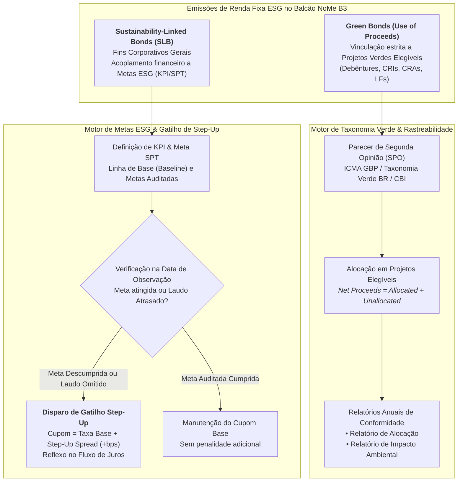

# Especificação Técnica: Registro e Certificação de Green Bonds e Sustainability-Linked Bonds no Balcão NoMe B3 (FL-065)
## Balcão NoMe & Central Depositária — Taxonomia Verde, Metas KPI/SPT, Gatilho de Step-Up e Relatórios ESG

---

## 1. Visão Geral e Arquitetura Regulatória

Os **Títulos de Renda Fixa Sustentável (ESG Fixed Income)** representam os instrumentos fundamentais de captação de recursos no mercado de capitais brasileiro voltados à transição ecológica, descarbonização da economia e sustentabilidade corporativa.

Na infraestrutura de mercado da **B3 (Brasil, Bolsa, Balcão)**, o fluxo **FL-065** estrutura o ciclo completo de registro, certificação técnica de rotulagem verde, monitoramento contínuo de metas de sustentabilidade e liquidação financeira de eventos de cupom no ambiente do **Balcão NoMe (Novo Mercado de Balcão)** e da **Central Depositária B3 (CSD)**.

O ecossistema divide-se em duas categorias regulatórias primárias:

1. **Green Bonds / Títulos Verdes (Modelo *Use of Proceeds*)**:
   - Títulos em que **100% dos recursos líquidos captados** (*Net Proceeds*) devem ser obrigatoriamente alocados em Projetos Verdes Elegíveis predefinidos segundo a **Taxonomia Verde**.
   - Exigem rastreabilidade contínua de recursos alocados versus não alocados (*Proceeds Tracking*).
   - Requerem Parecer de Segunda Opinião (*Second Party Opinion* - SPO) pré-emissão e Relatórios Anuais pós-emissão de Alocação (*Allocation Report*) e Impacto (*Impact Report*).
   - Instrumentos típicos: Debêntures Verdes (Leis nº 12.431/2011 e 14.801/2024), Certificados de Recebíveis do Agronegócio Verdes (CRA Verde), Certificados de Recebíveis Imobiliários Verdes (CRI Verde) e Letras Financeiras Verdes (LF Verde).

2. **Sustainability-Linked Bonds (SLB / Modelo de Metas Corporativas)**:
   - Títulos emitidos para fins corporativos gerais (*General Corporate Purposes*), sem vinculação obrigatória dos recursos a projetos específicos.
   - Suas características financeiras e estruturais (notadamente a **taxa de juros do cupom**) estão contratualmente atreladas ao cumprimento ou descumprimento de metas de sustentabilidade quantitativas e predefinidas (**Metas de Desempenho de Sustentabilidade — SPT**), mensuradas por Indicadores-Chave de Desempenho (**KPI**).
   - Caso a meta (SPT) não seja atingida na Data de Observação, ou caso a emissora deixe de apresentar o Laudo de Asseguração Independente (*Audited Assurance Report*) até o prazo regulamentar, dispara-se o **Gatilho de Step-Up de Cupom** (+bps ao ano sobre a taxa de juros), onerando financeiramente a emissora até o vencimento.

---

## 2. Arcabouço Normativo e Padrões Globais

A modelagem determinística do módulo implementa estritamente os padrões regulatórios nacionais e diretrizes internacionais:

| Norma / Padrão | Escopo e Autoridade | Aplicação no Módulo |
| :--- | :--- | :--- |
| **ICMA Green Bond Principles (GBP 2021)** | International Capital Market Association | Quatro pilares: (1) Uso de Recursos, (2) Avaliação e Seleção de Projetos, (3) Gestão de Recursos e (4) Relatórios Anuais. |
| **ICMA Sustainability-Linked Bond Principles (SLBP 2023)** | International Capital Market Association | Cinco pilares: Seleção de KPIs, Calibração de SPTs, Características do Título, Relatórios e Verificação Independente. |
| **Taxonomia Sustentável Brasileira (TSB)** | Ministério da Fazenda & FEBRABAN | Classificação de setores elegíveis, critérios de contribuição substancial e salvaguardas socioambientais mínimas. |
| **Climate Bonds Standard v4.0** | Climate Bonds Initiative (CBI) | Critérios setoriais de elegibilidade e certificação de baixo carbono para energias renováveis e agricultura sustentável. |
| **Resoluções CVM nº 59/2021 e nº 193/2023** | Comissão de Valores Mobiliários (CVM) | Divulgação obrigatória de fatores ASG/ESG e adoção dos padrões IFRS S1 e S2 para relatórios de sustentabilidade. |
| **Leis nº 12.431/2011 e nº 14.801/2024** | Legislação Federal Brasileira | Debêntures incentivadas e de infraestrutura com rotulagem verde registrada no Balcão NoMe B3. |

---

## 3. Taxonomia Verde e Gestão de Recursos (Use of Proceeds)

### 3.1 Setores Elegíveis da Taxonomia Verde B3

Para obter a certificação de título verde no Balcão NoMe, cada projeto financiado deve estar vinculado a uma categoria aprovada:

1. `RENEWABLE_ENERGY`: Parques eólicos, usinas solares fotovoltaicas centralizadas e distribuídas, PCHs sustentáveis, biometano, biomassa e hidrogênio verde.
2. `ENERGY_EFFICIENCY`: Retrofit industrial, redes elétricas inteligentes (*smart grids*), isolamento térmico e iluminação pública LED.
3. `CLEAN_TRANSPORTATION`: Eletrificação de transporte público, frotas de emissão zero, ferrovias elétricas de carga/passageiros e infraestrutura de recarga.
4. `SUSTAINABLE_WATER_WASTEWATER`: Universalização de saneamento, captação e tratamento eficiente de água, reuso de efluentes e dessalinização de baixo impacto.
5. `CIRCULAR_ECONOMY_WASTE`: Reciclagem mecânica/química, tratamento de resíduos sólidos urbanos e industriais e recuperação energética de biogás.
6. `GREEN_BUILDINGS`: Construções certificadas sob padrões internacionais (LEED Gold/Platinum, AQUA-HQE, EDGE).
7. `SUSTAINABLE_AGRO_FORESTRY`: Agricultura de baixo carbono (Plano ABC+), Integração Lavoura-Pecuária-Floresta (ILPF), restauração florestal nativa e manejo FSC.
8. `POLLUTION_PREVENTION_CONTROL`: Controle e abatimento de emissões de particulados e remediação de passivos e solos contaminados.
9. `CLIMATE_CHANGE_ADAPTATION`: Infraestrutura de drenagem resiliente, diques de contenção e sistemas de alerta de eventos climáticos extremos.

### 3.2 Equação de Conservação de Recursos

Para qualquer título classificado como `GREEN_BOND`:

$$\text{GrossProceeds} = \text{NominalUnitValue} \times \text{IssuedQuantity}$$

$$\text{NetProceeds} = \text{GrossProceeds} - \text{IssuanceCosts}$$

$$\text{NetProceeds} = \text{TotalAllocatedProceeds} + \text{TotalUnallocatedProceeds}$$

$$\text{TotalAllocatedProceeds} = \sum_{i=1}^{n} \text{ProjectAllocatedAmount}_i$$

$$\text{AllocationRatio} = \frac{\text{TotalAllocatedProceeds}}{\text{NetProceeds}} \times 100\%$$

**Regras de Restrição Estrita**:
1. $\text{TotalAllocatedProceeds} \le \text{NetProceeds}$ (proibição de alocação além dos recursos líquidos captados).
2. Para cada projeto $i$, $\text{ProjectAllocatedAmount}_i \le \text{TotalProjectCost}_i$ (proibição de sobrealocação / dupla contagem).
3. Recursos não alocados ($\text{TotalUnallocatedProceeds}$) devem ser mantidos transitoriamente conforme a política cadastrada (`TREASURY_BONDS`, `CDB_VERDE` ou `CASH_EQUIVALENT`).

---

## 4. Governança de Metas de Sustentabilidade em SLBs (KPI & SPT)

### 4.1 Definição de Indicadores e Linhas de Base

Cada Sustainability-Linked Bond possui um ou mais Indicadores-Chave de Desempenho (**KPI**):
- **Unidade de Medida**: Mensurável e material (ex: $\text{tCO}_2\text{e}/\text{ton de produto}$, $\%$, $\text{m}^3/\text{ton}$).
- **Linha de Base (*Baseline*)**: Valor histórico aferido em ano-base auditado anterior à emissão.
- **Direção da Meta**:
  - `DECREASE`: Exige redução do valor apurado em relação ao alvo (ex: intensidade de emissões de GEE, consumo de água). Cumprida se $\text{MeasuredValue} \le \text{TargetValue}$.
  - `INCREASE`: Exige expansão do valor apurado (ex: percentual de energia renovável na matriz, percentual de sucata reciclada). Cumprida se $\text{MeasuredValue} \ge \text{TargetValue}$.

### 4.2 Apuração de Progresso Rumo à Meta

O percentual de progresso realizado em direção à meta é calculado formalmente por:

$$\Delta_{\text{total}} = |\text{BaselineValue} - \text{TargetValue}|$$

$$\Delta_{\text{realizado}} = \begin{cases} 
\text{BaselineValue} - \text{MeasuredValue}, & \text{se } \text{Direction} = \text{DECREASE} \\ 
\text{MeasuredValue} - \text{BaselineValue}, & \text{se } \text{Direction} = \text{INCREASE} 
\end{cases}$$

$$\text{ProgressPct} = \frac{\Delta_{\text{realizado}}}{\Delta_{\text{total}}} \times 100\%$$

---

## 5. Mecanismo de Gatilho de Step-Up de Cupom

### 5.1 Regra de Disparo e Inadimplemento de Auditoria

O gatilho de Step-Up é avaliado em duas circunstâncias:
1. **Resultado da Medição na Data de Observação**:
   - Se o laudo auditado comprovar não cumprimento da meta ($\text{Status} = \text{MISSED}$), o Step-Up é disparado.
2. **Inadimplemento de Envio do Laudo (*Defaulted Reporting*)**:
   - Se a Data Corrente ultrapassar o Prazo Regulamentar de Verificação ($\text{VerificationDeadline}$) sem que o Laudo Auditado tenha sido protocolado na B3, o título transita automaticamente para `DEFAULTED_REPORTING`, disparando o Step-Up imediatamente.

### 5.2 Equação do Cupom Ajustado e Impacto Financeiro

Caso o Step-Up seja disparado, a taxa anual ativa do cupom passa a ser:

$$\text{CurrentCouponRate} = \text{BaseCouponRate} + \left( \frac{\text{StepUpSpreadBps}}{10.000} \right)$$

No cálculo financeiro de cada período de cupom:

$$\text{YearFraction} = \frac{\text{Days}}{360}$$

$$\text{BaseInterestAmount} = \text{RoundCents}\left( \text{OutstandingPrincipal} \times \text{BaseCouponRate} \times \text{YearFraction} \right)$$

$$\text{StepUpPenaltyAmount} = \text{RoundCents}\left( \text{OutstandingPrincipal} \times \left( \frac{\text{StepUpSpreadBps}}{10.000} \right) \times \text{YearFraction} \right)$$

$$\text{TotalInterestPayable} = \text{BaseInterestAmount} + \text{StepUpPenaltyAmount}$$

**Invariante Financeiro**: $\text{StepUpPenaltyAmount} \ge 0$.

---

## 6. Dicionário de Dados e Estrutura de Mensageria

### 6.1 Cadastro da Emissão ESG (`EsgBondEmission`)

| Campo | Tipo | Obr. | Descrição e Validação |
| :--- | :--- | :---: | :--- |
| `asset_code` | String(20) | Sim | Código mnemônico do título no Balcão NoMe (ex: `DEB-SOLAR-01`). |
| `isin` | String(12) | Sim | Código ISIN válido de 12 posições conforme ISO 6166. |
| `issuer_name` | String(120) | Sim | Razão social completa da companhia emissora. |
| `issuer_cnpj` | String(18) | Sim | CNPJ formatado da emissora (14 dígitos válidos). |
| `instrument_type` | Enum | Sim | `GREEN_BOND`, `SOCIAL_BOND`, `SUSTAINABLE_BOND`, `SUSTAINABILITY_LINKED_BOND`. |
| `issue_date` | Date | Sim | Data de emissão e liquidação inicial (formato ISO `YYYY-MM-DD`). |
| `maturity_date` | Date | Sim | Data de vencimento final ($\text{MaturityDate} > \text{IssueDate}$). |
| `nominal_unit_value` | Decimal(16,2) | Sim | Valor Nominal Unitário de emissão (estritamente positivo). |
| `issued_quantity` | Decimal(18,4) | Sim | Quantidade total de títulos emitidos. |
| `issuance_costs` | Decimal(16,2) | Sim | Despesas estruturantes de emissão dedutíveis do *Gross Proceeds*. |
| `base_coupon_rate` | Decimal(10,8) | Sim | Taxa anual base pactuada na escritura (ex: `0.06500000` = 6,50% a.a.). |
| `coupon_benchmark` | Enum | Sim | Indexador: `IPCA`, `CDI`, `PRE`, `SELIC`. |
| `payment_frequency` | Enum | Sim | `ANNUAL`, `SEMIANNUAL`, `QUARTERLY`, `MONTHLY`. |
| `unallocated_policy` | Enum | Sim | Gestão de caixa: `TREASURY_BONDS`, `CDB_VERDE`, `CASH_EQUIVALENT`. |
| `certification_status` | Enum | Sim | Status do selo: `CERTIFIED_ACTIVE`, `UNDER_REVIEW`, `SUSPENDED`, `REVOKED`. |

### 6.2 Cadastro de Projetos Elegíveis (`EligibleGreenProject`)

| Campo | Tipo | Obr. | Descrição e Validação |
| :--- | :--- | :---: | :--- |
| `project_id` | String(30) | Sim | Identificador único do projeto (ex: `PRJ-UFV-SERT-01`). |
| `name` | String(120) | Sim | Nome oficial do empreendimento verde. |
| `sector` | Enum | Sim | Categoria da Taxonomia Verde (ex: `RENEWABLE_ENERGY`). |
| `total_project_cost` | Decimal(16,2) | Sim | Custo total projetado ou realizado da obra/ativo. |
| `allocated_amount` | Decimal(16,2) | Sim | Valor alocado deste título ($\le \text{TotalProjectCost}$). |
| `allocation_date` | Date | Sim | Data da formalização da alocação de recursos. |
| `environmental_impact_metric` | String(60) | Sim | Indicador de impacto (ex: `tCO2e_avoided_per_year`). |
| `environmental_impact_value` | Decimal(16,3) | Sim | Magnitude de impacto ambiental gerada anualmente. |
| `location_uf` | String(2) | Sim | Unidade Federativa da instalação do projeto (ex: `BA`). |
| `verification_doc_ref` | String(60) | Sim | Número do processo ou licença ambiental de suporte. |

### 6.3 Cadastro de Metas SPT (`SptTarget`)

| Campo | Tipo | Obr. | Descrição e Validação |
| :--- | :--- | :---: | :--- |
| `spt_id` | String(30) | Sim | Identificador da meta (ex: `SPT-PULP-2026`). |
| `kpi_id` | String(30) | Sim | Referência ao KPI corporativo vinculado. |
| `target_year` | Integer | Sim | Ano de referência do compromisso socioambiental. |
| `observation_date` | Date | Sim | Data de corte para medição do indicador. |
| `verification_deadline` | Date | Sim | Prazo fatal para protocolo do laudo auditado na B3. |
| `target_value` | Decimal(16,4) | Sim | Valor contratual que define o cumprimento da meta. |
| `step_up_spread_bps` | Decimal(8,2) | Sim | Sobretaxa em *basis points* aplicável se descumprida. |
| `measured_value` | Decimal(16,4) | Não | Valor auditado aferido pelo verificador independente. |
| `status` | Enum | Sim | `PENDING`, `ACHIEVED`, `MISSED`, `DEFAULTED_REPORTING`. |
| `auditor_name` | String(100) | Não | Nome da empresa de auditoria independente credenciada. |

---

## 7. Relatórios de Conformidade e Selo ESG Balcão NoMe

O módulo disponibiliza 4 relatórios padronizados auditáveis:

1. **Relatório de Alocação (`AllocationReport`)**:
   - Consolida montante bruto, deduções de custos e captação líquida.
   - Apresenta o saldo alocado e não alocado centavo a centavo.
   - Discrimina a distribuição percentual e financeira por setor da Taxonomia Verde.
   - Confirma aderência total às diretrizes do ICMA Pillar 4.

2. **Relatório de Impacto Ambiental (`ImpactReport`)**:
   - Agrega emissões de GEE evitadas ($\text{tCO}_2\text{e}$), energia renovável gerada ($\text{MWh}$) e água tratada ($\text{m}^3$).
   - Apura o indicador de **Eficiência de Carbono**:
     $$\text{CarbonEfficiency} = \frac{\text{TotalCO2Avoided}}{\text{AllocatedProceeds} / 1.000.000} \quad \left( \frac{\text{tCO}_2\text{e}}{\text{R\$} \, 1\,\text{M alocado}} \right)$$

3. **Relatório de Progresso de SLB (`SlbProgressReport`)**:
   - Apresenta a evolução das trajetórias de KPIs desde o ano-base (*Baseline*).
   - Registra o status de cada SPT e o percentual de atingimento do compromisso.
   - Documenta a situação do gatilho de Step-Up e a taxa efetiva anual em vigor.

4. **Dossiê de Certificação NoMe (`B3EsgCertificationDossier`)**:
   - Emite certidão de regularidade do Selo Verde B3 com status (`CERTIFIED_ACTIVE`).
   - Gera **Hash Criptográfico SHA-256** irrevogável garantindo a integridade dos atributos cadastrais, SPO e histórico de auditorias.

---

## 8. Leis Invariantes Formais de Mercado e Custódia (Proof Laws)

O subsistema é regido por leis de conservação invioláveis:

- **Lei 1: Conservação de Recursos Verde (Use of Proceeds)**:
  $$\text{NetProceeds} = \text{TotalAllocatedProceeds} + \text{TotalUnallocatedProceeds}$$
- **Lei 2: Não-Sobrealocação da Emissão**:
  $$\text{TotalAllocatedProceeds} \le \text{NetProceeds}$$
- **Lei 3: Não-Sobrealocação de Projeto**:
  $$\forall p \in \text{Projects}, \quad p.\text{allocated\_amount} \le p.\text{total\_project\_cost}$$
- **Lei 4: Determinismo de Gatilho e Cupom (SLB)**:
  $$\text{CurrentCoupon} = \begin{cases} 
  \text{BaseCoupon} + \text{StepUpSpread}, & \text{se } \exists \, s \in \text{SPTs} : s.\text{status} \in \{\text{MISSED}, \text{DEFAULTED\_REPORTING}\} \\ 
  \text{BaseCoupon}, & \text{caso contrário} 
  \end{cases}$$
- **Lei 5: Não-Negatividade de Sobretaxa**:
  $$\text{StepUpPenaltyAmount} \ge 0$$
