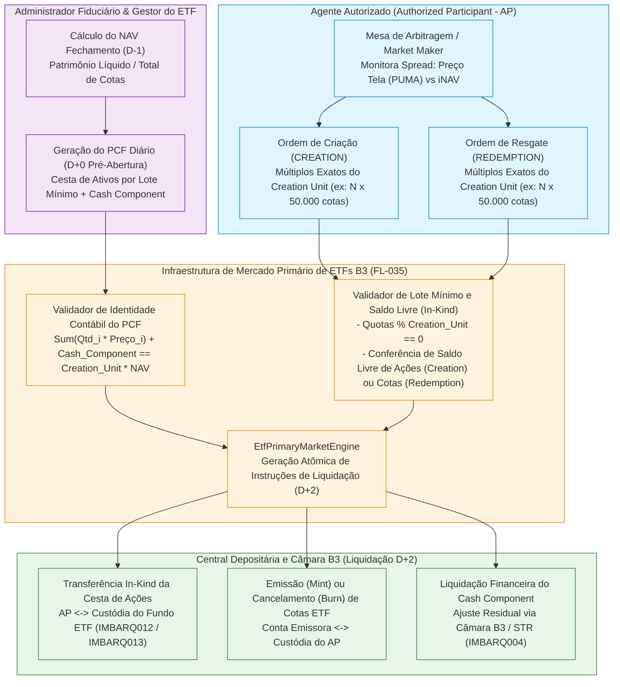

# Especificação Técnica de ETFs — Criação e Resgate de Cotas no Mercado Primário via Cesta de Ativos / PCF na B3 (FL-035)

## 1. Visão Geral e Contexto Regulatório (Resolução CVM 175 — Anexo Normativo V)

Os **Fundos de Índice (*Exchange Traded Funds* — ETFs)** listados e negociados na **B3 (Brasil, Bolsa, Balcão)** — tais como **BOVA11** (Ibovespa), **SMAL11** (Small Caps), **IVVB11** (S&P 500), **ECOO11** (Carbono Eficiente) e **HASH11** (Criptoativos) — são regidos pelo **Anexo Normativo V da Resolução CVM nº 175/2022** (que substituiu a histórica Instrução CVM 359/2002) e pelos manuais operacionais da **Central Depositária** e da **Câmara B3**.

A eficiência de precificação de um ETF no mercado secundário (PUMA Trading System) depende diretamente do mecanismo de arbitragem entre o **preço de tela da cota** e o **Valor Patrimonial Líquido por Cota (*Net Asset Value* — NAV)** da carteira subjacente. Essa arbitragem é executada exclusivamente no **Mercado Primário de ETFs** pelos **Agentes Autorizados (*Authorized Participants* — APs)** — corretoras e distribuidoras de valores mobiliários formalmente contratadas pelo Administrador Fiduciário e pela Gestora do ETF e habilitadas perante a B3.

O fluxo **FL-035** especifica e implementa de ponta a ponta o processamento determinístico do **Mercado Primário de ETFs na B3**:
1. **Publicação e Validação do Arquivo de Composição da Carteira (*PCF — Portfolio Composition File*)**: Divulgação diária (antes da abertura do pregão em $D+0$, com base no fechamento de $D-1$) da cesta teórica exata de ativos componentes necessária para integralizar ou resgatar **1 (um) Lote Mínimo de Cotas (*Creation Unit*)** — tipicamente **50.000 cotas** ou **100.000 cotas** — acrescida da **Parcela Financeira de Ajuste (*Cash Component / Residual Cash*)** que equaliza matematicamente o valor da cesta ao NAV do lote mínimo.
2. **Integralização de Cotas (*Creation* — Emissão Primária *In-Kind*)**: O Agente Autorizado entrega à conta de custódia do ETF na Central Depositária da B3 as quantidades exatas de cada ação componente da cesta (múltiplos inteiros do Lote Mínimo) mais (ou menos, se negativo) a Parcela Financeira de Ajuste, recebendo em contrapartida as novas cotas emitidas pelo ETF (`BOVA11`, etc.).
3. **Resgate de Cotas (*Redemption* — Cancelamento Primário *In-Kind*)**: O Agente Autorizado entrega lotes mínimos de cotas do ETF para cancelamento/extinção junto ao Administrador na Depositária B3 e recebe em sua conta de custódia as ações componentes da cesta mais a Parcela Financeira de Ajuste.
4. **Conferência de Saldo Livre em Custódia e Geração de Instruções de Liquidação**: Verificação prévia de disponibilidade livre de ônus/bloqueios (*free balance*) de cada ativo da cesta (na *Creation*) ou das cotas do ETF (no *Redemption*), garantindo a liquidação em $D+2$ sem falhas de entrega (*Settlement Fail*) e gerando as instruções atômicas de transferência de custódia (`IMBARQ012`/`IMBARQ013`) e liquidação financeira da parcela residual (`IMBARQ004`).

---

## 2. Mecanismo Econômico de Arbitragem e Paridade com o NAV

O mecanismo *in-kind* de Criação e Resgate mantém o preço secundário da cota ($P_{\text{ETF}}$) ancorado ao valor intrínseco da carteira ($i\text{NAV}$):

| Condição de Mercado | Ação do Agente Autorizado (*AP*) | Operação no Mercado Primário B3 (`EtfOrderType`) | Efeito no Mercado e no Patrimônio do ETF |
|---|---|---|---|
| **Ágio (*Premium*)**: $P_{\text{ETF}} > \text{NAV}$ | Compra a cesta de ações no mercado à vista e vende cotas do ETF no secundário. | **`CREATION`** (*Integralização de Cotas*) | O AP entrega a cesta de ações + *Cash Component* ao fundo e recebe novas cotas para cobrir sua venda; a oferta de cotas aumenta e elimina o ágio. |
| **Deságio (*Discount*)**: $P_{\text{ETF}} < \text{NAV}$ | Compra cotas do ETF descontadas no secundário e vende a cesta de ações no à vista. | **`REDEMPTION`** (*Resgate de Cotas*) | O AP entrega o lote mínimo de cotas ao fundo para cancelamento e recebe a cesta de ações + *Cash Component*; a redução de cotas em circulação elimina o deságio. |

---

## 3. Estrutura do Arquivo de Composição da Carteira (*PCF — Portfolio Composition File*)

Como as ações componentes da carteira são negociadas em quantidades inteiras por Lote Mínimo e o patrimônio do fundo também acumula proventos a receber (dividendos, JCP), caixa residual de rebalanceamentos e taxa de administração provisionada, o valor de mercado das ações inteiras da cesta quase nunca coincide ao centavo com o NAV exato de um Lote Mínimo.

Por essa razão, todo **PCF (`PortfolioCompositionFile`)** publicado diariamente na B3 obedece à **Identidade Fundamental do Lote Mínimo de ETF**:

$$\underbrace{\sum_{i=1}^{M} \left( q_i \times P_{i,\text{fech}} \right)}_{\text{Valor Financeiro da Cesta de Ações } (V_{\text{basket}})} + \underbrace{C_{\text{unit}}}_{\text{Parcela Financeira de Ajuste (*Cash Component*)}} = \underbrace{U_{\text{size}} \times \text{NAV}_{\text{cota}}}_{\text{Valor Patrimonial do Lote Mínimo } (\text{NAV}_{\text{unit}})}$$

Onde:
- $U_{\text{size}}$ (`creation_unit_size`): Quantidade padrão de cotas que compõe **1 (um) Lote Mínimo (*Creation Unit*)** — ex: $50.000$ cotas para `BOVA11` ou `SMAL11`.
- $\text{NAV}_{\text{cota}}$ (`nav_per_quota`): Valor patrimonial líquido unitário da cota do ETF apurado no fechamento (em $\text{R\$}$ com até 6 casas decimais; ex: $\text{R\$ } 125,50$).
- $q_i$ (`quantity_per_unit`): Quantidade inteira exata ($\mathbb{Z}_{>0}$) da ação componente $i$ exigida para **1 Lote Mínimo**.
- $P_{i,\text{fech}}$ (`closing_price`): Preço de fechamento da ação componente $i$ na B3 utilizado na apuração do NAV.
- $C_{\text{unit}}$ (`cash_component_per_unit`): Parcela financeira em reais ($\text{R\$}$) por Lote Mínimo:
  - Se $C_{\text{unit}} > 0$: Na **Criação (`CREATION`)**, o AP **paga** $C_{\text{unit}}$ por lote ao fundo além de entregar as ações; no **Resgate (`REDEMPTION`)**, o AP **recebe** $C_{\text{unit}}$ por lote do fundo além de receber as ações.
  - Se $C_{\text{unit}} < 0$ (ex: quando as obrigações/taxas superam o caixa do fundo ou por arredondamento para cima das ações na cesta): O fluxo financeiro da parcela em caixa inverte-se.

### 3.1 Dicionário de Dados do `PortfolioCompositionFile` (PCF)

| Campo | Tipo Python / JSON | Obrigatório | Descrição Técnica e Regra de Negócio |
|---|---|---|---|
| `pcf_id` | `str` | Sim | Identificador único do arquivo PCF diário (ex: `PCF-BOVA11-20261103`). |
| `etf_ticker` | `str` | Sim | Código de negociação do ETF na B3 (ex: `BOVA11`, `SMAL11`, `IVVB11`, `HASH11`). |
| `etf_isin` | `str` | Sim | Código ISIN de 12 caracteres da cota do ETF (ex: `BRBOVACTF003`). |
| `reference_date` | `str` (`YYYY-MM-DD`) | Sim | Data de referência da carteira / pregão de validade do PCF. |
| `settlement_date` | `str` (`YYYY-MM-DD`) | Sim | Data de liquidação física e financeira primária ($D+2$ no mercado brasileiro). |
| `benchmark_index` | `str` | Sim | Índice de referência aderente ao ETF (ex: `IBOV`, `SMLL`, `SP500`, `NCI`). |
| `fund_custody_account` | `str` | Sim | Conta de custódia do Fundo ETF na Central Depositária B3 (ex: `99001-0`). |
| `creation_unit_size` | `int` | Sim | Tamanho do Lote Mínimo de Cotas (*Creation Unit*, ex: `50000`). Deve ser $> 0$. |
| `nav_per_quota` | `Decimal` | Sim | Valor Patrimonial Líquido por cota ($\text{R\$}$). Deve ser $> 0$. |
| `cash_component_per_unit` | `Decimal` | Sim | Parcela financeira de ajuste (*Cash Component*) em $\text{R\$}$ por Lote Mínimo. |
| `components` | `List[BasketComponent]` | Sim | Lista não vazia das ações/ativos integrantes da cesta teórica por Lote Mínimo. |

### 3.2 Dicionário de Dados de Cada Ativo da Cesta (`BasketComponent`)

| Campo | Tipo Python / JSON | Obrigatório | Descrição Técnica e Regra de Negócio |
|---|---|---|---|
| `ticker` | `str` | Sim | Código de negociação da ação componente na B3 (ex: `VALE3`, `PETR4`, `ITUB4`). |
| `isin` | `str` | Sim | Código ISIN de 12 caracteres do ativo componente (ex: `BRVALEACNOR0`). |
| `quantity_per_unit` | `int` | Sim | Quantidade inteira exata de ações por **1 Lote Mínimo** ($> 0$). |
| `closing_price` | `Decimal` | Sim | Preço unitário de fechamento ($\text{R\$}$) utilizado na composição do PCF ($> 0$). |
| `theoretical_weight_pct` | `Decimal` | Não | Peso percentual teórico do ativo no NAV do Lote Mínimo (calculado automaticamente se omitido). |

---

## 4. Regras de Validação de Ordens Primárias (`EtfPrimaryOrder`) e Liquidação (`EtfSettlementInstruction`)

Quando um Agente Autorizado (*AP*) submete uma ordem de **Integralização (`CREATION`)** ou **Resgate (`REDEMPTION`)** para uma quantidade $Q_{\text{quotas}}$ de cotas do ETF, o motor `EtfPrimaryMarketEngine` executa quatro validações mandatórias antes de emitir as instruções de liquidação:

### 4.1 Regra 1 — Múltiplo Exato do Lote Mínimo (*Creation Unit Multiple*)
Não é permitida a emissão nem o resgate de frações de Lote Mínimo no mercado primário da B3. A quantidade solicitada $Q_{\text{quotas}}$ deve satisfazer:
$$Q_{\text{quotas}} > 0 \quad \text{e} \quad Q_{\text{quotas}} \bmod U_{\text{size}} = 0$$
O número de Lotes Mínimos da ordem é dado por:
$$N_{\text{units}} = \frac{Q_{\text{quotas}}}{U_{\text{size}}} \in \mathbb{Z}_{>0}$$

### 4.2 Regra 2 — Escalamento Exato da Cesta e Paridade Financeira (`Quotas * NAV`)
Para uma ordem de $N_{\text{units}}$ Lotes Mínimos ($Q_{\text{quotas}} = N_{\text{units}} \times U_{\text{size}}$):
1. **Quantidade Exigida de Cada Ativo $i$**:
   $$Q_{i,\text{order}} = N_{\text{units}} \times q_i$$
2. **Valor Financeiro da Cesta de Ações da Ordem ($V_{\text{basket,order}}$)**:
   $$V_{\text{basket,order}} = \sum_{i=1}^{M} \left( Q_{i,\text{order}} \times P_{i,\text{fech}} \right) = N_{\text{units}} \times V_{\text{basket,unit}}$$
3. **Parcela Financeira de Ajuste Total da Ordem ($C_{\text{order}}$)**:
   $$C_{\text{order}} = N_{\text{units}} \times C_{\text{unit}}$$
4. **Invariante de Conservação Patrimonial**:
   $$V_{\text{basket,order}} + C_{\text{order}} = Q_{\text{quotas}} \times \text{NAV}_{\text{cota}}$$

### 4.3 Regra 3 — Conferência de Saldo Livre em Custódia para Entrega *In-Kind*
A liquidação primária exige que os ativos a entregar estejam **livres e desembaraçados** na conta de custódia do participante entregador na Central Depositária B3 (`available_equities` e `available_etf_quotas`):
- **Na Integralização (`CREATION`)**:
  - Para cada ativo componente $i \in \{1, \dots, M\}$ da cesta, o saldo livre do Agente Autorizado $\text{Saldo}_{\text{AP}}(\text{ticker}_i)$ deve satisfazer:
    $$\text{Saldo}_{\text{AP}}(\text{ticker}_i) \ge Q_{i,\text{order}} = N_{\text{units}} \times q_i$$
  - Caso qualquer ação da cesta apresente déficit ($\text{Saldo}_{\text{AP}}(\text{ticker}_i) < Q_{i,\text{order}}$), a ordem é **rejeitada** (`InsufficientBasketCustodyError`) detalhando todos os ativos deficitários e as quantidades faltantes.
- **No Resgate (`REDEMPTION`)**:
  - O saldo livre de cotas do ETF detido pelo Agente Autorizado $\text{Saldo}_{\text{AP}}(\text{ETF})$ deve satisfazer:
    $$\text{Saldo}_{\text{AP}}(\text{ETF}) \ge Q_{\text{quotas}}$$
  - Adicionalmente, se o estoque da conta de custódia do Fundo ETF for informado ao motor, verifica-se se o fundo dispõe de saldo livre das ações componentes para entregar ao AP.

### 4.4 Regra 4 — Geração das Instruções de Transferência de Custódia (`EtfSettlementInstruction`)
Para cada ordem validada e aprovada, o `EtfPrimaryMarketEngine` gera uma instrução estruturada de liquidação (`EtfSettlementInstruction`) contendo as pernas (*legs*) atômicas para a Central Depositária e Câmara B3:

| Tipo de Ordem (`order_type`) | Perna de Ações da Cesta (*Basket Equities Leg*) | Perna de Cotas do ETF (*ETF Quotas Leg*) | Perna Financeira Residual (*Cash Component Leg*) |
|---|---|---|---|
| **`CREATION`** (*Integralização*) | **Entrega *In-Kind* (`AP -> FUND`)**: Transferência de $Q_{i,\text{order}}$ ações de cada componente da conta de custódia do AP para a conta do ETF (`IMBARQ012`/`IMBARQ013`). | **Emissão Primária (`MINT_TO_AP`)**: Crédito de $Q_{\text{quotas}}$ novas cotas do ETF na conta de custódia do AP. | Se $C_{\text{order}} > 0$: Débito financeiro do AP para o Fundo (`AP_PAYS_FUND`). Se $C_{\text{order}} < 0$: Crédito do Fundo para o AP (`FUND_PAYS_AP`). |
| **`REDEMPTION`** (*Resgate*) | **Recebimento *In-Kind* (`FUND -> AP`)**: Transferência de $Q_{i,\text{order}}$ ações de cada componente da conta de custódia do ETF para a conta do AP (`IMBARQ012`/`IMBARQ013`). | **Cancelamento Primário (`BURN_FROM_AP`)**: Débito e extinção de $Q_{\text{quotas}}$ cotas do ETF da conta de custódia do AP. | Se $C_{\text{order}} > 0$: Crédito financeiro do Fundo para o AP (`FUND_PAYS_AP`). Se $C_{\text{order}} < 0$: Débito do AP para o Fundo (`AP_PAYS_FUND`). |

---

## 5. Exemplo Numérico Completo (Cesta `BOVA11` — Lote Mínimo de 50.000 Cotas)

Considere o PCF de referência `PCF-BOVA11-20261103` para o ETF **BOVA11** (`BRBOVACTF003`), com:
- **Lote Mínimo (`creation_unit_size`)**: $50.000\text{ cotas}$
- **NAV por Cota (`nav_per_quota`)**: $\text{R\$ } 125,50$
- **Valor Patrimonial de 1 Lote Mínimo ($\text{NAV}_{\text{unit}}$)**: $50.000 \times \text{R\$ } 125,50 = \text{R\$ } 6.275.000,00$

| Ativo (`ticker`) | ISIN | Qtd por Lote ($q_i$) | Preço Fechamento ($P_{i,\text{fech}}$) | Valor Financeiro no Lote ($\text{R\$}$) | Participação no NAV (%) |
|---|---|---:|---:|---:|---:|
| **`VALE3`** | `BRVALEACNOR0` | $30.000$ | $\text{R\$ } 62,40$ | $\text{R\$ } 1.872.000,00$ | $29,8327\%$ |
| **`PETR4`** | `BRPETRACNPR6` | $35.000$ | $\text{R\$ } 38,20$ | $\text{R\$ } 1.337.000,00$ | $21,3068\%$ |
| **`ITUB4`** | `BRITUBACNPR1` | $32.000$ | $\text{R\$ } 34,50$ | $\text{R\$ } 1.104.000,00$ | $17,5936\%$ |
| **`WEGE3`** | `BRWEGEACNOR0` | $15.000$ | $\text{R\$ } 52,80$ | $\text{R\$ } 792.000,00$ | $12,6215\%$ |
| **`BBDC4`** | `BRBBDCACNPR8` | $45.000$ | $\text{R\$ } 15,20$ | $\text{R\$ } 684.000,00$ | $10,9004\%$ |
| **`B3SA3`** | `BRB3SAACNOR6` | $40.000$ | $\text{R\$ } 12,10$ | $\text{R\$ } 484.000,00$ | $7,7131\%$ |
| **Subtotal Ações ($V_{\text{basket}}$)** | — | **$197.000$** | — | **$\text{R\$ } 6.273.000,00$** | **$99,9681\%$** |
| **Parcela em Caixa ($C_{\text{unit}}$)** | — | — | — | **$\text{R\$ } 2.000,00$** | **$0,0319\%$** |
| **Total do Lote ($\text{NAV}_{\text{unit}}$)** | — | **$50.000\text{ cotas}$** | **$\text{R\$ } 125,50\text{/cota}$** | **$\text{R\$ } 6.275.000,00$** | **$100,0000\%$** |

- **Para uma Ordem de Criação de $100.000\text{ cotas}$ ($2\text{ Lotes Mínimos}$)**:
  - O Agente Autorizado transfere $60.000\text{ VALE3}$, $70.000\text{ PETR4}$, $64.000\text{ ITUB4}$, $30.000\text{ WEGE3}$, $90.000\text{ BBDC4}$ e $80.000\text{ B3SA3}$ ($\text{R\$ } 12.546.000,00$ em ações) + $\text{R\$ } 4.000,00$ de *Cash Component*, totalizando exatamente $\text{R\$ } 12.550.000,00 = 100.000 \times \text{R\$ } 125,50$, e recebe $100.000\text{ cotas}$ de `BOVA11`.

---

## 6. Rastreabilidade de Implementação no Repositório

| Artefato | Caminho no Repositório | Responsabilidade |
|---|---|---|
| **Especificação Técnica** | `docs/layout-etf-creation-redemption.md` | Documentação normativa, matemática do PCF, regras *in-kind* e instruções de liquidação B3. |
| **Fixture Oficial** | `fixtures/etf_primary_basket.json` | PCF completo de ETF Ibovespa (`BOVA11`) com 6 ativos componentes, parcela em caixa e ordens de criação e resgate por APs. |
| **Motor Determinístico** | `src/etf_creation_redemption.py` | Implementação 100% stdlib (`EtfOrderType`, `BasketComponent`, `PortfolioCompositionFile`, `EtfPrimaryOrder`, `EtfSettlementInstruction`, `EtfPrimaryMarketEngine`). |
| **Suíte de Testes** | `tests/test_etf_creation_redemption.py` | Testes unitários e de integração cobrindo identidade do PCF, múltiplos do lote mínimo, conferência de saldo livre e instruções de custódia. |
