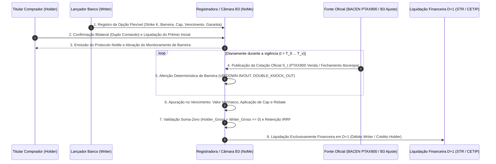

# Especificação Técnica — Opções Flexíveis de Balcão B3 (NoMe): Registro, Barreiras Exóticas (Knock-In / Knock-Out), Limitadores (Cap) e Liquidação Financeira (FL-042)

## 1. Visão Geral e Arcabouço Regulatório

As **Opções Flexíveis de Balcão Registradas na B3 (NoMe — Novo Mercado de Balcão / Câmara B3)** são contratos derivativos customizados celebrados no mercado de balcão organizado entre instituições financeiras (*Dealers*), investidores institucionais e empresas corporativas (*Hedgers*), tendo como ativos subjacentes:
- **Taxa de Câmbio de Reais por Dólar dos Estados Unidos (`USD_PTAX`)**: referenciada na cotação oficial **PTAX800 de venda** divulgada pelo Banco Central do Brasil (BACEN);
- **Índice Bovespa (`IBOVESPA`)**: referenciado na pontuação de fechamento ou índice de liquidação apurado pela B3;
- **Ações, Units, ETFs e BDRs (`EQUITY`)**: referenciados no preço médio ponderado ou preço de fechamento no pregão à vista da B3 (PUMA Trading System).

Diferentemente das opções padronizadas listadas em pregão (FL-041), nas **Opções Flexíveis (FL-042)** as partes contratantes têm liberdade para pactuar bilateralmente os parâmetros econômicos essenciais e cláusulas exóticas de proteção e barreira:
1. **Preço de Exercício (*Strike Price* — $K$)** livremente escolhido (em $\text{R\$/US\$}$ até 4 casas decimais, em pontos de índice ou em $\text{R\$/ação}$);
2. **Data de Vencimento ($T_v$) e Prazo ($DC / DU$)** customizados para casar exatamente com o fluxo de caixa corporativo (importação, exportação, dívida externa ou carteira de ações);
3. **Estilo de Exercício (`FlexibleExerciseStyle`)**: **Europeu (`EUROPEAN`)** (exercício exclusivamente na data de vencimento) ou **Americano (`AMERICAN`)** (exercício a qualquer dia útil até o vencimento, inclusive);
4. **Liquidação Exclusivamente Financeira em $D+1$ (`FINANCIAL_D1`)**: não há entrega física do ativo-objeto; o resultado do exercício (ou *Rebate*) é liquidado financeiramente em moeda nacional ($\text{BRL}$) no primeiro dia útil subsequente à data de exercício/vencimento ($D+1$);
5. **Modalidade de Garantia (`FlexibleGuaranteeMode`)**:
   - **Com Garantia da Câmara B3 (`COM_GARANTIA_CCP`)**: a Câmara B3 atua como Contraparte Central (CCP) mediante novação, exigindo depósito de margem de garantia (modelo de risco **CORE**) do Lançador (*Writer*) — ou de ambas as partes quando há pagamento postergado de prêmio;
   - **Sem Garantia da Câmara B3 (`SEM_GARANTIA_CCP`)**: registro puramente escritural na Registradora B3 (NoMe) para cumprimento da **Resolução CMN nº 4.952/2021** e **Resolução BCB nº 264/2022**, com risco de crédito bilateral entre Titular e Lançador.

---

## 2. Mecanismos de Barreira Exótica (*Barrier Options* — `BarrierType`)

O sistema NoMe da B3 permite acoplar cláusulas de barreira (*Knock-In* e *Knock-Out*) ao contrato de Opção Flexível. O monitoramento da barreira é realizado de forma determinística ao longo da série temporal de **cotações oficiais de referência ($S_t$)** observadas durante a vigência do contrato ($t \in [T_0, T_v]$), tais como a **PTAX800 de fechamento do BACEN** (para opções de dólar) ou o **preço/índice de fechamento da B3** (para Ibovespa e ações).

| Tipo de Barreira (`BarrierType`) | Nível(is) de Barreira | Condição de Acionamento (*Trigger Condition*) | Efeito Jurídico-Econômico sobre a Opção |
|---|---|---|---|
| **Sem Barreira (`NONE`)** | N/A | Nenhuma barreira monitorada | Opção *Vanilla* Flexível: permanece ativa desde a contratação até o vencimento. |
| **Up-and-In (`UP_AND_IN`)** | $B_{\text{up}} > S_0$ | $\exists\, t \in [T_0, T_v] \text{ tal que } S_t \ge B_{\text{up}}$ | Opção nasce inativa (latente); **passa a existir (ativa-se)** somente se a cotação atingir ou superar $B_{\text{up}}$. |
| **Up-and-Out (`UP_AND_OUT`)** | $B_{\text{up}} > S_0$ | $\exists\, t \in [T_0, T_v] \text{ tal que } S_t \ge B_{\text{up}}$ | Opção nasce ativa; **é extinta (*Knocked-Out*)** imediatamente caso a cotação atinja ou supere $B_{\text{up}}$. |
| **Down-and-In (`DOWN_AND_IN`)** | $B_{\text{down}} < S_0$ | $\exists\, t \in [T_0, T_v] \text{ tal que } S_t \le B_{\text{down}}$ | Opção nasce inativa (latente); **passa a existir (ativa-se)** somente se a cotação cair até ou abaixo de $B_{\text{down}}$. |
| **Down-and-Out (`DOWN_AND_OUT`)** | $B_{\text{down}} < S_0$ | $\exists\, t \in [T_0, T_v] \text{ tal que } S_t \le B_{\text{down}}$ | Opção nasce ativa; **é extinta (*Knocked-Out*)** imediatamente caso a cotação caia até ou abaixo de $B_{\text{down}}$. |
| **Dupla Barreira Knock-Out (`DOUBLE_KNOCK_OUT`)** | $B_{\text{down}} < S_0 < B_{\text{up}}$ | $\exists\, t \in [T_0, T_v] \text{ tal que } S_t \le B_{\text{down}} \text{ ou } S_t \ge B_{\text{up}}$ | Opção nasce ativa dentro do túnel $(B_{\text{down}}, B_{\text{up}})$; **é extinta (*Knocked-Out*)** se tocar ou romper qualquer uma das duas barreiras. |

### 2.1 Estado Final de Ativação da Opção no Vencimento ($\mathbb{I}_{\text{ativa}}$)

Seja $\text{Triggered} \in \{\text{True}, \text{False}\}$ o indicador booleano de que a condição da barreira foi atingida em pelo menos uma observação oficial $S_t$ da série histórica:
- Para `BarrierType.NONE`: $\mathbb{I}_{\text{ativa}} = \text{True}$ e $\mathbb{I}_{\text{knocked\_out}} = \text{False}$;
- Para barreiras do tipo **Knock-In** (`UP_AND_IN`, `DOWN_AND_IN`):
  $$\mathbb{I}_{\text{ativa}} = \text{Triggered}, \qquad \mathbb{I}_{\text{knocked\_out}} = \text{False}$$
- Para barreiras do tipo **Knock-Out** (`UP_AND_OUT`, `DOWN_AND_OUT`, `DOUBLE_KNOCK_OUT`):
  $$\mathbb{I}_{\text{ativa}} = \neg\,\text{Triggered}, \qquad \mathbb{I}_{\text{knocked\_out}} = \text{Triggered}$$

---

## 3. Modelo Matemático de Payoff, Limitador (*Cap*) e *Rebate*

Seja:
- $Q > 0$: quantidade de contratos ou unidades de ativo-objeto;
- $M > 0$: multiplicador financeiro por ponto/unidade da cotação (ex: $M = \text{US\$ } 50.000,00$ por contrato de opção flexível de dólar cotado em $\text{R\$/US\$}$, ou $M = 1,00$ quando $Q$ já representa o notional em $\text{US\$}$ ou quantidade de ações/pontos);
- $K > 0$: preço de exercício (*Strike*);
- $S_{\text{liq}} > 0$: cotação oficial de liquidação no vencimento/exercício (ex: PTAX800 de fechamento em $D-1$ ou índice de liquidação);
- $C_{\text{unit}} \ge 0$ (`cap_per_unit`): limitador máximo de ganho intrínseco por unidade de cotação (*Cap* / *Spread Limit* embutido no registro NoMe);
- $R_{\text{unit}} \ge 0$ (`rebate_per_unit`): valor de compensação (*Rebate*) pago por unidade ao Titular caso a opção sofra extinção por barreira (*Knock-Out*).

### 3.1 Valor Intrínseco Unitário Sem Limitador ($IV_{\text{raw}}$)

Se a opção chega **ativa** ao vencimento/exercício ($\mathbb{I}_{\text{ativa}} = \text{True}$):
- **Para Opção de Compra (`CALL`)**:
  $$IV_{\text{raw}} = \max\left(0,\; S_{\text{liq}} - K\right)$$
- **Para Opção de Venda (`PUT`)**:
  $$IV_{\text{raw}} = \max\left(0,\; K - S_{\text{liq}}\right)$$

Se a opção **não está ativa** ($\mathbb{I}_{\text{ativa}} = \text{False}$, seja por *Knock-Out* ocorrido ou por *Knock-In* não atingido):
$$IV_{\text{raw}} = 0$$

### 3.2 Aplicação do Limitador de Payoff (*Cap* / *Spread Limit*)

Nas opções flexíveis com limitador (*Capped Options* — muito utilizadas em *hedges* cambiais corporativos para baratear o prêmio emulando uma trava de alta *Bull Call Spread* ou trava de baixa *Bear Put Spread* em um único registro NoMe):
- Se há um limitador unitário $C_{\text{unit}} > 0$ configurado (`cap_per_unit`):
  $$IV_{\text{capped}} = \min\left(IV_{\text{raw}},\; C_{\text{unit}}\right)$$
- Caso contrário ($C_{\text{unit}} = \text{None}$):
  $$IV_{\text{capped}} = IV_{\text{raw}}$$

### 3.3 Aplicação de *Rebate* em Caso de *Knock-Out* e Payoff Financeiro Bruto ($P_{\text{gross}}$)

1. **Se a opção está ativa ($\mathbb{I}_{\text{ativa}} = \text{True}$) e $IV_{\text{capped}} > 0$ (Exercício *In-The-Money*)**:
   $$P_{\text{raw\_brl}} = Q \times M \times IV_{\text{capped}}$$
   - Caso exista também um teto financeiro global em Reais para o contrato (`cap_notional_brl` $= C_{\text{total\_brl}} > 0$):
     $$P_{\text{gross}} = \text{round}_2\left(\min\left(P_{\text{raw\_brl}},\; C_{\text{total\_brl}}\right)\right)$$
   - Caso contrário:
     $$P_{\text{gross}} = \text{round}_2\left(P_{\text{raw\_brl}}\right)$$

2. **Se a opção sofreu *Knock-Out* ($\mathbb{I}_{\text{knocked\_out}} = \text{True}$) e possui cláusula de *Rebate* ($R_{\text{unit}} > 0$)**:
   $$P_{\text{gross}} = \text{round}_2\left(Q \times M \times R_{\text{unit}}\right)$$

3. **Se a opção expirou fora do dinheiro (*Out-of-The-Money* / *At-The-Money*, $IV_{\text{capped}} = 0$) ou não ativou o *Knock-In* sem *Rebate***:
   $$P_{\text{gross}} = \text{R\$ } 0,00$$

---

## 4. Conservação Bilateral Soma-Zero e Tributação de Liquidação (IRRF)

### 4.1 Invariante da Conservação Bilateral Soma-Zero Bruta

Na liquidação financeira de exercício (ou de *Rebate*) em $D+1$, a obrigação financeira bruta é estritamente simétrica entre o **Titular Comprador da Opção (*Holder*)** e o **Lançador Vendedor da Opção (*Writer*)**:
- O Titular (*Holder*) jamais tem payoff de exercício negativo ($P_{\text{holder, gross}} = P_{\text{gross}} \ge 0$);
- O Lançador (*Writer*) suporta o débito exatamente igual ao crédito bruto do Titular ($P_{\text{writer, gross}} = -P_{\text{gross}} \le 0$);
- Portanto, o **Invariante Fundamental de Soma-Zero** no nível bruto é sempre satisfeito:
  $$P_{\text{holder, gross}} + P_{\text{writer, gross}} = \text{R\$ } 0,00$$

### 4.2 Base de Cálculo do Ganho Líquido do Titular e Retenção de IRRF

Conforme a **Instrução Normativa RFB nº 1.585/2015**, nas operações com opções flexíveis no mercado de balcão:
- O **Prêmio Pago ($V_{\text{prêmio}} = \text{round}_2(Q \times M \times p_{\text{unit}})$)** na abertura da operação constitui o custo de aquisição da opção para o Titular;
- Na liquidação positiva por exercício ou *Rebate* ($P_{\text{holder, gross}} > 0$), o **Ganho de Capital / Resultado Tributável do Titular ($G_{\text{trib}}$)** considera a dedução do prêmio pago (ou incide sobre o resultado positivo conforme parametrização tributária do regime de balcão):
  $$G_{\text{trib}} = \max\left(0,00,\; P_{\text{holder, gross}} - V_{\text{prêmio}}\right) \quad \text{(ou } P_{\text{holder, gross}} \text{ quando } \text{deduct\_premium\_in\_irrf\_base} = \text{False}\text{)}$$
- A retenção de **IRRF na fonte ($\text{IRRF}_{\text{holder}}$)** ocorre exclusivamente quando $G_{\text{trib}} > 0$ e o Titular não é isento (`holder_irrf_exempt == False`), aplicando-se a alíquota contratual/regressiva $\tau_{\text{IRRF}}$:
  $$\text{IRRF}_{\text{holder}} = \begin{cases} \text{round}_2\left(G_{\text{trib}} \times \tau_{\text{IRRF}}\right), & \text{se } G_{\text{trib}} > 0 \text{ e } \neg\,\text{holder\_irrf\_exempt} \\ 0,00, & \text{caso contrário} \end{cases}$$
- **Fluxo Financeiro Líquido de Liquidação em $D+1$**:
  $$\text{Net}_{\text{holder}} = P_{\text{holder, gross}} - \text{IRRF}_{\text{holder}}$$
  $$\text{Net}_{\text{writer}} = P_{\text{writer, gross}} = -P_{\text{holder, gross}}$$
  $$\text{Net}_{\text{holder}} + \text{Net}_{\text{writer}} + \text{IRRF}_{\text{holder}} = \text{R\$ } 0,00$$

---

## 5. Fluxo Operacional de Registro, Monitoramento de Barreira e Liquidação na B3

---

## 6. Invariantes Determinísticos Audíveis (FL-042)

1. **Invariante 1 — Conservação Bilateral Soma-Zero Bruta**:
   - Em qualquer cenário (exercício *In-The-Money* com ou sem *Cap*, pagamento de *Rebate* por *Knock-Out*, ou expiração sem valor *Out-of-The-Money*), a soma do payoff bruto do Titular com o ajuste bruto do Lançador é identicamente zero:
     $$\text{holder\_gross\_payoff\_brl} + \text{writer\_gross\_payoff\_brl} = \text{Decimal("0.00")}$$
2. **Invariante 2 — Equilíbrio Contábil Líquido com IRRF**:
   - O valor líquido creditado ao Titular somado ao débito do Lançador e ao IRRF recolhido à Receita Federal é identicamente zero:
     $$\text{holder\_net\_payoff\_brl} + \text{writer\_net\_payoff\_brl} + \text{holder\_irrf\_brl} = \text{Decimal("0.00")}$$
3. **Invariante 3 — Monotonicidade e Respeito Estrito ao Limitador (*Cap*)**:
   - Sempre que `cap_per_unit` ($C_{\text{unit}}$) estiver definido e a opção for exercida, o payoff unitário efetivo nunca excede $C_{\text{unit}}$ ($0 \le IV_{\text{capped}} \le C_{\text{unit}}$), e se `cap_notional_brl` estiver definido, o payoff bruto total nunca excede `cap_notional_brl`.
4. **Invariante 4 — Exclusão Mútua Determinística entre Exercício e *Knock-Out***:
   - Uma opção que sofreu *Knock-Out* (`is_knocked_out == True`) tem obrigatoriamente valor intrínseco exercido igual a zero (`capped_unit_intrinsic == 0`) e só pode gerar fluxo financeiro se houver cláusula de *Rebate* (`rebate_per_unit > 0`); inversamente, uma opção *Knock-In* cujo gatilho jamais foi atingido ao longo da série histórica (`barrier_triggered == False`) permanece inativa (`is_option_active == False`) e tem payoff nulo.
