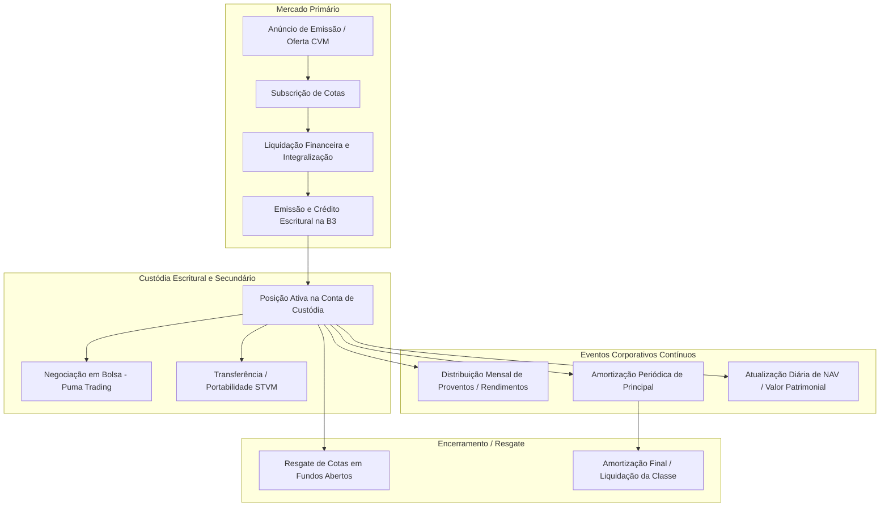
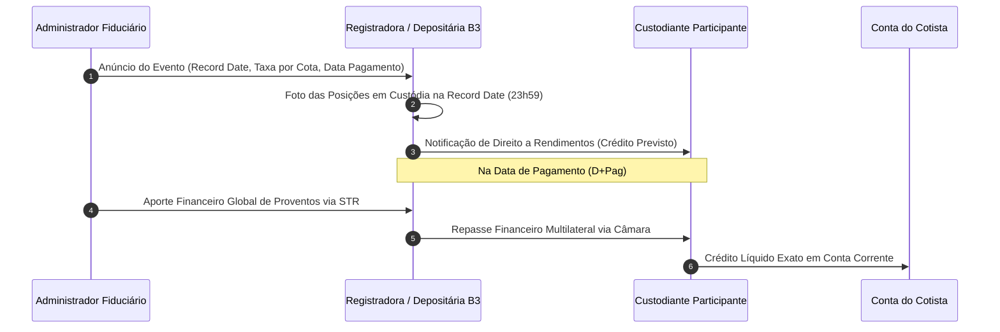

# Plataforma de Fundos de Investimento B3 — Registro e Custódia Escritural (FL-029)

## 1. Visão Geral e Marco Regulatório (Resolução CVM 175)

A **Plataforma de Fundos de Investimento da B3** é a infraestrutura de mercado financeiro responsável pelo registro escritural, controle de titularidade, liquidação de eventos e custódia de cotas de fundos estruturados e listados no mercado de capitais brasileiro.

Com a entrada em vigor da **Resolução CVM 175/2022** (novo marco regulatório dos fundos de investimento), o ecossistema de fundos no Brasil passou por uma modernização estrutural profunda, fundamentada em quatro pilares centrais:
1. **Segregação de Funções Fiduciárias**: Distinção clara e delimitação de deveres entre o **Administrador Fiduciário** (responsável legal pelo funcionamento, constituição, escrituração de cotas, custódia e cumprimento das normas CVM/B3) e o **Gestor de Recursos** (responsável pelas decisões discricionárias de investimento e alocação de carteira).
2. **Estrutura de Classes e Subclasses**: Possibilidade de um mesmo fundo conter patrimônios segregados por **classes** (com direitos econômicos distintos e responsabilidade patrimonial limitada ao patrimônio da própria classe) e **subclasses** (diferenciadas por taxa de administração, prazos de resgate, público-alvo ou moeda de liquidação).
3. **Responsabilidade Limitada do Cotista**: Proteção explícita do patrimônio pessoal dos cotistas, assegurando que o cotista não seja demandado a aportar recursos adicionais em caso de patrimônio líquido negativo, desde que previsto no regulamento.
4. **Registro Escritural Obrigatório em Entidade Autorizada**: Exigência de que as cotas de fundos fechados e fundos com negociação em mercado organizado sejam mantidas em depositária central ou registradora autorizada pelo Banco Central do Brasil e CVM — papel exercido centralmente pela B3.

Este documento formaliza as especificações técnicas do fluxo **`FL-029`**: Registro, Custódia Escritural, Apuração de Eventos Corporativos (Amortização e Rendimentos) e Conciliação de Extratos de Cotistas na B3.

---

## 2. Tipos de Fundos Suportados

A esteira de integração atende integralmente às categorias regulamentadas pela CVM e registradas na B3:

### 2.1. FIDC — Fundos de Investimento em Direitos Creditórios (Anexo Normativo II)
- **Natureza**: Fundos abertos ou fechados dedicados à aquisição de direitos creditórios originados de operações comerciais, industriais, financeiras, hipotecárias ou de prestação de serviços (duplicatas, contratos de cessão, CCBs, recebíveis de cartão).
- **Estrutura de Cotas**:
  - **Cota Sênior**: Possui prioridade absoluta na distribuição de rendimentos e amortização de principal. Conta com meta de rentabilidade convencionada (ex: 100% CDI + 2.50% a.a.).
  - **Cota Mezanino**: Subordinada à sênior, porém preferencial em relação à ordinária/júnior.
  - **Cota Subordinada (Júnior / Ordinária)**: Absorve primeiramente as perdas e inadimplências da carteira de recebíveis, amortizada somente após a remuneração integral das cotas seniores.
- **Ciclo de Amortização**: Amortizações periódicas programadas ou extraordinárias de principal, que reduzem diretamente o valor patrimonial unitário da cota (NAV).

### 2.2. FII — Fundos de Investimento Imobiliário (Anexo Normativo III)
- **Natureza**: Fundos fechados voltados à aquisição de ativos imobiliários (galpões logísticos, lajes corporativas, shopping centers) ou títulos imobiliários (CRI, LCI, cotas de outros FIIs).
- **Código de Negociação (Ticker)**: Código de 4 letras + terminação `11` (ex: `HGLG11`, `KNIP11`, `XPLG11`).
- **Distribuição Obrigatória de Rendimentos**: De acordo com a Lei 8.668/93 e regulamentação CVM, o FII deve distribuir semestralmente no mínimo **95% dos lucros auferidos sob regime de caixa**, com prática consolidada de mercado de **antecipação mensal de rendimentos** creditados na conta de custódia dos cotistas.
- **Tratamento Tributário**: Rendimentos isentos de Imposto de Renda para pessoas físicas na fonte, desde que o cotista detenha menos de 10% das cotas e o fundo possua mais de 100 cotistas (conforme marco da Lei 14.754/2023).

### 2.3. FIAGRO — Fundos nas Cadeias Produtivas Agroindustriais (Anexo Normativo IV)
- **Natureza**: Instrumento criado pela Lei 14.130/2021 voltado ao financiamento do agronegócio nacional em três modalidades operacionais:
  - **FIAGRO-FII (Imobiliário)**: Terras agrícolas, fazendas, silos e propriedades rurais.
  - **FIAGRO-FIDC (Creditório)**: Direitos creditórios do agro (CPR financeira/física, CRA, duplicatas agrícolas).
  - **FIAGRO-FIP (Participações)**: Participação societária em agroindústrias e biotecnologia agrícola.
- **Rendimentos**: Distribuição periódica mensal com dinâmica operacional idêntica aos FIIs.

### 2.4. ETF — Exchange Traded Funds / Fundos de Índice (Anexo Normativo V)
- **Natureza**: Fundos de condomínio aberto com cotas negociadas continuamente em bolsa no Puma Trading System, com o objetivo de replicar a variação e rentabilidade de um índice de referência (ações, renda fixa, commodities, criptoativos).
- **Mecanismo de Criação e Resgate**:
  - Operado exclusivamente por **Formadores de Mercado** e **Agentes Autorizados (Authorized Participants - AP)**.
  - Subscrição em lote padrão (*Creation Unit*) via entrega de cesta de ativos componentes do índice ou moeda corrente.
  - Resgate em lote padrão (*Redemption Unit*) mediante entrega de cotas para recebimento da cesta de ativos subjacentes.

---

## 3. Modelo Operacional e Ciclo de Vida de Cotas



### 3.1. Operações Suportadas (`QuotaMovementType`)

| Código da Operação | Nome da Operação | Efeito na Quantidade de Cotas | Efeito no NAV da Cota | Efeito Financeiro na Conta |
|---|---|---|---|---|
| `SUBSCRIPTION` | Subscrição de Cotas | Registra compromisso de aporte (D0) | Inalterado | Débito futuro acordado |
| `PAID_IN_CAPITAL` | Integralização de Cotas | **Crédito de Cotas** (+Q) | Calculado pelo PU de emissão | Débito financeiro realizado |
| `REDEMPTION` | Resgate de Cotas | **Débito de Cotas** (-Q) | Inalterado (valor na data de cotização) | Crédito financeiro ao investidor |
| `AMORTIZATION` | Amortização de Principal | **Inalterado** | **Redução do NAV** (-Taxa Amort) | **Crédito financeiro** ($Q \times Taxa$) |
| `INCOME_DISTRIBUTION` | Distribuição de Rendimentos | **Inalterado** | Inalterado | **Crédito financeiro** ($Q \times Rend$) |
| `TRANSFER_IN` | Entrada por Transferência (STVM) | **Crédito de Cotas** (+Q) | Inalterado | Neutro (transferência de custódia) |
| `TRANSFER_OUT` | Saída por Transferência (STVM) | **Débito de Cotas** (-Q) | Inalterado | Neutro (transferência de custódia) |

---

## 4. Motor de Apuração de Eventos Corporativos

### 4.1. Distribuição Mensal de Rendimentos (FII / FIAGRO)
Para fundos de rendimentos mensais, o Administrador Fiduciário divulga o **Aviso aos Cotistas** contendo:
- **Data-Base / Record Date (`record_date`)**: Último dia de negociação com direito ao provento (Data-Com).
- **Data-Ex (`ex_date`)**: Primeiro dia útil subsequente à data-base, a partir do qual as cotas são negociadas "ex-rendimentos".
- **Data de Pagamento (`payment_date`)**: Data de crédito financeiro dos rendimentos na conta do cotista.
- **Valor por Cota (`rate_per_quota`)**: Valor monetário bruto em moeda corrente nacional com precisão decimal.

#### Fórmula de Apuração Individual:
$$\text{Crédito Bruto}_i = Q_{i} \times \text{rate\_per\_quota}$$
$$\text{IR Fonte}_i = \text{Crédito Bruto}_i \times \text{tax\_rate}$$
$$\text{Crédito Líquido}_i = \text{Crédito Bruto}_i - \text{IR Fonte}_i$$

Onde:
- $Q_i$ é a quantidade total de cotas detidas pelo cotista $i$ na conta de custódia no encerramento da `record_date`.
- Para FIIs qualificados para isenção de pessoa física, $\text{tax\_rate} = 0$.



### 4.2. Amortização Periódica de Principal (FIDC / FII)
A amortização de principal constitui devolução de patrimônio líquido originário aos investidores, reduzindo o valor contábil de cada cota sem cancelar o título:

#### Fórmulas de Amortização:
$$\text{Crédito Amortização}_i = Q_{i} \times \text{amortization\_rate}$$
$$\text{NAV}_{t} = \text{NAV}_{t-1} - \text{amortization\_rate}$$
$$\text{PL}_{t} = Q_{\text{total}} \times \text{NAV}_{t}$$

#### Restrições de Integridade:
- $\text{amortization\_rate} > 0$
- $\text{NAV}_{t-1} \ge \text{amortization\_rate}$ (O valor amortizado não pode exceder o valor patrimonial da cota).
- $\text{NAV}_{t} \ge 0$.

---

## 5. Estrutura do Extrato Consolidado de Cotistas

O extrato da B3 provê a visão oficial auditável da posição escritural de cada participante e conta de custódia.

### 5.1. Esquema JSON de Intercâmbio de Dados (`fund_quota_statement.json`)

```json
{
  "statement_id": "STMT-B3-FUNDS-20261103-001",
  "system": "B3 Fundos - Plataforma de Registro de Cotas",
  "position_date": "2026-11-03",
  "generation_timestamp": "2026-11-03T20:15:00Z",
  "participant_code": "105",
  "participant_name": "BANCO LIQUIDADOR E CUSTODIANTE BRASIL S.A.",
  "funds": [
    {
      "fund_id": "11.222.333/0001-44",
      "ticker": "HGLG11",
      "isin": "BRHGLGCTF001",
      "fund_name": "CSHG LOGISTICA FII",
      "category": "FII",
      "administrator": "CREDIT SUISSE HEDGING-GRIFFO CORRETORA DE VALORES S.A.",
      "total_issued_quotas": "33787584",
      "quota_nav": "165.25000000",
      "nav_date": "2026-11-03",
      "positions": [
        {
          "custody_account": "105001",
          "investor_id": "123.456.789-00",
          "investor_name": "CARLOS EDUARDO PEREIRA",
          "quota_class": "UNICA",
          "quota_quantity": "10000.00000000",
          "blocked_quantity": "0.00000000",
          "pending_settlement_quantity": "0.00000000",
          "available_quantity": "10000.00000000",
          "total_equity_value": "1652500.00"
        }
      ]
    }
  ]
}
```

### 5.2. Dicionário de Dados do Registro de Posição de Cotas

| Campo | Tipo | Descrição | Regras de Negócio e Invariantes |
|---|---|---|---|
| `fund_id` | `String` | CNPJ do Fundo com máscara ou ISIN | Chave primária de identificação cadastral |
| `ticker` | `String` | Código de bolsa de 6 dígitos (se listado) | Terminação `11` para FII/FIAGRO/ETF |
| `category` | `FundCategory` | Categoria do fundo (`FIDC`, `FII`, `FIAGRO`, `ETF`) | Determina regras tributárias e de distribuição |
| `quota_class` | `String` | Classe ou subclasse da cota | Ex: `SENIOR`, `MEZZANINE`, `SUBORDINADA`, `UNICA` |
| `custody_account` | `String` | Código numérico da conta de custódia na B3 | 6 a 12 dígitos |
| `investor_id` | `String` | CPF ou CNPJ do titular da conta | Documento válido de identificação cadastral |
| `quota_quantity` | `Decimal` | Quantidade total de cotas sob titularidade | Precisão até 8 casas decimais; valor $\ge 0$ |
| `blocked_quantity` | `Decimal` | Cotas bloqueadas (margem, ônus, penhor) | $0 \le \text{blocked} \le \text{quota\_quantity}$ |
| `available_quantity`| `Decimal` | Cotas livres para negociação ou transferência | $\text{available} = \text{quota\_quantity} - \text{blocked}$ |
| `quota_nav` | `Decimal` | Valor Patrimonial Unitário da Cota (NAV) | Até 8 casas decimais; valor $\ge 0$ |
| `total_equity_value`| `Decimal` | Valor Patrimonial Bruto Total | $(\text{quota\_quantity} \times \text{quota\_nav})$ arredondado a 2 casas |

---

## 6. Motor de Conciliação e Leis de Conservação

### 6.1. Invariantes Matemáticas Formais

1. **Invariante de Quantidade por Conta**:
   $$\forall p \in \text{Posições}: \quad Q_{\text{total}}(p) = Q_{\text{disponível}}(p) + Q_{\text{bloqueada}}(p)$$

2. **Invariante de Patrimônio da Conta**:
   $$\forall p \in \text{Posições}: \quad V_{\text{patrimonial}}(p) = \text{round}\Big(Q_{\text{total}}(p) \times \text{NAV}(p), 2\Big)$$

3. **Invariante de Conservação de Amortização de Principal**:
   $$\Delta \text{PL}_{\text{fundo}} = Q_{\text{total\_fundo}} \times \text{taxa\_amortizacao} = \sum_{p \in \text{Posições}} \text{Crédito\_Amortização}(p)$$
   $$\text{NAV}_{\text{novo}} = \text{NAV}_{\text{anterior}} - \text{taxa\_amortizacao}$$

4. **Invariante de Crédito Exato de Proventos**:
   $$\text{Crédito Total Distribuído} = \sum_{i} \Big(Q_i(\text{record\_date}) \times \text{rate\_per\_quota}\Big)$$

### 6.2. Tipologia de Quebras de Conciliação (`FundBreakType`)

Durante a conciliação do extrato da B3 contra o livro interno do participante, as seguintes rupturas são detectadas e isoladas deterministicamente:

- **`QUANTITY_MISMATCH`**: A quantidade de cotas no livro interno diverge da quantidade informada pela registradora da B3 para a mesma conta e fundo ($|Q_{\text{int}} - Q_{\text{ext}}| > \epsilon$).
- **`NAV_MISMATCH`**: O valor patrimonial unitário da cota (NAV) cadastrado no livro interno diverge da cota oficial apurada pelo administrador e registrada na B3.
- **`EQUITY_MISMATCH`**: O valor patrimonial total diverge além da tolerância centesimal de arredondamento.
- **`MISSING_IN_INTERNAL`**: Posição ativa presente no extrato oficial B3, porém ausente no livro interno do custodiante (risco de omissão de ativo).
- **`MISSING_IN_STATEMENT`**: Posição registrada no livro interno que não consta no extrato da registradora B3 (risco de ativo fantasma ou liquidação não confirmada).

---

## 7. Rastreabilidade com os Padrões do Atlas de Integrações B3

- **Catálogo de Fluxos**: Mapeado e implementado sob o fluxo **`FL-029`** (`Fundos B3`).
- **Módulo Python**: `src/funds_platform.py` (Zero dependências externas, tipagem estrita com `dataclasses` e `Decimal`).
- **Fixtures Oficiais**: `fixtures/fund_quota_statement.json` (Exemplos de FII HGLG11, FIDC Credit Flow e FIAGRO).
- **Suíte de Testes**: `tests/test_funds_platform.py` (Cobertura 100% de rendimentos, amortizações e quebras de conciliação).
