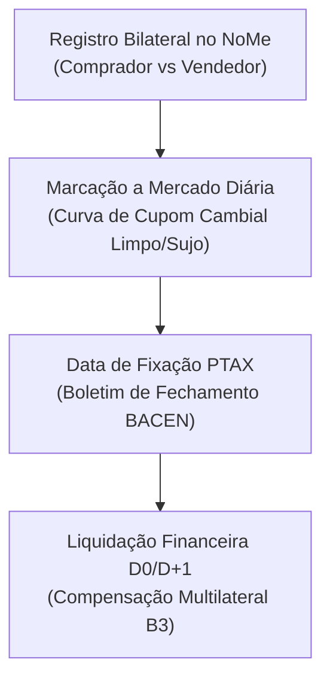

# Especificação Técnica de Termo de Moedas e NDF (USD/BRL e EUR/BRL) no Balcão NoMe B3 (FL-074)

## 1. Visão Geral e Arcabouço Regulatório

O fluxo **FL-074** implementa o registro, marcação a mercado e liquidação de contratos a termo de moedas e derivativos cambiais sem entrega física (**NDF - Non-Deliverable Forward**) sobre as paridades USD/BRL e EUR/BRL no **Balcão NoMe B3**.

Fundamentação regulatória:
- **Resolução CMN nº 3.568/2008 e Lei nº 14.286/2021**: Marco cambial brasileiro e livre conversibilidade;
- **Circular BACEN nº 3.698/2013**: Registro obrigatório de contratos derivativos de balcão;
- **Manual de Operações do Segmento Cetip UTVM / NoMe B3**: Regras de registro bilateral, fixação PTAX e liquidação financeira.

---

## 2. Modelagem Contratual e Paridade de Juros

O preço a termo teórico é calculado pela paridade coberta de taxas de juros (CIP):

$$F = S \cdot \frac{1 + i_{\text{BRL}} \cdot \frac{DU}{252}}{1 + i_{\text{USD}} \cdot \frac{DC}{360}}$$

A liquidação financeira do NDF no vencimento é determinada pela cotação PTAX Oficial de Fechamento divulgada pelo Banco Central do Brasil:

$$\text{Ajuste}_{\text{Comprador}} = \text{Nocional}_{\text{USD}} \cdot (\text{PTAX}_{\text{fixação}} - K_{\text{termo}})$$
$$\text{Ajuste}_{\text{Vendedor}} = -\text{Ajuste}_{\text{Comprador}}$$

---

## 3. Arquitetura do Fluxo no Balcão NoMe

---

## 4. Invariantes Formais

- **LAW-061 (Conservação Bilateral Soma-Zero)**: $\text{Ajuste}_{\text{Comprador}} + \text{Ajuste}_{\text{Vendedor}} == 0,00$.
- **LAW-062 (Paridade Cambial na Fixação PTAX)**: Liquidação estritamente indexada à taxa oficial sem distorções de spread.
