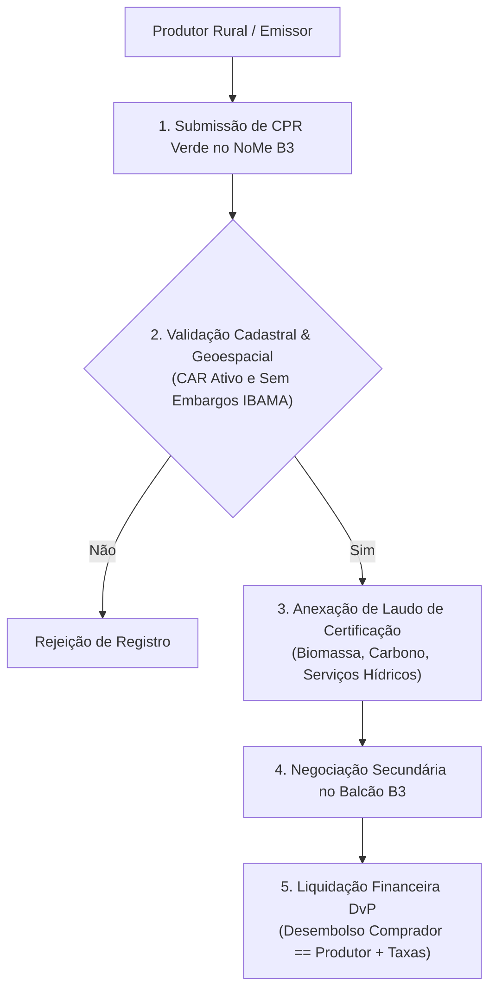

# Especificação Técnica de CPR Verde e Pagamentos por Serviços Ambientais no Balcão NoMe B3 (FL-082)

## 1. Visão Geral e Arcabouço Regulatório

O fluxo **FL-082** estabelece a arquitetura operacional para escrituração, validação geoespacial e liquidação de **Cédulas de Produto Rural Verde (CPR Verde)** e contratos de **Pagamentos por Serviços Ambientais (PSA)** no **Balcão NoMe B3**.

Fundamentação regulatória:
- **Lei Federal nº 8.929/1994** e **Lei Federal nº 13.986/2020 (Lei do Agro)**: Instituição e modernização da CPR;
- **Decreto Presidencial nº 10.828/2021**: Regulamentação da emissão de CPR Verde vinculada à conservação ou recuperação de florestas nativas e seus biomas;
- **Lei Federal nº 14.119/2021**: Política Nacional de Pagamento por Serviços Ambientais (PNPSA);
- **Código Florestal (Lei nº 12.651/2012)**: Requisitos de conformidade do Cadastro Ambiental Rural (CAR);
- **Manual de Operações de Ativos Agro e Balcão NoMe B3**: Registro escritural e liquidação multilateral.

---

## 2. Validação Geoespacial e Fluxo Operacional

---

## 3. Invariantes Formais

- **Unicidade de Hectare Preservado**: $\text{Área Comprometida} \le \text{Área Preservada Total do CAR}$ (proibição absoluta de dupla contagem ambiental).
- **Conservação Financeira de Liquidação**: $\text{Desembolso Comprador} == \text{Remuneração Produtor} + \text{Taxa Certificação}$.
- **Status Registral do CAR**: Vedado registro de CPR Verde para propriedades com CAR cancelado, suspenso ou com embargos ambientais ativos.
