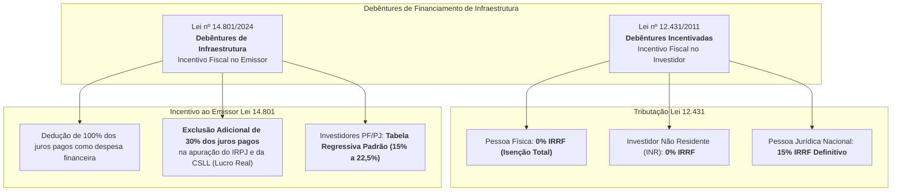
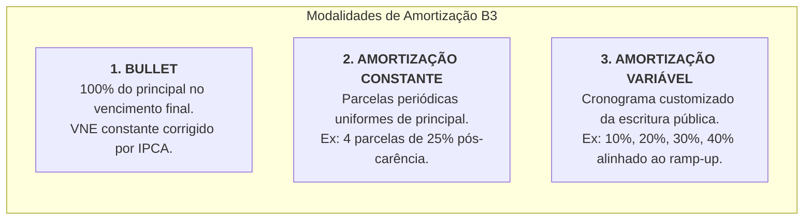
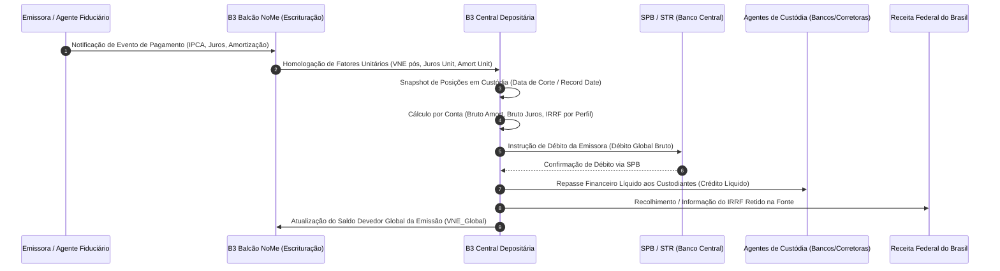
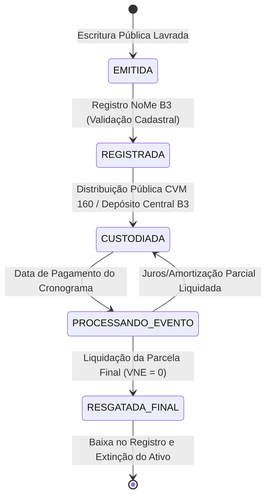

# Especificação Técnica de Debêntures Incentivadas e de Infraestrutura na B3 (FL-057)
## Balcão NoMe & Central Depositária — Escrituração, Amortização e Gestão de Debêntures (Leis 12.431/2011 e 14.801/2024)

---

## 1. Visão Geral e Arquitetura Regulatória

As **Debêntures de Infraestrutura** constituem os principais títulos de dívida corporativa privada de longo prazo no mercado de capitais brasileiro destinados a captar recursos para projetos prioritários de investimento em áreas essenciais como energia elétrica, rodovias, ferrovias, saneamento básico, portos, aeroportos e telecomunicações.

Na infraestrutura de mercado da **B3 (Brasil, Bolsa, Balcão)**, a gestão desses valores mobiliários opera de forma integrada entre dois ambientes:
1. **Balcão NoMe (Novo Mercado de Balcão B3)**: Responsável pelo registro das características da emissão, escrituração eletrônica da escritura pública, batimento bilateral e homologação das condições de taxas, indexadores e garantias reais ou flutuantes.
2. **Central Depositária B3**: Responsável pela custódia fungível das debêntures, manutenção das contas individualizadas por titular final (CPF/CNPJ), processamento centralizado dos eventos corporativos (pagamento de juros e amortizações de principal), retenção na fonte de tributos (IRRF) e liquidação financeira bruta ou líquida via Sistema de Pagamentos Brasileiro (**SPB / STR**) e contas de liquidação na B3.

---

## 2. Marco Legal: Lei nº 12.431/2011 versus Lei nº 14.801/2024

O arcabouço normativo brasileiro disponibiliza dois regimes jurídicos distintos para emissão de debêntures com incentivo público federal:

### 2.1 Lei nº 12.431/2011 — Debêntures Incentivadas (Foco no Investidor)

Sob a égide da **Lei nº 12.431/2011**, o incentivo financeiro é canalizado diretamente para a ponta investidora, reduzindo o custo de captação da empresa emissora ao oferecer rentabilidade líquida atrativa:
- **Pessoa Física (PF)** residente fiscal no Brasil: **Alíquota de 0% de IRRF** (isenção integral de imposto sobre ganhos de capital e rendimentos periódicos).
- **Investidor Não Residente (INR)**: **Alíquota de 0% de IRRF**, desde que opere conforme as regras do Conselho Monetário Nacional (Resolução CMN nº 4.373/2014) e não esteja sediado em país com tributação favorecida (jurisdição de baixa tributação / "paraíso fiscal").
- **Pessoa Jurídica (PJ)** residente fiscal no Brasil: Tributada à **alíquota exclusiva de 15% de IRRF**, retida na fonte no momento do pagamento de cada cupom de juros.

**Condições Estruturais Obrigatórias (Lei 12.431/2011)**:
- Prazo médio ponderado de vencimento superior a 4 (quatro) anos.
- Vedação à recompra do título pela emissora nos primeiros 2 (dois) anos após a emissão.
- Inexistência de compromisso de revenda assumido pelo comprador.
- Indexação prioritária a índice de preços oficial (**IPCA / IBGE**) ou taxa prefixada.

### 2.2 Lei nº 14.801/2024 — Debêntures de Infraestrutura (Foco no Emissor)

Instituída em 9 de janeiro de 2024, a **Lei nº 14.801/2024** introduziu um novo regime voltado para atrair investidores institucionais que já contavam com isenção ou não eram beneficiados pela Lei 12.431 (tais como Fundos de Pensão / Entidades Fechadas de Previdência Complementar - EFPC) e investidores corporativos:
- **Incentivo Fiscal Direto à Companhia Emissora**:
  - A pessoa jurídica emissora pode deduzir da apuração do **Lucro Real** (IRPJ) e da base de cálculo da **CSLL** as despesas com os juros pagos ou incorridos (dedução padrão de 100%).
  - **Exclusão Adicional de 30% (trinta por cento)**: A emissora pode excluir adicionalmente 30% da soma dos juros pagos na determinação do lucro real e da base de cálculo da CSLL.
  - Efeito prático: Para cada R$ 100,00 de juros pagos, a emissora deduz R$ 130,00 na determinação do lucro tributável, proporcionando uma economia fiscal combinada de até R$ 10,20 (considerando alíquota marginal de IRPJ de 25% somada a 9% de CSLL = 34% $\times$ 30% = 10,2%).
- **Tributação dos Investidores**:
  - Não há isenção de IR para o investidor pessoa física ou jurídica.
  - Aplica-se a tabela regressiva padrão de renda fixa:
    - Até 180 dias decorridos: **22,5%**
    - De 181 a 360 dias decorridos: **20,0%**
    - De 361 a 720 dias decorridos: **17,5%**
    - Acima de 720 dias decorridos: **15,0%**

### 2.3 Matriz Comparativa Regulatória

| Dimensão Regulatória | Lei nº 12.431/2011 (Incentivadas) | Lei nº 14.801/2024 (Infraestrutura) |
| :--- | :--- | :--- |
| **Público-Alvo Principal** | Varejo, Alta Renda (PF) e Não Residentes | Fundos de Pensão (EFPC), Fundos DI e Estrangeiros |
| **Incentivo Fiscal Principal** | Isenção no Investidor (PF/INR) | Dedução Extraordinária de 30% no Emissor (IRPJ/CSLL) |
| **Alíquota IRRF Pessoa Física** | **0% (Isento)** | Tabela Regressiva Geral (15% a 22,5%) |
| **Alíquota IRRF Pessoa Jurídica** | **15% (Definitivo na Fonte)** | Tabela Regressiva Geral (15% a 22,5%) |
| **Alíquota IRRF Não Residente (4.373)**| **0% (Isento)** | Tabela Regressiva Geral (15% a 22,5%) |
| **Benefício Fiscal da Emissora** | Nenhum além da despesa financeira regular | Exclusão de 130% dos juros pagos (100% + 30% bônus) |
| **Destinação dos Recursos** | Projetos Prioritários Portaria Ministerial | Projetos Prioritários Portaria Ministerial / Transição Climática |
| **Maturidade Média Mínima** | 4 anos | 4 anos |
| **Registro e Custódia** | Balcão NoMe B3 & Central Depositária | Balcão NoMe B3 & Central Depositária |

---

## 3. Modalidades de Amortização de Principal

A amortização do principal da debênture reduz diretamente o seu **Valor Nominal Escalonado (VNE)** unitário e o saldo devedor consolidado da emissão. O sistema B3 suporta três modalidades estruturadas de amortização:

1. **Bullet (Amortização Única no Vencimento)**:
   - O saldo devedor principal é mantido integralmente durante toda a vigência da emissão.
   - Os eventos periódicos intermediários liquidam exclusivamente juros (cupons remuneratórios).
   - No vencimento final ($t_n$), 100% do principal atualizado é amortizado em parcela única.
   - Fórmula: Para qualquer $t < t_n$, $\text{Amortização}_t = 0$; em $t = t_n$, $\text{Amortização}_{t_n} = VNE_{\text{atualizado}, t_n}$.

2. **Amortização Constante (Cotas Periódicas Iguais)**:
   - Após eventual período de carência (*grace period*), o saldo é amortizado em $K$ parcelas programadas, cada qual abatendo uma fração idêntica do principal ($1/K$).
   - O VNE unitário reduz linearmente a cada evento de amortização.
   - Cada amortização $k$ liquida uma cota percentual fixa ($P_{\text{amort}} = 100\% / K$).

3. **Amortização Variável / Customizada**:
   - As parcelas de amortização acompanham a curva projetada de geração de caixa (*ramp-up*) do empreendimento (ex.: usina hidrelétrica, concessão rodoviária em fase de obras).
   - Cada data do cronograma possui um percentual contratual explícito de amortização $P_{\text{amort}, t}$, tal que $\sum_{t=1}^N P_{\text{amort}, t} = 100\%$.

---

## 4. Dinâmica de Atualização Monetária (IPCA) e Cálculo de Cupom

### 4.1 Definições Fundamentais: VNO vs VNE vs VNA

- **VNO (Valor Nominal Original)**: Valor facial da debênture na data de emissão (ex.: R$ 1.000,00 ou R$ 10.000,00).
- **VNE (Valor Nominal Escalonado)**: Saldo devedor unitário do principal, atualizado pelas amortizações já ocorridas. Em $t_0$, $VNE_0 = VNO$.
- **VNA (Valor Nominal Atualizado)**: VNE corrigido pela inflação acumulada do índice acordado (**IPCA**) desde o último evento ou desde a emissão:

$$VNE_{\text{atualizado}, t} = VNE_{\text{anterior}} \times \left(1 + \Delta_{\text{IPCA}, t}\right)$$

Onde:
- $\Delta_{\text{IPCA}, t}$ é a taxa de inflação apurada ou projetada para o período de referência conforme as regras ANBIMA / B3.

### 4.2 Apuração de Juros Remuneratórios (Cupom Exponencial)

Os juros do período incidem diretamente sobre o **VNE atualizado**:

$$\text{Juros\_Unitário}_t = VNE_{\text{atualizado}, t} \times \left[ \left(1 + \text{Taxa\_Cupom\_Anual}\right)^{\frac{\text{DU}}{252}} - 1 \right]$$

Em pagamentos semestrais pré-fixados com taxa nominal periódica proporcional ou anualizada, utiliza-se a convenção de dias úteis (DU/252) oficial do mercado financeiro brasileiro.

### 4.3 Dedução de Amortização e VNE Residual Pós-Evento

O VNE unitário remanescente após o evento financeiro é determinado por:

$$\text{Amortização\_Unitária}_t = VNE_{\text{atualizado}, t} \times P_{\text{amort}, t}$$

$$VNE_{\text{pós-evento}, t} = VNE_{\text{atualizado}, t} - \text{Amortização\_Unitária}_t$$

No vencimento final ou último evento de amortização, $VNE_{\text{pós-evento}} = 0,00000000$.

---

## 5. Invariantes de Conservação e Fechamento Contábil Central B3

O processamento na Central Depositária e no NoMe deve satisfazer rigorosamente as leis fundamentais de conservação de ativos e liquidação financeira multilateral:

### Lei 1: Invariante de Conservação do Saldo Devedor Global
O saldo devedor total da emissora perante o mercado é rigorosamente igual à quantidade de títulos em circulação multiplicada pelo VNE unitário:

$$\boxed{VNE\_Global_t = \text{Quantidade\_em\_Circulação}_t \times VNE\_Unitário_t}$$

Essa identidade deve ser verificada com precisão absoluta de centavos antes e após o processamento de cada evento.

### Lei 2: Invariante de Conservação de Custódia Depositária
A quantidade de debêntures registrada em circulação deve ser idêntica à soma de todas as posições nas contas de custódia dos investidores:

$$\boxed{\text{Quantidade\_em\_Circulação} = \sum_{i=1}^{M} \text{Posição\_Custódia}_i}$$

### Lei 3: Invariante de Fechamento Financeiro Multilateral (Débito da Emissora)
O montante total debitado da conta de liquidação da companhia emissora deve ser exatamente igual à soma dos créditos líquidos efetuados aos investidores acrescida da totalidade do IRRF recolhido à Receita Federal do Brasil:

$$\boxed{\text{Débito\_Emissora}_t = \sum_{i=1}^M \text{Crédito\_Líquido}_i + \sum_{i=1}^M \text{IRRF\_Retido}_i}$$

Onde, para cada conta de custódia $i$:
$$\text{Bruto\_Amortização}_i = \text{Posição}_i \times \text{Amortização\_Unitária}_t$$
$$\text{Bruto\_Juros}_i = \text{Posição}_i \times \text{Juros\_Unitário}_t$$
$$\text{Bruto\_Total}_i = \text{Bruto\_Amortização}_i + \text{Bruto\_Juros}_i$$
$$\text{IRRF\_Retido}_i = \text{Bruto\_Juros}_i \times \text{Alíquota\_IRRF}_i$$
$$\text{Crédito\_Líquido}_i = \text{Bruto\_Total}_i - \text{IRRF\_Retido}_i$$

*Nota técnica:* A retenção de IRRF incide estritamente sobre a parcela de rendimento (**Juros**), sendo a parcela de amortização de principal isenta de tributação (devolução de capital).

### Lei 4: Invariante do Incentivo Corporativo ao Emissor (Lei 14.801/2024)
Para emissões registradas sob a Lei 14.801/2024, a dedução tributária extraordinária corporativa na apuração do lucro real e da base da CSLL é matematicamente conservada:

$$\boxed{\text{Exclusão\_Adicional\_CSLL\_IRPJ} = \text{Total\_Juros\_Pagos} \times 0{,}30}$$
$$\boxed{\text{Benefício\_Fiscal\_Estimado} = \text{Total\_Juros\_Pagos} \times 0{,}30 \times 0{,}34 = \text{Total\_Juros\_Pagos} \times 0{,}102}$$

---

## 6. Fluxos de Mensageria e Ciclo de Vida Operacional

### 6.1 Diagrama de Liquidação Financeira de Eventos B3

### 6.2 Máquina de Estados da Debênture

---

## 7. Estruturas de Dados e Classes de Domínio

As entidades canônicas do módulo estão implementadas em `src/infrastructure_debentures.py`:

| Classe | Descrição |
| :--- | :--- |
| `DebentureLegalFramework` | Enum que define o regime legal (`LEI_12431_2011` ou `LEI_14801_2024`). |
| `AmortizationType` | Enum com as modalidades de amortização (`BULLET`, `CONSTANT`, `VARIABLE`). |
| `InvestorTaxCategory` | Enum com perfis de tributação (`INDIVIDUAL_PF`, `CORPORATE_PJ`, `NON_RESIDENT_INR`). |
| `PaymentScheduleEvent` | Dataclass com os parâmetros de cada evento periódico de pagamento e amortização. |
| `CustodyPosition` | Dataclass com a posição de títulos alocada a cada conta de custódia e titular. |
| `DebentureEmission` | Dataclass com o cadastro completo da emissão, cronograma e posições. |
| `DebentureSettlementReceipt`| Dataclass com o recibo auditável de liquidação financeira e crédito na custódia. |
| `InfrastructureDebenturesEngine` | Motor determinístico de escrituração, cálculo de VNE, liquidação e prova de invariantes. |
