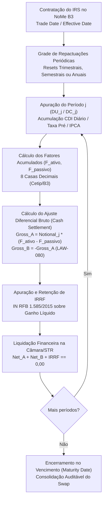

# Especificação Técnica — Swaps de Taxa de Juros com Ajustes Periódicos (IRS) no Balcão NoMe B3 (FL-080)

## 1. Visão Geral e Arcabouço Regulatório

O fluxo **FL-080** implementa o motor de registro escritural, apuração determinística de fluxos de caixa, acumulação diária da Taxa DI, liquidação diferencial periódica (*Cash Settlement*) e verificação formal de não-arbitragem para **Contratos de Swap de Taxa de Juros com Ajustes Periódicos (*Interest Rate Swap* — IRS)** na Registradora B3 (NoMe / Balcão B3).

Diferentemente dos swaps de balcão com liquidação única no vencimento (FL-040), os contratos de IRS modelados no FL-080 preveem **múltiplas datas de repactuação e liquidação financeira intermediária (*resets* periódicos)**: trimestrais, semestrais, anuais ou personalizados.

### 1.1 Normativos Aplicáveis
1. **Resolução CMN nº 4.952/2021 e Resolução BCB nº 264/2022**:
   - Obrigatoriedade de registro de derivativos de balcão em entidade registradora autorizada pelo Banco Central.
   - Identificação unívoca do contrato (`contract_id`, protocolo NoMe), qualificação das partes (`party_a`, `party_b`) e especificação contratual das pontas ativa e passiva.
2. **Instrução Normativa RFB nº 1.585/2015 (arts. 46 e 54)**:
   - A liquidação periódica de ajustes de swap caracteriza evento de apuração tributária na fonte.
   - O Imposto de Renda Retido na Fonte (**IRRF**) incide exclusivamente sobre o rendimento bruto positivo da parte credora a cada evento de liquidação financeira.
   - Aplicação da tabela regressiva: 22,5% (até 180 dias), 20,0% (181 a 360 dias), 17,5% (361 a 720 dias) e 15,0% (acima de 720 dias), respeitada a isenção de entidades imunes/isentas.
3. **Leis Formais de Conservação e Não-Arbitragem B3**:
   - **Lei 65 (LAW-080)**: Conservação bilateral soma-zero a cada evento de reset:
     $$\text{Ajuste Bruto}_{\text{Parte A}} + \text{Ajuste Bruto}_{\text{Parte B}} = \text{R\$ } 0,00$$
   - **Lei 66 (LAW-081)**: Não-arbitragem na estrutura a termo da Curva Pré/DI e consistência de replicação:
     $$\sum_{j=1}^{n} \left( F_{\text{fwd}, j} - 1 \right) \cdot DF(0, T_j) = 1.0 - DF(0, T_n)$$

---

## 2. Estrutura do Instrumento e Ciclo de Vida do Reset

---

## 3. Modelo Matemático e Convenções Cetip / NoMe

### 3.1 Acumulação Diária da Taxa DI (Padrão Cetip)
Para uma sequência de dias úteis $k = 1, \dots, DU_j$, dado o CDI anualizado diário $CDI_k$ (% a.a.):
$$f_k = \text{round}\left( \left(1 + \frac{CDI_k}{100}\right)^{\frac{1}{252}}, 8 \right)$$
$$F_{\text{CDI}} = \text{round}\left( \prod_{k=1}^{DU_j} f_k, 8 \right)$$

Com percentual de CDI ($p_{\text{CDI}}$) e *spread* anual ($s$):
$$F_{\text{adj}} = 1 + (F_{\text{CDI}} - 1) \cdot \frac{p_{\text{CDI}}}{100}$$
$$F_{\text{leg}} = \text{round}\left( F_{\text{adj}} \cdot \left(1 + \frac{s}{100}\right)^{\frac{DU_j}{252}}, 8 \right)$$

### 3.2 Ponta Prefixada
$$F_{\text{pré}} = \text{round}\left( \left(1 + \frac{r_{\text{pré}}}{100}\right)^{\frac{DU_j}{252}}, 8 \right)$$

### 3.3 Ponta IPCA + Cupom Real
$$F_{\text{IPCA}} = \text{round}\left( \left(1 + \frac{\Delta\text{IPCA}}{100}\right) \cdot \left(1 + \frac{r_{\text{real}}}{100}\right)^{\frac{DU_j}{252}}, 8 \right)$$

### 3.4 Apuração de Ajuste Periódico e IRRF
A cada corte de reset com nocional vigente $N_j$:
$$\text{Gross}_A = \text{round}\left( N_j \cdot (F_{\text{ativo}} - F_{\text{passivo}}), 2 \right)$$
$$\text{Gross}_B = -\text{Gross}_A$$

Se $\text{Gross}_A > 0$:
$$\text{IRRF}_A = \text{round}\left( \text{Gross}_A \cdot t_{\text{irrf}, A}, 2 \right) \quad (\text{se não isento})$$
$$\text{Net}_A = \text{Gross}_A - \text{IRRF}_A$$
$$\text{Net}_B = \text{Gross}_B = -\text{Gross}_A$$

Se $\text{Gross}_B > 0$:
$$\text{IRRF}_B = \text{round}\left( \text{Gross}_B \cdot t_{\text{irrf}, B}, 2 \right) \quad (\text{se não isento})$$
$$\text{Net}_B = \text{Gross}_B - \text{IRRF}_B$$
$$\text{Net}_A = \text{Gross}_A = -\text{Gross}_B$$

Conservação financeira:
$$\text{Net}_A + \text{Net}_B + \text{IRRF}_{\text{total}} = 0,00$$

---

## 4. Teorema de Não-Arbitragem na Curva Pré/DI

Dada uma curva com fatores de desconto $DF(0, T_j) = (1 + r(T_j)/100)^{-T_j/252}$:
1. Fatores forward implícitos:
   $$F_{\text{fwd}, j} = \frac{DF(0, T_{j-1})}{DF(0, T_j)}$$
2. Identidade da soma telescópica:
   $$\sum_{j=1}^n (F_{\text{fwd}, j} - 1) \cdot DF(0, T_j) = \sum_{j=1}^n \left( \frac{DF(0, T_{j-1})}{DF(0, T_j)} - 1 \right) DF(0, T_j) = \sum_{j=1}^n \left( DF(0, T_{j-1}) - DF(0, T_j) \right) = DF(0, T_0) - DF(0, T_n) = 1 - DF(0, T_n)$$
3. Taxa Par Teórica do Swap (*Fair Swap Rate* $R^*$):
   Valor de taxa fixa que anula o valor presente líquido ($NPV = 0$):
   $$\sum_{j=1}^n N_j \left( (1 + R^*)^{\frac{DU_j}{252}} - 1 \right) DF(0, T_j) = \sum_{j=1}^n N_j (F_{\text{fwd}, j} - 1) DF(0, T_j)$$
   Para nocional constante e prazos uniformes:
   $$(1 + R^*)^{\frac{DU}{252}} - 1 = \frac{1 - DF(0, T_n)}{\sum_{j=1}^n DF(0, T_j)}$$
