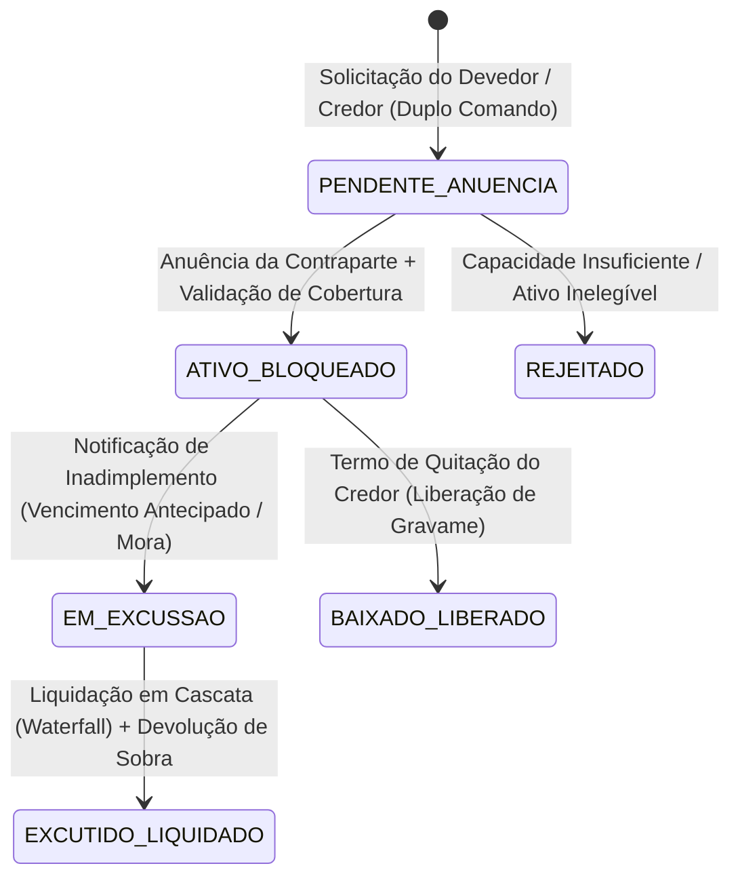

# Especificação Técnica — Central de Garantias, Gravames e Ônus Reais na Registradora B3 (FL-037)

## 1. Visão Geral e Arcabouço Regulatório

O sistema de **Central de Garantias, Gravames e Ônus Reais** da B3 (integrado ao **NoMe — Novo Mercado de Balcão** e à **Depositária Central de Ativos Listados — RTC/CAC**) provê a infraestrutura eletrônica para **Constituição, Averbação, Aditamento, Excussão e Baixa** de direitos reais de garantia e ônus sobre ativos financeiros, valores mobiliários e direitos creditórios (recebíveis).

A arquitetura do fluxo **FL-037** atende integralmente a:
1. **Lei nº 14.711/2023 (Marco Legal das Garantias)**:
   - Permite a extensão da garantia real e o compartilhamento do mesmo bem ou carteira de ativos financeiros por múltiplas operações de crédito com **graus distintos de prioridade (prelazia)** — 1º Grau (Sênior), 2º Grau (Subordinado/Mezanino), 3º Grau (Júnior) — até o limite do valor líquido de avaliação do ativo garantidor.
   - Regulamenta a **excussão extrajudicial** célere e a liquidação em cascata (*waterfall*), garantindo que o credor de grau prioritário receba 100% de seu crédito garantido atualizado antes da distribuição do saldo excedente aos credores de graus subsequentes, com restituição obrigatória do saldo remanescente ao devedor garantidor.
2. **Resolução BCB nº 264/2022 e Resolução CMN nº 4.593/2017**:
   - Exige o registro ou depósito centralizado de ativos financeiros e valores mobiliários objeto de garantia em entidade registradora ou depositária central autorizada pelo Banco Central do Brasil (BCB) e pela Comissão de Valores Mobiliários (CVM), garantindo **unicidade de controle**, **bloqueio automático de negociação livre** e prevenção contra duplicidade de gravames (*double-pledging*).
3. **Lei nº 10.406/2002 (Código Civil — arts. 1.419 a 1.460) e Lei nº 4.728/1965 (art. 66-B)**:
   - Disciplina o Penhor comum e mercantil, a Alienação Fiduciária em garantia no âmbito do mercado financeiro e de capitais, a Cessão Fiduciária de direitos creditórios e o Usufruto sobre valores mobiliários.

---

## 2. Modalidades de Gravames e Ônus Suportadas (`LienModality`)

| Código Enum | Modalidade Jurídica | Base Legal | Efeito na Titularidade e Custódia | Tratamento de Eventos Corporativos (Proventos / Juros) |
|---|---|---|---|---|
| `PENHOR` | Penhor de Ativos Financeiros / Valores Mobiliários | Código Civil (art. 1.431 e segs.) | O devedor garantidor mantém a propriedade plena; o ativo é transferido para subconta de custódia bloqueada vinculada ao credor pignoratício. | Juros, amortizações e dividendos podem ser retidos na conta vinculada ou liberados conforme pactuado na escritura. |
| `ALIENACAO_FIDUCIARIA` | Alienação Fiduciária em Garantia | Lei 4.728/1965 (art. 66-B) e Lei 14.711/2023 | Transfere ao credor fiduciário a **propriedade resolúvel** e a posse indireta do ativo, tornando-o incomunicável com a massa falida ou recuperação judicial do devedor. | Eventos financeiros seguem o regime fiduciário registrado no instrumento constitutivo. |
| `CESSAO_FIDUCIARIA` | Cessão Fiduciária de Direitos Creditórios / Recebíveis | Lei 4.728/1965 (art. 66-B, § 3º) e Lei 10.931/2004 | Titularidade fiduciária sobre fluxos de caixa futuros, CDBs, Debêntures, CPRs ou recebíveis financeiros em favor do credor cessionário. | Liquidação financeira das parcelas ou resgates é direcionada diretamente à conta de liquidação do credor fiduciário (*trava de domicílio*). |
| `USUFRUTO` | Usufruto de Valores Mobiliários (Ações / Cotas / Títulos) | Lei 6.404/1976 (art. 40 e art. 114) | Desmembra a nua-propriedade (mantida pelo titular) do direito econômico aos frutos (dividendos, JCP, rendimentos) e, se averbado, do direito de voto. | Proventos em dinheiro são creditados automaticamente ao usufrutuário; ativo-base permanece bloqueado para alienação na nua-propriedade. |

---

## 3. Graus de Prioridade e Compartilhamento de Garantia (`LienPriorityRank`)

Em conformidade com o **Marco Legal das Garantias (Lei 14.711/2023)**, um mesmo `CollateralAssetPool` (lote de CDBs, Debêntures ou Ações custodiadas) pode caucionar múltiplas obrigações financeiras perante o mesmo credor ou credores distintos, desde que respeitada a capacidade de cobertura avaliada e a ordem estrita de prelazia:

| Grau (`LienPriorityRank`) | Nomenclatura de Mercado | Ordem de Prelazia | Regra de Constituição e Pagamento na Excussão |
|---|---|---|---|
| `PRIMEIRO_GRAU` (Rank `1`) | Sênior (*First Lien*) | Prioridade Absoluta (1º) | Tem preferência integral sobre o produto da liquidação ou excussão do ativo garantidor até a quitação de 100% do crédito garantido atualizado. |
| `SEGUNDO_GRAU` (Rank `2`) | Subordinado / Mezanino (*Second Lien*) | 2ª Prioridade | Constituído sobre a margem excedente de avaliação do ativo (*equity cushion*). Na excussão, recebe apenas após a satisfação integral de todos os gravames de `1º Grau`. |
| `TERCEIRO_GRAU` (Rank `3`) | Júnior (*Third Lien*) | 3ª Prioridade | Constituído sobre eventual capacidade residual após 1º e 2º graus. Na excussão, recebe apenas após a quitação integral dos créditos de `1º` e `2º Grau`. |

> [!IMPORTANT]
> **Invariante de Ordenação Temporal Intra-Grau**: Caso existam múltiplos registros ativos no mesmo grau de prioridade (ex.: consórcio de credores seniores ou averbações sucessivas autorizadas no instrumento de compartilhamento), o desempate na cascata de excussão obedece estritamente à anterioridade do protocolo de registro (`registration_timestamp`) ou ao rateio *pro rata* quando de mesmo protocolo sindicalizado. No modelo determinístico padrão B3, ordena-se por `(priority_rank.order, registration_timestamp, lien_id)`.

---

## 4. Ciclo de Vida do Gravame (`LienStatus`) e Bloqueio de Custódia

### 4.1 Subcontas de Custódia na Depositária B3
Ao transitar para `ATIVO_BLOQUEADO`, o motor da Registradora B3 executa atomicamente a transferência contábil do ativo:
- **Conta Livre (`2101-6` — Custódia Livre do Investidor)**: A quantidade gravada é debitada imediatamente, impedindo que o ativo seja entregue em liquidação de vendas no PUMA, alugado no BTC ou portado via STVM sem anuência do credor.
- **Conta de Garantia/Gravame (`2901-X` — Custódia Bloqueada por Ônus Real)**: O ativo permanece vinculado ao `pool_id` e aos códigos de registro (`lien_id`) dos gravames ativos.

---

## 5. Modelo Matemático de Capacidade de Cobertura e Bloqueio

Seja um lote de ativos garantidores (`CollateralAssetPool`) identificado por $P$:
- $Q_{total}$: Quantidade total custodiada do ativo no pool.
- $V_{unit}$: Preço unitário de mercado ou PU na curva (*Mark-to-Market* / PU Par).
- $H \in [0, 1)$: *Haircut* (deságio conservador de avaliação/liquidez) aplicável à classe do ativo.

### 5.1 Valor Bruto e Valor Líquido de Avaliação (*Valuation Ceiling*)
1. **Valor Bruto de Mercado ($V_{bruto}$)**:
   $$V_{bruto} = Q_{total} \times V_{unit}$$

2. **Valor Líquido de Avaliação / Teto de Garantia ($V_{avaliacao}$)**:
   $$V_{avaliacao} = V_{bruto} \times (1 - H)$$

### 5.2 Regra de Capacidade de Cobertura Multi-Grau
Seja $\mathcal{L}_{ativos}(P)$ o conjunto de todos os gravames com status `ATIVO_BLOQUEADO` ou `EM_EXCUSSAO` vinculados ao pool $P$. Para cada gravame $k \in \mathcal{L}_{ativos}(P)$, seja $C_{garantido}^{(k)}$ o valor atualizado da dívida/obrigação garantida (*secured amount*).

O **Comprometimento Total de Avaliação ($C_{total}$)** sobre o pool é:
$$C_{total} = \sum_{k \in \mathcal{L}_{ativos}(P)} C_{garantido}^{(k)}$$

A **Capacidade Disponível para Novos Graus ($Cap_{disp}$)** é dada por:
$$Cap_{disp} = V_{avaliacao} - C_{total}$$

Para que um novo gravame $novo$ com valor garantido $C_{garantido}^{(novo)}$ seja constituído sobre o pool $P$, o motor exige invariavelmente:
$$C_{garantido}^{(novo)} \le Cap_{disp} \iff C_{total} + C_{garantido}^{(novo)} \le V_{avaliacao}$$

Caso $C_{garantido}^{(novo)} > Cap_{disp}$, a constituição é rejeitada com `InsufficientCollateralCapacityError`, impedindo a alavancagem descoberta (*over-encumbrance*) além do valor líquido de avaliação do colateral.

### 5.3 Bloqueio Automático de Negociação Livre
- Enquanto houver **qualquer** gravame ativo ($\mathcal{L}_{ativos}(P) \neq \emptyset$) sobre o pool $P$, a quantidade bloqueada para negociação livre é estritamente controlada.
- Um gravame de `1º Grau`, `2º Grau` ou `3º Grau` sobre o pool bloqueia a alienação livre dos ativos subjacentes (`is_free_trading_blocked = True`), exigindo a baixa (`BAIXADO_LIBERADO`) de todos os gravames incidentes (ou liberação parcial expressa com sobra de cobertura) para que as unidades retornem à livre negociação.

---

## 6. Cascata de Excussão e Liquidação por Ordem de Prelazia (*Waterfall*)

Quando ocorre o inadimplemento de uma ou mais obrigações garantidas pelo pool $P$, deflagra-se o procedimento de **Excussão de Garantia** (Lei 14.711/2023).

Seja $V_{exec\_bruto}$ o valor bruto apurado na venda/liquidação ou apropriação do ativo garantidor no mercado secundário ou resgate antecipado, e seja $C_{custos}$ o total de custos operacionais, emolumentos da B3 e despesas de excussão.

1. **Produto Líquido de Excussão ($V_{liq\_exec}$)**:
   $$V_{liq\_exec} = V_{exec\_bruto} - C_{custos}$$
   *(Requer $V_{liq\_exec} \ge 0$).*

2. **Ordenação Estrita de Prelazia**:
   Os gravames ativos $k \in \mathcal{L}_{ativos}(P)$ são ordenados em sequência estrita $k_1, k_2, \dots, k_m$ segundo:
   $$\text{Chave}(k) = \left(\text{rank\_order}(k),\ \text{registration\_timestamp}(k),\ \text{lien\_id}(k)\right)$$
   Onde $\text{rank\_order}(\text{PRIMEIRO\_GRAU}) = 1 < \text{rank\_order}(\text{SEGUNDO\_GRAU}) = 2 < \text{rank\_order}(\text{TERCEIRO\_GRAU}) = 3$.

3. **Alocação Sequencial (*Senior-First Waterfall*)**:
   Define-se o saldo disponível inicial $S_0 = V_{liq\_exec}$. Para cada gravame $k_i$ ($i = 1, \dots, m$):
   - **Valor Pago ao Credor $k_i$ ($P_{pago}^{(i)}$)**:
     $$P_{pago}^{(i)} = \min\left(S_{i-1},\ C_{garantido}^{(i)}\right)$$
   - **Saldo Devedor Descoberto / *Shortfall* ($D_{aberto}^{(i)}$)**:
     $$D_{aberto}^{(i)} = C_{garantido}^{(i)} - P_{pago}^{(i)}$$
   - **Atualização do Saldo Disponível para o Grau Seguinte ($S_i$)**:
     $$S_i = S_{i-1} - P_{pago}^{(i)}$$

   > [!IMPORTANT]
   > **Regra de Prelazia Absoluta**: O credor de **2º Grau** ($rank = 2$) somente recebe qualquer centavo ($P_{pago} > 0$) se, e somente se, todos os credores de **1º Grau** ($rank = 1$) tiverem recebido **100% de seus créditos garantidos** ($\forall r \in \text{1º Grau}, D_{aberto}^{(r)} = 0$). O mesmo vale do 2º Grau para o 3º Grau.

4. **Restituição do Saldo Remanescente ao Devedor Garantidor ($R_{devedor}$)**:
   Após percorrer todos os graus registrados, todo o excedente remanescente pertence por direito ao devedor garantidor (vedação ao pacto comissório sem devolução de sobejo — art. 1.428 do Código Civil e Lei 14.711/2023):
   $$R_{devedor} = S_m = V_{liq\_exec} - \sum_{i=1}^{m} P_{pago}^{(i)}$$

5. **Invariante de Conservação Financeira da Excussão**:
   $$V_{exec\_bruto} = C_{custos} + \sum_{i=1}^{m} P_{pago}^{(i)} + R_{devedor}$$

---

## 7. Especificação do Layout JSON de Mensageria (`fixtures/lien_collateral_registry.json`)

### 7.1 Estrutura do Pool de Ativos Garantidores (`CollateralAssetPool`)
| Campo | Tipo | Obrigatório | Descrição |
|---|---|---|---|
| `pool_id` | `string` | Sim | Identificador único do pool de garantia na Registradora B3 (ex.: `POOL-CDB-2026-001`). |
| `asset_type` | `string` | Sim | Classe do ativo: `CDB`, `DEBENTURE`, `ACAO`, `LCI_LCA`, `CPR_FINANCEIRA`, `TITULO_PUBLICO`. |
| `ticker_or_cetip_code` | `string` | Sim | Código de negociação PUMA ou código IF no NoMe Balcão. |
| `isin` | `string` | Sim | Código ISIN padrão ISO 6166 (12 caracteres). |
| `grantor_document` | `string` | Sim | CPF ou CNPJ do devedor garantidor / titular do ativo. |
| `grantor_name` | `string` | Sim | Nome ou razão social do garantidor. |
| `custodian_participant_code` | `string` | Sim | Código do custodiante/ escriturador na B3. |
| `total_quantity` | `string (Decimal)` | Sim | Quantidade total de ativos depositados no pool. |
| `unit_market_price` | `string (Decimal)` | Sim | PU ou cotação de mercado unitária em BRL. |
| `haircut_pct` | `string (Decimal)` | Sim | Fator de deságio de avaliação (ex.: `"0.0500"` para 5%). |

### 7.2 Estrutura do Registro de Gravame (`LienRegistration`)
| Campo | Tipo | Obrigatório | Descrição |
|---|---|---|---|
| `lien_id` | `string` | Sim | Protocolo único do gravame na B3 (ex.: `GRV-2026-000101`). |
| `pool_id` | `string` | Sim | Referência ao `CollateralAssetPool` onerado. |
| `modality` | `string` | Sim | `PENHOR`, `ALIENACAO_FIDUCIARIA`, `CESSAO_FIDUCIARIA` ou `USUFRUTO`. |
| `priority_rank` | `string` | Sim | `PRIMEIRO_GRAU`, `SEGUNDO_GRAU` ou `TERCEIRO_GRAU`. |
| `status` | `string` | Sim | `PENDENTE_ANUENCIA`, `ATIVO_BLOQUEADO`, `EM_EXCUSSAO`, `EXCUTIDO_LIQUIDADO`, `BAIXADO_LIBERADO`, `REJEITADO`. |
| `creditor_document` | `string` | Sim | CNPJ/CPF da instituição credora / beneficiária do gravame. |
| `creditor_name` | `string` | Sim | Razão social do credor. |
| `contract_reference` | `string` | Sim | Número da CCB, Escritura de Emissão, Contrato de Derivativos ou Instrumento de Crédito. |
| `secured_amount_brl` | `string (Decimal)` | Sim | Valor atualizado da obrigação garantida em BRL. |
| `earmarked_quantity` | `string (Decimal)` | Sim | Quantidade de referência vinculada no pool. |
| `registration_timestamp` | `string (ISO-8601)` | Sim | Data/hora do protocolo de averbação na Registradora B3. |
| `legal_framework` | `string` | Sim | Base normativa declarada (ex.: `LEI_14711_2023_BCB_264`). |

---

## 8. Regras de Validação Determinística e Casos de Borda

1. **Validação de Capacidade antes da Averbação**:
   - Nenhum gravame de 1º, 2º ou 3º grau pode ser averbado se a soma dos créditos garantidos ativos ultrapassar o `net_valuation_amount` ($V_{avaliacao}$) do pool.
2. **Bloqueio de Negociação Livre e Desbloqueio Condicionado**:
   - A baixa de um gravame de 1º grau (`release_lien`) libera capacidade financeira no pool e extingue aquela obrigação sênior, mas **mantém o ativo bloqueado para negociação livre** caso ainda exista um gravame de 2º grau ativo sobre o mesmo pool. Somente quando todos os gravames do pool estiverem baixados (`BAIXADO_LIBERADO`) ou liquidados é que o bloqueio de negociação livre cessa.
3. **Excussão com Cobertura Total vs. Cobertura Parcial (*Shortfall*)**:
   - Se o valor líquido da venda na excussão cobrir 100% do 1º grau e 100% do 2º grau, o excedente é devolvido integralmente ao devedor garantidor (`grantor_surplus_returned_brl > 0`).
   - Se o valor líquido cobrir 100% do 1º grau mas apenas parte do 2º grau, o 1º grau recebe 100%, o 2º grau recebe exatamente a sobra disponível (registrando `shortfall_brl > 0`), o 3º grau (se houver) recebe `0.00`, e o devedor garantidor recebe `0.00`.
   - Se o valor líquido da venda em cenário de estresse extremo for inferior até mesmo ao crédito de 1º grau, o 1º grau absorve 100% da liquidez líquida disponível e os demais graus recebem `0.00`.
