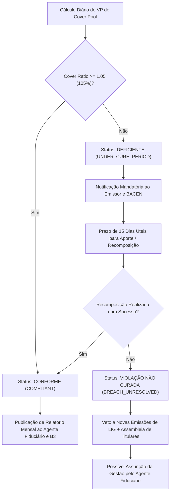

# Especificação Técnica — Registro, Monitoramento de Carteira de Ativos (Cover Pool) e Liquidação de Letras Imobiliárias Garantidas (LIG / Covered Bonds) na B3 (FL-049)

---

## 1. Visão Geral e Arcabouço Regulatório

A **Letra Imobiliária Garantida (LIG)** é o instrumento financeiro brasileiro equivalente aos *Covered Bonds* europeus (como os *Pfandbriefe* alemães e as *Obligations Foncières* francesas). Criada pela **Lei nº 13.097/2015** (artigos 63 a 88), com aprimoramentos trazidos pelo Marco Legal das Garantias (**Lei nº 14.711/2023**), e regulamentada pelo Conselho Monetário Nacional através da **Resolução CMN nº 4.598/2017** (e alterações consolidadas pelo Banco Central do Brasil - BACEN), a LIG estabelece um marco de segurança institucional no crédito imobiliário nacional.

O fluxo **`FL-049` — Balcão NoMe: Registro, Gestão de Carteira de Ativos e Liquidação de LIGs** define a infraestrutura operacional, contábil e matemática da B3 para:
1. **Registro da Emissão da LIG**: Criação, averbação de características financeiras (prefixada, IPCA, CDI), indexadores, datas de vencimento e cronograma de pagamentos no sistema **NoMe (Novo Mercado de Balcão da B3)**.
2. **Constituição e Averbação de Patrimônio de Afetação (*Cover Pool*)**: Segregação contábil e jurídica de uma carteira de ativos vinculada de créditos imobiliários elegíveis, títulos públicos federais e derivativos de hedge, incomunicável com o restante do patrimônio do emissor.
3. **Monitoramento Mandatório de Sobrecolateralização (OC)**: Garantia de que o Valor Presente (VP) dos ativos elegíveis do *Cover Pool* seja permanentemente igual ou superior a **105%** do Valor Presente das LIGs emitidas e obrigações de derivativos associadas.
4. **Teste de Estresse de Liquidez de 180 Dias**: Projeção contínua e estressada dos fluxos de caixa para garantir que, mesmo em cenários de alta inadimplência e choques de taxas de juros, a carteira de ativos cubra integralmente os desembolsos exigidos nos próximos 6 meses.
5. **Governança do Agente Fiduciário**: Atuação de entidade fiduciária independente homologada pela CVM/BACEN, encarregada do batimento mensal, emissão de pareceres de conformidade, notificação de cura de déficit e assunção imediata da gestão do *Cover Pool* em caso de intervenção, liquidação extrajudicial ou falência da instituição emissora.

```
+-------------------------------------------------------------------------------------------------------------------+
|                        ARQUITETURA DE DUPLO RECURSO (DUAL RECOURSE) DA LIG NA B3 (FL-049)                        |
+-------------------------------------------------------------------------------------------------------------------+
|                                                                                                                   |
|   +------------------------------------+                         +--------------------------------------------+   |
|   |   INVESTIDOR TITULAR DA LIG        |                         |        AGENTE FIDUCIÁRIO (INDEPENDENTE)    |   |
|   |   (PF Isenta / PJ / Institucional) |                         |        (DTVM / Fiduciária Credenciada)     |   |
|   +------------------------------------+                         +--------------------------------------------+   |
|                     |                                                                  |                          |
|                     | [1. Obrigação Primária]                                          | [Auditoria Contínua]     |
|                     v                                                                  v                          |
|   +------------------------------------+       Segregação Legal          +------------------------------------+   |
|   |   INSTITUIÇÃO EMISSORA             | ------------------------------> |   PATRIMÔNIO DE AFETAÇÃO           |   |
|   |   (Banco Múltiplo / CEF / B. Inv.) |   (Art. 68 da Lei 13.097/15)    |   (COVER POOL VINCULADO NO NOME)   |   |
|   |   - Responsabilidade Geral         |                                 |   - Incomunicabilidade Concursal   |   |
|   |   - Patrimônio Geral               |                                 |   - Gravame na B3 (Conta 3901-LIG) |   |
|   +------------------------------------+                                 +------------------------------------+   |
|                     |                                                                  |                          |
|       Em caso de    | [Default / Falência]                                             | [2. Recurso Secundário]  |
|       Insolvência   +------------------------------------------------------------------+                          |
|                                                     |                                                             |
|                                                     v                                                             |
|                               +--------------------------------------------+                                      |
|                               | LIQUIDAÇÃO PREFERENCIAL DO COVER POOL      |                                      |
|                               | - 100% dos recursos revertidos às LIGs     |                                      |
|                               | - Isento de concurso da massa falida       |                                      |
|                               | - Sobra patrimonial restituída ao emissor  |                                      |
|                               +--------------------------------------------+                                      |
+-------------------------------------------------------------------------------------------------------------------+
```

---

## 2. Princípio do Duplo Recurso (*Dual Recourse*) e Incomunicabilidade Jurídica

A LIG diferencia-se estruturalmente de debêntures e CDBs convencionais por atribuir ao titular um **duplo nível de proteção creditícia**:
- **Recurso Primário (*First Recourse*)**: Obrigação direta, pessoal e ilimitada da instituição emissora, respondendo todo o seu patrimônio financeiro pela pontualidade de juros e amortizações.
- **Recurso Secundário (*Second Recourse*)**: Privilégio especial exclusivo sobre a **Carteira de Ativos Afetada (*Cover Pool*)**. Nos termos do art. 68 da Lei nº 13.097/2015:
  > *"Os créditos integrantes da carteira de ativos submetida ao regime fiduciário não se comunicam com os demais bens, direitos e obrigações do patrimônio da instituição emissora, não integram a massa concursal nem respondem pelas dívidas desta, inclusive as tributárias, previdenciárias e trabalhistas."*

Caso a instituição financeira emissora sofra decretação de Regime de Administração Especial Temporária (RAET), intervenção ou liquidação extrajudicial pelo Banco Central do Brasil:
1. As LIGs emitidas **não são aceleradas compulsoriamente** no momento da decretação, mantendo suas datas de amortização e cupons originais.
2. A administração do *Cover Pool* transfere-se *ipso facto* para o **Agente Fiduciário**, que passa a gerir os recebíveis imobiliários, derivativos e ativos líquidos, pagando os titulares de LIG diretamente com o fluxo gerado pela carteira segregada.
3. Apenas se o *Cover Pool* se mostrar deficitário em assembleia de credores da LIG poderá ser deliberada a liquidação antecipada do patrimônio segregado; eventual déficit residual habilitar-se-á como crédito quirografário na massa falida da instituição financeira.

---

## 3. Composição e Regras de Elegibilidade da Carteira de Ativos (*Cover Pool*)

Conforme o art. 6º da Resolução CMN nº 4.598/2017, somente podem compor o *Cover Pool* vinculado à LIG:

### 3.1 Classes de Ativos Elegíveis

| Código Enum | Categoria de Ativo | Descrição Normativa | Critérios de Elegibilidade e Tetos |
|---|---|---|---|
| `REAL_ESTATE_CREDIT` | Créditos Imobiliários | Financiamentos imobiliários habitacionais e comerciais garantidos por alienação fiduciária de bem imóvel ou hipoteca de 1º grau. | - Adimplência estrita (atraso máximo de 60 dias).<br>- Teto de LTV (*Loan-to-Value*): máximo de 80% para imóveis residenciais e 60% para comerciais.<br>- A parcela do crédito que exceder o teto de LTV não é computada no cálculo do OC. |
| `TREASURY_BOND` | Títulos Públicos Federais (TPF) | Títulos de emissão do Tesouro Nacional (LFT, LTN, NTN-B, NTN-F) custodiados no Selic/B3. | - Livres de gravames prévios.<br>- Precificados a valor de mercado pela curva de juros oficial ANBIMA/B3. |
| `HEDGE_DERIVATIVE` | Derivativos Financeiros de Hedge | Contratos de Swap, Termo de Moedas (NDF) ou Opções registrados na B3. | - Exclusivamente vinculados à mitigação de risco de mercado da LIG (taxa de juros ou moeda).<br>- Contraparte de primeira linha ou com câmara de compensação com contraparte central (CCP B3). |
| `CASH_EQUIVALENT` | Disponibilidades e Moeda Nacional | Depósitos à vista em conta de liquidação no BACEN ou depósitos remunerados em contas de custódia vinculadas na B3. | - Liquidez imediata (D0/D+1).<br>- Saldo bloqueado na subconta fiduciária `3901-LIG-AFETACAO`. |

### 3.2 Regras de Exclusão e Haircut de Elegibilidade
1. **Inadimplência (*Days Past Due*)**: Créditos com atraso superior a 60 dias são sumariamente desconsiderados do Valor Presente Elegível (`eligible_value = 0`). Créditos com atraso entre 31 e 60 dias sofrem um *haircut* preventivo de 20%.
2. **Teto de LTV (*Loan-to-Value Limit*)**: Se um contrato de crédito habitacional possui saldo de R$ 500.000 sobre um imóvel avaliado em R$ 500.000 (LTV de 100%), apenas o montante correspondente a 80% do valor do imóvel (R$ 400.000) pode ser computado como lastro elegível para atendimento da sobrecolateralização.

---

## 4. Requisitos de Sobrecolateralização Mínima (OC - *Overcollateralization*)

A Resolução CMN nº 4.598/2017 impõe uma salvaguarda quantitativa permanente:

$$\text{Cover Ratio} = \frac{\sum \text{Valor Presente dos Ativos Elegíveis do Cover Pool}}{\sum \text{Valor Presente das LIGs Emitidas} + \text{Passivos de Derivativos de Hedge}} \ge 1{,}05 \quad (105\%)$$

$$\text{Overcollateralization (OC \%)} = \frac{\text{VP}_{\text{CoverPool}} - \text{VP}_{\text{LIG}}}{\text{VP}_{\text{LIG}}} \ge 5{,}0\%$$

### Invariantes Matemáticas de Solvência
1. **Invariante de Valor Presente**:
   $$\text{VP}_{\text{CoverPool\_Elegível}} \ge 1{,}05 \times \text{VP}_{\text{LIG\_Total}}$$
2. **Invariante Nominal**:
   $$\text{Saldo Nominal da Carteira} \ge \text{Saldo Nominal das LIGs Emitidas}$$
3. **Prazo de Cura Regulatória (*Cure Period*)**:
   Se a razão de cobertura declinar para valor inferior a 1,05 (devido a amortizações aceleradas de crédito imobiliário, depreciação cambial ou inadimplência), o emissor tem um prazo mandatório de **15 dias úteis** para recompor a carteira através do aporte de novos créditos imobiliários elegíveis ou títulos públicos federais.



---

## 5. Teste de Estresse de Liquidez de 180 Dias (*Liquidity Stress Test*)

O art. 11 da Resolução CMN nº 4.598/2017 determina que a instituição emissora deve demonstrar a capacidade de pagamento do serviço da dívida das LIGs para os **próximos 180 dias (6 meses)**, mesmo na ocorrência de cenários econômicos e operacionais adversos.

### 5.1 Metodologia de Projeção em 6 Baldes Mensais (30 a 180 dias)

A projeção divide a janela de 180 dias em períodos contínuos $t \in [1, 6]$ (baldes de 30 dias):
- **Entradas Projetadas Estressadas ($\text{Inflow}_t^{\text{stressed}}$)**:
  $$\text{Inflow}_t^{\text{stressed}} = \text{Receitas TPF}_t + \text{Receitas Derivativos}_t + (1 - \delta_{\text{stress}}) \times \text{Receitas Crédito Imobiliário}_t$$
  onde $\delta_{\text{stress}}$ representa o choque de inadimplência mandatória (mínimo de 15% a 20% de perda sobre o fluxo previsto de créditos imobiliários privados).
- **Saídas Projetadas Integrais ($\text{Outflow}_t$)**:
  $$\text{Outflow}_t = \text{Cupons LIG}_t + \text{Amortizações LIG}_t + \text{Desembolsos Derivativos}_t + \text{Honorários Fiduciários}_t$$
  *(Sem qualquer redução ou estresse favorável; obrigações devem ser honradas em 100%)*.
- **Saldo de Liquidez Acumulado ($\text{CumLiquidity}_t$)**:
  $$\text{CumLiquidity}_t = \text{Caixa Inicial D0} + \sum_{i=1}^t \left( \text{Inflow}_i^{\text{stressed}} - \text{Outflow}_i \right)$$

### 5.2 Regra de Aprovação
O teste de estresse de liquidez é considerado **APROVADO** se, e somente se:
$$\min_{t \in \{1, \dots, 6\}} \text{CumLiquidity}_t \ge 0$$
Havendo qualquer déficit pontual ($\text{CumLiquidity}_t < 0$), o emissor deve imediatamente alocar títulos públicos federais com liquidez D0/D+1 para restaurar o colchão mínimo de liquidez de 180 dias.

---

## 6. Atribuições do Agente Fiduciário de LIG

O Agente Fiduciário atua como guardião legal e independente da integridade do *Cover Pool*:

```
+---------------------------------------------------------------------------------------------------------------+
|                             CICLO DE GOVERNANÇA DO AGENTE FIDUCIÁRIO DE LIG                                   |
+---------------------------------------------------------------------------------------------------------------+
|                                                                                                               |
|   1. Validação Diária/Mensal             2. Verificação de Inadimplência        3. Emissão de Parecer Técnico |
|   - Confronto com dados B3 NoMe          - Monitoramento de atrasos > 60d       - Divulgação pública ao       |
|   - Recálculo independente de VP         - Expulsão de contratos inadimplentes    mercado, B3 e BACEN         |
|   - Verificação de Overcollateralization - Monitoramento de reenquadramento     - Alerta de cure period       |
|                                                                                                               |
|                                                     |                                                         |
|                                                     v                                                         |
|                                  +------------------------------------+                                       |
|                                  |   EVENTO DE INSOLVÊNCIA DO EMISSOR |                                       |
|                                  +------------------------------------+                                       |
|                                                     |                                                         |
|                                                     v                                                         |
|   4. Assunção Plena da Gestão            5. Manutenção dos Pagamentos           6. Liquidação Final da LIG    |
|   - Transferência operacional do pool    - Pagamento regular dos cupons         - Resgate integral aos credores|
|   - Movimentação exclusiva da conta      - Venda seletiva de ativos para        - Repasse de eventuais sobras  |
|     3901-LIG-AFETACAO na B3                prover liquidez sem desconto           à massa falida do emissor   |
+---------------------------------------------------------------------------------------------------------------+
```

---

## 7. Modelo de Mensageria e Averbação no Balcão NoMe B3

O registro da LIG e de sua carteira vinculada no sistema NoMe B3 utiliza mensagens estruturadas (XML e JSON) contendo os seguintes campos fundamentais:

```json
{
  "nome_header": {
    "message_type": "LIG_COVER_POOL_REGISTRATION_REPORT",
    "protocol_number": "NOME-LIG-20261104-770192",
    "transmission_timestamp": "2026-11-04T10:00:00.000Z",
    "submitting_participant": "00033"
  },
  "cover_pool_identification": {
    "cover_pool_id": "CP-LIG-2026-001",
    "issuer_cnpj": "00000000000191",
    "issuer_name": "BANCO BRADESCO S.A.",
    "fiduciary_agent_cnpj": "11223344000155",
    "fiduciary_agent_name": "OLIVEIRA TRUST DTVM S.A.",
    "nome_segregated_account": "3901-LIG-AFETACAO-001"
  },
  "metrics_summary": {
    "cover_ratio": "1.1250",
    "overcollateralization_pct": "0.1250",
    "regulatory_minimum_cover_ratio": "1.0500",
    "liquidity_stress_180d_compliant": true,
    "minimum_180d_cash_balance": "45250000.00"
  }
}
```

---

## 8. Sumário de Conformidade Regulatória B3 / BACEN

| Requisito Regulatória | Norma de Referência | Limite Mínimo | Penalidade por Descumprimento |
|---|---|---|---|
| **Razão de Cobertura (*Cover Ratio*)** | Art. 6º Res. CMN 4.598/2017 | $\ge 1{,}0500$ (105%) | Prazo de cura de 15 dias úteis; veto a emissões; execução pelo Agente Fiduciário. |
| **Sobrecolateralização (*OC %*)** | Art. 6º Res. CMN 4.598/2017 | $\ge 5{,}00\%$ | Notificação à B3 e BACEN; aporte compulsório de TPF ou créditos elegíveis. |
| **Colchão de Liquidez 180 Dias** | Art. 11 Res. CMN 4.598/2017 | $\min \text{Saldo} \ge 0$ | Aporte imediato de ativos líquidos (TPF/Caixa) em subconta segregada. |
| **Elegibilidade de LTV** | Art. 7º Res. CMN 4.598/2017 | Residencial $\le 80\%$, Comercial $\le 60\%$ | Exclusão do montante excedente da base do Valor Presente Elegível. |
| **Inadimplência Máxima de Crédito** | Art. 8º Res. CMN 4.598/2017 | Atraso $\le 60$ dias | Glosa integral de créditos vencidos há mais de 60 dias (`eligible_value = 0`). |
