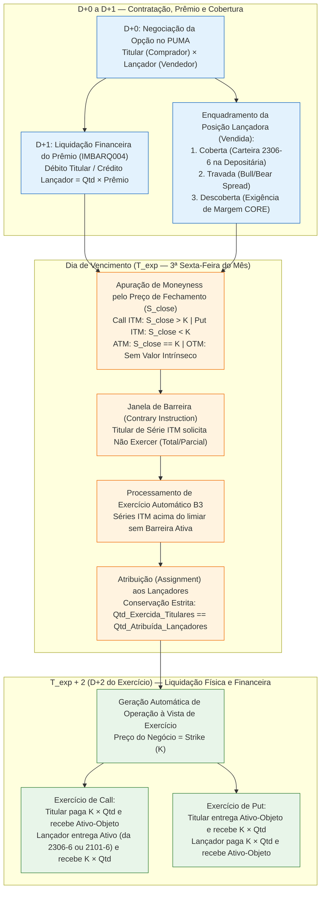

# Especificação Técnica de Opções Listadas sobre Ações e Índices — Apuração de Prêmio D+1, Travas/Cobertura e Exercício no Vencimento — Câmara B3 (FL-039)

## 1. Visão Geral e Contexto Operacional (FL-039)

O mercado de **Opções Listadas sobre Ações, Units, ETFs e Índices** operado no **PUMA Trading System** e compensado pela **Câmara B3** abrange todo o ciclo de vida do derivativo padronizado: desde a contratação em **D+0** com liquidação financeira multilateral do **Prêmio em D+1**, passando pela gestão contínua de **Cobertura na Central Depositária (Carteira 2306-6)**, **Travas Operacionais (*Bull/Bear Spreads*)** e **Margem de Garantia (Metodologia CORE)**, até o **Exercício de Opções** (antecipado para estilo Americano ou no vencimento na **3ª sexta-feira do mês** para estilos Americano e Europeu), que origina operações no mercado à vista de exercício com liquidação física e financeira em **D+2** pelo preço de exercício (*Strike*).

### 1.1 Simbologia Padronizada de Séries de Opções na B3

O código de negociação (*Ticker*) de uma série de opção listada na B3 segue a estrutura determinística `XXXX L NN(N)`:
- **`XXXX` (4 caracteres)**: Radical do ativo-objeto (ex.: `PETR` para `PETR4`, `VALE` para `VALE3`, `BOVA` para `BOVA11`, `ITUB` para `ITUB4`).
- **`L` (5º caractere — Letra do Mês de Vencimento e Tipo da Opção)**:
  - **Opções de Compra (*Call*)**: Letras de **`A` a `L`** (Janeiro = `A`, Fevereiro = `B`, ..., Outubro = `J`, Novembro = `K`, Dezembro = `L`).
  - **Opções de Venda (*Put*)**: Letras de **`M` a `X`** (Janeiro = `M`, Fevereiro = `N`, ..., Outubro = `V`, Novembro = `W`, Dezembro = `X`).
- **`NN(N)` (Sufixo numérico)**: Código identificador do preço de exercício (*Strike*) da série (ex.: `PETRA28`, `VALEM80`, `BOVAL110`).

| Mês de Vencimento | Letra Call (Compra) | Letra Put (Venda) | Exemplo Série Call | Exemplo Série Put | Regra de Vencimento Padrão |
| :--- | :---: | :---: | :---: | :---: | :--- |
| Janeiro | `A` | `M` | `PETRA28` | `VALEM80` | 3ª sexta-feira de Janeiro |
| Fevereiro | `B` | `N` | `ITUBB32` | `BBDCN15` | 3ª sexta-feira de Fevereiro |
| Março | `C` | `O` | `PETRC36` | `PETRO34` | 3ª sexta-feira de Março |
| Abril | `D` | `P` | `VALED65` | `VALEP60` | 3ª sexta-feira de Abril |
| Maio | `E` | `Q` | `BOVAE125` | `BOVAQ120` | 3ª sexta-feira de Maio |
| Junho | `F` | `R` | `WEGEF42` | `WEGER38` | 3ª sexta-feira de Junho |
| Julho | `G` | `S` | `PETRG38` | `PETRS35` | 3ª sexta-feira de Julho |
| Agosto | `H` | `T` | `VALEH70` | `VALET68` | 3ª sexta-feira de Agosto |
| Setembro | `I` | `U` | `BOVAI130` | `BOVAU125` | 3ª sexta-feira de Setembro |
| Outubro | `J` | `V` | `PETRJ40` | `PETRV36` | 3ª sexta-feira de Outubro |
| Novembro | `K` | `W` | `ITUBK35` | `ITUBW33` | 3ª sexta-feira de Novembro |
| Dezembro | `L` | `X` | `BOVAL110` | `BOVAX105` | 3ª sexta-feira de Dezembro |

### 1.2 Estilos de Exercício

- **Estilo Americano (`AMERICAN`)**: Permite ao titular exercer o direito a partir de **D+1** da abertura da posição até a data de vencimento (inclusive).
- **Estilo Europeu (`EUROPEAN`)**: Permite o exercício exclusivamente na **data de vencimento** da série (3ª sexta-feira do mês de referência ou dia útil imediatamente anterior em caso de feriado).

---

## 2. Regras de Negócio e Fórmulas Determinísticas da Câmara B3

### 2.1 Liquidação Financeira do Prêmio em D+1

Diferentemente do mercado à vista de ações (cuja liquidação ocorre em D+2), o **Prêmio da Opção** negociado em **D+0** é liquidado financeiramente em **D+1** na janela multilateral da Câmara B3 (`IMBARQ004`):

$$\text{Valor Financeiro do Prêmio (D+1)} = \text{round}\left(Q \times P_{\text{prêmio}},\ 2\right)$$

- **Titular (`HOLDER` / Comprado)**: Sofre **débito** financeiro em D+1 ($\text{Fluxo D+1} = -\text{Valor do Prêmio}$) e adquire o direito de exercício.
- **Lançador (`WRITER` / Vendido)**: Recebe **crédito** financeiro em D+1 ($\text{Fluxo D+1} = +\text{Valor do Prêmio}$) e assume a obrigação de atender ao exercício caso atribuído.

---

### 2.2 Modalidades de Garantia da Posição Lançadora (`CoverageType`)

Toda posição lançadora (`WRITER`) aberta na Câmara B3 deve estar enquadrada em uma das três categorias de mitigação de risco previstas no Manual de Procedimentos Operacionais (MPO):

1. **Posição Lançadora Coberta (`COVERED` — Carteira de Custódia `2306-6`)**:
   - Aplicável ao lançamento de opções de compra (*Covered Call*).
   - O comitente lançador transfere a quantidade integral do ativo-objeto correspondente ($Q_{\text{coberta}} == Q_{\text{lançada}}$) da sua conta livre (`2101-6`) para a **Carteira de Cobertura de Opções (`2306-6`)** na Central Depositária B3.
   - Os ativos bloqueados na carteira `2306-6` isentam a posição de chamada de margem de risco adicional (CORE) para o risco de alta do ativo-objeto, sendo automaticamente direcionados para a liquidação física em D+2 caso ocorra atribuição de exercício (*Assignment*).

2. **Posição Lançadora Travada (`SPREAD_LOCKED` — *Bull/Bear Spread*)**:
   - O comitente lançador mantém, na mesma conta e para o mesmo ativo-objeto e vencimento, uma ponta titular (`HOLDER`) de opção do mesmo tipo (`CALL` ou `PUT`) que limita a perda máxima da estrutura.
   - O risco máximo fica restrito ao diferencial de *Strikes* multiplicado pela quantidade ($\max(0, \Delta K \times Q)$), reduzindo drasticamente a exigência de margem CORE em relação à posição descoberta.

3. **Posição Lançadora Descoberta (`UNCOVERED` — Margem CORE)**:
   - O lançador não depositou o ativo-objeto na carteira `2306-6` nem possui trava protetora.
   - A posição fica integralmente submetida ao cálculo diário de margem de garantia pelo motor **CORE (*Closeout Risk Evaluation*)**, exigindo colateral elegível depositado na Câmara B3.

> [!IMPORTANT]
> Para que uma posição lançadora seja classificada como `COVERED`, a quantidade de ativos-objeto efetivamente depositada e bloqueada na carteira `2306-6` deve ser maior ou igual à quantidade vendida na série ($Q_{\text{coberta}} \ge Q$). Caso contrário, a validação operacional rejeita o enquadramento como coberto (`InsufficientCoverageError`).

---

### 2.3 Apuração Determinística de *Moneyness* e Valor Intrínseco no Vencimento

Dado o preço de fechamento de referência do ativo-objeto no dia do vencimento ($S_{\text{close}}$) e o preço de exercício da série ($K$):

1. **Opção de Compra (`CALL`)**:
   - **Valor Intrínseco Unitário**:
     $$V_{\text{intrínseco}}^{\text{CALL}} = \max\left(0,\ S_{\text{close}} - K\right)$$
   - **Classificação (*Moneyness*)**:
     - `ITM` (*In-The-Money* / Dentro do Dinheiro): $S_{\text{close}} > K$ ($V_{\text{intrínseco}} > 0$).
     - `ATM` (*At-The-Money* / No Dinheiro): $S_{\text{close}} == K$ ($V_{\text{intrínseco}} == 0$).
     - `OTM` (*Out-Of-The-Money* / Fora do Dinheiro): $S_{\text{close}} < K$ ($V_{\text{intrínseco}} == 0$).

2. **Opção de Venda (`PUT`)**:
   - **Valor Intrínseco Unitário**:
     $$V_{\text{intrínseco}}^{\text{PUT}} = \max\left(0,\ K - S_{\text{close}}\right)$$
   - **Classificação (*Moneyness*)**:
     - `ITM` (*In-The-Money* / Dentro do Dinheiro): $S_{\text{close}} < K$ ($V_{\text{intrínseco}} > 0$).
     - `ATM` (*At-The-Money* / No Dinheiro): $S_{\text{close}} == K$ ($V_{\text{intrínseco}} == 0$).
     - `OTM` (*Out-Of-The-Money* / Fora do Dinheiro): $S_{\text{close}} > K$ ($V_{\text{intrínseco}} == 0$).

---

### 2.4 Exercício Automático no Vencimento e *Contrary Instruction* (*Barreira*)

Na data de vencimento (3ª sexta-feira do mês), a Câmara B3 executa o procedimento de **Exercício Automático**:

1. **Limiar de Exercício Automático (`auto_exercise_min_intrinsic`)**:
   - Toda posição titular (`HOLDER`) em série `ITM` cujo valor intrínseco unitário seja igual ou superior ao limiar mínimo regulamentar (padrão `R$ 0,01`, ou seja, $V_{\text{intrínseco}} \ge \text{R\$ } 0,01$) é elegível ao **Exercício Automático** pela totalidade da quantidade aberta.
2. **Solicitação de *Contrary Instruction* (*Barreira / Não Exercer*)**:
   - O titular de uma posição `ITM` pode enviar, por intermédio de seu Participante de Negociação Pleno (PNP) até a janela limite do dia de vencimento, uma instrução de **Barreira (*Contrary Instruction*)** total ou parcial ($0 \le Q_{\text{barreira}} \le Q_{\text{titular}}$).
   - A quantidade bloqueada por *Contrary Instruction* **não é exercida** e expira sem valor (*Lapsed*), reduzindo diretamente a quantidade exercida na série:
     $$Q_{\text{exercida}} = Q_{\text{titular}} - Q_{\text{barreira}}$$
     $$Q_{\text{expirada (virada pó)}} = Q_{\text{barreira}}$$
3. **Séries `ATM` e `OTM`**:
   - Não possuem valor intrínseco positivo ($V_{\text{intrínseco}} == \text{R\$ } 0,00$).
   - Não sofrem exercício automático, expirando integralmente ($Q_{\text{exercida}} = 0$, $Q_{\text{expirada}} = Q_{\text{titular}}$).

---

### 2.5 Atribuição aos Lançadores (*Assignment*) e Invariante de Conservação

Para cada série de opção em vencimento, a Câmara B3 consolida a quantidade total exercida por todos os titulares:

$$Q_{\text{total\_exercida}} = \sum_{i \in \text{Titulares}} Q_{\text{exercida}, i}$$

Essa quantidade é atribuída (*Assigned*) às posições lançadoras (`WRITER`) abertas na mesma série:
- Se todos os titulares exercerem integralmente sem barreira ($Q_{\text{total\_exercida}} == Q_{\text{total\_lançada}}$), **100% das posições lançadoras são atribuídas**.
- Se houver *Contrary Instruction* parcial por parte de algum titular ($0 < Q_{\text{total\_exercida}} < Q_{\text{total\_lançada}}$), a atribuição aos lançadores ocorre de forma **proporcional (*pro-rata*)** às quantidades abertas de cada lançador, com distribuição determinística dos lotes residuais inteiros pela maior fração residual / maior posição aberta.

> [!IMPORTANT]
> **Invariante Fundamental de Conservação no Exercício (FL-039)**:
> Em qualquer série de opções processada pela Câmara B3, a soma das quantidades exercidas pelos titulares deve ser **estritamente idêntica** à soma das quantidades atribuídas aos lançadores:
> $$\sum_{i \in \text{Titulares}} Q_{\text{exercida}, i} == \sum_{j \in \text{Lançadores}} Q_{\text{atribuída}, j}$$
> Adicionalmente, no livro de posições abertas da série antes do exercício:
> $$\sum_{i \in \text{Titulares}} Q_{\text{aberta}, i} == \sum_{j \in \text{Lançadores}} Q_{\text{aberta}, j}$$

---

### 2.6 Geração da Operação à Vista no Mercado de Exercício (Liquidação D+2 pelo *Strike*)

Cada exercício titular e cada atribuição lançadora geram negócios de exercício no mercado à vista com liquidação física e financeira em **D+2** ($T_{\text{liq}} = T_{\text{vencimento}} + 2\text{ dias úteis}$) pelo **Preço de Exercício (*Strike* $K$)**:

$$\text{Volume Financeiro de Exercício (D+2)} = \text{round}\left(Q_{\text{exercida/atribuída}} \times K,\ 2\right)$$

| Tipo da Opção | Papel na Opção | Papel Gerado no Mercado à Vista (D+2) | Obrigação Financeira D+2 (`IMBARQ004`) | Obrigação Física D+2 (Central Depositária) |
| :--- | :--- | :--- | :--- | :--- |
| **`CALL` (Compra)** | **Titular (`HOLDER`)** | **Comprador à Vista (`BUYER`)** | Paga $Q_{\text{exerc}} \times K$ (Débito) | Recebe $Q_{\text{exerc}}$ ações na conta livre `2101-6` |
| **`CALL` (Compra)** | **Lançador (`WRITER`)** | **Vendedor à Vista (`SELLER`)** | Recebe $Q_{\text{atrib}} \times K$ (Crédito) | Entrega $Q_{\text{atrib}}$ ações (baixadas da carteira `2306-6` se Coberto, ou da `2101-6` se Descoberto) |
| **`PUT` (Venda)** | **Titular (`HOLDER`)** | **Vendedor à Vista (`SELLER`)** | Recebe $Q_{\text{exerc}} \times K$ (Crédito) | Entrega $Q_{\text{exerc}}$ ações da conta livre `2101-6` |
| **`PUT` (Venda)** | **Lançador (`WRITER`)** | **Comprador à Vista (`BUYER`)** | Paga $Q_{\text{atrib}} \times K$ (Débito) | Recebe $Q_{\text{atrib}}$ ações na conta livre `2101-6` |

---

## 3. Integração com os Arquivos Posicionais da Família IMBARQ e Sistema PUMA

| Sistema / Arquivo B3 | Etapa do Ciclo | Papel no Fluxo FL-039 |
| :--- | :--- | :--- |
| **PUMA Trading System (`FIX` / `SBE`)** | Contratação D+0 e Exercício | Negociação da série de opção em D+0 e geração automática dos negócios de exercício à vista (`POPC` / sufixo `E`) no vencimento. |
| **Central Depositária (`Carteira 2306-6`)** | Cobertura de Lançamento | Bloqueio fiduciário do ativo-objeto para posições lançadoras cobertas de Call (*Covered Call*). |
| **`IMBARQ006` (Posições de Derivativos e Custódia)** | Diário (D+0 a Vencimento) | Conciliação das posições abertas titulares (`HOLDER`) e lançadoras (`WRITER`), saldos na carteira `2306-6` e travas de *spread*. |
| **`IMBARQ013` / `IMBARQ014` (Margem CORE)** | Diário | Apuração de margem de garantia exigida para posições lançadoras descobertas (`UNCOVERED`) e travadas (`SPREAD_LOCKED`). |
| **`IMBARQ004` (Compensação Financeira Multilateral)** | D+1 (Prêmio) e D+2 (Exercício) | Liquidação financeira do prêmio em D+1 e liquidação financeira pelo *Strike* ($K \times Q$) em D+2 das opções exercidas. |

---

## 4. Rastreabilidade de Implementação no Repositório

- **Motor Determinístico (Python 100% Stdlib)**: [`src/listed_options_exercise.py`](file:///mnt/j/Documents/github/b3-integration-atlas/src/listed_options_exercise.py)
  - Classes de domínio: `OptionType`, `OptionStyle`, `PositionSide`, `CoverageType`, `Moneyness`, `OptionSeries`, `OptionPosition`, `ExerciseInstruction`, `AssignmentRecord`, `ExpirationSettlementSummary`, `ListedOptionsEngine`.
- **Fixture Sintética de Vencimento**: [`fixtures/listed_options_expiration.json`](file:///mnt/j/Documents/github/b3-integration-atlas/fixtures/listed_options_expiration.json)
- **Suíte de Testes Automatizados**: [`tests/test_listed_options_exercise.py`](file:///mnt/j/Documents/github/b3-integration-atlas/tests/test_listed_options_exercise.py)
