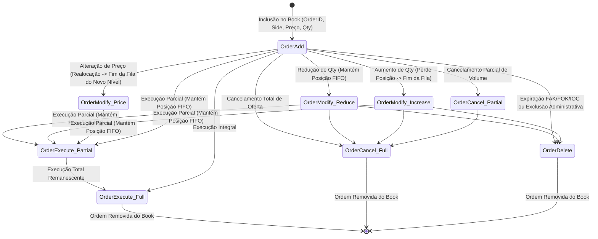
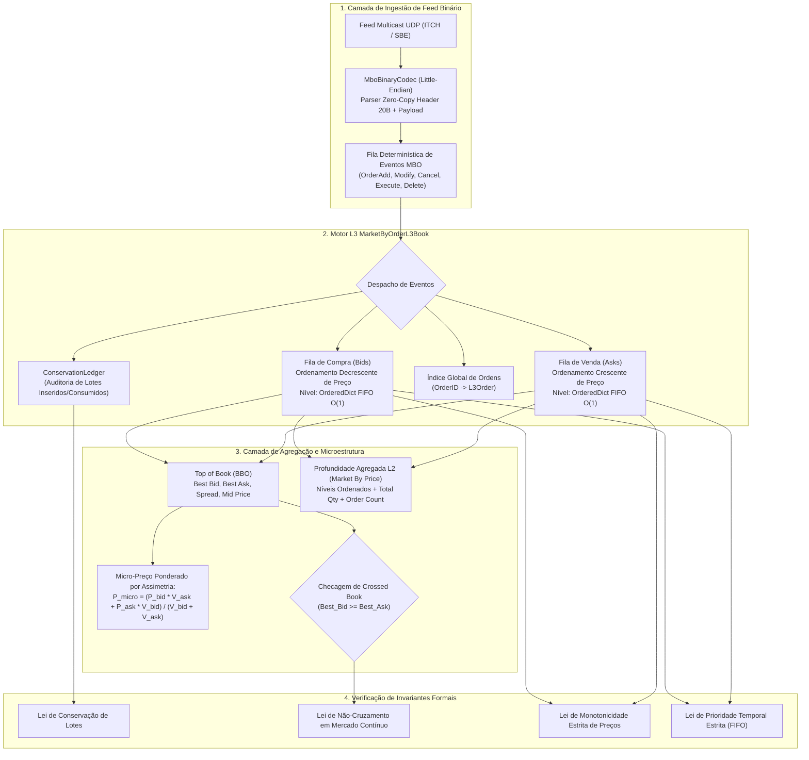

# Especificação Técnica da Reconstituição Determinística de Livro de Ofertas L3 Market By Order (MBO) — B3 (FL-091)

## 1. Visão Geral e Contexto de Microestrutura

O fluxo **FL-091** implementa o motor determinístico de reconstituição em tempo real do **Livro de Ofertas L3 (Market By Order - MBO)** a partir de fluxos de eventos binários (**ITCH / SBE B3 UMDF Market Data**) para os mercados à vista, futuros e derivativos negociados na plataforma **PUMA Trading System** da **B3 (Brasil, Bolsa, Balcão)**.

Diferente de livros consolidados L2 (*Market By Price* ou agregação por nível de preço), o livro L3 preserva a identidade individual de cada oferta (**OrderID**), sua quantidade específica, timestamp de alta resolução em nanossegundos e a sua posição ordinal exata na fila temporal de prioridade de execução.

### Pilares Normativos e Manuais de Mercado
- **Manual de Negociação do PUMA Trading System da B3**: Regras de ordenamento por prioridade estrita Preço-Tempo (FIFO), tratamento de alteração de ofertas e leilões.
- **B3 UMDF Market Data Binary Specification (SBE - Simple Binary Encoding)**: Especificação de envelopes de mensageria binária multicast UDP ativa-ativa (Feeds A e B).
- **ITCH B3 Market Data Feed Specification**: Gramática de eventos granulares atômicos (*Add*, *Modify*, *Cancel*, *Execute*, *Delete*).
- **Regulamento de Operações e Boas Práticas da B3**: Prevenção de spoofing, layering e proteção fail-safe contra cruzamento indevido de ofertas em mercado contínuo (*Crossed / Locked Book*).

---

## 2. Eventos Granulares MBO e Ciclo de Vida da Ordem



### Tipologia dos Eventos MBO:

| Evento | Ação de Negócio | Impacto na Fila FIFO de Mesmo Preço | Impacto Contábil no Ledger |
| :--- | :--- | :--- | :--- |
| `OrderAdd` | Insere nova oferta no book com identificador único | Entra no final da fila FIFO do nível de preço | $\text{lots\_added\_initial} \mathrel{+}= Q$ |
| `OrderModify` (Redução) | Diminui o volume da ordem sem alterar o preço | **MANTÉM** rigorosamente a prioridade na fila | $\text{lots\_canceled\_modify} \mathrel{+}= \Delta Q$ |
| `OrderModify` (Aumento) | Incrementa o volume da ordem no mesmo preço | **PERDE** a prioridade e é movida para o **final da fila** | $\text{lots\_added\_modify} \mathrel{+}= \Delta Q$ |
| `OrderModify` (Preço) | Altera o preço da ordem (com ou sem alteração de qty) | Removida do nível anterior; inserida no final do novo nível | Ajusta $\text{lots\_added}$ ou $\text{lots\_canceled}$ pelo $\Delta Q$ |
| `OrderCancel` (Parcial) | Reduz a quantidade remanescente da ordem | **MANTÉM** rigorosamente a prioridade na fila | $\text{lots\_canceled\_partial} \mathrel{+}= Q_{\text{canc}}$ |
| `OrderCancel` (Total) | Cancela integralmente a ordem | Ordem removida do nível de preço e do índice global | $\text{lots\_canceled\_full} \mathrel{+}= Q_{\text{rem}}$ |
| `OrderExecute` (Parcial) | Executa negócio contra ordem passiva agressora | Reduz volume remanescente mantendo prioridade FIFO | $\text{lots\_executed} \mathrel{+}= Q_{\text{exec}}$ |
| `OrderExecute` (Total) | Executa o volume restante integral da ordem | Ordem liquidada e removida do book | $\text{lots\_executed} \mathrel{+}= Q_{\text{exec}}$ |
| `OrderDelete` | Exclusão definitiva (expiração, cancelamento do sistema) | Ordem removida do book | $\text{lots\_deleted} \mathrel{+}= Q_{\text{rem}}$ |

---

## 3. Arquitetura de Reconstituição e Métricas de Microestrutura



---

## 4. Top of Book (BBO) e Fórmulas de Microestrutura

### 4.1. Top of Book (BBO)
- **Melhor Preço de Compra ($P_{\text{best\_bid}}$)**: $\max(\{P \in \text{Bids}\})$
- **Melhor Preço de Venda ($P_{\text{best\_ask}}$)**: $\min(\{P \in \text{Asks}\})$
- **Spread Bid-Ask**:
  $$\text{Spread} = P_{\text{best\_ask}} - P_{\text{best\_bid}}$$
- **Preço Médio (Mid Price)**:
  $$P_{\text{mid}} = \frac{P_{\text{best\_bid}} + P_{\text{best\_ask}}}{2}$$

### 4.2. Micro-Preço Ponderado por Assimetria de Fila (Volume-Weighted Micro-Price)
O micro-preço reflete a probabilidade de absorção e o desequilíbrio instantâneo de liquidez no topo do livro:
$$P_{\text{micro}} = \frac{P_{\text{best\_bid}} \times V_{\text{ask}} + P_{\text{best\_ask}} \times V_{\text{bid}}}{V_{\text{bid}} + V_{\text{ask}}}$$
Onde $V_{\text{bid}}$ e $V_{\text{ask}}$ representam a quantidade total ofertada no melhor nível de compra e venda, respectivamente.

---

## 5. Leis Invariantes Formais de Mercado e Auditoria (FL-091)

O motor submete o livro a seis leis invariantes de conservação e microestrutura executáveis via `verify_invariants(raise_on_error=True)`:

1. **Invariante Formal de Conservação Contábil de Lotes (LAW-091-CONSERVATION)**:
   $$\text{Lotes\_Atuais} = \text{Lotes\_Adicionados} - \text{Lotes\_Executados} - \text{Lotes\_Cancelados}$$
   Onde:
   - $\text{Lotes\_Adicionados} = \text{lots\_added\_initial} + \text{lots\_added\_modify}$
   - $\text{Lotes\_Executados} = \text{lots\_executed}$
   - $\text{Lotes\_Cancelados} = \text{lots\_canceled\_partial} + \text{lots\_canceled\_full} + \text{lots\_canceled\_modify} + \text{lots\_deleted}$
   Nenhum lote é criado ou destruído sem contrapartida registrada no razão contábil.

2. **Invariante de Não-Cruzamento de Book em Mercado Contínuo (LAW-091-NO-CROSSED-CONTINUOUS)**:
   Em modo de negociação contínua (`TradingMode.CONTINUOUS`):
   $$P_{\text{best\_bid}} < P_{\text{best\_ask}}$$
   Qualquer tentativa de inclusão de oferta que resulte em $P_{\text{best\_bid}} \ge P_{\text{best\_ask}}$ aciona a proteção fail-safe levantando `CrossedBookError`. No modo de leilão (`TradingMode.AUCTION`), o cruzamento é permitido para cálculo do Preço Teórico de Abertura.

3. **Invariante de Monotonicidade Estrita de Preços (LAW-091-PRICE-MONOTONICITY)**:
   - Os níveis de compra mantêm estrita ordenação decrescente: $P_1 > P_2 > P_3 > \dots$
   - Os níveis de venda mantêm estrita ordenação crescente: $P_1 < P_2 < P_3 < \dots$
   - Níveis vazios são automaticamente eliminados da árvore de busca.

4. **Invariante de Prioridade Estrita Preço-Tempo (FIFO) (LAW-091-FIFO-PRIORITY)**:
   Para todas as ordens $i$ e $i+1$ pertencentes a um mesmo nível de preço:
   $$\text{Timestamp\_Prioridade}(O_i) \le \text{Timestamp\_Prioridade}(O_{i+1})$$
   Garantido pela estrutura `OrderedDict` com operações de realocação $O(1)$.

5. **Invariante de Consistência de Volume dos Níveis (LAW-091-LEVEL-QUANTITY-CONSISTENCY)**:
   Para cada nível de preço ativo:
   $$\text{total\_quantity} = \sum_{o \in \text{orders}} o.\text{quantity}$$

6. **Invariante de Integridade do Índice Global (LAW-091-INDEX-INTEGRITY)**:
   A cardinalidade do mapa de ordens ativas coincide rigorosamente com o total de ordens contidas na agregação de todos os níveis:
   $$|\text{orders\_index}| = \sum_{l \in \text{bids} \cup \text{asks}} |l.\text{orders}|$$

---

## 6. Especificação do Protocolo Binário (ITCH / SBE B3 UMDF)

O módulo fornece serialização e desserialização compacta Little-Endian de alta performance:

### Cabeçalho Comum (20 bytes):
| Campo | Tipo | Tamanho | Descrição |
| :--- | :--- | :--- | :--- |
| `magic` | `uint16` | 2 bytes | Assinatura canônica `0xB34D` ("B3M") |
| `version` | `uint8` | 1 byte | Versão do protocolo (`1`) |
| `msg_type` | `char` | 1 byte | 'A' (Add), 'M' (Modify), 'X' (Cancel), 'E' (Execute), 'D' (Delete) |
| `sequence_number` | `uint64` | 8 bytes | Sequencial de mensagem determinístico |
| `timestamp_ns` | `uint64` | 8 bytes | Timestamp em nanossegundos Unix Epoch |

### Payloads Granulares:
- **OrderAdd ('A' / 33 bytes)**: `order_id` (u64), `security_id` (u64), `side` (char 'B'/'S'), `price_scaled` (i64, $10^8$), `quantity` (u64).
- **OrderModify ('M' / 24 bytes)**: `order_id` (u64), `price_scaled` (i64, 0 se inalterado), `new_quantity` (u64).
- **OrderCancel ('X' / 16 bytes)**: `order_id` (u64), `canceled_quantity` (u64, 0 para total).
- **OrderExecute ('E' / 32 bytes)**: `order_id` (u64), `executed_quantity` (u64), `execution_price_scaled` (i64), `trade_id_num` (u64).
- **OrderDelete ('D' / 10 bytes)**: `order_id` (u64), `reason_code` (u16).

---

## 7. Diagrama de Sequência de Execução de Ordem

```mermaid
sequenceDiagram
    autonumber
    actor Participant as Participante / Corretora
    participant PUMA as PUMA Matching Engine
    participant Feed as UMDF Feed A/B (Multicast)
    participant MBO as MarketByOrderL3Book
    participant Auditor as Motor de Invariantes

    Participant->>PUMA: Submissão de Ordem Vendedora (ASK 35.52, 1000)
    PUMA->>Feed: Publica Evento OrderAdd (ID=2001, Side=ASK, P=35.52, Q=1000)
    Feed->>MBO: Ingestão de Pacote Binário ITCH/SBE
    MBO->>MBO: Adiciona Ordem no PriceLevel(35.52) ao final da Fila FIFO
    MBO->>MBO: Atualiza Top of Book (BBO) e Micro-preço
    
    Participant->>PUMA: Ordem Agressora Compradora (BID a Mercado, 600)
    PUMA->>Feed: Publica Evento OrderExecute (ID=2001, Q_exec=600, TradeID=TRD_1)
    Feed->>MBO: Ingestão de OrderExecute
    MBO->>MBO: Reduz Volume Remanescente de 2001 para 400 (Mantém Posição FIFO)
    MBO->>MBO: Credita Ledger de Execuções (+600)
    
    Auditor->>MBO: verify_invariants(raise_on_error=True)
    MBO-->>Auditor: Invariantes 100% Satisfeitas (Conservação, FIFO, Monotonicidade)
```
