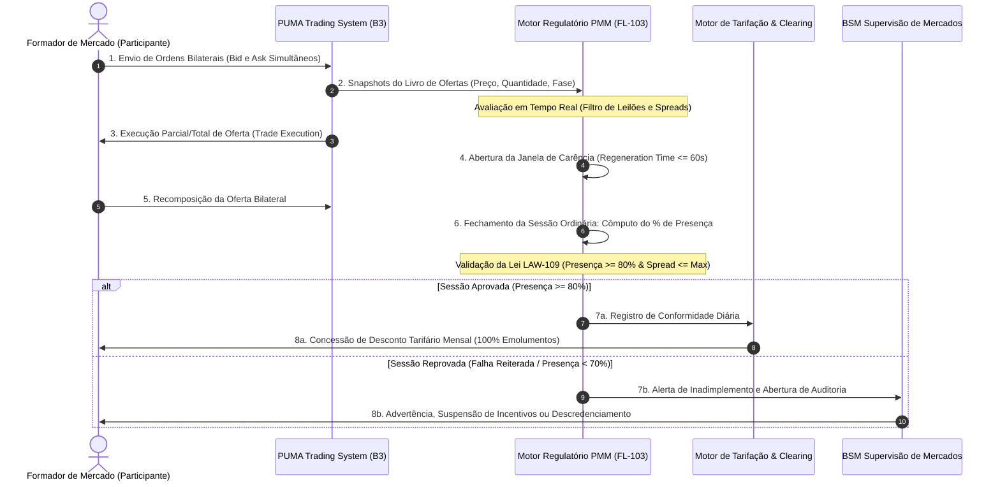
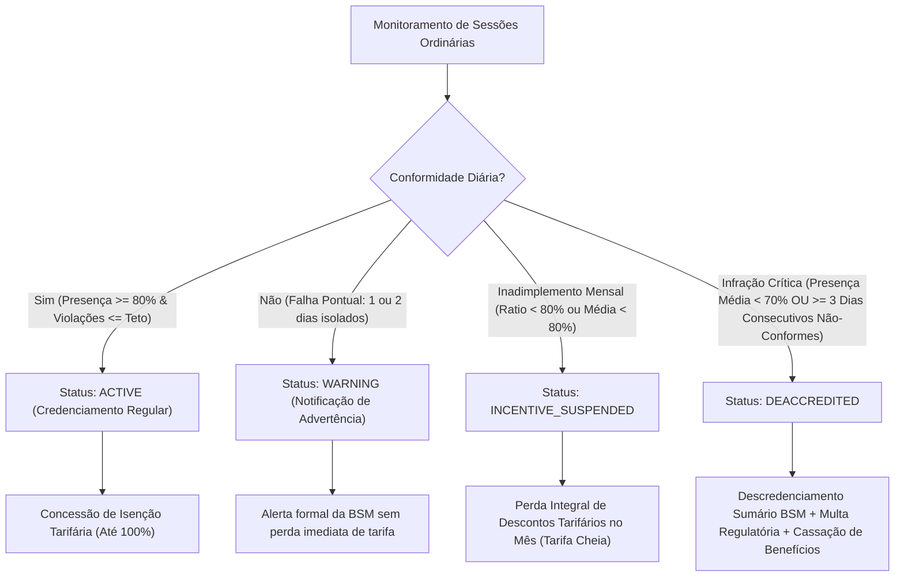

# Especificação Técnica — Motor Regulatório do Programa de Metas de Formador de Mercado (PMM B3 / BSM) (FL-103)

---

## 1. Visão Geral e Arcabouço Regulatório

O fluxo **`FL-103` — Motor Regulatório do Programa de Metas de Formador de Mercado (PMM B3 / BSM)** estabelece a infraestrutura matemática, operacional e de supervisão contínua para auditoria das obrigações de liquidez assumidas por instituições financeiras credenciadas como Formadores de Mercado (*Market Makers*) nos mercados administrados pela B3 S.A. – Brasil, Bolsa, Balcão.

O motor opera em conformidade estrita com as diretrizes regulatórias e de autorregulação do mercado de capitais brasileiro:

1. **Resolução CVM nº 135/2022** (que revogou e atualizou a Instrução CVM nº 384/2003): Dispõe sobre a atividade de formador de mercado para valores mobiliários negociados em mercados regulamentados, estipulando parâmetros de cotação bilateral, obrigações de presença e condições de descredenciamento.
2. **Regulamento de Operações e Manual de Procedimentos Operacionais do PUMA Trading System da B3**: Define a mecânica de apuração dos períodos de negociação contínua, as janelas de carência para recomposição de ofertas (*regeneration time*) e as regras de exclusão de leilões de abertura, fechamento e volatilidade.
3. **Diretoria de Autorregulação da BSM Supervisão de Mercados**: Roteiro formal de supervisão contínua, monitoramento de manipulação de mercado e aplicação de sanções administrativas, advertências e descredenciamento sumário por descumprimento de metas contratuais.
4. **Ofícios Circulares e Catálogo Tarifário da B3**: Regras paramétricas para concessão de isenções e descontos tarifários (emolumentos, taxas de registro e de liquidação da Câmara B3) e escalonamento por faixas de presença (*tiers*).

---

## 2. Arquitetura Operacional e Fluxo de Mensageria PMM

O ecossistema do Formador de Mercado opera de maneira bidirecional em tempo real, confrontando as ofertas ativas no livro de ofertas (*order book*) com os parâmetros contratuais cadastrados na B3:



---

## 3. Parâmetros Oficiais de Liquidez e Obrigações Contratuais

Para que a atuação do Formador de Mercado seja considerada válida em determinado pregão, o participante deve satisfazer simultaneamente quatro pilares contratuais:

### 3.1 Presença Mínima em Tela ($\ge 80.00\%$)
O Formador deve manter ofertas bilaterais de compra e venda ativas durante, no mínimo, **80.00%** do tempo total da sessão ordinária contínua:
$$\text{Taxa de Presença (\%)} = \left( \frac{\text{Tempo com Cotações Válidas (s)}}{\text{Tempo Total de Negociação Contínua Elegível (s)}} \right) \times 100 \ge 80.00\%$$

- **Exclusão Regulatória**: São estritamente expurgados do denominador da fórmula:
  * Leilão de Abertura (*Opening Auction*);
  * Leilão de Fechamento (*Closing Auction*);
  * Leilões de Volatilidade / Intradiários (*Volatility Auctions*);
  * Suspensões de Negociação (*Trading Halts*);
  * Períodos fora do horário regular (Pré-abertura e Pós-fechamento).

### 3.2 Spread Máximo de Cotação
O *spread* percentual entre a melhor oferta de venda (*ask*) e a melhor oferta de compra (*bid*) do formador não pode exceder o teto estipulado para a classe de liquidez do ativo:
$$\text{Spread (\%)} = \left( \frac{\text{Ask} - \text{Bid}}{\text{Bid}} \right) \times 100 \le \text{MaxSpread}_{\text{contratual}}$$

Adicionalmente, livros cruzados ou invertidos ($\text{Ask} \le \text{Bid}$) são considerados inconsistências graves e computados imediatamente como violação de *spread*.

| Classe de Liquidez (*Tier*) | Tipo de Ativo Típico | Spread Máximo Típico | Lote Mínimo Típico |
| :--- | :--- | :--- | :--- |
| **TIER_1_HIGH** | ETFs líquidos (SMAL11, BOVA11), Futuros de DI | $0.30\% - 0.80\%$ | 200 - 500 cotas/contratos |
| **TIER_2_MEDIUM** | Ações Mid Caps, Futuros Agropecuários (BGI, CCM) | $1.00\% - 2.00\%$ | 500 - 1.000 ações / 10 contratos |
| **TIER_3_LOW** | Ações Small Caps, Opções sobre Ações Líquidas | $2.50\% - 5.00\%$ | 500 - 2.000 ações / 1.000 opções |
| **TIER_4_ILLIQUID** | Ativos em desenvolvimento, Debêntures Privadas | $5.00\% - 10.00\%$ | Lotes fracionários / Mínimo contratual |

### 3.3 Quantidade Mínima Ofertada (Profundidade de Lote)
O formador deve manter simultaneamente em ambas as pontas quantidade igual ou superior aos lotes mínimos estabelecidos no contrato:
$$\text{Quantidade}_{\text{bid}} \ge \text{MinBidQty} \quad \text{e} \quad \text{Quantidade}_{\text{ask}} \ge \text{MinAskQty}$$

### 3.4 Janela de Carência de Recomposição (*Regeneration Window*)
Após a execução total ou parcial de uma de suas ofertas, o Formador de Mercado dispõe de uma janela de tolerância de até **60 segundos** (ou até 45s para derivativos de commodities) para atualizar suas cotações e repor os lotes mínimos no livro.
Durante este período de carência legítima:
- A ausência temporária de uma ou de ambas as pontas é classificada como `REGENERATING`;
- O tempo decorrido dentro da carência é computado como **presença válida** para o formador, protegendo a instituição contra descredenciamento por choque de execução intradiário.

---

## 4. Auditoria de Descredenciamento e Sanções BSM / B3

O descumprimento das obrigações contratuais desencadeia sanções escalonadas de acordo com a severidade e reincidência da infração:



---

## 5. Invariantes Formais do Motor PMM (LAW-109)

O motor regulatório implementa o método formal `verify_invariants()`, garantindo o cumprimento contínuo das quatro leis fundamentais de liquidez:

### LAW-109A: Lei de Presença Mínima Ordinária
Nenhuma sessão pode ser certificada como conforme (`is_compliant == True`) se a taxa de presença efetiva for inferior ao mínimo contratual (mínimo regulatório oficial de 80.00%):
$$\forall s \in \text{Sessões}, \quad s.\text{is\_compliant} \implies s.\text{presence\_pct} \ge s.\text{required\_presence\_pct}$$

### LAW-109B: Lei de Spread Máximo e Não-Negatividade
Em qualquer snapshot classificado como `COMPLIANT`, os preços devem ser estritamente positivos, não-cruzados e o spread percentual deve estar contido no limite contratual:
$$\forall q \in \text{Snapshots}_{\text{COMPLIANT}}, \quad \text{Ask} > \text{Bid} > 0 \quad \text{e} \quad \left( \frac{\text{Ask} - \text{Bid}}{\text{Bid}} \right) \times 100 \le \text{MaxSpread}$$

### LAW-109C: Lei de Profundidade Bilateral e Continuidade
Em qualquer snapshot classificado como `COMPLIANT`, as quantidades ofertadas devem cobrir integralmente os lotes mínimos:
$$\forall q \in \text{Snapshots}_{\text{COMPLIANT}}, \quad \text{BidQty} \ge \text{MinBidQty} \quad \text{e} \quad \text{AskQty} \ge \text{MinAskQty}$$
E para snapshots em carência (`REGENERATING`), o tempo decorrido deve respeitar a janela máxima:
$$\text{RegenerationElapsedSeconds} \le \text{MaxRegenerationSeconds}$$

### LAW-109D: Lei de Integridade de Incentivos e Descredenciamento
Nenhum incentivo, estorno ou desconto tarifário pode ser liquidado em benefício de participantes inelegíveis ou sancionados. Se o participante estiver descredenciado (`DEACCREDITED`) ou com incentivos suspensos (`INCENTIVE_SUSPENDED`), os benefícios devem ser integralmente anulados (`discount_amount == 0.00` e `incentives_revoked == True`):
$$\neg \text{is\_reward\_eligible} \implies \text{discount\_amount} = 0.00$$

---

## 6. Esquema de Dados e Estrutura JSON

Abaixo apresenta-se o layout do arquivo de fixture oficial `fixtures/market_maker_pmm_engine.json`:

```json
{
  "contracts": [
    {
      "contract_id": "PMM-2026-PRIO3-BTG",
      "participant_id": "016-BTG_PACTUAL",
      "symbol": "PRIO3",
      "asset_class": "EQUITY_CASH",
      "liquidity_tier": "TIER_2_MEDIUM",
      "min_presence_pct": "80.00",
      "max_spread_pct": "1.50",
      "min_bid_qty": "500",
      "min_ask_qty": "500",
      "max_regeneration_seconds": 60,
      "max_daily_spread_violations": 5,
      "base_discount_pct": "100.00",
      "min_monthly_compliant_ratio": "80.00",
      "deaccreditation_threshold_pct": "70.00",
      "max_consecutive_non_compliant_sessions": 3
    }
  ],
  "sessions": [
    {
      "session_date": "2026-11-02",
      "participant_id": "016-BTG_PACTUAL",
      "symbol": "PRIO3",
      "snapshots": [
        {
          "timestamp": "2026-11-02T13:00:00Z",
          "phase": "OPENING_AUCTION",
          "bid_price": "45.10",
          "bid_qty": "1000",
          "ask_price": "45.30",
          "ask_qty": "1000",
          "duration_seconds": "900.0"
        },
        {
          "timestamp": "2026-11-02T13:15:00Z",
          "phase": "CONTINUOUS",
          "bid_price": "45.15",
          "bid_qty": "800",
          "ask_price": "45.35",
          "ask_qty": "800",
          "duration_seconds": "3600.0"
        }
      ]
    }
  ],
  "monthly_billings": [
    {
      "month_reference": "2026-11",
      "participant_id": "016-BTG_PACTUAL",
      "symbol": "PRIO3",
      "gross_trading_fees": "154500.00",
      "gross_clearing_fees": "98200.00",
      "use_tiered_discount": true
    }
  ]
}
```

---

## 7. Exemplo de Uso em Python

```python
from decimal import Decimal
from src.market_maker_pmm_engine import (
    AssetClass,
    LiquidityTier,
    MarketMakerPmmEngine,
    PmmContract,
)

# 1. Instanciação do Motor e Registro de Contrato
engine = MarketMakerPmmEngine()
contract = PmmContract(
    contract_id="PMM-2026-PRIO3-BTG",
    participant_id="016-BTG_PACTUAL",
    symbol="PRIO3",
    asset_class=AssetClass.EQUITY_CASH,
    liquidity_tier=LiquidityTier.TIER_2_MEDIUM,
    min_presence_pct=Decimal("80.00"),
    max_spread_pct=Decimal("1.50"),
    min_bid_qty=Decimal("500"),
    min_ask_qty=Decimal("500"),
)
engine.register_contract(contract)

# 2. Carregamento de Fixture e Execução de Auditoria
summary = engine.load_from_fixture("fixtures/market_maker_pmm_engine.json")
print("Resumo da Auditoria PMM:", summary)

# 3. Auditoria Formal de Invariantes LAW-109
invariants = engine.verify_invariants()
assert all(invariants.values()), "Violação de Invariante de Liquidez Detectada!"
print("Invariantes LAW-109 validadas com 100% de sucesso:", invariants)
```

---

## 8. Execução e Homologação dos Testes

Para executar a suíte completa de testes unitários:

```bash
python3 -m unittest tests/test_market_maker_pmm_engine.py
```
