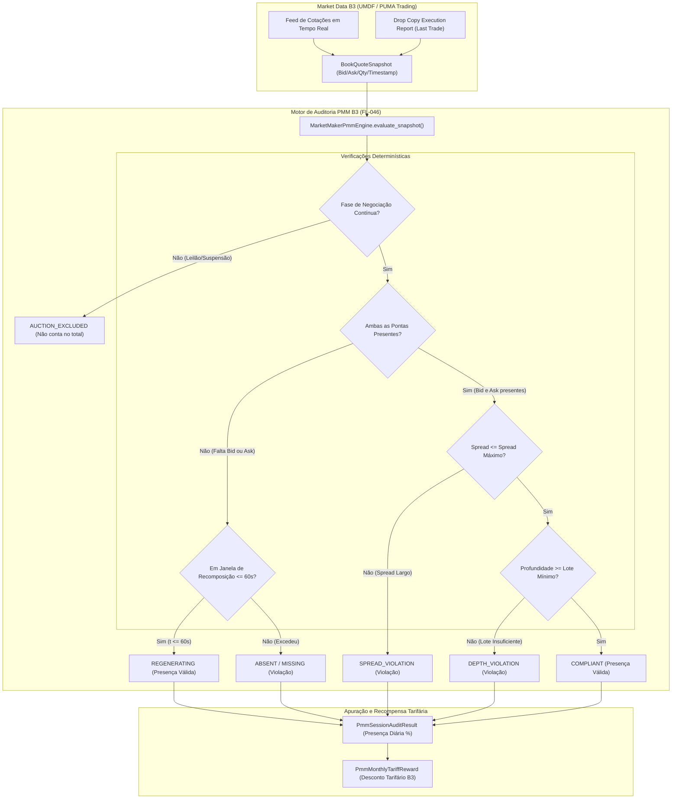
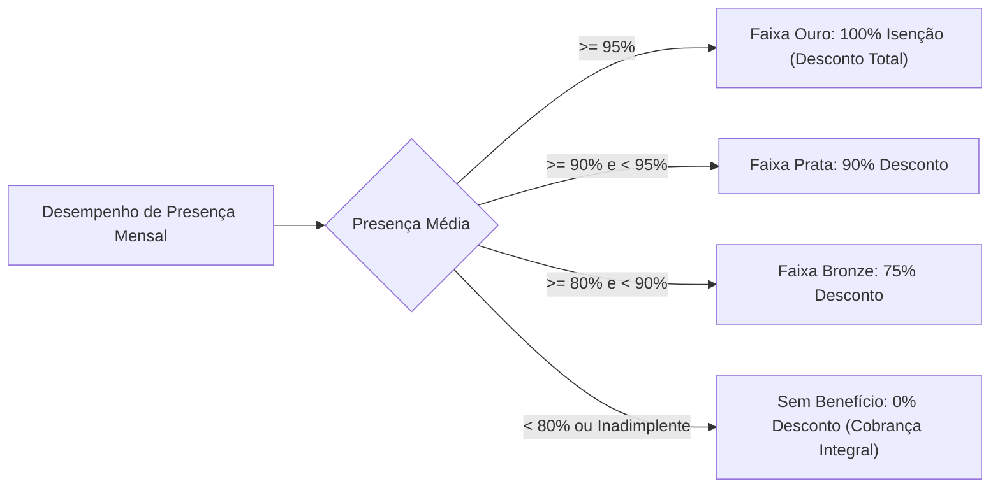

# Especificação Técnica do Programa de Formador de Mercado B3 (PMM) (FL-046)

## 1. Visão Geral e Fundamentação Regulatória

O **Programa de Formador de Mercado (PMM - Market Maker)** da B3 (Brasil, Bolsa, Balcão) tem como finalidade primordial fomentar a liquidez de ativos elegíveis, assegurar a continuidade das cotações em tela e mitigar distorções de preços decorrentes de assimetrias informacionais ou escassez temporária de contrapartes.

A regulamentação do programa está fundamentada nas seguintes diretrizes normativas:
- **Resolução CVM nº 135/2022** (anterior Instrução CVM nº 384/2003): Estabelece as regras gerais sobre o exercício da atividade de formador de mercado nos mercados regulamentados de valores mobiliários.
- **Regulamento de Operações e Manual de Procedimentos Operacionais da B3**: Define os critérios de credenciamento, deveres contratuais e mecanismos de supervisão intradiária de formadores de mercado.
- **Ofícios Circulares Periódicos da Diretoria de Operações da B3 (VOP/NME)**: Parametrizam periodicamente os ativos elegíveis, spreads máximos, quantidades mínimas e metas de presença por classe de ativo.

O Formador de Mercado atua exclusivamente por conta própria (conta proprietária / carteira própria de instituição autorizada), assumindo a obrigação jurídica e operacional de manter ofertas firmes de compra (*bid*) e venda (*ask*) no livro central do **PUMA Trading System** durante o período de negociação contínua. Em contrapartida ao cumprimento estrito dos parâmetros, o participante faz jus a **descontos e isenções de até 100% sobre emolumentos e taxas de negociação e liquidação** da B3 para as operações realizadas no âmbito do programa.

---

## 2. Ativos Elegíveis e Parâmetros Contratuais

A B3 credencia formadores de mercado para diferentes classes de instrumentos, aplicando parâmetros de liquidez calibrados para cada perfil de risco:

| Classe de Ativo | Exemplos Típicos B3 | Dever de Presença Mínimo | Spread Máximo Permitido | Profundidade Mínima (*Lot Depth*) | Tempo de Recomposição (*Regeneration*) |
| :--- | :--- | :--- | :--- | :--- | :--- |
| **Ações Small / Mid Caps** | `PRIO3`, `LWSA3`, `CASH3`, `POSI3` | $\ge 80\%$ ou $\ge 90\%$ | $1,50\% \text{ a } 2,50\%$ | $100 \text{ a } 1.000 \text{ ações}$ | Até 60 segundos |
| **Opções Listadas** | Opções fora-do-dinheiro / moderadas (`PETRE...`, `VALEE...`) | $\ge 80\%$ | $2,00\% \text{ a } 4,00\%$ | $10 \text{ a } 50 \text{ contratos}$ | Até 60 segundos |
| **Futuros e Commodities** | `OZ1D` (Ouro), `CCM` (Milho), `BGI` (Boi), `ICF` (Café) | $\ge 85\%$ | $0,20\% \text{ a } 1,00\%$ | $5 \text{ a } 20 \text{ contratos}$ | Até 30 a 60 segundos |
| **ETFs de Renda Variável** | `SMAL11`, `HASH11`, `IVVB11`, `DIVO11` | $\ge 90\%$ | $0,50\% \text{ a } 1,00\%$ | $100 \text{ a } 500 \text{ cotas}$ | Até 60 segundos |

### 2.1 Métrica de Spread Máximo

O spread relativo percentual entre a melhor oferta de venda (*Best Ask*) e a melhor oferta de compra (*Best Bid*) do formador é calculado deterministicamente conforme a fórmula regulatória oficial da B3:

$$\text{Spread}_{\%} = \frac{P_{\text{Ask}} - P_{\text{Bid}}}{P_{\text{Bid}}} \times 100$$

Onde:
- $P_{\text{Ask}}$: Preço unitário da oferta de venda inserida pelo formador de mercado.
- $P_{\text{Bid}}$: Preço unitário da oferta de compra inserida pelo formador de mercado.
- Condição de conformidade: $\text{Spread}_{\%} \le \text{Spread}_{\text{Máximo}}$ (e, onde aplicável, $\text{Spread}_{\text{Ticks}} \le \text{Spread}_{\text{Ticks\_Máximo}}$).

### 2.2 Profundidade Mínima de Lote (*Minimum Lot Depth*)

O formador deve manter simultaneamente no livro de ofertas:
- $\text{Quantidade}_{\text{Bid}} \ge \text{Qtd Mínima Contratual}$
- $\text{Quantidade}_{\text{Ask}} \ge \text{Qtd Mínima Contratual}$

Caso uma das pontas possua quantidade inferior ao lote estipulado, o snapshot é classificado como violação de profundidade (`DEPTH_VIOLATION`), a menos que esteja protegido pela janela de recomposição.

### 2.3 Tempo de Recomposição de Ofertas (*Regeneration Time*)

Quando uma oferta do formador de mercado é executada total ou parcialmente por contrapartes agressoras no PUMA Trading System, o participante dispõe de uma **janela de tolerância operacional (*grace period*)**, tipicamente de até **60 segundos** (ou 30 segundos em derivativos de alta frequência), contados a partir do timestamp da última execução (`last_trade_timestamp`).

Durante essa janela temporal:
1. Se o formador ficar temporariamente ausente de uma ou ambas as pontas para recompor sua posição de custódia e risco, o período é classificado como `REGENERATING`.
2. O tempo em recomposição legítima **é computado como presença válida**, evitando punição indevida ao participante que acabou de absorver fluxo agressor do mercado.
3. Se a janela de recomposição expirar sem a reinserção de ofertas em conformidade (spread $\le$ teto e lote $\ge$ piso), o tempo subsequente passa a contar imediatamente como violação (`ABSENT`, `MISSING_BID`, `MISSING_ASK` ou `DEPTH_VIOLATION`).

### 2.4 Fases de Negociação e Elegibilidade de Auditoria

A obrigação de formador de mercado incide estritamente durante a **fase de negociação contínua (*Continuous Trading*)**. As seguintes fases do pregão são formalmente **excluídas** do denominador do tempo total elegível:
- **Leilão de Abertura (*Opening Auction*)**: Período de formação do preço de abertura.
- **Leilão de Fechamento (*Closing Auction*)**: Fixação do preço de encerramento do pregão.
- **Leilão de Volatilidade (*Volatility Auction*)**: Túneis dinâmicos rompidos por oscilação brusca.
- **Suspensão de Negociação (*Trading Halt / Circuit Breaker*)**: Paralisação de mercado por fato relevante ou estresse sistêmico.

$$\text{Tempo Elegível} = \sum \Delta t_{\text{Negociação Contínua}}$$

---

## 3. Arquitetura de Auditoria Contínua de Cotação

O sistema de auditoria do PMM captura periodicamente snapshots do livro de ofertas (*Order Book Snapshots*) gerados pelo subsistema de Market Data UMDF da B3, avaliando a integridade das ordens do formador.



---

## 4. Metodologia de Cálculo de Presença Diária e Mensal

### 4.1 Taxa de Presença no Pregão Diário

Para cada pregão $d$, a taxa de presença percentual $\text{Presença}_{\%}^{(d)}$ é obtida pela razão estrita entre a duração de tempo em conformidade (incluindo recomposição aprovada) e o tempo total de negociação contínua elegível:

$$\text{Presença}_{\%}^{(d)} = \left( \frac{\text{Tempo Válido}^{(d)}}{\text{Tempo Total Elegível}^{(d)}} \right) \times 100$$

O pregão é aprovado como **Conforme (`is_compliant = True`)** se e somente se:
1. $\text{Presença}_{\%}^{(d)} \ge \text{Meta de Presença Diária}$ (ex: $80,0\%$ ou $90,0\%$).
2. $\text{Violações de Spread}^{(d)} \le \text{Limite Máximo de Violações Toleradas}$ (ex: até 10 violações pontuais no dia).

### 4.2 Apuração Mensal de Elegibilidade Tarifária

No encerramento de cada mês de competência, a B3 consolida todos os pregões auditados para o par `(Participante, Ativo)`:
- $\text{Pregões Realizados} = N$
- $\text{Pregões Conformes} = K$
- $\text{Taxa de Conformidade Mensal} = \frac{K}{N} \times 100$
- $\text{Presença Média Mensal} = \frac{1}{N} \sum_{i=1}^N \text{Presença}_{\%}^{(i)}$

O participante é qualificado como **Elegível ao Benefício Tarifário (`is_reward_eligible = True`)** quando:
- $\text{Taxa de Conformidade Mensal} \ge \text{Mínimo Contratual}$ (tipicamente $\ge 80\%$ dos pregões do mês).
- $\text{Presença Média Mensal} \ge \text{Meta de Presença do Ativo}$.

---

## 5. Estrutura de Descontos Tarifários B3 (Emolumentos e Liquidação)

Os custos operacionais de negociação e liquidação da B3 devidos pelo formador de mercado sobre as operações no ativo objeto são submetidos à tabela progressiva de isenção:



### 5.1 Conservação Financeira Tarifária

O valor do desconto concedido e o valor líquido a recolher satisfazem a seguinte invariante exata:

$$\text{Taxa Bruta Total} = \text{Emolumentos Negociação} + \text{Taxa Liquidação Câmara}$$

$$\text{Desconto Tarifário} = \text{Taxa Bruta Total} \times \left( \frac{\text{Desconto}_{\%}}{100} \right)$$

$$\text{Taxa Líquida Devida} = \text{Taxa Bruta Total} - \text{Desconto Tarifário}$$

- Se $\text{Desconto}_{\%} = 100\%$, então $\text{Taxa Líquida Devida} = R\$ \, 0,00$.
- Toda a aritmética é computada com o tipo `Decimal` do Python Standard Library, garantindo precisão monetária sem erros de ponto flutuante IEEE 754.

---

## 6. Modelos de Dados e Estrutura JSON

### 6.1 Contrato de Formador de Mercado (`PmmAssetContract`)

```json
{
  "contract_id": "PMM-2026-PRIO3-001",
  "participant_id": "008-UBS",
  "symbol": "PRIO3",
  "asset_class": "EQUITY_SMALL_CAP",
  "min_presence_pct": "80.00",
  "max_spread_pct": "1.50",
  "min_bid_qty": "500",
  "min_ask_qty": "500",
  "max_regeneration_seconds": 60,
  "max_daily_spread_violations": 10,
  "base_discount_pct": "100.00",
  "min_monthly_compliant_ratio": "80.00"
}
```

### 6.2 Snapshot de Cotação (`BookQuoteSnapshot`)

```json
{
  "timestamp": "2026-11-04T10:15:30.000000Z",
  "symbol": "PRIO3",
  "participant_id": "008-UBS",
  "bid_price": "42.50",
  "bid_qty": "500",
  "ask_price": "43.10",
  "ask_qty": "500",
  "phase": "CONTINUOUS",
  "last_trade_timestamp": null,
  "duration_seconds": "5.0"
}
```

---

## 7. Rastreabilidade com Normas e Sistemas B3

| Módulo / Sistema B3 | Descrição da Interface | Papel no Fluxo FL-046 |
| :--- | :--- | :--- |
| **PUMA Trading System** | Matching Engine e Order Book central | Inserção de ordens firmes de compra e venda via protocolo FIX 4.4 / SBE. |
| **UMDF (Market Data)** | Unified Market Data Feed (Templates SBE) | Disseminação de snapshots e atualizações incrementais do livro para auditoria. |
| **Drop Copy B3** | Feed de notificações de execução e negócios | Registro do timestamp de execução de ordens do formador para controle do tempo de recomposição (*Regeneration Time*). |
| **Câmara B3 (Clearing)** | Sistema de tarifação multilateral e tarifação | Apuração e faturamento mensal de emolumentos e liquidação com aplicação das isenções contratuais. |
| **BSM Supervisão** | Autorreguladora BSM (FL-030) | Auditoria de conduta para assegurar que ofertas não configurem *spoofing*, *layering* ou manipulação. |
