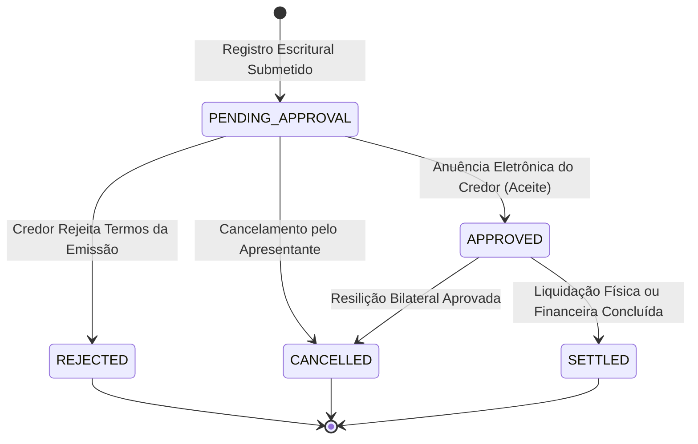
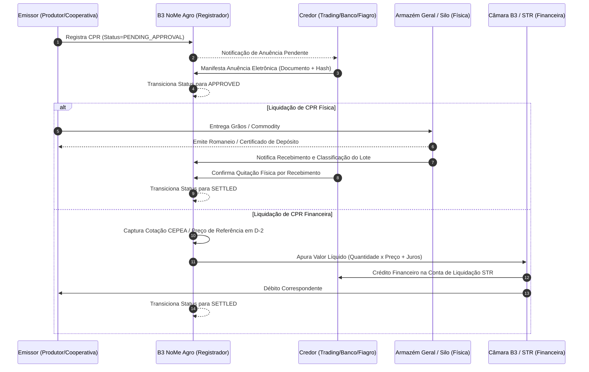

# Especificação Técnica de Registro e Escrituração de Títulos do Agronegócio (FL-026) — B3 NoMe Agro

## 1. Visão Geral e Contexto de Mercado

O módulo **NoMe Agro** da **B3 S.A. – Brasil, Bolsa, Balcão** é a infraestrutura eletrônica central autorizada pelo Banco Central do Brasil para o registro, escrituração, controle de garantias e liquidação de títulos de crédito do agronegócio. Entre esses instrumentos, destaca-se a **Cédula de Produto Rural (CPR)**, em suas modalidades **Física** e **Financeira**, além de títulos securitizados e de custódia como **CRA**, **CDCA**, **CDA** e **WA**.

Historicamente regulada pela Lei nº 8.929/1994, a CPR foi profundamente reformulada e modernizada pelo marco regulatório da **Lei nº 13.986/2020** (*Lei do Agro*) e aprimorada pela **Lei nº 14.421/2022**, bem como pelas Resoluções do Conselho Monetário Nacional (CMN nº 4.870/2020 e nº 5.040/2022).

A legislação tornou obrigatório o registro ou depósito escritural das CPRs em entidades registradoras autorizadas pelo Banco Central (como a B3) para validade e eficácia contra terceiros, estabelecendo prazos estritos de até 10 (dez) dias úteis contados da data de emissão.

```
+---------------------------------------------------------------------------------------------------------+
|                                    B3 NoMe Agro - Sistema Registrador                                  |
+---------------------------------------------------------------------------------------------------------+
                                                     |
             +---------------------------------------+---------------------------------------+
             |                                                                               |
             v                                                                               v
+---------------------------------------+                       +---------------------------------------+
|  CPR Física (Lei 8.929/94 art. 1º)    |                       |  CPR Financeira (art. 4º-A)           |
|  - Promessa de entrega de mercadoria  |                       |  - Obrigação de pagamento em dinheiro |
|  - Commodity / Quantidade / Sacas     |                       |  - Indexador: CEPEA, ESALQ, B3, Fixo  |
|  - Local de entrega / Silo / Armazém  |                       |  - Liquidação financeira em moeda     |
|  - Cronograma e janela de safra       |                       |  - Ajuste por juros / ágio / deságio  |
+---------------------------------------+                       +---------------------------------------+
             |                                                                               |
             +---------------------------------------+---------------------------------------+
                                                     |
                                                     v
                         +-------------------------------------------------------+
                         |       Validações Determinísticas do Agronegócio       |
                         |  - Código CAR Válido (SICAR - UF-IBGE-HASH32)         |
                         |  - Safra Futura / Coerente (Não retroativa)           |
                         |  - Quantidade e Preços estritamente positivos         |
                         |  - Emissor e Credor com CPF/CNPJ válidos              |
                         +-------------------------------------------------------+
                                                     |
                                                     v
                         +-------------------------------------------------------+
                         |           Ciclo de Anuência Eletrônica                |
                         |  - Status inicial: PENDING_APPROVAL                   |
                         |  - Aceite formal do Credor com carimbo de tempo       |
                         |  - Status após anuência: APPROVED                     |
                         +-------------------------------------------------------+
                                                     |
                                                     v
                         +-------------------------------------------------------+
                         |                  Modalidade de Liquidação             |
                         |  - Física: Atestado / Romaneio de entrega em armazém  |
                         |  - Financeira: Quantidade x Preço Índice de Liquidação|
                         +-------------------------------------------------------+
```

---

## 2. Marco Regulatório e Diretrizes Legais

| Legislação / Norma | Órgão Regulador | Impacto no Registro NoMe Agro |
|---|---|---|
| **Lei nº 8.929/1994** | Presidência da República | Criação da CPR, definindo requisitos essenciais, praça de pagamento e emissão por produtor rural ou cooperativas. |
| **Lei nº 13.986/2020** (*Nova Lei do Agro*) | Presidência da República | Introdução da CPR sob forma escritural, obrigatoriedade de registro em sistema registrador autorizado pelo Bacen, criação do Patrimônio Rural em Afetação (PRA) e Fundo Garantidor Solidário (FGS). |
| **Lei nº 14.421/2022** | Presidência da República | Aprimoramento da assinatura eletrônica (simples, avançada ou qualificada), flexibilização de prazos e fortalecimento do CAR em garantias reais. |
| **Resolução CMN nº 4.870/2020** | Banco Central do Brasil | Cronograma de obrigatoriedade de registro e depósito de CPR em entidades registradoras de ativos autorizadas. |
| **Resolução CMN nº 5.040/2022** | Banco Central do Brasil | Consolidação dos critérios de dispensa e escalonamento por faixas de valor e elegibilidade para garantia do Proagro. |

---

## 3. Parâmetros e Estrutura de Domínio da CPR

### 3.1 Emissores Habilitados
Conforme o art. 2º da Lei 8.929/1994 (redação da Lei 13.986/2020), são habilitados a emitir CPR:
- **Produtor Rural Pessoa Física (PF)**: Identificado por CPF ativo.
- **Produtor Rural Pessoa Jurídica (PJ)**: Sociedades empresárias agrícolas identificadas por CNPJ.
- **Cooperativa Agropecuária**: Cooperativas de produtores com CNPJ ativo.
- **Associação de Produtores Rurais**: Entidades associativas da cadeia produtiva agropecuária.

### 3.2 Credor / Beneficiário
Pessoa física ou jurídica a favor de quem a cédula é emitida:
- **Instituições Financeiras**: Bancos de varejo ou investimento provedores de crédito agrícola.
- **Tradings de Commodities**: Empresas exportadoras e comercializadoras de grãos.
- **Distribuidores de Insumos Agropecuários**: Operações de *barter* (troca de insumos por produção futura).
- **Fundos de Investimento (Fiagro / FIDC)**: Veículos de securitização e investimento no agronegócio.

### 3.3 Commodities e Produtos Agropecuários Elegíveis
O NoMe Agro parametriza as seguintes classes de commodities agropecuárias:

| Commodity | Código Interno | Unidade Padrão | Descrição de Mercado |
|---|---|---|---|
| **Soja** | `SOJA` | `SACAS_60KG` / `TONELADAS` | Soja em grãos a granel, padrão exportação (umidade max 14%, impurezas max 1%). |
| **Milho** | `MILHO` | `SACAS_60KG` / `TONELADAS` | Milho em grão amarelo, padrão comercial para consumo animal e etanol. |
| **Café** | `CAFE` | `SACAS_60KG` | Café arábica ou conilon/robusta em grãos beneficiados. |
| **Boi Gordo** | `BOI_GORDO` | `ARROBAS` (@ = 15 kg) | Bovinos machos terminados para abate, padrão frigorífico. |
| **Algodão** | `ALGODAO` | `TONELADAS` / `QUILOGRAMAS` | Algodão em pluma padronizado. |
| **Cana-de-Açúcar** | `CANA_DE_ACUCAR` | `TONELADAS` | Cana entregue para moagem e produção sucroalcooleira (ATR). |
| **Trigo** | `TRIGO` | `TONELADAS` / `SACAS_60KG` | Trigo em grãos para panificação e moagem. |

### 3.4 Unidades de Medida Homologadas
- `SACAS_60KG`: Saca padrão de 60 quilogramas líquidos (grãos e café).
- `ARROBAS`: Arroba líquida de carcaça bovina (15 kg).
- `TONELADAS`: Tonelada métrica (1.000 kg).
- `QUILOGRAMAS`: Massa expressa em quilogramas (kg).
- `LITROS`: Volume em litros (etanol / leite).
- `METROS_CUBICOS`: Volume de madeira / floresta plantada.

### 3.5 Cronograma de Safra e Prazos Operacionais
- **Safra (`crop_year`)**: Ano agrícola ou ciclo de cultivo no formato `YYYY/YYYY` (ex: `2026/2027`) ou anual `YYYY` (ex: `2026`). A safra declarada não pode ser retroativa em relação à data de emissão.
- **Data de Emissão (`issue_date`)**: Momento formal da criação da cártula ou emissão escritural.
- **Data de Vencimento (`maturity_date`)**: Termo final da obrigação, devendo ser estritamente igual ou posterior à data de emissão.
- **Janela de Entrega Física (`delivery_start_date` a `delivery_end_date`)**: Intervalo pactuado em que o produtor deve disponibilizar a mercadoria no armazém credenciado.

### 3.6 Local de Entrega (CPR Física)
O local de cumprimento da obrigação de entrega física deve conter:
- Razão Social e CNPJ do Armazém Geral / Silo depositário ou identificação da propriedade rural.
- Endereço completo, Município e Unidade da Federação (UF).
- Código IBGE do município (7 dígitos).

### 3.7 Referenciais de Preço e Índices (CPR Financeira)
Na CPR Financeira, a obrigação pecuniária pode ser referenciada a preços de mercado ou fixa:
- `CEPEA_PARANAGUA`: Indicador da Soja Paranaguá ESALQ/CEPEA em R$/saca de 60 kg.
- `CEPEA_ESALQ`: Indicadores Cepea/Esalq regionalizados (Milho Campinas, Boi Gordo SP, Café Arábica).
- `B3_AGRO`: Cotações de fechamento dos contratos futuros agropecuários da B3.
- `FIXO`: Preço unitário pré-determinado fixado na emissão (ex.: R$ 138,50 por saca).
- `CUSTOM`: Fórmula ou indicador acordado contratualmente entre as partes.

Fórmula de apuração do valor financeiro:
$$\text{Valor Bruto} = \text{Quantidade} \times \text{Preço de Referência}$$
$$\text{Valor Final} = \text{Valor Bruto} \times \left(1 + \frac{\text{Spread}}{100}\right) \times \left(1 + \frac{\text{Taxa Anual}}{100} \times \frac{\text{Dias}}{365}\right)$$

---

## 4. Garantias do Agronegócio e Validação do CAR

### 4.1 Modalidades de Garantia
A Lei nº 13.986/2020 consolidou diversas formas de garantia para a CPR:
1. **`PENHOR_AGRICOLA`**: Penhor de safra pendente ou futura colhida na propriedade agrícola.
2. **`ALIENACAO_FIDUCIARIA_IMOVEL`**: Transferência resolúvel da propriedade do imóvel rural em favor do credor. Exige vínculo obrigatório ao **Cadastro Ambiental Rural (CAR)**.
3. **`PATRIMONIO_RURAL_AFETACAO` (PRA)**: Destinação de fração de imóvel rural ao pagamento exclusivo da cédula, desmembrada com CAR e memorial descritivo.
4. **`FUNDO_GARANTIDOR_SOLIDARIO` (FGS)**: Garantia coletiva constituída por no mínimo 2 produtores rurais e o credor.
5. **`HIPOTECA_RURAL`**: Garantia real tradicional gravada na matrícula do imóvel rural (também exige CAR).
6. **`AVAL`**: Garantia pessoal prestada por terceiro corresponsável.
7. **`SEM_GARANTIA`**: Cédula quirografária sem garantia real associada.

### 4.2 Validação Determinística do Cadastro Ambiental Rural (CAR)
O CAR é o registro público eletrônico nacional obrigatório para todos os imóveis rurais (Lei nº 12.651/2012). O NoMe Agro valida o formato oficial do Sistema Nacional de Cadastro Ambiental Rural (**SICAR**):

$$\text{Padrão SICAR: } \underbrace{\text{[UF]}}_{2\text{ letras}} - \underbrace{\text{[Código IBGE]}}_{7\text{ dígitos}} - \underbrace{\text{[Hash Alfanumérico Hex]}}_{32\text{ caracteres}}$$

**Exemplo Válido**: `MT-5107909-E8B1A2C3D4E5F6789012345678901234`
- `MT`: Estado de Mato Grosso (validado contra lista de 27 Unidades Federativas).
- `5107909`: Código IBGE do município de Sorriso/MT.
- `E8B1A2C3D4E5F6789012345678901234`: Identificador hash único de 32 caracteres hexadecimais.

> [!IMPORTANT]
> Se a garantia for do tipo `ALIENACAO_FIDUCIARIA_IMOVEL`, `PATRIMONIO_RURAL_AFETACAO` ou `HIPOTECA_RURAL`, o preenchimento do código CAR é estritamente obrigatório e seu formato deve ser aprovado pelo validador do NoMe Agro.

---

## 5. Ciclo de Anuência Eletrônica do Credor e Liquidação

### 5.1 Fluxo de Estados da CPR no NoMe Agro



### 5.2 Anuência Eletrônica do Credor
1. A CPR é inserida no sistema pelo participante custodiante/apresentante em nome do emissor com status `PENDING_APPROVAL`.
2. O sistema NoMe Agro gera uma notificação e hash transacional para o credor indicado.
3. O credor valida as cláusulas da cédula (quantidade, prazo, garantia, indexador) e emite sua **anuência eletrônica** (assinatura digital com carimbo de tempo ICP-Brasil ou eletrônica qualificada).
4. O documento do credor anuente deve coincidir rigorosamente com o CNPJ/CPF cadastrado na emissão.
5. Uma vez anuída, a CPR atinge o status `APPROVED` (Ativa), tornando-se plenamente negociável no mercado secundário e apta para servir de lastro para emissão de Certificados de Recebíveis do Agronegócio (**CRA**) e CDCAs.

### 5.3 Liquidação: Física vs. Financeira



---

## 6. Especificação de Mensageria (JSON / XML NoMe Agro)

### 6.1 Dicionário de Dados do Registro de CPR

| Campo | Tipo | Obrigatório | Descrição / Regra |
|---|---|---|---|
| `cpr_id` | String | Sim | Identificador único do contrato no padrão B3 (ex.: `CPR-2026-SOJA-001`). |
| `cpr_type` | String Enum | Sim | `FISICA` ou `FINANCEIRA`. |
| `issuer` | Object | Sim | Dados do emissor: `name`, `document` (CPF/CNPJ limpo), `party_type` (`PF`/`PJ`), `city`, `state`. |
| `creditor` | Object | Sim | Dados do credor: `name`, `document` (CPF/CNPJ limpo), `party_type` (`PF`/`PJ`), `city`, `state`. |
| `commodity` | String Enum | Sim | `SOJA`, `MILHO`, `CAFE`, `BOI_GORDO`, `ALGODAO`, `CANA_DE_ACUCAR`, `TRIGO`. |
| `quantity` | Decimal | Sim | Quantidade total de produto, estritamente maior que zero. |
| `unit` | String Enum | Sim | `SACAS_60KG`, `ARROBAS`, `TONELADAS`, `QUILOGRAMAS`, `LITROS`, `METROS_CUBICOS`. |
| `crop_year` | String | Sim | Ano safra no formato `YYYY/YYYY` ou `YYYY`. Não pode ser retroativa em relação à emissão. |
| `issue_date` | Date (YYYY-MM-DD) | Sim | Data formal da emissão da CPR. |
| `maturity_date` | Date (YYYY-MM-DD) | Sim | Data de vencimento, deve ser $\ge$ `issue_date`. |
| `delivery_location` | Object | Se Física | Obrigatório em CPR Física. Contém armazém, endereço, cidade, UF, código IBGE e datas da janela de entrega. |
| `price_index` | String Enum | Se Financeira | Obrigatório em CPR Financeira: `CEPEA_PARANAGUA`, `CEPEA_ESALQ`, `B3_AGRO`, `FIXO`, `CUSTOM`. |
| `unit_price` | Decimal | Opcional | Preço unitário por saca/arroba em moeda corrente. Obrigatório se índice for `FIXO`. |
| `spread_percentage` | Decimal | Não | Ágio ou deságio percentual sobre o preço de referência (default: 0.00). |
| `interest_rate_annual` | Decimal | Não | Taxa de juros anual pró-rata (default: 0.00). |
| `currency` | String | Sim | Moeda de liquidação (default: `BRL`). |
| `guarantees` | Array de Garantias | Não | Lista de garantias reais e pessoais vinculadas à CPR. |
| `status` | String Enum | Sim | `PENDING_APPROVAL`, `APPROVED`, `REJECTED`, `SETTLED`, `CANCELLED`. |

---

## 7. Exemplos Oficiais de Mensageria

### 7.1 Exemplo: CPR Financeira de Soja Indexada ao CEPEA Paranaguá
```json
{
  "cpr_id": "CPR-2026-SOJA-001",
  "cpr_type": "FINANCEIRA",
  "issuer": {
    "name": "Agropecuária Fazenda Primavera Ltda",
    "document": "12345678000195",
    "party_type": "PJ",
    "city": "Sorriso",
    "state": "MT"
  },
  "creditor": {
    "name": "Banco Agro Investimentos S.A.",
    "document": "98765432000198",
    "party_type": "PJ",
    "city": "São Paulo",
    "state": "SP"
  },
  "commodity": "SOJA",
  "quantity": 10000,
  "unit": "SACAS_60KG",
  "crop_year": "2026/2027",
  "issue_date": "2026-05-10",
  "maturity_date": "2026-11-20",
  "price_index": "CEPEA_PARANAGUA",
  "unit_price": "138.50",
  "spread_percentage": "0.00",
  "interest_rate_annual": "0.00",
  "currency": "BRL",
  "guarantees": [
    {
      "guarantee_type": "ALIENACAO_FIDUCIARIA_IMOVEL",
      "description": "Alienação fiduciária de fração de imóvel rural devidamente registrada no SICAR",
      "car_code": "MT-5107909-E8B1A2C3D4E5F6789012345678901234",
      "property_name": "Fazenda Boa Esperança",
      "land_registry_number": "45.120",
      "registry_office": "1º Cartório de Registro de Imóveis de Sorriso/MT",
      "city": "Sorriso",
      "state": "MT",
      "guarantee_value": "3200000.00",
      "coverage_percentage": "100.00"
    }
  ],
  "status": "PENDING_APPROVAL"
}
```

### 7.2 Exemplo: CPR Física de Milho com Entrega em Terminal Armazenador
```json
{
  "cpr_id": "CPR-2026-MILHO-002",
  "cpr_type": "FISICA",
  "issuer": {
    "name": "Cooperativa Agroindustrial do Centro-Oeste",
    "document": "12345678000195",
    "party_type": "PJ",
    "city": "Rio Verde",
    "state": "GO"
  },
  "creditor": {
    "name": "Trading Commodities Brasil S.A.",
    "document": "98765432000198",
    "party_type": "PJ",
    "city": "Santos",
    "state": "SP"
  },
  "commodity": "MILHO",
  "quantity": 20000,
  "unit": "SACAS_60KG",
  "crop_year": "2026/2027",
  "issue_date": "2026-06-01",
  "maturity_date": "2026-10-15",
  "delivery_location": {
    "warehouse_name": "Terminal Graneleiro Rio Verde - Armazéns Gerais",
    "address": "Rodovia GO-174, Km 05, Distrito Agroindustrial",
    "city": "Rio Verde",
    "state": "GO",
    "ibge_code": "5218805",
    "warehouse_cnpj": "98765432000198",
    "delivery_start_date": "2026-09-01",
    "delivery_end_date": "2026-10-15"
  },
  "guarantees": [
    {
      "guarantee_type": "PENHOR_AGRICOLA",
      "description": "Penhor agrícola de primeiro grau sobre a safra de milho 2026/2027",
      "city": "Rio Verde",
      "state": "GO",
      "guarantee_value": "1500000.00",
      "coverage_percentage": "100.00"
    }
  ],
  "status": "PENDING_APPROVAL"
}
```

---

## 8. Tabela de Validações do Motor (`AgroRegistrationEngine`)

| Regra / Invariante | Código / Erro | Condição de Bloqueio |
|---|---|---|
| **Formato e Validade do CAR** | `AgroValidationError` | Rejeita se garantia de imóvel rural não possuir CAR válido no padrão `UF-IBGE-HASH32` ou UF inexistente. |
| **Safra Retroativa** | `AgroValidationError` | Rejeita se ano de término da safra for anterior ao ano da data de emissão. |
| **Vencimento Anterior à Emissão** | `AgroValidationError` | Rejeita se `maturity_date < issue_date`. |
| **Quantidade Estritamente Positiva** | `AgroValidationError` | Rejeita se `quantity <= 0`. |
| **Preço Positivo** | `AgroValidationError` | Rejeita se `unit_price <= 0`. |
| **Local de Entrega em CPR Física** | `AgroValidationError` | Rejeita CPR Física sem `delivery_location` completo ou com inversão cronológica de entrega. |
| **Divergência de Anuência** | `AgroValidationError` | Rejeita anuência se o documento do credor anuente não bater com o credor registrado. |
| **Liquidação Pré-Anuência** | `AgroSettlementError` | Bloqueia liquidação de CPR cujo status ainda seja `PENDING_APPROVAL` ou `REJECTED`. |
| **Dígito Verificador CPF/CNPJ** | `AgroValidationError` | Valida algoritmo módulo 11 de documentos oficiais de emissor e credor. |
