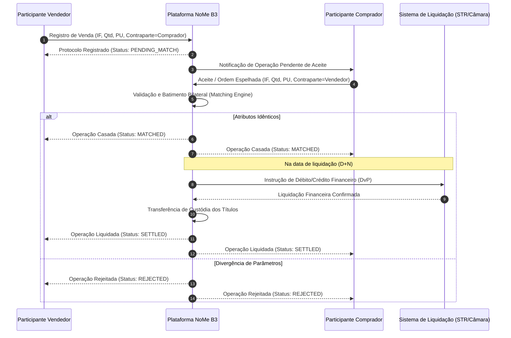

# Plataforma NoMe B3 — Registro e Conciliação de Balcão (FL-014 e FL-019)

## 1. Visão Geral da Plataforma NoMe

O **NoMe (Novo Mercado de Balcão)** é a plataforma tecnológica central da B3 responsável pelo registro, depósito, custódia e negociação eletrônica de ativos do mercado de balcão organizado brasileiro. Criado para modernizar e suceder os sistemas legados herdados da antiga **CETIP**, o NoMe unifica a infraestrutura de pós-negociação para títulos de renda fixa privada bancária, títulos corporativos de dívida e instrumentos de securitização.

Diferente do mercado de bolsa tradicional (*Puma Trading System*), onde a formação de preços ocorre via livro centralizado de ofertas anônimas com contraparte central garantidora (CCP), o mercado de balcão caracteriza-se pela **negociação bilateral customizada** entre instituições financeiras, investidores institucionais e emissores. O NoMe atua como o registrador e depositário central autorizado pelo Banco Central do Brasil (Bacen) e pela Comissão de Valores Mobiliários (CVM), garantindo a unicidade, imutabilidade, batimento bilateral de condições e publicidade dos negócios.

Este documento formaliza as especificações técnicas de dois fluxos centrais:
- **`FL-014`**: Registro de Operações de Renda Fixa Privada Bancária e Corporativa (CDB, RDB, LCI, LCA, Debêntures, CRI, CRA).
- **`FL-019`**: Conciliação de Posições e Ativos de Balcão (Extrato Balcão NoMe vs. Livro Interno de Custódia).

---

## 2. Instrumentos Suportados

A esteira de integração suporta os principais instrumentos de balcão emitidos no mercado financeiro nacional, subdivididos em duas grandes famílias:

### 2.1. Renda Fixa Privada Bancária
Títulos emitidos por instituições financeiras autorizadas para captação de recursos de terceiros:
- **CDB (Certificado de Depósito Bancário)**: Título de depósito a prazo emitido por bancos comerciais, de investimento ou múltiplos.
- **RDB (Recibo de Depósito Bancário)**: Título de captação inalienável e intransferível antes do vencimento (exceto quando registrado em balcão para cessão entre partes autorizadas).
- **LCI (Letra de Crédito Imobiliário)**: Título lastreado em créditos imobiliários garantidos por hipoteca ou alienação fiduciária, com isenção fiscal para pessoas físicas.
- **LCA (Letra de Crédito do Agronegócio)**: Título lastreado em recebíveis originados de produtores rurais ou cooperativas agropecuárias, igualmente incentivado.

### 2.2. Títulos Corporativos e Securitização
Títulos de dívida de médio e longo prazo emitidos por companhias abertas ou securitizadoras:
- **Debêntures**: Títulos de dívida privada emitidos por sociedades anônimas (não financeiras), podendo conter cláusulas de amortização periódica, juros semestrais e garantias reais ou flutuantes.
- **CRI (Certificado de Recebíveis Imobiliários)**: Título de securitização emitido exclusivamente por companhias securitizadoras, lastreado em créditos imobiliários (aluguéis, financiamentos habitacionais).
- **CRA (Certificado de Recebíveis do Agronegócio)**: Título de securitização lastreado em direitos creditórios do agronegócio (venda de insumos, financiamento de safras).

### 2.3. Matriz de Indexadores Financeiros

| Código | Indexador | Descrição | Parâmetros de Remuneração Típicos |
|---|---|---|---|
| `DI` | Taxa DI / CDI | Taxa média de depósitos interfinanceiros calculada pela B3. | `% CDI` (ex: 100%, 105%) ou `CDI + Spread` (ex: CDI + 1.20% a.a.) |
| `PRE` | Pré-fixado | Taxa de juros fixa convencionada no momento da emissão/negociação. | Taxa anual base 252 dias úteis (ex: 11.50% a.a.) |
| `IPCA` | Índice de Preços ao Consumidor Amplo | Índice oficial de inflação medido pelo IBGE. | `IPCA + Taxa Anual` (ex: IPCA + 5.85% a.a.) |
| `IGPM` | Índice Geral de Preços do Mercado | Índice medido pela Fundação Getulio Vargas (FGV). | `IGPM + Taxa Anual` (ex: IGPM + 4.50% a.a.) |

---

## 3. Modelo de Registro e Ciclo de Vida da Operação

O registro de operações no NoMe pode ser originado por **Emissão Primária** (depósito inicial do título pelo emissor ou distribuidor) ou por **Negociação no Mercado Secundário** (compra e venda entre dois participantes).

### 3.1. Batimento Bilateral (*Bilateral Matching*)
No mercado secundário, para que a operação seja registrada com eficácia jurídica e transferida na depositária, é exigido o **batimento bilateral** entre a ponta compradora e a ponta vendedora:
1. **Registro Unilateral (Ponta Ofertante / Proponente)**:
   - Um dos participantes envia os dados do negócio (Identificador do ativo, Quantidade, PU, Data de Liquidação, Identificação da contraparte).
   - O status inicial da operação no NoMe assume o valor `PENDING_MATCH` (Pendente de Aceite).
2. **Confirmação pela Contraparte**:
   - A contraparte pode submeter o aceite da ordem referenciando o ID de registro ou enviar uma ordem espelhada com os mesmos parâmetros contratuais.
   - O motor de batimento NoMe compara os 6 atributos contratuais mandatórios:
     * Código IF (Instrumento Financeiro).
     * Quantidade negociada.
     * Preço Unitário (PU).
     * Data de Negociação (`trade_date`).
     * Data de Liquidação (`settlement_date`).
     * Relação Comprador $\leftrightarrow$ Vendedor.
3. **Casamento (*Matched*)**:
   - Se todos os atributos coincidirem estritamente, a operação transiciona para `MATCHED`.
4. **Liquidação (*Settled*)**:
   - Na data de liquidação acordada (D+0, D+1 ou D+2), a transferência de custódia ocorre simultaneamente à liquidação financeira (via STR/LBTR ou câmara multilateral), transicionando a operação para `SETTLED`.
5. **Rejeição (*Rejected*)**:
   - Caso qualquer atributo divirja ou a contraparte recuse o negócio, a operação transiciona para `REJECTED`.



---

## 4. Estrutura de Mensagens de Registro

As integrações NoMe operam via mensagens estruturadas em **JSON** (API REST moderna) e **XML** (mensageria assíncrona / interface de conectividade NoMe).

### 4.1. Atributos da Operação

| Campo | Tipo | Obrigatoriedade | Descrição |
|---|---|---|---|
| `trade_id` | String | Obrigatório | Identificador único do registro no participante ou atribuído pelo NoMe. |
| `asset.asset_code` | String | Obrigatório | Código de identificação do título (ex: `CDB-ITAU-202611`, `DEB-VALE-2030`). |
| `asset.instrument_type` | String | Obrigatório | Tipo do título: `CDB`, `RDB`, `LCI`, `LCA`, `DEBENTURE`, `CRI`, `CRA`. |
| `asset.issuer_cnpj` | String | Obrigatório | CNPJ do emissor (14 dígitos numéricos). |
| `asset.issuer_name` | String | Obrigatório | Razão social ou nome institucional do emissor. |
| `asset.issue_date` | Date (YYYY-MM-DD) | Obrigatório | Data de emissão original do título. |
| `asset.maturity_date` | Date (YYYY-MM-DD) | Obrigatório | Data de vencimento final do título. |
| `asset.indexer` | String | Obrigatório | Indexador: `DI`, `PRE`, `IPCA`, `IGPM`. |
| `asset.indexer_percentage` | Decimal | Opcional | Percentual sobre o indexador (ex: `105.00` para 105% do CDI). |
| `asset.rate_spread` | Decimal | Opcional | Spread de taxa anualizada (ex: `2.50` para 2.50% a.a.). |
| `asset.emission_unit_price`| Decimal | Obrigatório | Preço Unitário (PU) nominal na emissão (geralmente R$ 1.000,00). |
| `quantity` | Decimal / Int | Obrigatório | Quantidade de títulos negociada ou registrada. |
| `unit_price` | Decimal | Obrigatório | Preço Unitário de negociação (PU) com precisão de até 8 casas decimais. |
| `financial_amount` | Decimal | Obrigatório | Valor financeiro total ($Qtd \times PU$), precisão de 2 casas decimais. |
| `trade_date` | Date (YYYY-MM-DD) | Obrigatório | Data da realização da operação. |
| `settlement_date` | Date (YYYY-MM-DD) | Obrigatório | Data prevista para liquidação financeira e de custódia. |
| `buyer` | Objeto | Obrigatório | Dados da ponta compradora: participante, conta custódia, conta liquidação. |
| `seller` | Objeto | Obrigatório | Dados da ponta vendedora: participante, conta custódia, conta liquidação. |
| `match_status` | String | Obrigatório | `PENDING_MATCH`, `MATCHED`, `REJECTED`, `SETTLED`. |

---

## 5. Layout do Extrato Diário de Balcão NoMe (FL-019)

Ao final de cada dia útil (processamento noturno de fechamento), o NoMe disponibiliza o extrato analítico de posições de balcão para cada instituição participante. Esse extrato é a fonte de verdade para a conciliação diária da custódia.

### 5.1. Estrutura do Arquivo / Payload de Extrato

```json
{
  "statement_id": "EXT-NOME-20261103-00001050",
  "participant_id": "00001050",
  "reference_date": "2026-11-03",
  "generation_timestamp": "2026-11-03T20:30:00Z",
  "total_records": 5,
  "total_financial_amount": 18450250.00,
  "positions": [
    {
      "custody_account": 105001,
      "asset_code": "CDB-BMA-202611",
      "instrument_type": "CDB",
      "issuer_cnpj": "60701190000104",
      "issuer_name": "BANCO ITAU UNIBANCO S.A.",
      "available_quantity": 5000,
      "blocked_quantity": 0,
      "total_quantity": 5000,
      "unit_price": 1050.250000,
      "financial_amount": 5251250.00
    }
  ]
}
```

---

## 6. Motor de Conciliação de Balcão (`NoMeReconciler`)

O motor de conciliação cruza as posições extraídas do extrato NoMe da B3 com o livro interno de custódia da instituição, gerando um relatório determinístico de batimento.

### 6.1. Tipologia de Quebras de Balcão

1. **`MATCHED`**:
   - Posição perfeitamente coincidente na conta, código do ativo, quantidade total e preço unitário (dentro da tolerância configurada).
2. **`QUANTITY_MISMATCH`**:
   - O ativo existe em ambos os livros para a conta informada, mas a quantidade total declarada pela B3 difere do livro interno.
3. **`PU_MISMATCH`**:
   - A quantidade confere, mas há divergência no Preço Unitário (PU de marcação a mercado ou curva) superior à tolerância admitida (default: $0.0001$).
4. **`GHOST_IN_NOME`**:
   - O ativo consta no extrato NoMe da B3, porém não existe registro no livro interno da instituição (risco de lançamento fantasma ou falha de escrituração interna).
5. **`MISSING_IN_NOME`**:
   - O ativo consta no livro interno da instituição, mas não aparece na custódia reportada pelo NoMe da B3 (risco de operação não registrada ou perda de custódia).

### 6.2. Invariante Financeiro de Balcão
Em qualquer registro ou posição de balcão NoMe, o valor financeiro deve respeitar estritamente a lei de conservação:
$$\text{Valor Financeiro} = \text{Quantidade Total} \times \text{PU}$$
com tolerância máxima de arredondamento cambial/financeiro de R$ 0,02 por evento.
