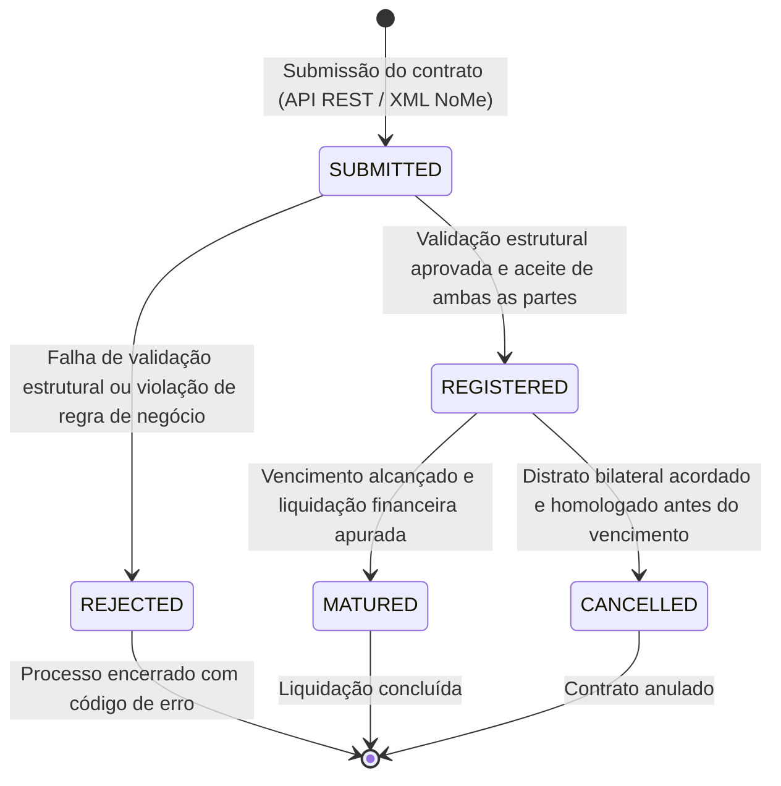
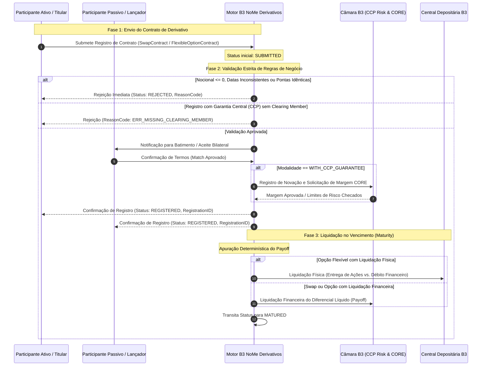

# Especificação Técnica de Registro de Derivativos de Balcão e Opções Flexíveis (FL-016 e FL-017) — B3 NoMe

## 1. Visão Geral e Contexto de Mercado

No ecossistema de infraestrutura de mercado financeiro administrado pela **B3 S.A. – Brasil, Bolsa, Balcão**, o sistema **NoMe (Novo Mercado de Balcão)** é a plataforma eletrônica oficial dedicada ao registro, custódia escritural, validação de regras de negócio e liquidação de operações financeiras realizadas no mercado de balcão organizado (OTC – *Over-The-Counter*).

Enquanto ativos padronizados negociados em bolsa são transacionados via livro de ofertas no PUMA Trading System, os derivativos de balcão atendem a demandas corporativas e institucionais de proteção patrimonial (*hedge*), arbitragem e estruturação sob medida (*tailor-made*).

Os fluxos cobertos nesta especificação técnica compreendem:
- **`FL-016` — Registro e Gerenciamento de Derivativos de Balcão (Swaps e NDFs de Moedas)**: Contratos bilaterais de troca de rentabilidade e contratos a termo de moedas sem entrega física (*Non-Deliverable Forwards*).
- **`FL-017` — Registro de Opções Flexíveis de Balcão**: Contratos de opções customizados sobre ações ou moedas, contemplando strikes customizados, vencimentos livres, barreiras ativadoras/desativadoras e escolha de modalidade de liquidação (física vs. financeira).

```
+---------------------------------------------------------------------------------------------------------+
|                                    B3 NoMe - Derivativos de Balcão                                      |
+---------------------------------------------------------------------------------------------------------+
                                                     |
             +---------------------------------------+---------------------------------------+
             |                                                                               |
             v                                                                               v
+---------------------------------------+                       +---------------------------------------+
|  FL-016: Swaps e NDFs                 |                       |  FL-017: Opções Flexíveis             |
|  - Ponta Ativa vs. Ponta Passiva      |                       |  - Ativo-Objeto (Ações / Moedas)      |
|  - Indexadores: CDI, Pré, USD, IPCA   |                       |  - Call / Put | Americano / Europeu   |
|  - Bases: DU/252, DC/360, DC/365      |                       |  - Strike e Barreiras Customizadas    |
|  - Notional em BRL ou Moeda Extr.     |                       |  - Liquidação Física vs. Financeira   |
+---------------------------------------+                       +---------------------------------------+
             |                                                                               |
             +---------------------------------------+---------------------------------------+
                                                     |
                                                     v
                         +-------------------------------------------------------+
                         |       Modalidades de Registro e Garantia B3           |
                         +-------------------------------------------------------+
                                     /                               \
                                    /                                 \
                                   v                                   v
             +---------------------------------------+   +---------------------------------------+
             | Com Garantia Central (CCP B3)         |   | Sem Garantia (Bilateral)              |
             | - Novação contratual pela Câmara B3   |   | - Registro escritural de validade     |
             | - Chamadas de margem diárias (CORE)   |   | - Risco de contraparte 100% bilateral |
             | - Obrigatoriedade de PL/Clearing Mbr  |   | - Sem mitigação de crédito central    |
             | - Liquidação financeira garantida     |   | - Liquidação bilateral direta / B3    |
             +---------------------------------------+   +---------------------------------------+
```

---

## 2. Modelos de Contrato

### 2.1 Contratos de Swap (FL-016)

O contrato de Swap consiste na troca simultânea de fluxos financeiros futuros entre duas contrapartes, baseados em montantes nocionais de referência e indexadores acordados.

#### 2.1.1 Estrutura de Pontas (Legs)
Cada contrato de Swap é composto rigorosamente por duas pontas financeiras:
1. **Ponta Ativa (*Active Leg / Receivable*)**: Representa o direito de crédito do Participante Titular (*Party Active*), correspondendo ao fluxo que este recebe no vencimento ou nos ajustes periódicos.
2. **Ponta Passiva (*Passive Leg / Payable*)**: Representa a obrigação de débito do Participante Titular (*Party Active*), correspondendo ao fluxo que este paga à contraparte (*Party Passive*).

#### 2.1.2 Indexadores Homologados pela B3 NoMe
| Código | Nome do Indexador | Convenção de Base | Aplicação Típica | Descrição de Mercado |
|---|---|---|---|---|
| `CDI` / `DI` | Taxa DI Contas Cetip | `DU/252` | Ponta Flutuante BRL | Média ponderada das operações compromissadas de 1 dia apuradas pela B3. |
| `PRE` | Taxa Fixa Pré-fixada | `DU/252` | Ponta Fixa BRL | Taxa anual linear/exponencial acordada entre as partes. |
| `DOLAR` / `USD` | Cupom Cambial / PTAX | `DC/360` ou `DU/252` | Câmbio / NDF / Cupom | Variação da cotação de venda do Dólar PTAX (Banco Central do Brasil) acrescida de cupom. |
| `IPCA` | Índice de Preços ao Consumidor Amplo | `DU/252` | Inflação Oficial | Variação do VNA (Valor Nominal Atualizado) do IPCA (IBGE) mais cupom real de juros. |
| `IGPM` | Índice Geral de Preços do Mercado | `DU/252` | Inflação FGV | Variação do índice divulgado pela Fundação Getúlio Vargas acrescido de cupom. |
| `SELIC` | Taxa Selic Over | `DU/252` | Ponta Flutuante Soberana | Taxa média ponderada das operações com títulos públicos federais no Selic. |

#### 2.1.3 Bases de Cálculo e Convenções de Contagem
- **`DU/252` (Dias Úteis / 252)**: Padrão nacional brasileiro conforme calendário de feriados da B3/ANBIMA. Utilizado universalmente para taxas em reais (CDI, Pré e inflação).
  $$\text{Fator}_{\text{Pré}} = \left(1 + \text{Taxa}\right)^{\frac{\text{DU}}{252}}$$
- **`DC/360` (Dias Corridos / 360)**: Padrão internacional (Money Market) empregado em indexadores cambiais e cupons limpos de moedas estrangeiras.
  $$\text{Fator}_{\text{DC360}} = 1 + \left(\text{Taxa} \times \frac{\text{DC}}{360}\right) \quad \text{ou} \quad \left(1 + \text{Taxa}\right)^{\frac{\text{DC}}{360}}$$
- **`DC/365` (Dias Corridos / 365)**: Convenção britânica/euro aplicável em NDFs com indexação a moedas específicas (ex.: GBP).

#### 2.1.4 Preço Unitário Inicial (PU Inicial) e Nocional
- **PU Inicial (`pu_initial`)**: Valor de referência unitário do contrato, tipicamente fixado em R$ 1.000,00, R$ 10.000,00 ou R$ 100.000,00.
- **Nocional Total (`notional_amount`)**:
  $$\text{Notional}_{\text{BRL}} = \text{Quantidade de Contratos} \times \text{PU Inicial}$$
  Para contratos envolvendo moeda estrangeira (ex.: USD), o nocional equivalente em BRL é calculado multiplicando a quantidade de moeda estrangeira pela Taxa de Câmbio Inicial (*Initial FX Rate*).

#### 2.1.5 Fluxos Periódicos de Ajuste vs. Pagamento no Vencimento (Bullet)
- **Bullet (Vencimento Único)**: `periodic_adjustments = false`. O ajuste de liquidação ocorre exclusivamente na data de vencimento (`maturity_date`).
- **Com Ajuste Periódico**: `periodic_adjustments = true`. O contrato calcula liquidações intermediárias de ajuste (mensal, trimestral ou diário), reduzindo o acúmulo de risco de crédito entre as contrapartes.

---

### 2.2 Opções Flexíveis de Balcão (FL-017)

As Opções Flexíveis de Balcão conferem ao titular o direito (mas não a obrigação) de comprar (*Call*) ou vender (*Put*) um determinado ativo subjacente a um preço pré-estabelecido (*Strike*), com cláusulas customizadas não encontradas nos contratos padronizados de bolsa.

#### 2.2.1 Atributos Estruturais
- **Ativo-Objeto (`underlying_asset`)**: Ações listadas na B3 (ex.: `PETR4`, `VALE3`, `ITUB4`) ou moedas estrangeiras (ex.: `USD`, `EUR`).
- **Tipo de Ativo (`underlying_type`)**: `EQUITY` (Ações/Units/ETFs) ou `CURRENCY` (Moedas Estrangeiras).
- **Tipo de Opção (`option_type`)**:
  - `CALL`: Opção de Compra. Confere ao titular o direito de comprar o ativo pelo strike.
  - `PUT`: Opção de Venda. Confere ao titular o direito de vender o ativo pelo strike.
- **Estilo de Exercício (`exercise_style`)**:
  - `EUROPEAN` (Europeu): Exercício permitido **apenas** na data de vencimento (`expiration_date`).
  - `AMERICAN` (Americano): Exercício permitido a **qualquer dia útil** até a data de vencimento.
- **Preço de Exercício (`strike_price`)**: Preço acordado livremente em moeda corrente (BRL).
- **Prêmio Unitário (`premium`) e Prêmio Total**:
  $$\text{Prêmio Total} = \text{Prêmio Unitário} \times \text{Quantidade}$$
- **Data de Liquidação do Prêmio (`premium_payment_date`)**: Tipicamente em D+1 da negociação (`trade_date`).

#### 2.2.2 Condições de Barreira (Barrier Options)
O contrato flexível pode prever cláusulas de barreira que ativam ou extinguem o direito de exercício caso a cotação do ativo-objeto atinja determinado patamar (*barrier_level*):
- `NONE`: Sem barreira (opção vanilla pura).
- `UP_AND_IN`: A opção passa a existir apenas se o ativo subir e atingir/superar a barreira.
- `UP_AND_OUT` (Knock-out superior): A opção é extinta imediatamente se o ativo subir e atingir/superar a barreira.
- `DOWN_AND_IN`: A opção passa a existir apenas se o ativo cair e atingir/furar a barreira.
- `DOWN_AND_OUT` (Knock-out inferior): A opção é extinta imediatamente se o ativo cair e atingir/furar a barreira.

#### 2.2.3 Modalidade de Liquidação: Física vs. Financeira
- **Liquidação Financeira (`FINANCIAL`)**:
  Não há movimentação física do ativo-objeto. O titular recebe a diferença monetária positiva entre a cotação de mercado no exercício ($S$) e o preço de exercício ($K$):
  $$\text{Payoff}_{\text{Call}} = \max(0, S - K) \times \text{Quantidade}$$
  $$\text{Payoff}_{\text{Put}} = \max(0, K - S) \times \text{Quantidade}$$
- **Liquidação Física (`PHYSICAL`)**:
  Ocorre a entrega real do ativo-objeto mediante o pagamento do montante nocional ($K \times \text{Quantidade}$).
  > [!IMPORTANT]
  > A liquidação física com garantia central (CCP B3) é restrita a ativos elegíveis custodiados no Depositário Central B3 (ex.: ações listadas). Não é permitida liquidação física com garantia para moedas que dependam de entrega física direta sem canal bancário cambial homologado.

---

## 3. Matriz de Garantia: CCP B3 vs. Bilateral

A B3 NoMe permite registrar derivativos em duas modalidades essenciais de mitigação de risco:

| Critério de Comparação | Registro Com Garantia Central (CCP B3) | Registro Sem Garantia (Bilateral) |
|---|---|---|
| **Novação Contratual** | **Sim**. A B3 torna-se a contraparte central garantidora (compradora de todo vendedor, vendedora de todo comprador). | **Não**. O vínculo jurídico e financeiro permanece estritamente entre as duas instituições. |
| **Risco de Crédito** | Absorvido pela Câmara B3 (*Clearinghouse*). | Risco direto de inadimplência da contraparte (*Counterparty Credit Risk*). |
| **Participantes Obrigatórios** | Exige Participante Liquidante / Membro de Compensação Pleno (PL / Clearing Member) ativo e passivo. | Exige apenas o código de registro dos participantes bilaterais e suas contas. |
| **Gestão de Margem** | Cálculo diário de margem de garantia via modelo CORE da B3 com chamadas intramercado e fechamento. | Sem chamada de margem da câmara (sujeito apenas a acordos privados de CSA/ISDA). |
| **Liquidação Financeira** | Executada e garantida pela câmara no STR (Sistema de Transferência de Reservas). | Pode ser liquidada via B3 (sem garantia de cumprimento) ou liquidada fora de câmara. |
| **Validação Estrita de Registro** | Rejeição automática se os códigos de Clearing Member estiverem ausentes, nulos ou forem inválidos. | Clearing Member opcional; foco em consentimento bilateral e batimento de pontas. |

---

## 4. Ciclo de Vida e Mensageria

### 4.1 Máquina de Estados de Registro



### 4.2 Diagrama de Sequência de Registro e Liquidação



---

## 5. Regras de Validação de Negócio

O validador `DerivativesRegistrationEngine` impõe as seguintes regras determinísticas:

1. **Nocional e Quantidades Estritamente Positivos**:
   - `notional_amount > 0`
   - `quantity > 0`
   - `pu_initial > 0`
   - `strike_price > 0`
   - `premium >= 0` (prêmio unitário pode ser zero em estruturas específicas, mas não pode ser negativo).
   - *Violação*: Dispara `NegativeOrZeroValueError`.

2. **Cronologia Estrita de Datas**:
   - Em Swaps: `trade_date <= start_date < maturity_date`.
   - Em Opções: `trade_date <= premium_payment_date` e `trade_date < expiration_date`.
   - `business_days >= 1` e `calendar_days >= 1`.
   - *Violação*: Dispara `ChronologicalDateError`.

3. **Validação de Pontas de Swap (Legs)**:
   - A ponta ativa e a ponta passiva não podem ser financeiramente idênticas (mesmo indexador e mesma taxa/spread no mesmo sentido).
   - Se os indexadores forem ambos pré-fixados, as taxas devem ser distintas.
   - Moedas das pontas devem ser compatíveis: se uma ponta for em BRL e outra em USD, o contrato deve definir explicitamente `foreign_currency = "USD"` e fornecer `initial_fx_rate > 0`.
   - *Violação*: Dispara `InvalidLegConfigurationError` ou `IncompatibleCurrencyError`.

4. **Validação de Regras de Garantia Central**:
   - Quando `guarantee_type == "WITH_CCP_GUARANTEE"`:
     - Swap: `clearing_member_active` e `clearing_member_passive` devem ser informados e ser inteiros estritamente positivos (códigos de PL válidos na B3).
     - Opção: `clearing_member_holder` e `clearing_member_writer` devem ser informados e ser inteiros estritamente positivos.
   - *Violação*: Dispara `GuaranteeValidationError`.

5. **Validação de Liquidação Física em Opções**:
   - Se `settlement_type == "PHYSICAL"`, o ativo subjacente deve ser do tipo `EQUITY`. Moedas estrangeiras (`CURRENCY`) não admitem liquidação física com garantia central no motor NoMe de derivativos de balcão.
   - *Violação*: Dispara `SettlementValidationError`.

---

## 6. Fórmulas de Cálculo Determinístico

### 6.1 Cálculo do Nocional
- **Swap BRL**:
  $$\text{Nocional} = \text{Quantidade de Contratos} \times \text{PU Inicial}$$
- **Swap Cambial com Moeda Estrangeira**:
  $$\text{Nocional}_{\text{BRL}} = \text{Quantidade de Moeda Estrangeira} \times \text{Taxa Câmbio Inicial}$$
- **Opções Flexíveis**:
  $$\text{Prêmio Total} = \text{Quantidade} \times \text{Prêmio Unitário}$$
  $$\text{Nocional Subjacente} = \text{Quantidade} \times \text{Preço de Exercício (Strike)}$$

### 6.2 Cálculo do Fluxo de Liquidação no Vencimento (Swap)
Dado o fator acumulado realizado da ponta ativa ($F_{\text{ativa}}$) e da ponta passiva ($F_{\text{passiva}}$):
$$\text{PU Final}_{\text{ativa}} = \text{PU Inicial} \times F_{\text{ativa}}$$
$$\text{PU Final}_{\text{passiva}} = \text{PU Inicial} \times F_{\text{passiva}}$$
$$\text{Fluxo Líquido}_{\text{Titular}} = \text{Quantidade} \times \left(\text{PU Final}_{\text{ativa}} - \text{PU Final}_{\text{passiva}}\right) = \text{Nocional} \times \left(F_{\text{ativa}} - F_{\text{passiva}}\right)$$

- Se $\text{Fluxo Líquido} > 0$: O Participante Ativo recebe o valor líquido da contraparte passiva.
- Se $\text{Fluxo Líquido} < 0$: O Participante Ativo paga o valor líquido à contraparte passiva.

### 6.3 Cálculo do Payoff de Exercício (Opções Flexíveis)
Para uma opção com liquidação financeira no vencimento com preço de mercado à vista $S$:
- **Call**:
  $$\text{Payoff} = \max\left(0, S - K\right) \times \text{Quantidade}$$
- **Put**:
  $$\text{Payoff} = \max\left(0, K - S\right) \times \text{Quantidade}$$
- **Barreira**: Se a opção for condicionada a barreira ativadora/desativadora, o payoff só é devido se as condições de barreira permitirem o exercício (ex.: para `UP_AND_OUT`, se $\max(S_t) \ge B$, payoff = 0).
