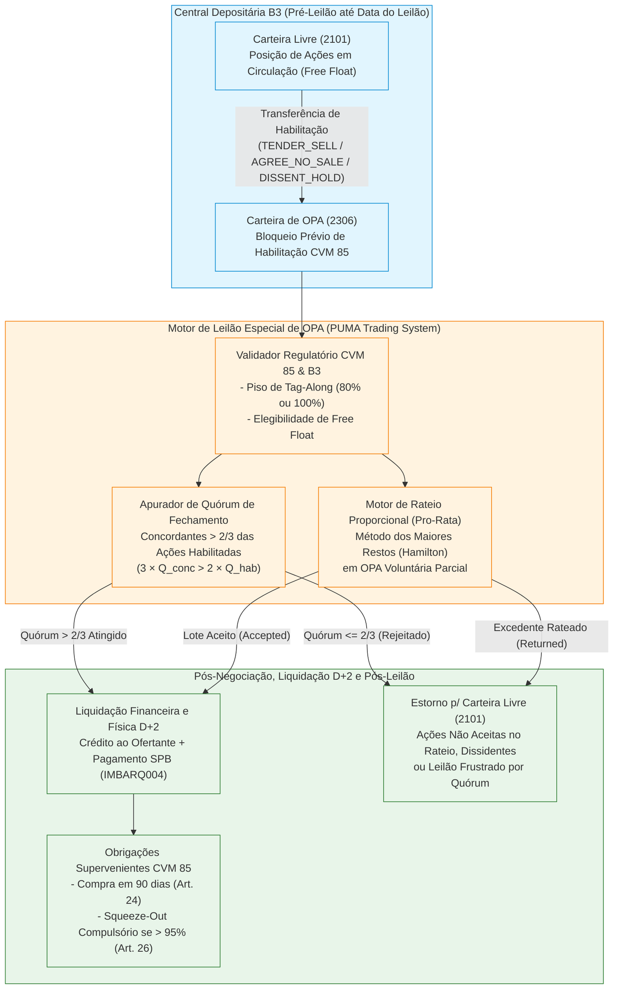

# Especificação Técnica de Leilões Especiais de OPA (Oferta Pública de Aquisição de Ações — Resolução CVM 85, Tag-Along, Quórum de Fechamento de Capital e Rateio) na B3 (FL-044)

## 1. Visão Geral e Arcabouço Regulatório (Resolução CVM 85 e Lei 6.404/1976)

As **Ofertas Públicas de Aquisição de Ações (OPA)** constituem eventos societários estruturados de compra de ações de companhias abertas em mercado organizado, disciplinados pela **Lei nº 6.404/1976 (Lei das S.A., especialmente Arts. 4º, 4º-A e 254-A)**, pela **Resolução CVM nº 85/2022** (que revogou e consolidou a histórica Instrução CVM 361/2002) e pelos **Regulamentos de Listagem dos Segmentos Especiais da B3** (*Novo Mercado*, *Nível 2*, *Nível 1*, *Bovespa Mais* e *Básico/Tradicional*).

Na infraestrutura integrada da **B3 (Brasil, Bolsa, Balcão)**, o fluxo **FL-044** modela o ciclo operacional completo de uma OPA — desde a **habilitação e bloqueio prévio das ações na Central Depositária** até a **realização do Leilão Especial no PUMA Trading System**, a **apuração determinística de quórum ou rateio proporcional (*pro-rata*)** e a **liquidação física e financeira em $D+2$**:

1. **Habilitação de Acionistas e Bloqueio em Carteira Especial de Custódia (`2306`)**: Até o horário limite fixado no Edital de OPA, os Agentes de Custódia transferem as ações dos acionistas habilitados da **Carteira Livre (`2101`)** para a **Carteira de Bloqueio de OPA (`2306`)** na Central Depositária da B3, registrando a manifestação societária do acionista:
   - **Alienar no Leilão (`TENDER_SELL`)**: Vender as ações pelo preço da OPA (o que, em OPA de fechamento de capital, também configura concordância expressa com o cancelamento de registro).
   - **Concordar sem Alienar (`AGREE_NO_SALE`)**: Manifestar concordância expressa com o cancelamento do registro de companhia aberta, porém optando por permanecer acionista da companhia.
   - **Discordar do Fechamento de Capital (`DISSENT_HOLD`)**: Habilitar as ações em circulação especificamente para votar contra o cancelamento do registro (computando no denominador do quórum do Art. 22 da Resolução CVM 85 sem alienar os papéis).
2. **Apuração de Preço Mínimo Regulatório de *Tag-Along* (Art. 254-A da Lei 6.404/76)**: Na alienação direta ou indireta de controle acionário, o adquirente do controle é obrigado a formular OPA pelas ações com direito a tag-along por preço equivalente a, no mínimo, **$80\%$** do valor pago por ação integrante do bloco de controle (ou **$100\%$** para companhias listadas no **Novo Mercado** ou **Nível 2** da B3).
3. **Apuração do Quórum Qualificado de $2/3$ para Cancelamento de Registro (Art. 4º, § 4º da Lei 6.404/76 e Art. 22 da Res. CVM 85)**: O fechamento de capital somente é homologado se acionistas titulares de **mais de $2/3$ (dois terços)** das ações em circulação habilitadas para o leilão concordarem expressamente com o cancelamento do registro ou alienarem suas ações no certame.
4. **Rateio Proporcional Determinístico em OPA Parcial (`OPA_VOLUNTARIA_PARCIAL`)**: Quando a oferta visa adquirir quantidade limitada de ações em circulação ($Q_{\text{target}}$) e a adesão dos acionistas supera o lote máximo ofertado ($Q_{\text{sell}} > Q_{\text{target}}$), o sistema executa o **rateio proporcional (*pro-rata*)** pelo Método dos Maiores Restos (Hamilton), aceitando exatamente $Q_{\text{target}}$ ações e devolvendo imediatamente o saldo excedente para a Carteira Livre (`2101`).

---

## 2. Modalidades de OPA e Segmentos de Governança Corporativa B3

### 2.1 Modalidades Regulatórias (`OpaModality`)

| Modalidade (`OpaModality`) | Base Legal (Lei 6.404/76 e Res. CVM 85) | Regra de Preço e Condição de Eficácia | Regra de Alocação / Rateio |
|---|---|---|---|
| **`OPA_FECHAMENTO_CAPITAL`** (*Cancelamento de Registro*) | Art. 4º, § 4º da Lei 6.404/76; Arts. 2º, I e 19 a 26 da Res. CVM 85 | Preço justo amparado em Laudo de Avaliação. Eficácia condicionada à concordância expressa de titulares de **mais de $2/3$** das ações em circulação habilitadas. | Sem rateio: se aprovado o quórum ($> 2/3$), $100\%$ das ordens de venda (`TENDER_SELL`) são integralmente aceitas. Se reprovado ($\le 2/3$), $0\%$ é aceito. |
| **`OPA_ALIENACAO_CONTROLE`** (*Tag-Along*) | Art. 254-A da Lei 6.404/76; Arts. 2º, III e 29 a 32 da Res. CVM 85 | Preço mínimo obrigatório de **$80\%$** (segmentos Tradicional, Nível 1 e Bovespa Mais) ou **$100\%$** (Novo Mercado e Nível 2) do preço pago por ação do bloco de controle. | Sem rateio: o ofertante adquire $100\%$ das ações habilitadas para venda (`TENDER_SELL`) pelos minoritários titulares de direito de *tag-along*. |
| **`OPA_VOLUNTARIA_PARCIAL`** (*Aquisição Parcial Voluntária*) | Art. 2º, IV e Art. 15 da Res. CVM 85 | Preço livremente fixado pelo Ofertante no Instrumento de OPA, visando adquirir até o lote máximo $Q_{\text{target}}$ (respeitado eventual lote mínimo de sucesso $Q_{\min}$). | **Sujeita a Rateio Proporcional (*Pro-Rata*)**: se $Q_{\text{sell}} > Q_{\text{target}}$, aplica-se corte proporcional exato para distribuir $Q_{\text{target}}$ entre todos os vendedores habilitados. |
| **`OPA_AUMENTO_PARTICIPACAO`** (*Aumento de Participação*) | Art. 4º, § 6º da Lei 6.404/76; Arts. 2º, II e 27 a 28 da Res. CVM 85 | Obrigatória quando o controlador adquire mais de $1/3$ das ações em circulação de uma mesma espécie e classe, restringindo a liquidez remanescente. | Aquisição integral ($100\%$) das ações habilitadas para venda pelos acionistas minoritários. |

### 2.2 Segmentos de Listagem B3 e Piso Regulatório de *Tag-Along* (`CorporateGovernanceSegment`)

| Segmento B3 (`CorporateGovernanceSegment`) | Percentual Mínimo de *Tag-Along* sobre o Bloco de Controle | Base Normativa |
|---|---|---|
| **`NOVO_MERCADO`** | **$100\%$** (`1.00`) do preço pago por ação do bloco de controle | Regulamento do Novo Mercado B3 e Art. 254-A da Lei 6.404/76 |
| **`NIVEL_2`** | **$100\%$** (`1.00`) do preço pago por ação do bloco de controle (ON e PN) | Regulamento de Listagem do Nível 2 de Governança Corporativa B3 |
| **`NIVEL_1`** | **$80\%$** (`0.80`) do preço pago por ação integrante do bloco de controle | Art. 254-A da Lei 6.404/76 e Regulamento do Nível 1 B3 |
| **`BOVESPA_MAIS`** | **$80\%$** (`0.80`) (mínimo legal; estatuto pode prever $100\%$ para ON) | Art. 254-A da Lei 6.404/76 |
| **`TRADICIONAL`** | **$80\%$** (`0.80`) do preço pago por ação com direito a voto do controle | Art. 254-A da Lei 6.404/76 |

Formalmente, em qualquer leilão de modalidade `OPA_ALIENACAO_CONTROLE`, dado o preço por ação pago aos alienantes do controle $P_{\text{ctrl}} > 0$ e o fator mínimo regulatório $\alpha_{\text{seg}} \in \{0{,}80;\, 1{,}00\}$:

$$P_{\min}^{\text{tag}} = \text{round}\left(P_{\text{ctrl}} \times \alpha_{\text{seg}},\, 2\right)$$

O motor de validação da B3 rejeita imediatamente qualquer configuração de OPA de *Tag-Along* cujo preço ofertado $P_{\text{oferta}}$ viole a inequação:

$$P_{\text{oferta}} < P_{\min}^{\text{tag}}$$

---

## 3. Regras Matemáticas de Apuração do Leilão Especial de OPA

### 3.1 Apuração Exata do Quórum de $2/3$ em `OPA_FECHAMENTO_CAPITAL` (Art. 22 da Res. CVM 85)

Para fins de verificação do quórum de cancelamento de registro de companhia aberta:
- Consideram-se **Ações em Circulação (*Free Float*)** todas as ações emitidas pela companhia, excetuadas as ações detidas pelo acionista controlador, por pessoas a ele vinculadas, por administradores da companhia e aquelas mantidas em tesouraria (Art. 3º, III da Resolução CVM 85).
- Somente integram a base de cálculo do quórum de deliberação as ações em circulação cujos titulares se **habilitaram tempestivamente** para o leilão na Central Depositária da B3 (Carteira `2306`), assumindo uma das três posições (`ShareholderOpaStance`):
  1. $Q_{\text{sell}}$ (`TENDER_SELL`): Ações habilitadas para **venda no leilão** (importam concordância expressa com o fechamento de capital).
  2. $Q_{\text{agree}}$ (`AGREE_NO_SALE`): Ações habilitadas cujos titulares **concordam expressamente** com o fechamento de capital, mas optam por não alienar suas ações no leilão.
  3. $Q_{\text{dissent}}$ (`DISSENT_HOLD`): Ações habilitadas cujos titulares manifestam **discordância expressa** quanto ao fechamento de capital (não alienam suas ações e votam contra o cancelamento).

Definindo:
- **Total de Ações Concordantes**:
  $$Q_{\text{conc}} = Q_{\text{sell}} + Q_{\text{agree}}$$
- **Total de Ações Habilitadas no Quórum (*Enabled Quorum Free Float*)**:
  $$Q_{\text{hab}} = Q_{\text{sell}} + Q_{\text{agree}} + Q_{\text{dissent}}$$

A condição legal do Art. 22, inciso II da Resolução CVM 85 exige concordância de **mais de dois terços ($> 2/3$)** das ações habilitadas. Para evitar qualquer imprecisão de dízima periódica ($0{,}6666\dots$), a verificação no motor determinístico é realizada em aritmética inteira exata:

$$\text{Quórum Aprovado} \iff Q_{\text{hab}} > 0 \quad \land \quad 3 \times Q_{\text{conc}} > 2 \times Q_{\text{hab}}$$

> [!IMPORTANT]
> Note que a desigualdade é **estrita ($> 2/3$)**. Caso $Q_{\text{hab}} = 300.000$ ações e $Q_{\text{conc}} = 200.000$ ações, tem-se exatamente $2/3$ ($3 \times 200.000 = 600.000 = 2 \times 300.000$), hipótese em que o quórum **não é atingido**. São necessárias pelo menos $200.001$ ações concordantes para homologar o fechamento de capital.

#### Efeitos Pós-Leilão de Fechamento de Capital:
1. **Quórum Atingido ($3 \times Q_{\text{conc}} > 2 \times Q_{\text{hab}}$)**:
   - Todas as ordens `TENDER_SELL` são integralmente aceitas e liquidadas em $D+2$ ($q_i^{\text{acc}} = q_i^{\text{hab}}$, $q_i^{\text{ret}} = 0$).
   - As ordens `AGREE_NO_SALE` e `DISSENT_HOLD` permanecem de titularidade dos respectivos acionistas e retornam à Carteira Livre (`2101`) ($q_i^{\text{acc}} = 0$, $q_i^{\text{ret}} = q_i^{\text{hab}}$).
   - **Obrigação Superveniente de Compra em $90$ Dias (Art. 24 da Res. CVM 85)**: O ofertante fica obrigado a adquirir, pelo prazo de **$3$ meses ($90$ dias)** contados da realização do leilão, as ações em circulação remanescentes pelo mesmo preço final da OPA atualizado pela Taxa SELIC.
   - **Resgate Compulsório / *Squeeze-Out* (Art. 4º, § 5º da Lei 6.404/76 e Art. 26 da Res. CVM 85)**: Se, após a OPA, remanescerem em circulação **menos de $5\%$ (cinco por cento)** do total de ações emitidas pela companhia ($Q_{\text{free\_float\_remanescente}} < 0{,}05 \times Q_{\text{total\_emitido}}$), a Assembleia Geral pode aprovar o resgate compulsório dessas ações pelo preço da OPA (`squeeze_out_eligible = True`).
2. **Quórum Rejeitado ($3 \times Q_{\text{conc}} \le 2 \times Q_{\text{hab}}$)**:
   - O cancelamento de registro é indeferido e o leilão não produz alienação (`status = QUORUM_REJECTED`).
   - $100\%$ das ações habilitadas ($Q_{\text{sell}}$, $Q_{\text{agree}}$ e $Q_{\text{dissent}}$) são desbloqueadas da Carteira `2306` e devolvidas à Carteira Livre `2101` ($q_i^{\text{acc}} = 0$, $q_i^{\text{ret}} = q_i^{\text{hab}}$).

---

### 3.2 Rateio Proporcional Exato em `OPA_VOLUNTARIA_PARCIAL`

Em uma OPA Voluntária Parcial destinada à aquisição de até $Q_{\text{target}}$ ações (com lote mínimo opcional de sucesso $Q_{\min} \le Q_{\text{target}}$):
1. Se $Q_{\text{sell}} < Q_{\min}$: a condição mínima de sucesso não é alcançada (`status = MIN_ACCEPTANCE_NOT_MET`), e todas as ações habilitadas são devolvidas ($q_i^{\text{acc}} = 0$, $q_i^{\text{ret}} = q_i^{\text{hab}}$).
2. Se $Q_{\min} \le Q_{\text{sell}} \le Q_{\text{target}}$: não há excesso de adesão; todas as ordens `TENDER_SELL` são atendidas em $100\%$ ($q_i^{\text{acc}} = q_i^{\text{hab}}$, $q_i^{\text{ret}} = 0$, fator de rateio $= 1{,}00000000$).
3. Se $Q_{\text{sell}} > Q_{\text{target}}$ (**Excesso de Adesão / *Oversubscription***):
   - O **Fator de Rateio (*Pro-Rata Factor*)** é definido com precisão de $8$ casas decimais por:
     $$F_{\text{rateio}} = \frac{Q_{\text{target}}}{Q_{\text{sell}}}$$
   - Para garantir que a soma das quantidades inteiras aceitas seja **exatamente igual a $Q_{\text{target}}$**, aplica-se o **Método dos Maiores Restos (Hamilton)**:
     - Cota inteira base de cada ordem de venda $i$:
       $$q_i^{\text{floor}} = \left\lfloor \frac{Q_{\text{target}} \times q_i^{\text{hab}}}{Q_{\text{sell}}} \right\rfloor$$
     - Numerador exato do resto fracionário:
       $$r_i^{\text{num}} = \left(Q_{\text{target}} \times q_i^{\text{hab}}\right) \bmod Q_{\text{sell}}$$
     - As ações residuais $U_{\text{res}} = Q_{\text{target}} - \sum_i q_i^{\text{floor}}$ (onde $0 \le U_{\text{res}} < N_{\text{sell}}$) são atribuídas, à razão de $+1$ ação por ordem, às $U_{\text{res}}$ ordens com maior resto $r_i^{\text{num}}$, desempatando deterministicamente por:
       1. Maior quantidade habilitada (`enabled_quantity DESC`);
       2. Menor carimbo de tempo de habilitação (`timestamp ASC`);
       3. Menor identificador lexicográfico da ordem (`order_id ASC`).
   - A quantidade devolvida ao acionista para a Carteira Livre (`2101`) é:
     $$q_i^{\text{ret}} = q_i^{\text{hab}} - q_i^{\text{acc}}$$

---

### 3.3 Invariante Fundamental de Conservação de Custódia

Em qualquer modalidade e sob qualquer desfecho do Leilão Especial de OPA, o motor garante o invariante estrito de conservação física de ações tanto por ordem individual quanto no agregado do leilão:

$$\forall i \in \{1, \dots, N\}: \quad q_i^{\text{acc}} + q_i^{\text{ret}} = q_i^{\text{hab}}$$

$$\sum_{i=1}^{N} q_i^{\text{acc}} + \sum_{i=1}^{N} q_i^{\text{ret}} = \sum_{i=1}^{N} q_i^{\text{hab}} = Q_{\text{hab}}$$

---

## 4. Especificação do Layout JSON de Leilões de OPA (`fixtures/opa_tender_offer_auction.json`)

### 4.1 Parâmetros de Configuração do Leilão (`OpaAuctionConfig`)

| Campo | Tipo | Obrig | Descrição |
|---|---|---|---|
| `auction_id` | String | S | Identificador único do Leilão Especial de OPA no PUMA/B3 (ex: `OPA-B3-2026-001`). |
| `company_name` | String | S | Denominação social da companhia aberta objeto da OPA. |
| `offeror_name` | String | S | Nome ou razão social do acionista controlador / ofertante adquirente. |
| `ticker` | String | S | Código de negociação do ativo objeto no PUMA (ex: `ATLS3`, `VALE3`, `SMFT3`). |
| `isin` | String | S | Código ISIN de 12 caracteres (ex: `BRATLSACNOR1`). |
| `modality` | String | S | `OPA_FECHAMENTO_CAPITAL`, `OPA_ALIENACAO_CONTROLE`, `OPA_VOLUNTARIA_PARCIAL` ou `OPA_AUMENTO_PARTICIPACAO`. |
| `governance_segment` | String | S | Segmento B3: `NOVO_MERCADO`, `NIVEL_2`, `NIVEL_1`, `BOVESPA_MAIS` ou `TRADICIONAL`. |
| `offer_price_per_share` | Decimal (Str) | S | Preço ofertado por ação no leilão de OPA (em R$). |
| `control_block_price_per_share` | Decimal (Str) | Cond | Preço pago por ação ao bloco de controle (obrigatório em `OPA_ALIENACAO_CONTROLE`). |
| `total_issued_shares` | Int | S | Total de ações emitidas pela companhia aberta. |
| `total_free_float_shares` | Int | S | Total de ações em circulação (*Free Float*) elegíveis à OPA. |
| `max_target_quantity` | Int | Cond | Lote máximo ofertado para compra (obrigatório em `OPA_VOLUNTARIA_PARCIAL`). |
| `min_acceptance_quantity` | Int | N | Lote mínimo condicionado de aceitação para sucesso da OPA parcial (default `0`). |
| `auction_date` | String (`YYYY-MM-DD`) | S | Data de realização do Leilão Especial no PUMA Trading System ($D+0$). |
| `settlement_date` | String (`YYYY-MM-DD`) | S | Data de liquidação física e financeira na Câmara B3 ($D+2$). |

### 4.2 Ordens de Habilitação de Acionistas (`ShareholderTenderOrder`)

| Campo | Tipo | Obrig | Descrição |
|---|---|---|---|
| `order_id` | String | S | Identificador único da instrução de habilitação/oferta na corretora/custodiante. |
| `shareholder_id` | String | S | CPF/CNPJ ou código de conta de depósito individualizada na Central Depositária B3. |
| `participant_code` | Int | S | Código do Agente de Custódia / Corretora participante da B3. |
| `custody_account` | String | S | Conta de custódia do investidor na B3. |
| `stance` | String | S | Posição societária: `TENDER_SELL` (Alienar), `AGREE_NO_SALE` (Concordar sem Vender) ou `DISSENT_HOLD` (Discordar do Fechamento). |
| `enabled_quantity` | Int | S | Quantidade inteira de ações bloqueadas previamente na Carteira de OPA (`2306`). |
| `blocked_in_opa_portfolio` | Bool | S | Confirmação de bloqueio prévio na carteira `2306` da Depositária B3 antes do leilão. |
| `timestamp` | ISO-8601 | S | Carimbo de tempo UTC do bloqueio/habilitação na Depositária B3. |

---

## 5. Integração Pós-Negociação B3 (SPB, IMBARQ004, IMBARQ012 e IMBARQ013)

1. **Movimentação de Custódia Pré-Leilão (`IMBARQ013`)**:
   - No período de habilitação (até as 12h00 do dia do leilão $D+0$), cada instrução válida gera uma transferência interna de carteira na Central Depositária: débito na **Carteira `2101` (Livre)** e crédito na **Carteira `2306` (Bloqueio de OPA)**.
2. **Liquidação Física e Financeira em $D+2$ (`IMBARQ004` e `LDL0001` SPB)**:
   - Para cada ordem com $q_i^{\text{acc}} > 0$, o valor financeiro bruto de liquidação é:
     $$V_i^{\text{fin}} = \text{round}\left(q_i^{\text{acc}} \times P_{\text{oferta}},\, 2\right)$$
   - O Agente Liquidante do Ofertante recolhe o montante total $\sum_i V_i^{\text{fin}}$ na janela multilateral do **SPB (`LDL0001`)** referenciada no arquivo **IMBARQ004**, enquanto os Agentes Liquidantes dos acionistas vendedores recebem os respectivos créditos líquidos.
3. **Transferência Definitiva e Estorno de Saldo Excedente (`IMBARQ012` / `IMBARQ013`)**:
   - As ações aceitas ($q_i^{\text{acc}}$) são transferidas da Carteira `2306` dos minoritários para a conta de custódia do Ofertante.
   - As ações não aceitas por rateio, pertencentes a acionistas concordantes sem venda (`AGREE_NO_SALE`), dissidentes (`DISSENT_HOLD`) ou oriundas de leilão frustrado ($q_i^{\text{ret}}$) são imediatamente desbloqueadas da Carteira `2306` de volta para a Carteira Livre `2101` dos respectivos titulares.
