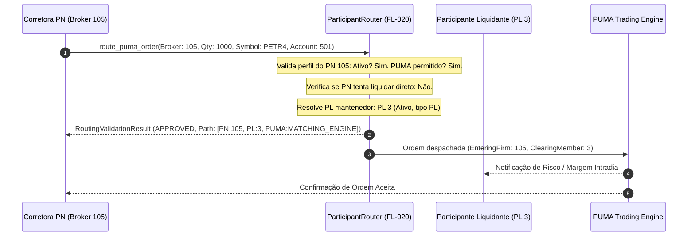
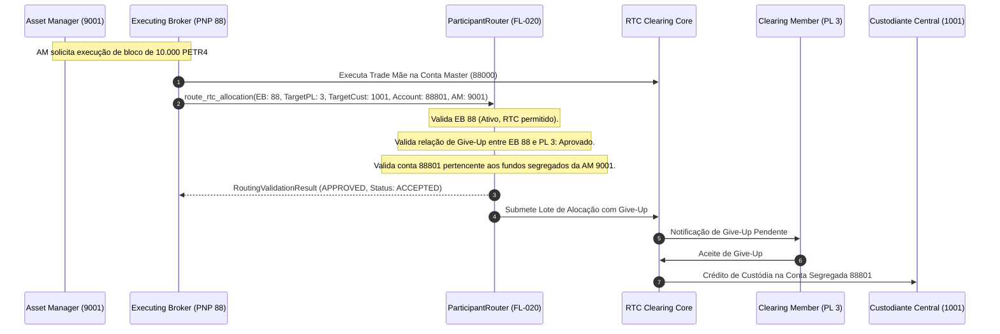

# Especificação Técnica de Governança de Participantes e Roteamento Institucional B3 (FL-020 & FL-018)

## 1. Visão Geral e Contexto de Mercado

No mercado financeiro brasileiro operado pela **B3 S.A. – Brasil, Bolsa, Balcão**, o acesso aos ambientes de negociação (**PUMA Trading System**), registro de balcão (**NoMe Balcão**) e liquidação/alocação multilar em tempo real (**RTC – Real-Time Clearing**) é rigorosamente segregado por perfis de participantes e membros de compensação.

A arquitetura do **B3 Integration Atlas** formaliza os seguintes fluxos normativos fundamentais:
* **`FL-020` — Roteamento e Segregação de Operações por Perfil de Participante (PN / PNP / PL / Custodiante / Asset Manager)**: governa a validação de permissões, resolução determinística de caminhos operacionais, segregação patrimonial entre contas master e subcontas de investimento (Instrução CVM 555 / Resolução CVM 175) e aceites formais de *Give-Up*.
* **`FL-018` — Estabelecimento e Autenticação de Sessão Segura mTLS / VPN (RCC e Conectividade B3)**: especifica a camada de segurança criptográfica (certificados digitais ICP-Brasil e-CNPJ A1/A3, CSR, mTLS e túneis IPsec redundantes sobre a Rede de Comunicação de Corretoras - RCC).

```
+---------------------------------------------------------------------------------------------------------+
|                                    ECOSSISTEMA DE PARTICIPANTES B3                                      |
+---------------------------------------------------------------------------------------------------------+
|                                                                                                         |
|   +-----------------------+           +-----------------------+           +-------------------------+   |
|   |  Asset Manager        |           |  PN (Participante     |           |  PNP (Participante      |   |
|   |  (Gestora CVM 175)    |           |  Não Liquidante)      |           |  Negociador Pleno)      |   |
|   +-----------------------+           +-----------------------+           +-------------------------+   |
|              | (Ordens via broker)                | (Negociação pura)                 | (Negociação própria/|   |
|              |                                    |                                   |  mesa institucional)|   |
|              v                                    v                                   v                 |
|   +-------------------------------------------------------------------------------------------------+   |
|   |                       MOTOR DE GOVERNANÇA E ROTEAMENTO (FL-020 / FL-018)                        |   |
|   +-------------------------------------------------------------------------------------------------+   |
|              |                                    |                                   |                 |
|              v (Give-Up / Alocação)               v (Compensação Delegada)            v                 |
|   +-------------------------------------------------------------------------------------------------+   |
|   |                                  PL (Participante Liquidante)                                   |   |
|   |                  (Clearing Member / Garantias / Acesso Direto à Câmara CCP)                     |   |
|   +-------------------------------------------------------------------------------------------------+   |
|              |                                                                        |                 |
|              v                                                                        v                 |
|   +-------------------------------------------------------+      +----------------------------------+   |
|   | Custodiante Central / Banco Depositário (CSD B3)      |      | Câmara de Compensação B3 (CCP)   |   |
|   | (Guarda escritural de contas segregadas de fundos)    |      | (Liquidação financeira SPB/STR)  |   |
|   +-------------------------------------------------------+      +----------------------------------+   |
+---------------------------------------------------------------------------------------------------------+
```

---

## 2. Matriz Canônica de Perfis de Participantes B3

Em consonância com o **Regulamento Operacional da Câmara de Compensação e Liquidação B3** e o **Manual de Acesso de Participantes** (`SRC-014`), as instituições autorizadas enquadram-se em categorias formais com obrigações e capacidades assimétricas:

### 2.1 PN — Participante Não Liquidante
* **Natureza Jurídica**: Sociedade corretora ou distribuidora de títulos e valores mobiliários (DTVM/CTVM) autorizada pelo Banco Central e CVM.
* **Capacidade de Negociação**: Habilitada a inserir ordens de compra e venda diretamente no **PUMA Trading System** e registrar operações bilaterais de balcão no **NoMe**.
* **Vedações Operacionais**: **Não possui conta de liquidação na B3** e não realiza aportes diretos de garantias financeiras nem liquidação física/financeira no Sistema de Pagamentos Brasileiro (STR/SPB).
* **Obrigatoriedade de Vínculo**: Deve obrigatoriamente contratar e manter ativo um contrato de prestação de serviços de compensação e liquidação com um **Participante Liquidante (PL)** credenciado perante a B3. Toda ordem enviada no PUMA ou registro NoMe deve apontar de forma determinística o código do PL liquidante (`clearing_member_id`).

### 2.2 PNP — Participante Negociador Pleno
* **Natureza Jurídica**: Corretora de grande porte ou banco de investimento que opera mesa proprietária e mesa de clientes institucionais.
* **Capacidade de Negociação**: Total acesso ao livro central de ofertas do **PUMA Trading System**, registro de balcão **NoMe** e barramento de alocação/repasse **RTC**.
* **Modelo de Liquidação Flexível**:
  1. *Liquidação Própria*: Se homologado como membro de compensação, liquida seus próprios negócios e de seus comitentes diretos.
  2. *Liquidação Delegada*: Pode optar por terceirizar a liquidação financeira de certas classes de ativos ou mercados a um PL terceiro especializado via acordo de repasse.

### 2.3 PL — Participante Liquidante (Clearing Member)
* **Natureza Jurídica**: Banco comercial, banco múltiplo ou grande corretora autorizada a operar como membro de compensação titular da câmara B3.
* **Prerrogativas Exclusivas**:
  * Titular de conta de reservas bancárias ou conta de liquidação no Banco Central do Brasil (STR/SELIC).
  * Acesso pleno à interface de monitoramento de risco intradiário e margem multilateral (arquivos `IMBARQ014`).
  * Liquidação de obrigações financeiras brutas e líquidas diárias da câmara (arquivos `IMBARQ004`).
  * Gestão de empréstimo de ativos e doadores/tomadores (arquivos `IMBARQ011`).
* **Responsabilidade Solidária**: Assume perante a Câmara B3 responsabilidade incondicional pela liquidação financeira e física de todos os PNs a ele vinculados e pelos negócios que aceitou via *Give-Up*.

### 2.4 Custodiante Central / Banco Custodiante
* **Natureza Jurídica**: Instituição financeira habilitada perante a CVM para o exercício da atividade de custódia qualificada (Resolução CVM 32/2021).
* **Atribuições**:
  * Abertura e manutenção das contas de custódia escritural na Central Depositária da B3 (arquivos `IMBARQ012` e `IMBARQ013`).
  * Não participa da negociação ativa em tela no PUMA (vedado envio de ordens diretas de livro).
  * Atua como recebedor final de alocações e repasses no RTC, validando o vínculo entre os negócios executados pelos brokers e as subcontas dos investidores finais.

### 2.5 Asset Manager / Gestora de Recursos
* **Natureza Jurídica**: Administradora e gestora fiduciária de carteiras de valores mobiliários devidamente registrada na CVM (Resolução CVM 21/2021).
* **Modo Operacional**:
  * Não possui conexão direta como corretora de mercado no PUMA.
  * Executa suas estratégias através de múltiplos brokers credenciados (PN ou PNP).
  * Aloca blocos executados em sua conta mãe (*Master/Omnibus Account*) desdobrando-os nas subcontas de investimento segregadas dos fundos (ex: Fundo Ações Institucional, Fundo Long Biased, Fundo Previdência), instruindo o *Give-Up* aos respectivos PLs/Custodiantes no RTC.

---

## 3. Matriz de Capacidades e Permissões por Perfil

| Perfil | Execução PUMA | Registro NoMe | Alocação RTC | Liquidação Própria | Exige PL Externo | Aceite Custódia CSD |
| :--- | :---: | :---: | :---: | :---: | :---: | :---: |
| **PN** | Sim | Sim | Sim (via PL) | **Não** | **Sim (Mandatório)** | Não |
| **PNP** | Sim | Sim | Sim | Sim (ou Delegada) | Condicional | Sim (se credenciado) |
| **PL** | Sim | Sim | Sim | **Sim** | Não (É o PL) | Sim |
| **Custodiante**| **Não** | Sim (Guarda) | Sim (Aceite) | Sim (Contas Finais) | Não | **Sim (Exclusivo)** |
| **Asset Manager**| **Não** | Não (via broker) | Sim (Instrução)| **Não** | Sim (via broker) | Não (Cliente Fundo) |

---

## 4. Regras de Roteamento e Governança de Ordens e Posições

### 4.1 Roteamento de Ordens no PUMA Trading System (Order Entry FIX 4.4 / 5.0 SP2)
Toda ordem encaminhada para o livro de ofertas da B3 deve ser validada segundo as regras:
1. **Identificação do Emissor**: O participante remetente deve estar com cadastro `active == true` e possuir `PUMA` em suas permissões de sistema.
2. **Vedação de Execução Direta**: Ordens originadas diretamente por identificadores com perfil `ASSET_MANAGER` ou `CUSTODIAN` são imediatamente rejeitadas com erro `ERR_ASSET_MANAGER_DIRECT_EXECUTION` ou `ERR_CUSTODIAN_DIRECT_EXECUTION`. A execução deve ser intermediada por PN ou PNP.
3. **Validação de Membro Liquidante para PN**:
   * O PN não pode solicitar liquidação direta (`ERR_PN_DIRECT_SETTLEMENT_PROHIBITED`).
   * A ordem deve especificar ou resolver deterministicamente o `clearing_member_id` associado.
   * O participante indicado como `clearing_member_id` DEVE possuir perfil `PL`, estar ativo e ter relação de liquidação contratual cadastrada com o PN.
4. **Resolução de Rota Determinística**:
   * Para PNP com liquidação própria: `[PNP:{id}, PL:{id}, PUMA:MATCHING_ENGINE]`.
   * Para PN com liquidação terceirizada: `[PN:{id}, PL:{pl_id}, PUMA:MATCHING_ENGINE]`.

### 4.2 Alocação e Repasse no RTC (Real-Time Clearing — FL-008 / FL-020)
1. **Segregação Patrimonial Master vs. Subcontas**:
   * O Executing Broker fecha o bloco na conta mestre do broker/gestor.
   * As instruções de alocação desdobram a quantidade para contas de investimento finais segregadas.
   * O motor valida que a conta de destino pertence à relação de contas autorizadas da gestora ou regras ativas (`ERR_UNAUTHORIZED_SEGREGATED_ACCOUNT`).
2. **Autorização de Give-Up**:
   * O repasse só é aprovado se existir uma `RoutingRule` ativa homologando a relação bilateral de *Give-Up* entre o `executing_broker_id` e o `target_clearing_member_id`.
   * Na ausência da relação formal de repasse, o lote é rejeitado com `ERR_INVALID_GIVE_UP_RELATION`.

### 4.3 Registros Bilaterais no NoMe Balcão
1. A contraparte informada deve existir, estar ativa e possuir permissão para derivativos de balcão (`NOME`).
2. Se o participante for um PN, a liquidação financeira no NoMe deve obrigatoriamente apontar a conta de liquidação do PL mantenedor.

---

## 5. Requisitos de Conectividade Segura e Credenciais (FL-018)

O acesso seguro aos ambientes de produção e homologação da B3 é regulado pela especificação de infraestrutura de conectividade (`SRC-012`):

```
+---------------------------------------------------------------------------------------------------------+
|                                    ARQUITETURA DE CONECTIVIDADE SEGURA                                  |
+---------------------------------------------------------------------------------------------------------+
|                                                                                                         |
|       +------------------------------------+                                                            |
|       | Participante (PN / PNP / PL / AM)  |                                                            |
|       +------------------------------------+                                                            |
|              |                  |                                                                       |
|              | Primário         | Secundário (Failover)                                                 |
|              v                  v                                                                       |
|       +------------------------------------+                                                            |
|       | Túneis IPsec VPN / Circuitos RCC   |  Criptografia AES-256 / IKEv2 / IP Dedicado                |
|       +------------------------------------+                                                            |
|                          |                                                                              |
|                          v                                                                              |
|       +------------------------------------+                                                            |
|       | Autenticação mTLS ICP-Brasil       |  Certificados Digitais e-CNPJ A1/A3                        |
|       | (Mutual TLS Handshake)             |  Validação Estrita de CN, SAN e Emissor B3                 |
|       +------------------------------------+                                                            |
|                          |                                                                              |
|                          v                                                                              |
|       +------------------------------------+                                                            |
|       | Gateways B3 (FIX / RTC / NoMe)     |                                                            |
|       +------------------------------------+                                                            |
+---------------------------------------------------------------------------------------------------------+
```

### 5.1 Matriz de Requisitos de Rede por Perfil

| Perfil | Circuito RCC Dedicado | Túneis IPsec Redundantes | mTLS Obrigatório | Certificado Digital |
| :--- | :---: | :---: | :---: | :---: |
| **PL** | Mandatório (2x 10Gbps/1Gbps) | Sim (Backup sobre Internet) | Sim | e-CNPJ A3 / HSM |
| **PNP** | Recomendado / Co-location | Mandatório (Primário/Secundário) | Sim | e-CNPJ A1 ou A3 |
| **PN** | Opcional (ou via Broker ASP) | Mandatório | Sim | e-CNPJ A1 |
| **Custodiante** | Mandatório | Mandatório | Sim | e-CNPJ A3 / HSM |
| **Asset Manager** | Opcional (Internet Segura B3)| Mandatório (se conexão direta) | Sim | e-CNPJ A1 |

### 5.2 Validações Criptográficas do Motor de Roteamento
* **Mutual TLS (mTLS)**: O motor valida se a requisição de conexão originou-se com certificado válido cujo `Common Name` (CN) coincide com o CN cadastrado na credencial do participante.
* **Allowlist de IP**: O tráfego de entrada deve originar-se de sub-redes previamente homologadas junto ao Comitê de Segurança da B3.
* **Rejeição Criptográfica**: Divergências de certificado ou origem não homologada disparam rejeição imediata com `ERR_CONNECTIVITY_MISMATCH`.

---

## 6. Diagramas de Sequência

### 6.1 Roteamento de Ordem Puma (PN com PL Terceiro)



### 6.2 Alocação e Give-Up RTC para Fundo de Asset Manager



---

## 7. Catálogo de Códigos de Motivo e Resolução

| Código de Erro | Severidade | Descrição Técnica | Ação Corretiva |
| :--- | :--- | :--- | :--- |
| `OK` | Informativo | Rota validada e aprovada com sucesso. | Prosseguir com despacho da ordem ou lote. |
| `ERR_PARTICIPANT_NOT_FOUND` | Crítico | Código de participante não localizado na base cadastral B3. | Cadastrar participante com perfil válido. |
| `ERR_PARTICIPANT_INACTIVE` | Crítico | Participante suspenso, cancelado ou inativo perante a B3. | Regularizar situação cadastral na B3. |
| `ERR_SYSTEM_NOT_PERMITTED` | Bloqueante | O participante não tem autorização para o sistema de destino (PUMA/RTC/NoMe). | Solicitar habilitação de módulo junto à B3. |
| `ERR_PN_DIRECT_SETTLEMENT_PROHIBITED` | Bloqueante | Participante PN tentou executar liquidação própria sem indicar PL. | Configurar clearing member PL obrigatório. |
| `ERR_MISSING_CLEARING_MEMBER` | Bloqueante | Nenhuma entidade de liquidação (PL) associada ao participante ou requisição. | Informar código de PL credenciado. |
| `ERR_CLEARING_MEMBER_NOT_PL` | Bloqueante | O código de participante informado como liquidante não possui perfil PL. | Corrigir código para membro liquidante homologado. |
| `ERR_INVALID_GIVE_UP_RELATION` | Bloqueante | Ausência de autorização bilateral de repasse (Give-Up) entre corretora e PL. | Cadastrar e aprovar regra de repasse bilateral. |
| `ERR_UNAUTHORIZED_SEGREGATED_ACCOUNT` | Bloqueante | A subconta de destino não está vinculada à gestora/fundo informado. | Associar conta de custódia à respectiva gestora. |
| `ERR_ASSET_MANAGER_DIRECT_EXECUTION` | Bloqueante | Gestora tentou enviar ordem direta ao livro de ofertas PUMA. | Rotear através de corretora executora (PN/PNP). |
| `ERR_CUSTODIAN_DIRECT_EXECUTION` | Bloqueante | Custodiante central tentou negociar diretamente no PUMA. | Operar apenas em liquidação e custódia. |
| `ERR_CONNECTIVITY_MISMATCH` | Crítico | Certificado mTLS não bate com cadastro ou IP fora da allowlist RCC. | Verificar certificado ICP-Brasil e sub-rede RCC. |
