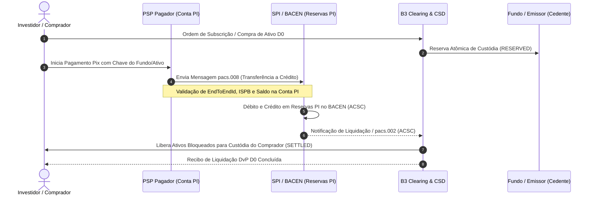

# Especificação Técnica: Liquidação Instantânea via SPI / Pix no Mercado de Capitais (FL-064)

## 1. Visão Geral e Contexto Regulatório

O advento do **Sistema de Pagamentos Instantâneos (SPI)** operado pelo **Banco Central do Brasil (Bacen)** e a regulamentação do ecossistema **Pix** revolucionaram a infraestrutura de pagamentos de varejo e atacado no Brasil. Com as **Resoluções BCB nº 1/2020** (Regulamento do Pix e do SPI) e **BCB nº 269/2022** (Evolução das regras operacionais, participantes indiretos e contas gráficas no mercado financeiro), abriu-se a via formal para a utilização da mensageria SPI na **liquidação financeira imediata em D0 de operações do mercado de capitais**.

Em sinergia com o marco regulatório de fundos da CVM (**Resolução CVM nº 175**) e as normas de registro e custódia da **B3**, o fluxo **`FL-064`** normatiza e implementa:
1. **Subscrição e integralização imediata D0 de cotas de fundos** de investimento (FII, FIDC, FIAGRO e fundos estruturados) com conciliação via chaves Pix registradas no Diretório de Identificadores de Contas Transacionais (DICT);
2. **Negociação primária e secundária D0 de títulos escriturais** (CDB, LF, Debêntures, Títulos Públicos e Privados) sob a garantia atômica de **Entrega contra Pagamento (DvP — Delivery versus Payment)**;
3. **Idempotência estrita de mensageria SPI** através do identificador unívoco `EndToEndId` (32 posições do Bacen);
4. **Conciliação bilateral entre o canal STR (Sistema de Transferência de Reservas) e o SPI**, monitorando os aportes (`STR0007`) e resgates de liquidez (`STR0008`) nas Contas Pagamentos Instantâneos (Contas PI) dos participantes liquidantes.

---

## 2. Arquitetura da Mensageria ISO 20022 no SPI

O SPI adota estritamente a sintaxe XML baseada na norma internacional **ISO 20022**. No âmbito da liquidação no mercado de capitais, o fluxo opera com duas mensagens pilares:

### 2.1. Mensagem `pacs.008.001.08` — Financial Institution Customer Credit Transfer
Responsável por transportar a ordem de transferência interbancária de liquidação instantânea entre as Contas PI dos participantes no Bacen.
- **Cabeçalho de Grupo (`GrpHdr`)**: Identificador único da mensagem (`MsgId`), carimbo de data/hora (`CreDtTm`), número de transações (`NbOfTxs = 1`), e método de liquidação (`SttlmMtd = CLRG`, `ClrSys = SPI`).
- **Informações da Transação (`CdtTrfTxInf`)**:
  - `EndToEndId`: Identificador E2E obrigatório de exatamente 32 caracteres gerado pelo PSP debitado.
  - `TxId`: Código identificador da operação de subscrição/compra.
  - `IntrBkSttlmAmt`: Valor financeiro em BRL correspondente ao produto: $\text{Quantidade} \times \text{Preço Unitário}$.
  - `Dbtr` / `DbtrAgt`: Dados do investidor e ISPB de 8 dígitos do participante debitado.
  - `Cdtr` / `CdtrAgt`: Dados do fundo/emissor e ISPB de 8 dígitos do participante creditado.
  - `RmtInf`: Metadados da transação escritural (ex.: `ASSET:HGLG11;QTY:100;PU:165.50`).

### 2.2. Mensagem `pacs.002.001.10` — Payment Status Report
Emitida pelo SPI/Bacen para reportar o resultado formal do processamento da transferência.
- `OrgnlEndToEndId`: Vinculação direta ao `EndToEndId` da mensagem `pacs.008` original.
- `TxSts`: Status regulamentar no SPI:
  - `ACSC` (*AcceptedSettlementCompleted*): Liquidação financeira finalizada com sucesso nas reservas PI do Bacen. Desencadeia a transferência imediata de titularidade na custódia da B3.
  - `RJCT` (*Rejected*): Rejeição pelo SPI (motivos: `AM04` saldo insuficiente na Conta PI, `DS04` ordem duplicada, `AB03` expiração de prazo de liquidação). Aciona o **Rollback Atômico** imediato, restituindo a custódia reservada ao vendedor e estornando qualquer retenção financeira.
  - `ACTC` (*AcceptedTechnicalValidation*): Mensagem validada sintaticamente e aceita pelo motor.

---

## 3. Estrutura do EndToEndId (Padrão BACEN 32 Caracteres)

Conforme manual do SPI, o `EndToEndId` é rigorosamente estruturado em 32 posições alfanuméricas:

| Posição | Tamanho | Conteúdo | Descrição |
|---|---|---|---|
| `[0]` | 1 | `E` | Prefixo fixo para transferências padrão Pix / SPI. |
| `[1..8]` | 8 | ISPB Pagador | Código ISPB de 8 dígitos numéricos da instituição liquidante pagadora. |
| `[9..20]` | 12 | `YYYYMMDDHHMM` | Timestamp UTC do momento de geração da ordem no PSP. |
| `[21..31]` | 11 | Alfanumérico | Sequencial aleatório ou determinístico único (`[a-zA-Z0-9]{11}`). |

---

## 4. Garantia de Idempotência Estrita no SPI

A comunicação em mensageria crítica de liquidação exige resiliência contra retransmissões de rede e duplicidade de chamadas:
1. O motor mantém registro transacional indexado por `EndToEndId`.
2. Caso uma mensagem `pacs.008` com `EndToEndId` já processado seja retransmitida ao motor, este executa a **deduplicação idempotente imediata**:
   - Não efetua novos débitos nem créditos nas Contas PI;
   - Não gera nova entrega de ativos na conta de custódia do comprador;
   - Retorna o recibo da liquidação original acompanhado do sinalizador formal `idempotent_replay = True`.
3. Essa garantia preserva a inviolabilidade patrimonial e elimina risco de duplicidade de cotas ou títulos.

---

## 5. Reconciliação do Canal STR x SPI (Contas PI)

As instituições financeiras participantes diretas do SPI mantêm no Banco Central uma **Conta Pagamentos Instantâneos (Conta PI)**, alimentada e equilibrada diariamente a partir de suas **Contas Reservas Bancárias** via canal **STR**:
- **`STR0007` (Aporte de Liquidez)**: Transferência de recursos da Conta Reservas Bancárias para a Conta PI no SPI.
- **`STR0008` (Nivelamento / Resgate)**: Transferência de excesso de recursos da Conta PI de volta para a Conta Reservas Bancárias no STR ao final da sessão diária.

### Equação de Conservação do Canal STR
Ao fechamento do ciclo, o motor executa o batimento determinístico:

$$\text{Saldo Final Real} \equiv \text{Saldo Inicial} + \sum \text{Aportes STR0007} - \sum \text{Resgates STR0008} - \sum \text{Débitos SPI}_{\text{ACSC}} + \sum \text{Créditos SPI}_{\text{ACSC}}$$

A divergência contábil ($\text{Discrepância}$) deve ser estritamente zero:

$$\Delta = \text{Saldo Final Real} - \text{Saldo Calculado} \equiv 0{,}00$$

---

## 6. Leis Formais de Conservação e Invariantes Provadas

1. **Lei de Conservação Financeira Multilateral**:
   $$\sum_{i} \Delta \text{Saldo PI}_i = 0 \implies \sum \text{Débitos Executados} = \sum \text{Créditos Recebidos}$$
   Nenhum centavo é gerado ou suprimido no processo de liquidação.

2. **Lei de Conservação de Custódia Escritural**:
   Para qualquer cota ou título escritural $A$:
   $$Q_{\text{Total}}(A) = \sum_{c \in \text{Contas}} Q_{\text{Disponível}}(c, A) + \sum_{c \in \text{Contas}} Q_{\text{Reservada}}(c, A)$$
   A transferência de titularidade entre cedente e cessionário preserva rigorosamente o estoque de títulos em circulação.

3. **Invariante de Preço e Volume Financeiro**:
   $$\text{Valor Financeiro do } pacs.008 = \text{Quantidade} \times \text{Preço Unitário (PU)}$$

4. **Atomicidade DvP D0 (Zero Risco de Principal)**:
   $$\text{Titularidade Transferida} \iff \text{Status SPI} = \text{ACSC}$$
   $$\text{Status SPI} = \text{RJCT} \implies \text{Rollback Total (Custódia Restaurada e Fundos Liberados)}$$

---

## 7. Estrutura de Artefatos no Atlas B3

- **Módulo Python**: `src/pix_spi_settlement.py`
- **Fixture Canônica Sintética**: `fixtures/pix_spi_settlement.json`
- **Bateria de Testes**: `tests/test_pix_spi_settlement.py`
- **Documento de Layout**: `docs/layout-pix-spi-settlement.md`
