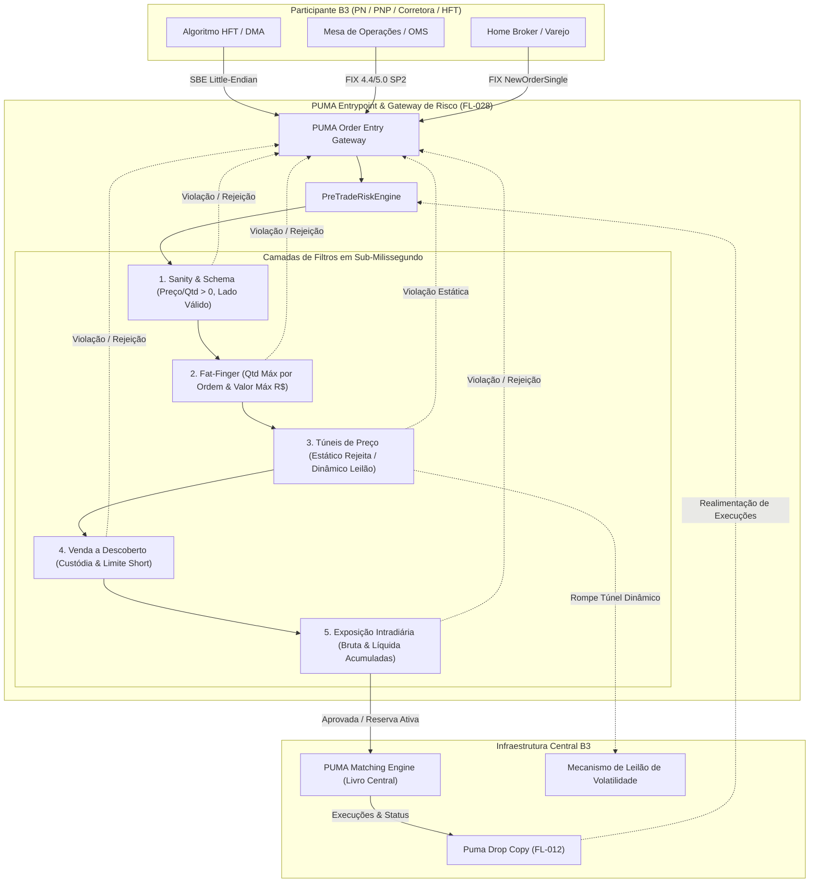

# Especificação Técnica de Risco Pré-Trading e Gestão de Limites Operacionais PUMA (FL-028)

## 1. Visão Geral e Arquitetura do Gateway de Risco

No ecossistema de negociação da B3 (Brasil, Bolsa, Balcão), a integridade dos livros de ofertas (*order books*) e a solidez patrimonial dos participantes de mercado dependem da validação rigorosa de ordens antes que qualquer oferta atinja o motor de emparelhamento (*Matching Engine*). O fluxo de **Risco Pré-Trading (Pre-Trade Risk Management - FL-028)** atua como barreira mandatória interceptando ofertas submetidas via protocolos **FIX (4.4 e 5.0 SP2)** e binário **SBE (*Simple Binary Encoding*)**.

O módulo opera em **sub-milissegundo (*low-latency hot path*)**, executando checagens determinísticas em memória sem dependências externas ou I/O bloqueante na camada de avaliação direta.

### 1.1 Posicionamento do Gateway de Risco no PUMA Trading System



---

## 2. Prevenção de Fat-Finger (*Fat-Finger Controls*)

Erros operacionais de digitação ou divergências de parâmetros de algoritmos (conhecidos como incidentes de *fat-finger*) representam risco sistêmico de desestabilização de preços e insolvência intradiária. O motor de risco B3 implementa dois controles rígidos no nível individual de cada ordem:

### 2.1 Limite Máximo de Quantidade por Ordem (`max_order_qty`)

Cada perfil operacional define a quantidade máxima de contratos, cotas ou ações permitida em uma única ordem de compra ou venda (`NewOrderSingle` ou substituição `OrderCancelReplace`).

$$\text{Ordem Válida} \iff \text{OrderQty} \le \text{max\_order\_qty}$$

- **Violação**: Rejeição imediata com código de motivo `MAX_ORDER_QUANTITY_EXCEEDED`.
- **Ação**: A ordem não é enfileirada no livro de ofertas; é retornado um reject ao remetente com a quantidade rejeitada e o limite autorizado da conta.

### 2.2 Limite Máximo de Valor Financeiro por Ordem (`max_order_value`)

Impede que ordens com quantidades permitidas, porém aplicadas a instrumentos com alto valor unitário (ex.: contratos cheios de índice/dólar ou ações de valor expressivo), gerem compromisso financeiro desmedido em um único disparo.

$$\text{Valor da Ordem} = \text{OrderQty} \times \text{Price}$$
$$\text{Ordem Válida} \iff \text{Valor da Ordem} \le \text{max\_order\_value}$$

- **Violação**: Rejeição imediata com código de motivo `MAX_ORDER_VALUE_EXCEEDED`.

---

## 3. Túneis de Preço (*Price Bands*)

A B3 adota uma política de proteção contra discrepâncias severas de cotação dividida em duas bandas complementares: o **Túnel Estático** e o **Túnel Dinâmico**.

### 3.1 Túnel Estático (*Static Band*) — Rejeição Dura

O túnel estático é calibrado sobre um preço de referência fixo do dia, denominado **Preço de Referência do Túnel Estático** ($P_{\text{ref}}$) — geralmente a cotação de ajuste do pregão anterior, o preço de fechamento ou o preço de abertura do leilão regular:

$$L_{\text{estático, inferior}} = P_{\text{ref}} \times (1 - \Delta_{\text{estático, inferior}})$$
$$L_{\text{estático, superior}} = P_{\text{ref}} \times (1 + \Delta_{\text{estático, superior}})$$

- **Condição de Aceite**:
  $$L_{\text{estático, inferior}} \le \text{Price} \le L_{\text{estático, superior}}$$
- **Comportamento em Violação**:
  - Rejeição mandatória da ordem com código `FAT_FINGER_PRICE_OUT_OF_BANDS`.
  - Nenhuma ordem com preço fora do túnel estático pode ingressar no sistema PUMA sob nenhuma circunstância.

### 3.2 Túnel Dinâmico (*Dynamic Band*) — Acionamento de Leilão

O túnel dinâmico é uma banda mais estreita (ex.: $\pm 2\%$ a $\pm 4\%$) calculada sobre o **Preço de Referência Dinâmico** ($P_{\text{dinâmico}}$) — tipicamente o último preço negociado no livro (*Last Traded Price - LTP*) ou o preço médio das melhores ofertas (*Mid-Price*):

$$L_{\text{dinâmico, inferior}} = P_{\text{dinâmico}} \times (1 - \Delta_{\text{dinâmico, inferior}})$$
$$L_{\text{dinâmico, superior}} = P_{\text{dinâmico}} \times (1 + \Delta_{\text{dinâmico, superior}})$$

- **Condição de Fluxo Contínuo**:
  $$L_{\text{dinâmico, inferior}} \le \text{Price} \le L_{\text{dinâmico, superior}}$$
- **Comportamento em Violação**:
  - Se a ordem estiver fora do túnel dinâmico, mas contida no túnel estático, ela rompe o intervalo de negociação contínua.
  - Conforme a regulamentação do PUMA Trading System, esse rompimento suspende o casamento contínuo do ativo e **dispara o Leilão de Volatilidade (*Volatility Auction*)**.
  - O status retornado pelo motor é `AUCTION_TRIGGERED` com código `PRICE_TRIGGERED_DYNAMIC_AUCTION`, sinalizando ao gateway que a ordem iniciou a fase de leilão ou que deve ser retida conforme política da corretora.

### 3.3 Matriz de Decisão de Túneis de Preço

| Cenário de Preço | Comparativo Túnel Estático | Comparativo Túnel Dinâmico | Status de Risco | Código de Motivo | Ação Operacional |
|---|---|---|---|---|---|
| **Cenário A** | Dentro do intervalo | Dentro do intervalo | `APPROVED` | `APPROVED` | Enfileiramento regular no book |
| **Cenário B** | Dentro do intervalo | Fora do intervalo | `AUCTION_TRIGGERED` | `PRICE_TRIGGERED_DYNAMIC_AUCTION` | Disparo de Leilão de Volatilidade B3 |
| **Cenário C** | Fora do intervalo (inferior) | Fora do intervalo | `REJECTED` | `FAT_FINGER_PRICE_OUT_OF_BANDS` | Rejeição imediata da ordem |
| **Cenário D** | Fora do intervalo (superior) | Fora do intervalo | `REJECTED` | `FAT_FINGER_PRICE_OUT_OF_BANDS` | Rejeição imediata da ordem |

---

## 4. Gestão de Limites de Exposição Intradiária por Conta / Mesa

Além do controle pontual por ordem, o motor supervisiona a evolução patrimonial acumulada ao longo do pregão, considerando execuções passadas e compromissos abertos (*working orders*).

### 4.1 Limite Financeiro Bruto (*Gross Exposure Limit*)

O limite bruto protege contra algoritmos em loop ou desbalanceamento em cascata, mensurando a soma de todos os fluxos financeiros gerados ou propostos no dia:

$$\text{Exposição Bruta} = \sum |V_{\text{compras executadas}}| + \sum |V_{\text{vendas executadas}}| + \sum |V_{\text{ordens compra ativas}}| + \sum |V_{\text{ordens venda ativas}}|$$

Ao submeter nova ordem de valor $V_{\text{ordem}} = \text{OrderQty} \times \text{Price}$:

$$\text{Exposição Bruta Projetada} = \text{Exposição Bruta Atual} + V_{\text{ordem}}$$
$$\text{Aprovação} \iff \text{Exposição Bruta Projetada} \le \text{max\_gross\_exposure}$$

- **Violação**: Rejeição imediata com código `GROSS_EXPOSURE_LIMIT_EXCEEDED`.

### 4.2 Limite Financeiro Líquido (*Net Exposure Limit*)

O limite líquido monitora o risco direcional da conta, garantindo que o saldo patrimonial aberto (comprado vs. vendido) permaneça dentro da margem de garantia alocada na câmara:

$$\text{Exposição Líquida Atual} = \left(\sum V_{\text{compras exec}} - \sum V_{\text{vendas exec}}\right) + \left(\sum V_{\text{comp pend}} - \sum V_{\text{vend pend}}\right)$$

Ao submeter nova ordem:
- Se ordem de **Compra**: $\text{Exposição Líquida Projetada} = \text{Exposição Líquida Atual} + V_{\text{ordem}}$
- Se ordem de **Venda**: $\text{Exposição Líquida Projetada} = \text{Exposição Líquida Atual} - V_{\text{ordem}}$

$$\text{Aprovação} \iff |\text{Exposição Líquida Projetada}| \le \text{max\_net\_exposure}$$

- **Violação**: Rejeição imediata com código `NET_EXPOSURE_LIMIT_EXCEEDED`.

### 4.3 Controle de Venda a Descoberto (*Short-Selling Check*)

Na B3, contas sem contrato formal de aluguel de ativos (BTC - Banco de Títulos CBLC / IMBARQ011) ou sem autorização explícita da corretora não podem submeter ordens de venda desprovidas de custódia física disponível (venda a descoberto nua / *naked short selling*).

Para qualquer ordem de **Venda (`Side = 2 / SELL`)**:

$$\text{Posição em Custódia} = \text{Posição Física Inicial} + \text{Compras Executadas} - \text{Vendas Executadas}$$
$$\text{Posição Disponível para Nova Venda} = \text{Posição em Custódia} - \text{Vendas Pendentes no Book}$$

1. **Conta sem Permissão de Short (`allow_short_selling = False`)**:
   $$\text{Ordem Válida} \iff \text{OrderQty} \le \text{Posição Disponível para Nova Venda}$$
   - Caso $\text{OrderQty} > \text{Posição Disponível}$, a ordem é sumariamente rejeitada com `SHORT_SELLING_RESTRICTED`.

2. **Conta Institucional com Permissão de Short (`allow_short_selling = True`)**:
   - A venda pode exceder a posição física coberta, desde que a posição vendida projetada respeite o teto de aluguel/descoberto parametrizado (`max_short_position`):
   $$\text{Descoberto Projetado} = \max(0, \text{Vendas Totais Projetadas} - \text{Custódia})$$
   $$\text{Ordem Válida} \iff \text{Descoberto Projetado} \le \text{max\_short\_position}$$
   - Caso ultrapasse: rejeição com `SHORT_SELLING_LIMIT_EXCEEDED`.

---

## 5. Modelagem de Dados e Integração dos Protocolos

### 5.1 Estrutura de Configuração do Perfil de Risco (`RiskLimitProfile`)

```json
{
  "account": "88001",
  "name": "Conta HFT Institucional Market Maker - Alpha Desk",
  "desk_id": "MESA_HFT_01",
  "participant_id": 88,
  "max_order_qty": 50000,
  "max_order_value": 5000000.0,
  "max_gross_exposure": 50000000.0,
  "max_net_exposure": 20000000.0,
  "allow_short_selling": true,
  "max_short_position": 200000,
  "active": true
}
```

### 5.2 Estrutura do Túnel de Preços (`PriceBandConfig`)

```json
{
  "symbol": "PETR4",
  "reference_price": 36.50,
  "static_lower_limit": 32.85,
  "static_upper_limit": 40.15,
  "dynamic_reference_price": 36.50,
  "dynamic_lower_limit": 35.405,
  "dynamic_upper_limit": 37.595,
  "auction_on_dynamic_breach": true
}
```

### 5.3 Resposta Formal de Validação (`RiskValidationResult`)

Toda chamada de validação ao `PreTradeRiskEngine` retorna um objeto imutável estruturado:

| Campo | Tipo | Descrição |
|---|---|---|
| `status` | `RiskValidationStatus` | `APPROVED`, `REJECTED` ou `AUCTION_TRIGGERED`. |
| `is_approved` | `bool` | Indicador booleano direto de prosseguimento da ordem. |
| `reason_code` | `RiskReasonCode` | Código mnemônico formal do motivo de aprovação/rejeição. |
| `message` | `str` | Mensagem explicativa para logs de auditoria e FIX Tag 58 (Text). |
| `account` | `str` | Conta do comitente avaliado. |
| `symbol` | `str` | Ticker do ativo avaliado. |
| `side` | `str` | Lado da operação (`1`=Buy, `2`=Sell). |
| `order_qty` | `int` | Quantidade da ordem avaliada. |
| `price` | `float` | Preço unitário da ordem. |
| `order_value` | `float` | Valor financeiro total calculado (`order_qty * price`). |
| `cl_ord_id` | `Optional[str]` | Identificador unívoco do cliente (Tag 11 no FIX / SBE ClOrdID). |
| `latency_micros` | `float` | Tempo decorrido de processamento no motor em microssegundos. |
| `current_gross_exposure`| `float` | Exposição bruta total após a reserva da ordem (se aprovada). |
| `current_net_exposure` | `float` | Exposição líquida total após a reserva da ordem (se aprovada). |
| `current_position` | `int` | Posição física em custódia do ativo para a conta. |
| `details` | `Dict[str, Any]` | Detalhes contextuais adicionais (limites configurados, deltas). |

---

## 6. Integração Nativa FIX e SBE

O `PreTradeRiskEngine` disponibiliza métodos de alta conveniência e compatibilidade direta:

1. **`validate_order(...)`**: Ponto de entrada canônico aceitando strings, inteiros ou enums.
2. **`validate_fix_order(msg: FixMessage)`**: Extrai automaticamente as tags padrão FIX (1, 11, 38, 44, 54, 55).
3. **`validate_sbe_order(msg: NewOrderSingleBinary, symbol_map: Optional[Dict[int, str]])`**: Converte os campos binários da struct Little-Endian (SecurityID, ClOrdID, PriceScaled, OrderQty, Account) e valida o risco em sub-milissegundo.
4. **Ciclo de Vida de Reservas**:
   - `auto_reserve = True`: Ao aprovar uma ordem, reserva automaticamente o valor financeiro e a quantidade no livro de ordens ativas (*working orders*).
   - `record_fill(...)`: Transforma a ordem pendente em execução real, ajustando a posição em custódia e desfazendo a reserva de trabalho.
   - `record_cancel(...)`: Libera a reserva pendente caso a ordem seja cancelada antes da execução.
   - `record_reject(...)`: Libera a reserva caso o PUMA Matching Engine rejeite por outro motivo.

---

## 7. Catálogo Canônico de Códigos de Motivo de Risco

| Código (`RiskReasonCode`) | Status | Descrição Operacional B3 |
|---|---|---|
| `APPROVED` | `APPROVED` | Ordem aprovada em todos os filtros de risco pré-trading. |
| `FAT_FINGER_PRICE_OUT_OF_BANDS` | `REJECTED` | Preço da ordem excede os limites do Túnel Estático (rejeição mandatória). |
| `PRICE_TRIGGERED_DYNAMIC_AUCTION` | `AUCTION_TRIGGERED` / `REJECTED` | Preço da ordem rompe o Túnel Dinâmico, disparando Leilão de Volatilidade. |
| `MAX_ORDER_QUANTITY_EXCEEDED` | `REJECTED` | Quantidade da ordem superior ao limite máximo por ordem parametrizado. |
| `MAX_ORDER_VALUE_EXCEEDED` | `REJECTED` | Valor financeiro da ordem excede o limite máximo permitido por ordem. |
| `GROSS_EXPOSURE_LIMIT_EXCEEDED` | `REJECTED` | Exposição financeira bruta intradiária acumulada ultrapassa o limite da conta. |
| `NET_EXPOSURE_LIMIT_EXCEEDED` | `REJECTED` | Exposição financeira líquida intradiária acumulada ultrapassa o limite da conta. |
| `SHORT_SELLING_RESTRICTED` | `REJECTED` | Venda a descoberto não autorizada para o perfil cadastral do comitente. |
| `SHORT_SELLING_LIMIT_EXCEEDED` | `REJECTED` | Posição vendida a descoberto projetada ultrapassa o teto autorizado. |
| `PROFILE_NOT_FOUND` | `REJECTED` | Conta/comitente não possui perfil de risco pré-trading cadastrado. |
| `PROFILE_INACTIVE` | `REJECTED` | Perfil de limites de risco da conta encontra-se suspenso ou inativo. |
| `PRICE_BAND_NOT_FOUND` | `REJECTED` | Túnel de preços não localizado para o instrumento negociado. |
| `INVALID_ORDER_PARAMETERS` | `REJECTED` | Quantidade ou preço menores ou iguais a zero, ou lado inválido. |
