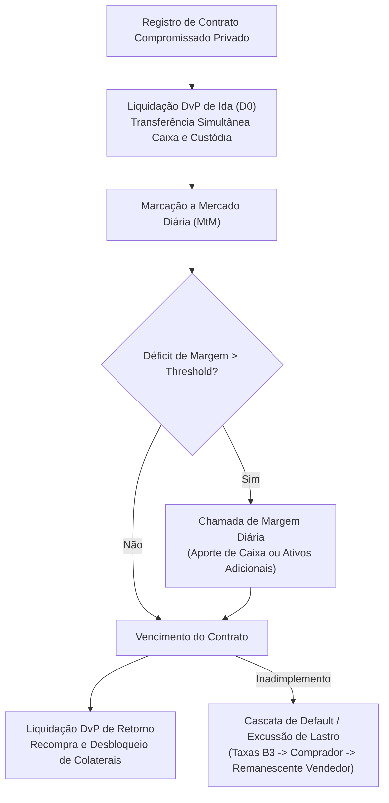

# Especificação Técnica de Operações Compromissadas com Títulos Privados no Balcão NoMe B3 (FL-079)

## 1. Visão Geral e Arcabouço Regulatório

O fluxo **FL-079** implementa o registro, marcação a mercado, chamada diária de margem e liquidação DvP de **Operações Compromissadas com Lastro em Títulos Privados** (Debêntures simples e incentivadas, Letras Financeiras - LF, Certificados de Recebíveis Imobiliários - CRI e Certificados de Recebíveis do Agronegócio - CRA) no **Balcão NoMe B3**.

Fundamentação regulatória:
- **Resolução CMN nº 4.706/2018**: Critérios de reconhecimento, mensuração contábil e risco de operações compromissadas;
- **Instrução CVM nº 476/2009 e Resolução CVM nº 160/2022**: Negociação secundária de valores mobiliários de renda fixa;
- **Manual de Operações do NoMe Balcão B3**: Mecânica de liquidação DvP, gestão de garantias e excussão de títulos em default.

---

## 2. Ciclo de Vida e Matriz Regulatória de Haircuts

A B3 aplica uma matriz tridimensional de sobretaxas combinadas (*haircuts*) por **Rating de Crédito**, **Prazo Residual do Título** e **Tipologia do Ativo**:

$$\text{Haircut} = \text{Haircut}_{\text{rating}} + \text{Haircut}_{\text{tenor}} + \text{Haircut}_{\text{tipo}}, \quad \text{com } 2\% \le \text{Haircut} \le 50\%$$

---

## 3. Invariantes Formais

- **Conservação DvP Estrita**: $\Delta\text{Caixa}_{\text{Comprador}} + \Delta\text{Caixa}_{\text{Vendedor}} == 0,00$.
- **Paridade de Recompra**: $\text{Preço Recompra} == \text{round\_cents}(\text{Preço Venda} \cdot \text{Fator Remuneração})$.
- **Monotonicidade da Matriz de Haircuts**: Risco crescente implica corte de valor estritamente não-decrescente.
- **Conservação do Waterfall de Excussão Judicial**: $\text{Recursos Brutos} == \text{Taxas B3} + \text{Pago ao Comprador} + \text{Devolvido ao Vendedor}$.
