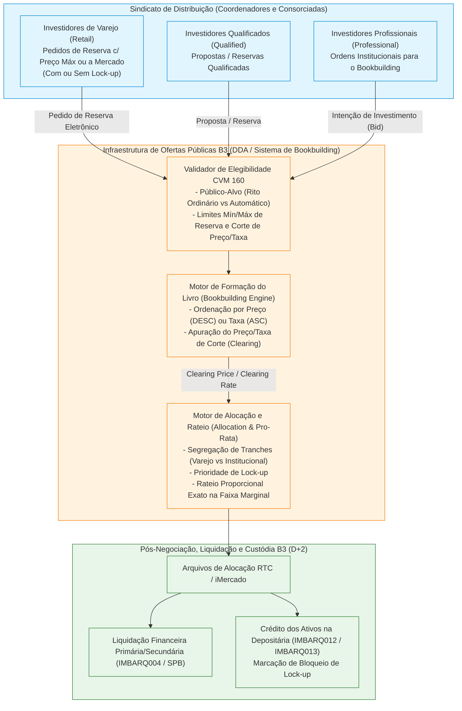

# Especificação Técnica de Ofertas Públicas (Resolução CVM 160), Reserva Eletrônica, Bookbuilding e Rateio na B3 (FL-033)

## 1. Visão Geral e Contexto Regulatório (Resolução CVM 160/2022)

A **Resolução CVM nº 160**, editada em 13 de julho de 2022 e em vigor desde 2 de janeiro de 2023, unificou e modernizou o arcabouço regulatório das **Ofertas Públicas de Distribuição Primária e Secundária de Valores Mobiliários** no Brasil, revogando as históricas Instruções CVM 400 (ofertas registradas tradicionais) e CVM 476 (ofertas com esforços restritos).

Na infraestrutura de mercado da **B3 (Brasil, Bolsa, Balcão)**, o fluxo **FL-033** materializa o processamento eletrônico de ponta a ponta das ofertas públicas (Ações em *IPO* e *Follow-On*, Cotas de Fundos Fechados como FII/FI-Infra/FIDC, Debêntures Simples e Incentivadas sob a Lei 12.431/14, CRI e CRA), compreendendo:

1. **Coleta Eletrônica de Intenções de Investimento e Pedidos de Reserva**: Recepção estruturada das propostas de investidores de **Varejo (*Retail*)**, **Investidores Qualificados (*Qualified*)** e **Investidores Profissionais / Institucionais (*Professional*)** através dos participantes consorciados (Coordenador Líder, Sindicato de Coordenadores e Corretoras Consorciadas).
2. **Procedimento de *Bookbuilding* (Coleta de Intenções e Precificação)**: Formação do livro de demanda sob leilão de preço único (*Uniform-Price Dutch Auction*), seja por **Preço por Ação/Cota (R$)** — onde a demanda é ordenada de forma decrescente de preço máximo — seja por **Taxa/Spread de Remuneração (% a.a. ou bps)** em emissões de renda fixa/crédito privado — onde a demanda é ordenada de forma crescente de taxa mínima exigida.
3. **Alocação por Tranches, Prioridade de *Lock-up* e Rateio Proporcional (*Pro-Rata*)**: Segregação entre a **Oferta Não Institucional (Varejo)** e a **Oferta Institucional**, aplicação de critérios objetivos de desempate/prioridade (como adesão a acordos de restrição de venda ou *lock-up* voluntário) e rateio proporcional exato na faixa marginal (*clearing price/rate*) ou na tranche de varejo em caso de excesso de demanda (*oversubscription*), garantindo estrita conservação da quantidade ofertada sem alocações fracionárias indevidas.

---

## 2. Classificação de Investidores e Ritos da Resolução CVM 160

A Resolução CVM 160 estrutura os ritos de registro (**Rito de Registro Automático** vs **Rito de Registro Ordinário**) em função do emissor (EGEM, Emissor Frequente de Renda Fixa — EFRF, emissor em fase pré-operacional), do valor mobiliário e do **público-alvo destinatário**:

| Categoria (`InvestorCategory`) | Base Regulatória (Res. CVM 30 / CVM 160) | Definição e Elegibilidade em Ofertas Públicas | Papel no *Bookbuilding* e Alocação |
|---|---|---|---|
| **`PROFESSIONAL`** (*Investidor Profissional*) | Art. 11 da Resolução CVM 30 | Instituições financeiras, seguradoras, fundos de investimento, entidades de previdência, investidores não residentes e PF/PJ com investimentos financeiros $> \text{R\$ } 10.000.000,00$. | Participa diretamente da formação do preço/taxa no *Bookbuilding* institucional; elegível a todas as ofertas (incluindo rito automático restrito exclusivamente a profissionais). |
| **`QUALIFIED`** (*Investidor Qualificado*) | Art. 12 da Resolução CVM 30 | Investidores profissionais, PF/PJ com investimentos financeiros $> \text{R\$ } 1.000.000,00$ e certificações aprovadas pela CVM. | Elegível a ofertas destinadas a investidores qualificados e ao público geral; pode participar do livro institucional ou de sub-tranches dedicadas conforme escritura/prospecto. |
| **`RETAIL`** (*Investidor de Varejo / Público em Geral*) | Público investidor não enquadrado como profissional ou qualificado | Pessoas físicas e jurídicas que acessam ofertas registradas com prospecto e lâmina (público geral). | Submete **Pedidos de Reserva** na Tranche Não Institucional (usualmente $10\%$ a $20\%$ da oferta), podendo estipular preço máximo ou aderir a *lock-up* prioritário. |

---

## 3. Modalidades de Ofertas e Regimes de Cotação (`OfferingType`)

O motor de *Bookbuilding* da B3 suporta duas naturezas matemáticas distintas para formação do livro e determinação do corte (*Clearing*):

### 3.1 Ofertas Cotadas por Preço Unitário (`PRICE` — *Maior Preço Vence*)
Aplicável a ofertas de renda variável e fundos listados onde o emissor/vendedor busca maximizar o preço de emissão/venda por unidade (ou onde o preço unitário varia dentro de uma faixa indicativa $\left[P_{\min}, P_{\max}\right]$):
- **`IPO`** (*Initial Public Offering* — Oferta Pública Inicial de Ações Primária/Secundária).
- **`FOLLOW_ON`** (Oferta Subsequente de Ações / *Units*).
- **`FII_QUOTA`** (Emissão de Cotas de Fundos de Investimento Imobiliário ou FI-Infra cotados por preço de subscrição).
- **Regra de Elegibilidade ao Corte ($P_{\text{cut}}$)**: Uma proposta com preço máximo estipulado $P_{\text{bid}}$ permanece no livro se, e somente se:
  $$P_{\text{bid}} \ge P_{\text{cut}}$$
  *(Pedidos de varejo "a mercado", representados com limite nulo ou no teto da faixa, aceitam qualquer $P_{\text{cut}}$ fixado pelos coordenadores dentro dos parâmetros da oferta).*

### 3.2 Ofertas Cotadas por Taxa ou Spread (`RATE` — *Menor Taxa Vence*)
Aplicável a emissões primárias de títulos de dívida corporativa e securitização (onde o Valor Nominal Unitário / PU Par é fixo, ex: $\text{R\$ } 1.000,00$, e o certame define a taxa máxima de remuneração do papel — ex: $\text{IPCA} + X\%\text{ a.a.}$, $\text{DI} + Y\%\text{ a.a.}$ ou $\% \text{ do DI}$):
- **`DEBENTURE_INCENTIVADA`** (Debêntures de Infraestrutura — Lei 12.431/2011 e Lei 14.801/2024).
- **`CRI`** (Certificados de Recebíveis Imobiliários).
- **`CRA`** (Certificados de Recebíveis do Agronegócio).
- **Regra de Elegibilidade ao Corte ($R_{\text{cut}}$)**: Uma proposta com taxa mínima exigida $R_{\text{bid}}$ permanece no livro se, e somente se, o investidor aceitar receber uma remuneração igual ou menor que a taxa teto final de emissão:
  $$R_{\text{bid}} \le R_{\text{cut}}$$

---

## 4. Algoritmo Determinístico de *Bookbuilding*, Preço de Equilíbrio e Rateio

### 4.1 Ordenação Canônica das Propostas no Livro
Para apurar a curva de demanda acumulada e determinar o preço ou taxa de equilíbrio (*Dutch Auction Clearing*), todas as intenções de investimento válidas são ordenadas segundo a hierarquia determinística:

1. **Competitividade de Preço/Taxa**:
   - Em ofertas por **Preço (`PRICE`)**: Ordem **decrescente** de preço limite ($P_{\text{bid}}$ maior tem prioridade; ofertas sem preço limite / a mercado assumem prioridade máxima de preço no topo da curva).
   - Em ofertas por **Taxa (`RATE`)**: Ordem **crescente** de taxa mínima exigida ($R_{\text{bid}}$ menor tem prioridade, pois representa menor custo de captação para o emissor).
2. **Compromisso de *Lock-up* (`lockup_days DESC`)**:
   - Investidores que aceitam restrição contratual de negociação secundária por maior prazo (ex: 90 dias ou 180 dias após o início de negociação na B3) possuem prioridade de alocação sobre propostas de mesmo nível de preço/taxa sem *lock-up*.
3. **Prioridade Temporal e Identificador Determinístico (`timestamp ASC`, `bid_id ASC`)**:
   - Empates remanescentes na ordenação são resolvidos por ordem cronológica de recepção (`timestamp`) e, por fim, pelo identificador lexicográfico da proposta (`bid_id`).

### 4.2 Determinação do Preço ou Taxa de Corte (*Clearing Price / Rate*)
Dado um lote total ofertado $Q_{\text{target}}$ (podendo incluir lote adicional / *hot issue* e lote suplementar / *greenshoe* conforme configuração da oferta):
1. Percorre-se a lista ordenada de propostas elegíveis acumulando a quantidade demandada:
   $$Q_{\text{cum}}(k) = \sum_{i=1}^{k} q_i$$
2. **Caso de Excesso de Demanda ou Demanda Exata ($Q_{\text{cum}}(N) \ge Q_{\text{target}}$)**:
   - O índice crítico $k^*$ é o menor índice tal que $Q_{\text{cum}}(k^*) \ge Q_{\text{target}}$.
   - O **Preço de Corte ($P_{\text{cut}}$)** ou **Taxa de Corte ($R_{\text{cut}}$)** é exatamente o valor ofertado pela proposta marginal $k^*$:
     $$V_{\text{cut}} = V_{\text{bid}}(k^*)$$
3. **Caso de Sub-subscrição ($Q_{\text{cum}}(N) < Q_{\text{target}}$)**:
   - Se a demanda total válida for inferior ao lote ofertado, todas as propostas elegíveis são integralmente atendidas e o preço/taxa de equilíbrio recai sobre a última proposta válida atendida (ou piso/teto da oferta).

### 4.3 Regra de Alocação em Tranches, Prioridade de *Lock-up* e Rateio Proporcional Exato
Uma vez apurado o valor de corte $V_{\text{cut}}$:
1. **Exclusão Fora do Corte (*Cut-off Rejection*)**:
   - Toda proposta com $P_{\text{bid}} < P_{\text{cut}}$ (em ofertas por preço) ou $R_{\text{bid}} > R_{\text{cut}}$ (em ofertas por taxa) recebe alocação **zero** (`allocated_quantity = 0`, `status = CUTOFF_EXCLUDED`).
2. **Atendimento Integral Inframarginal (*In-the-Money / Better than Clearing*)**:
   - Propostas estritamente melhores que o corte ($P_{\text{bid}} > P_{\text{cut}}$ ou $R_{\text{bid}} < R_{\text{cut}}$) são integralmente atendidas (`allocated_quantity = quantity`), desde que haja saldo disponível na oferta/tranche.
3. **Prioridade de *Lock-up* e Faixa Marginal ($V_{\text{bid}} = V_{\text{cut}}$)**:
   - Se a demanda acumulada até o nível de corte exceder $Q_{\text{target}}$, as propostas situadas na faixa marginal (ou dentro da mesma sub-tranche de varejo/institucional sujeita a rateio) são agrupadas por escalão de prioridade de *lock-up* (se ativado na oferta) ou rateadas proporcionalmente.
   - Dentro do grupo marginal sujeito a rateio, seja $Q_{\text{rem}}$ o saldo de ativos disponível para distribuição entre as propostas marginais $M$, cuja demanda somada é $D_M = \sum_{j \in M} q_j > Q_{\text{rem}}$.
4. **Rateio Proporcional Exato em Inteiros (Método dos Maiores Restos / Hamilton)**:
   - Cada proposta $j \in M$ tem direito teórico exato em `Decimal`:
     $$q_j^{\text{exact}} = Q_{\text{rem}} \times \frac{q_j}{D_M}$$
   - Atribui-se inicialmente a parte inteira truncada:
     $$q_j^{\text{floor}} = \lfloor q_j^{\text{exact}} \rfloor, \quad r_j = q_j^{\text{exact}} - q_j^{\text{floor}}$$
   - As unidades residuais $U_{\text{res}} = Q_{\text{rem}} - \sum_{j \in M} q_j^{\text{floor}}$ (onde $0 \le U_{\text{res}} < |M|$) são distribuídas, $1$ unidade por proposta, para as $U_{\text{res}}$ propostas com **maior parte fracionária $r_j$** (desempatando por maior `lockup_days`, maior `quantity`, menor `timestamp` e menor `bid_id`), garantindo que jamais nenhuma proposta receba mais do que pediu ($q_j^{\text{alloc}} \le q_j$) e que:
     $$\sum_{i=1}^{N} q_i^{\text{alloc}} = \min\left(Q_{\text{target}}, \sum_{i \in \text{Elegíveis}} q_i\right)$$

---

## 5. Estrutura do Payload de Reserva e Bookbuilding (`fixtures/bookbuilding_cvm160_bids.json`)

O intercâmbio eletrônico de reservas e ordens de *bookbuilding* entre as corretoras/coordenadores e o motor da B3 é representado em JSON canônico com a seguinte estrutura:

| Campo | Escopo | Tipo | Obrig | Descrição |
|---|---|---|---|---|
| `offering_id` | Raiz | String | S | Código identificador único da oferta pública na B3 (ex: `OFR-CVM160-2026-001`). |
| `issuer_name` | Raiz | String | S | Razão social ou nome de pregão do emissor. |
| `ticker` | Raiz | String | S | Código de negociação do ativo/reserva (ex: `ATLS3`, `ATLS11`, `ATLS-DEB1`). |
| `isin` | Raiz | String | S | Código ISIN internacional de 12 caracteres (ex: `BRATLSACNOR1`). |
| `offering_type` | Raiz | String | S | Modalidade: `IPO`, `FOLLOW_ON`, `DEBENTURE_INCENTIVADA`, `CRI`, `CRA`, `FII_QUOTA`. |
| `cvm_rite` | Raiz | String | S | Rito CVM 160: `ORDINARY` (Ordinário) ou `AUTOMATIC` (Automático). |
| `total_offered_quantity` | Raiz | Int | S | Quantidade total de valores mobiliários ofertados na distribuição base/total. |
| `min_price_or_rate` | Raiz | Decimal (Str) | S | Piso da faixa indicativa de preço (R$) ou taxa mínima (% a.a.). |
| `max_price_or_rate` | Raiz | Decimal (Str) | S | Teto da faixa indicativa de preço (R$) ou taxa teto (% a.a.). |
| `retail_tranche_pct` | Raiz | Decimal (Str) | N | Percentual reservado prioritariamente para a tranche Não Institucional / Varejo (ex: `"0.20"`). |
| `lockup_priority_enabled` | Raiz | Bool | N | Indica se propostas com compromisso de *lock-up* têm prioridade sobre propostas sem *lock-up* no corte. |
| `bids[].bid_id` | Item (`bids`) | String | S | Identificador único do pedido de reserva ou intenção institucional. |
| `bids[].investor_id` | Item (`bids`) | String | S | Documento ou código de conta de custódia do investidor na B3. |
| `bids[].participant_id` | Item (`bids`) | Int | S | Código do participante B3 (Corretora / Coordenador). |
| `bids[].investor_category` | Item (`bids`) | String | S | `PROFESSIONAL`, `QUALIFIED` ou `RETAIL`. |
| `bids[].quantity` | Item (`bids`) | Int | S | Quantidade solicitada de ativos (inteiro positivo). |
| `bids[].limit_price_or_rate` | Item (`bids`) | Decimal (Str) | S | Preço máximo aceito (R$) ou taxa mínima exigida (% a.a.). |
| `bids[].lockup_days` | Item (`bids`) | Int | N | Prazo de *lock-up* aceito pelo investidor em dias corridos (default `0`). |
| `bids[].timestamp` | Item (`bids`) | ISO-8601 | S | Carimbo de tempo UTC da recepção da ordem/reserva. |

---

## 6. Integração com Pós-Negociação B3 (RTC, SPB e Depositária)

Após o encerramento do *Bookbuilding* e homologação do resultado pelo Coordenador Líder junto à B3 e à CVM:
1. **Geração das Alocações (`AllocationOutcome`)**: Cada reserva/proposta contemplada ($q_i^{\text{alloc}} > 0$) gera um registro de alocação definitivo pelo **Preço ou PU/Taxa Único de Corte (`clearing_price_or_rate`)**, independentemente de o investidor ter submetido preço limite superior (corte holandês uniforme).
2. **Liquidação Financeira em $D+2$ (FL-002 / FL-027)**: Os valores financeiros líquidos ($\text{Quantidade Alocada} \times \text{Preço de Corte}$) são lançados nos demonstrativos **IMBARQ004** dos agentes de custódia/liquidantes e liquidados via janela multilateral no **SPB/STR (`LDL0001`)**.
3. **Custódia e Bloqueio de *Lock-up* (FL-010 / FL-013)**: Os ativos são creditados nas contas de depósito individualizadas dos investidores (**IMBARQ012** / **IMBARQ013**). Para alocações oriundas de reservas/propostas com `lockup_days > 0`, a Central Depositária da B3 aplica automaticamente o bloqueio de negociação pelo prazo pactuado.
