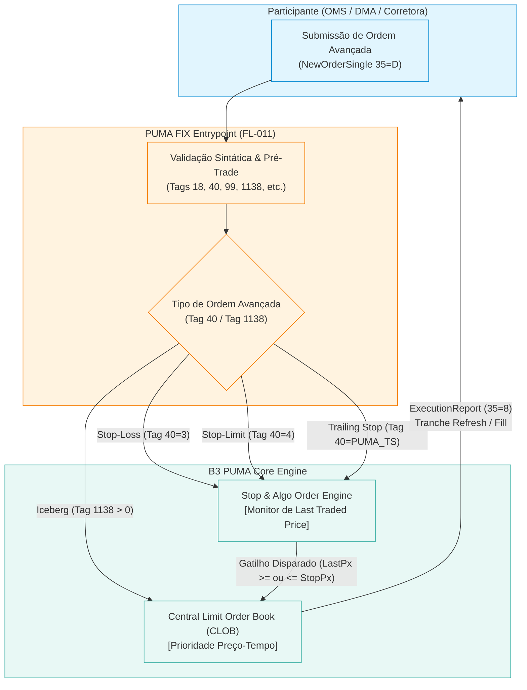
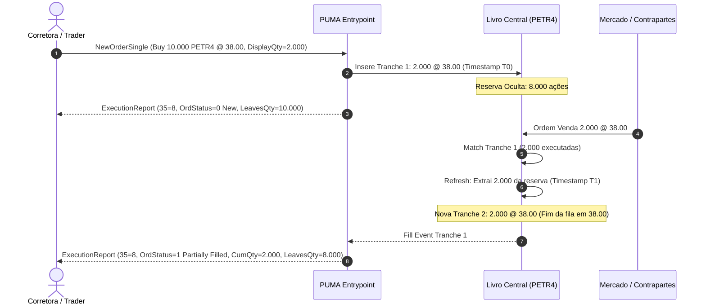
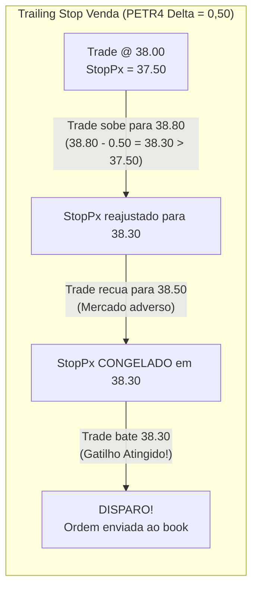

# Especificação Técnica de Ordens Avançadas e Algorítmicas no PUMA Trading System — B3 (FL-056)

## 1. Visão Geral e Arquitetura de Ordens Avançadas no PUMA Trading System

O **PUMA Trading System** da B3 (Brasil, Bolsa, Balcão) provê suporte nativo e algorítmico a tipos especiais de ordens no motor de negociação (*Matching Engine*), permitindo que participantes de mercado (corretoras, formadores de mercado, investidores institucionais e plataformas DMA) executem estratégias complexas de mitigação de impacto de mercado (*market impact*), proteção de capital e gestão de risco automatizada.

O fluxo **FL-056** define as regras formais de validação, roteamento via **PUMA FIX Entrypoint** (FIX 4.4 / FIX 5.0 SP2), gestão de estado no livro central de ofertas (*Central Limit Order Book - CLOB*), ciclo de vida de tranches, gatilhos de preço de mercado e conservação de quantidades para quatro categorias de ordens avançadas:

1. **Ordem Iceberg (Reserva Oculta / *Hidden Reserve Order*)**: Exposição fracionada no livro de ofertas via Tag 1138 `DisplayQty`. Apenas a tranche visível é anunciada aos participantes de mercado (Market Data UMDF). À medida que a tranche ativa é consumida, o motor promove automaticamente a próxima tranche da reserva oculta para o livro, atribuindo-lhe nova prioridade temporal (*time priority loss*).
2. **Ordem Stop-Loss (Gatilho a Mercado / *Stop Market*)**: Permanece em estado dormente no livro de gatilhos (*Stop Order Book*) até que o preço do último negócio (*Last Traded Price*) atinja ou ultrapasse o `StopPx` (Tag 99). Uma vez disparada, converte-se imediatamente em ordem a mercado (`OrdType=1`).
3. **Ordem Stop-Limit (Gatilho Limitado / *Stop Limit*)**: Permanece em espera até que o gatilho `StopPx` seja acionado. Ao ser disparada, insere no livro central uma ordem limitada com preço estipulado em `Price` (Tag 44).
4. **Ordem Trailing Stop (Gatilho Móvel / *Trailing Stop*)**: Ordem de proteção dinâmica cujo `StopPx` é recalculado em tempo real acompanhando os movimentos favoráveis do mercado por uma distância parametrizada (*Trail Amount / Delta*). Quando o mercado recua, o `StopPx` permanece congelado (*ratchet lock*); se o recuo atingir o nível congelado, o gatilho dispara.

---

## 2. Especificação Canônica das Mensagens FIX (FIX 4.4 / B3 Entrypoint)

As ordens avançadas utilizam extensões e campos padronizados do protocolo FIX 4.4 adaptados para o PUMA Trading System.

### 2.1 Tags Mandatórias para Ordens Avançadas

| Tag FIX | Nome do Campo | Tipo de Dado | Descrição no Contexto de Ordens Avançadas |
| :--- | :--- | :--- | :--- |
| **11** | `ClOrdID` | String | Identificador único da ordem atribuído pelo participante. |
| **37** | `OrderID` | String | Identificador único da ordem gerado pelo PUMA. |
| **40** | `OrdType` | Char/String | Tipo da ordem: `1`=Market, `2`=Limit, `3`=Stop (Stop-Loss), `4`=Stop-Limit, `T`=Trailing Stop. |
| **54** | `Side` | Char | Direção: `1`=Buy (Compra), `2`=Sell (Venda). |
| **38** | `OrderQty` | Int/Decimal | Quantidade total da ordem (*Total Quantity*). |
| **44** | `Price` | Price | Preço limite (obrigatório para Limit, Iceberg e Stop-Limit). |
| **99** | `StopPx` | Price | Preço de gatilho para ordens Stop-Loss, Stop-Limit e Trailing-Stop. |
| **18** | `ExecInst` | MultipleValueString | Instruções de execução (ex: `f`=Participate don't initiate, `V`=Reserve Order). |
| **1138** | `DisplayQty` | Int/Decimal | Quantidade visível inicial e de renovação no book (Ordem Iceberg). Equivalente ao Tag 111 `MaxFloor`. |
| **840** | `PegDifference` | Price/Offset | Distância de trailing (*Trail Amount / Delta*) em ordens Trailing Stop. |
| **14** | `CumQty` | Int/Decimal | Quantidade cumulativa já executada. |
| **151** | `LeavesQty` | Int/Decimal | Quantidade remanescente a ser executada no total. |
| **39** | `OrdStatus` | Char | `0`=New, `1`=Partially Filled, `2`=Filled, `4`=Cancelled, `8`=Rejected. |

---

## 3. Dinâmica Detalhada por Tipo de Ordem

### 3.1 Ordem Iceberg (Reserva Oculta)

A ordem Iceberg destina-se à execução de grandes lotes sem revelar a dimensão total da ordem ao mercado, minimizando a pressão contrária nos preços.

#### 3.1.1 Parâmetros e Regras de Validação
- `OrderQty` ($Q_{tot}$): Quantidade total a ser executada (ex: 10.000 ações de PETR4).
- `DisplayQty` ($Q_{disp}$): Quantidade da tranche visível inicial e de reposição (ex: 2.000 ações). Deve satisfazer:
  $$1 \le Q_{disp} \le Q_{tot}$$
  Caso $Q_{disp} = Q_{tot}$, a ordem comporta-se como uma ordem limitada convencional.
- `Price` ($P$): Preço limite da ordem.

#### 3.1.2 Ciclo de Vida e Renovação de Tranches (*Refresh*)
1. **Inserção Inicial**: O motor de negociação aloca $Q_{disp}$ no livro central de ofertas com carimbo temporal $T_0$. A quantidade oculta em reserva é:
   $$Q_{hidden} = Q_{tot} - Q_{disp}$$
2. **Execução Parcial da Tranche**: Se ocorrer match de $q < Q_{disp}$, a quantidade visível remanescente torna-se $Q_{disp} - q$. A prioridade temporal no nível de preço é mantida.
3. **Esgotamento da Tranche Visível**: Quando a quantidade visível chega a zero:
   - Se $Q_{hidden} > 0$: O motor extrai da reserva oculta uma nova tranche de tamanho:
     $$Q_{next} = \min(Q_{disp}, Q_{hidden})$$
   - A nova tranche é inserida no livro central com um **novo carimbo temporal** ($T_1 > T_0$). Isso significa que a nova tranche vai para o final da fila de prioridade temporal daquele nível de preço (*time priority reset*).
   - A quantidade oculta remanescente é atualizada:
     $$Q_{hidden}' = Q_{hidden} - Q_{next}$$
   - Emite-se um `ExecutionReport` com status `OrdStatus=1` (Partially Filled) e atualização de `LeavesQty`.
4. **Esgotamento Total**: Quando $Q_{hidden} = 0$ e a última tranche visível é totalmente executada, a ordem atinge `OrdStatus=2` (Filled).

---

### 3.2 Ordem Stop-Loss (Gatilho a Mercado)

A ordem Stop-Loss visa estancar prejuízos em posições abertas ou disparar entradas em rompimentos (*breakouts*). Ela não reside no livro público enquanto não for acionada.

#### 3.2.1 Regra de Disparo
O motor monitora o preço do último negócio ($P_{last}$):
- **Venda (Sell Stop)**: Protege posição comprada. Dispara quando:
  $$P_{last} \le StopPx$$
- **Compra (Buy Stop)**: Protege posição vendida ou entrada em rompimento de alta. Dispara quando:
  $$P_{last} \ge StopPx$$

#### 3.2.2 Transição de Estado e Execução
- Antes do disparo: Estado `PENDING_TRIGGER`. A ordem não tem visibilidade no book e não consome margem intradiária de oferta no livro.
- No momento do disparo: Transiciona para `TRIGGERED` e imediatamente gera uma ordem de mercado (`OrdType=1`) enviada ao livro central para consumir liquidez disponível contra o melhor preço oposto.

---

### 3.3 Ordem Stop-Limit (Gatilho Limitado)

A ordem Stop-Limit combina um gatilho de ativação (`StopPx`) com uma restrição de preço máximo/mínimo de execução (`Price`). Evita execuções a preços desfavoráveis em mercados ilíquidos ou com gaps severos.

#### 3.3.1 Regra de Disparo
- **Venda (Sell Stop-Limit)**: Dispara quando $P_{last} \le StopPx$. Ao disparar, submete ao CLOB uma ordem limitada de venda com `Price` $\le StopPx$ (ex: $StopPx = 37.50$, $Price = 37.40$).
- **Compra (Buy Stop-Limit)**: Dispara quando $P_{last} \ge StopPx$. Ao disparar, submete ao CLOB uma ordem limitada de compra com `Price` $\ge StopPx$ (ex: $StopPx = 38.50$, $Price = 38.60$).

#### 3.3.2 Comportamento Pós-Disparo
Uma vez no livro central, a ordem atua como uma ordem limitada ordinária:
- Se houver contrapartes elegíveis no preço limite ou melhor, ela é executada imediatamente (parcial ou totalmente).
- O saldo não executado repousa no livro de ofertas no nível de preço `Price`, com prioridade temporal baseada no instante exato de sua ativação ($T_{trigger}$).

---

### 3.4 Ordem Trailing Stop (Gatilho Móvel Dinâmico)

O Trailing Stop acompanha a evolução favorável das cotações em tempo real, travando lucros e reduzindo o risco à medida que a tendência avança.

#### 3.4.1 Algoritmo de Ajuste Dinâmico (*Ratchet Algorithm*)

Considere uma ordem com distância de acompanhamento (*Trail Amount*) $\Delta > 0$ e preço de gatilho inicial $StopPx_0$:

- **Trailing Stop de Venda (Proteção de Posição Comprada)**:
  1. Para cada novo negócio com preço $P_{trade}$:
  2. Se o mercado avança favoravelmente ($P_{trade}$ sobe) tal que:
     $$P_{trade} - \Delta > StopPx_{current}$$
     O gatilho avança:
     $$StopPx_{new} = P_{trade} - \Delta$$
  3. Se o mercado recua ou fica estável ($P_{trade} - \Delta \le StopPx_{current}$):
     O gatilho permanece **inalterado** (congelado no topo atingido).
  4. Disparo: Ocorre quando $P_{trade} \le StopPx_{current}$.

- **Trailing Stop de Compra (Proteção de Posição Vendida)**:
  1. Para cada novo negócio com preço $P_{trade}$:
  2. Se o mercado avança favoravelmente ($P_{trade}$ cai) tal que:
     $$P_{trade} + \Delta < StopPx_{current}$$
     O gatilho avança para baixo:
     $$StopPx_{new} = P_{trade} + \Delta$$
  3. Se o mercado sobe ou fica estável:
     O gatilho permanece inalterado.
  4. Disparo: Ocorre quando $P_{trade} \ge StopPx_{current}$.

---

## 4. Invariantes Formais de Conservação no PUMA

Em todas as fases do processamento de ordens avançadas no PUMA Trading System, aplicam-se leis estritas de conservação de lotes e estados financeiros:

### 4.1 Invariante Fundamental da Ordem Iceberg
A qualquer instante $t$, para uma ordem Iceberg com quantidade inicial $Q_{tot}$:
$$\text{Quantidade\_Executada}(t) + \text{Quantidade\_Visível\_Ativa}(t) + \text{Quantidade\_Oculta\_Restante}(t) \equiv \text{Quantidade\_Total}$$

No fechamento de cada tranche e ao final da ordem:
$$\text{Quantidade\_Executada} + \text{Quantidade\_Oculta\_Restante} = \text{Quantidade\_Total}$$

### 4.2 Invariante de Prioridade Temporal
Cada renovação (*refresh*) de tranche visível acarreta **perda de prioridade temporal**. Para duas ordens $A$ e $B$ no mesmo nível de preço $P$, se a tranche $k$ da ordem Iceberg $A$ é inserida no instante $t_{A,k} > t_B$, a ordem $B$ tem prioridade de execução sobre $A$, mesmo que a ordem mãe de $A$ tenha chegado ao PUMA antes de $B$.

### 4.3 Invariante de Monotonicidade do Gatilho Trailing Stop
- Para Venda: O preço de stop $StopPx(t)$ é **monotonamente não-decrescente**:
  $$t_2 > t_1 \implies StopPx(t_2) \ge StopPx(t_1)$$
- Para Compra: O preço de stop $StopPx(t)$ é **monotonamente não-crescente**:
  $$t_2 > t_1 \implies StopPx(t_2) \le StopPx(t_1)$$

---

## 5. Matriz de Estados e Transições

| Estado (`OrderTriggerStatus`) | Descrição |
| :--- | :--- |
| `PENDING_TRIGGER` | Ordem condicional (Stop, Stop-Limit, Trailing Stop) aguardando condição de mercado. |
| `ACTIVE` | Ordem presente no livro de ofertas (Iceberg ou Stop após disparo). |
| `TRIGGERED` | Gatilho atingido; ordem em transição imediata para o livro central. |
| `PARTIALLY_FILLED` | Uma ou mais tranches executadas, mas ainda com saldo a executar. |
| `FILLED` | Quantidade total ($Q_{tot}$) 100% executada no mercado. |
| `CANCELLED` | Ordem cancelada pelo participante antes do esgotamento total. |
| `REJECTED` | Ordem rejeitada na validação de risco ou parâmetros inválidos. |
