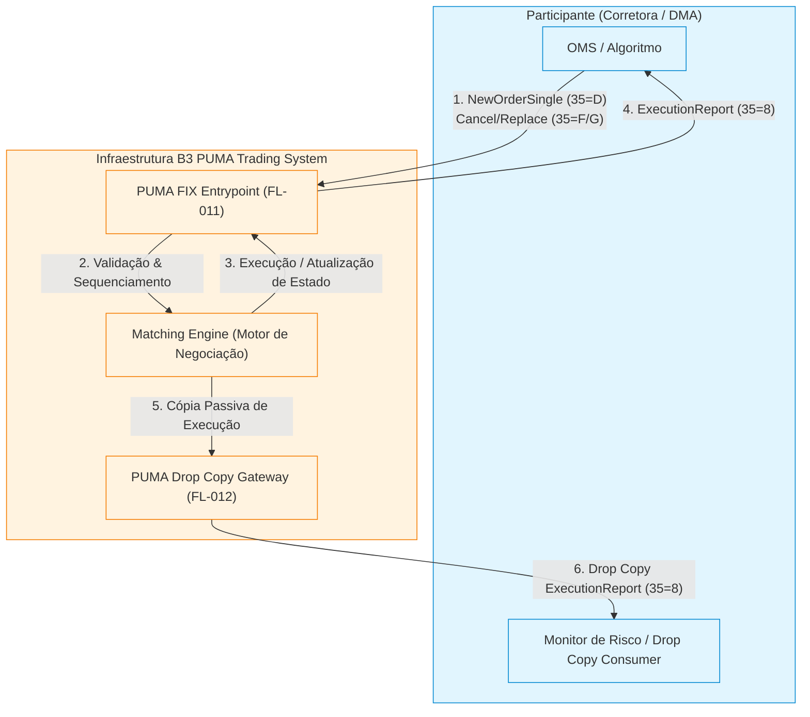

# Especificação Técnica do Protocolo PUMA FIX e Drop Copy — B3 PUMA Trading System

## 1. Visão Geral e Arquitetura de Negociação B3

O **PUMA Trading System** é a plataforma unificada de negociação de alta performance e baixa latência da B3 (Brasil, Bolsa, Balcão), responsável pelo matching de ordens e formação de preços nos mercados de renda variável (ações, BDRs, ETFs, fundos imobiliários), opções, derivativos financeiros e de commodities.

A conectividade de negociação com a B3 é estruturada em dois canais essenciais:
1. **Puma Entrypoint (Order Entry — FL-011)**: Conexão interativa e bidirecional baseada no protocolo **Financial Information eXchange (FIX)** (versões FIX 4.4 e FIXT 1.1 / FIX 5.0 SP2), utilizada pelas instituições participantes (corretoras, distribuidoras e clientes autorizados DMA) para submissão, modificação e cancelamento de ordens em tempo real.
2. **Drop Copy (FL-012)**: Fluxo passivo, assíncrono e resiliente de replicação de mensagens de execução (`ExecutionReport` — `MsgType=8` e `OrderCancelReject` — `MsgType=9`). É utilizado por sistemas de monitoramento de risco intradiário, compliance, middle-office e back-office para consolidação de custódia e controle de limites operacionais.



---

## 2. Anatomia e Codificação das Mensagens FIX na B3

Todas as mensagens FIX transmitidas no PUMA Entrypoint seguem a estrutura de campos delimitados no formato `Tag=Valor<SOH>`, onde `<SOH>` é o caractere ASCII `0x01` (*Start of Heading*). Na documentação e em logs legíveis, o caractere `<SOH>` é habitualmente representado por `|` (pipe).

### 2.1 Estrutura Canônica da Mensagem

Uma mensagem FIX é composta estritamente por três blocos sequenciais:
1. **Standard Header**: Inicia obrigatoriamente com a Tag `8` (`BeginString`), seguida pela Tag `9` (`BodyLength`) e Tag `35` (`MsgType`).
2. **Message Body**: Contém os campos de negócio ou sessão específicos de cada tipo de mensagem.
3. **Standard Trailer**: Finaliza obrigatoriamente com a Tag `10` (`CheckSum`).

```
+-----------------------------------+------------------------------------------+--------------------+
|          Standard Header          |               Message Body               |  Standard Trailer  |
| 8=FIX.4.4 | 9=Length | 35=Type... | Tag1=Val | Tag2=Val | ... | TagN=Val     | 10=CheckSum (3dig) |
+-----------------------------------+------------------------------------------+--------------------+
```

### 2.2 Cálculo Rigoroso do BodyLength (Tag 9)

O campo `BodyLength` (Tag 9) representa o número exato de bytes transmitidos no corpo da mensagem, iniciando **imediatamente após o delimitador `<SOH>` do campo `9`** e terminando **no delimitador `<SOH>` anterior à Tag `10`** (inclusive).

$$\text{BodyLength} = \sum_{k \notin \{8, 9, 10\}} \text{len}(\text{Tag}_k = \text{Valor}_k\text{<SOH>})$$

> [!IMPORTANT]
> A Tag `8` (`BeginString`), a própria Tag `9` (`BodyLength`) e a Tag `10` (`CheckSum`) **não entram** na contagem do `BodyLength`.

### 2.3 Cálculo Rigoroso do CheckSum (Tag 10)

O `CheckSum` (Tag 10) é um inteiro de 3 dígitos (preenchido com zeros à esquerda, ex.: `042`, `108`, `255`), calculado pela soma dos valores ordinais ASCII de todos os bytes da mensagem desde o primeiro byte da Tag `8` até o caractere delimitador `<SOH>` imediatamente anterior à Tag `10`, submetido à operação módulo 256.

$$\text{CheckSum} = \left( \sum_{i=0}^{N-1} \text{byte}_i \right) \pmod{256}$$

O pacote final é encerrado com: `10={CheckSum:03d}<SOH>`.

---

## 3. Mensagens de Sessão e Gestão de Sequenciamento

A camada de sessão FIX garante entrega ordenada, integridade de mensagens e detecção imediata de quebra de conexão ou dessincronização de sequência (`MsgSeqNum` — Tag 34).

### 3.1 Dicionário de Mensagens de Sessão

| MsgType (35) | Nome da Mensagem | Direção | Finalidade / Regra de Negócio |
|:---:|---|:---:|---|
| `A` | **Logon** | Bi-direcional | Autentica a sessão, define o intervalo de heartbeat e sincroniza os números de sequência (`MsgSeqNum`). Deve ser a primeira mensagem transmitida. |
| `0` | **Heartbeat** | Bi-direcional | Monitora a integridade da conexão durante períodos de inatividade. Responde obrigatoriamente a um `TestRequest`. |
| `1` | **TestRequest** | Bi-direcional | Solicita confirmação de presença do par quando o intervalo de inatividade ultrapassa `HeartBtInt + 1s`. Exige resposta imediata com Heartbeat portando o mesmo `TestReqID` (Tag 112). |
| `2` | **ResendRequest** | Bi-direcional | Solicita a retransmissão de mensagens perdidas após detecção de gap na sequência (`MsgSeqNum` recebido maior que o esperado). |
| `3` | **Reject** | Bi-direcional | Rejeita uma mensagem que violou regras sintáticas, tags obrigatórias ausentes ou tipos inválidos na camada de sessão. |
| `5` | **Logout** | Bi-direcional | Encerra formalmente a sessão FIX entre as partes. |

### 3.2 Campos da Mensagem de Logon (35=A)

| Tag | Nome do Campo | Tipo | Obrigatório | Descrição / Valores Aceitos |
|---|---|---|:---:|---|
| `8` | `BeginString` | String | Sim | `FIX.4.4` ou `FIXT.1.1`. |
| `9` | `BodyLength` | Int | Sim | Tamanho calculado do corpo. |
| `35` | `MsgType` | String | Sim | `A` (Logon). |
| `49` | `SenderCompID` | String | Sim | Identificador do participante fornecido pela B3. Ex.: `BROKER105`. |
| `56` | `TargetCompID` | String | Sim | Identificador do gateway da B3: `BVMF`. |
| `34` | `MsgSeqNum` | Int | Sim | Número sequencial crescente da mensagem. |
| `52` | `SendingTime` | UTCTimestamp | Sim | Data e hora de envio em UTC (`YYYYMMDD-HH:MM:SS.sss`). |
| `98` | `EncryptMethod` | Int | Sim | Método de encriptação FIX. Na B3 via TLS/VPN: `0` (None). |
| `108` | `HeartBtInt` | Int | Sim | Intervalo de Heartbeat em segundos (padrão B3: `30`). |
| `141` | `ResetSeqNumFlag` | Boolean | Não | `Y` (redefine sequências para 1 no início do dia) ou `N`. |
| `553` | `Username` | String | Não | Operador credenciado na B3. |
| `554` | `Password` | String | Não | Senha ou token de autenticação de sessão. |
| `1137` | `DefaultApplVerID` | String | Não | `9` (FIX 5.0 SP2) quando a sessão opera sob `FIXT.1.1`. |
| `10` | `CheckSum` | String | Sim | Checksum de 3 dígitos mod 256. |

---

## 4. Mensagens de Negociação (Order Entry — FL-011)

### 4.1 NewOrderSingle (35=D)

Utilizada para submeter uma nova oferta ao motor de negociação do PUMA Trading System.

| Tag | Nome do Campo | Tipo | Obrigatório | Descrição e Regras B3 |
|---|---|---|:---:|---|
| `11` | `ClOrdID` | String | Sim | Identificador unívoco da ordem gerado pelo cliente para o dia. |
| `1` | `Account` | String | Sim | Código da conta do investidor final na câmara B3. |
| `55` | `Symbol` | String | Sim | Código de negociação do ativo na B3 (ex.: `PETR4`, `VALE3`, `WINZ26`). |
| `54` | `Side` | Char | Sim | Sentido da oferta: `1` = Compra (*Buy*), `2` = Venda (*Sell*). |
| `60` | `TransactTime` | UTCTimestamp | Sim | Horário de criação da ordem no cliente em UTC. |
| `38` | `OrderQty` | Int / Qty | Sim | Quantidade de títulos/contratos ofertados. Deve ser maior que zero. |
| `40` | `OrdType` | Char | Sim | Tipo de ordem: `1` = Mercado (*Market*), `2` = Limitada (*Limit*), `3` = Stop, `4` = Stop Limitada. |
| `44` | `Price` | Price | Cond. | Preço unitário da ordem. Obrigatório para `OrdType=2` (Limitada) e `4` (Stop Limitada). |
| `99` | `StopPx` | Price | Cond. | Preço de disparo (*trigger*). Obrigatório para `OrdType=3` e `4`. |
| `59` | `TimeInForce` | Char | Não | Validade da oferta: `0` = No Dia (*Day* - padrão), `1` = Até Cancelar (*GTC*), `3` = Imediata ou Cancela (*IOC*), `4` = Tudo ou Nada (*FOK*). |
| `100` | `ExDestination` | String | Não | Destino de execução: `BVMF`. |
| `207` | `SecurityExchange`| String | Não | Bolsa de custódia: `BVMF`. |
| `453` | `NoPartyIDs` | Int | Não | Número de partes participantes no grupo de repasse/execução. |
| `448` | `PartyID` | String | Não | Identificador do participante (ex.: Código da Corretora `105`). |
| `447` | `PartyIDSource` | Char | Não | Fonte do identificador: `D` (Proprietary / B3). |
| `452` | `PartyRole` | Int | Não | Papel do participante: `1` = Corretora Executante (*Executing Broker*), `4` = Membro de Compensação (*Clearing Member*), `3` = Cliente Final, `12` = Operador da Mesa (*Executing Trader*). |
| `5149` | `Memo` | String | Não | **Tag Customizada B3**: Anotação livre de roteamento interno da mesa (ex.: `ALGO_TWAP_01`). |

---

### 4.2 OrderCancelRequest (35=F) e OrderCancelReplaceRequest (35=G)

- **OrderCancelRequest (35=F)**: Solicita o cancelamento total do saldo em aberto de uma oferta previamente enviada.
  - Campos mandatórios: `ClOrdID` (novo ID do pedido de cancelamento), `OrigClOrdID` (Tag 41 — `ClOrdID` da ordem a cancelar), `OrderID` (Tag 37 — ID gerado pela B3), `Symbol`, `Side`, `TransactTime`.
- **OrderCancelReplaceRequest (35=G)**: Solicita alteração de preço e/ou quantidade remanescente de uma oferta ativa no livro de ofertas sem perda desnecessária de prioridade temporal quando permitida pelas regras do PUMA.
  - Campos mandatórios: `ClOrdID`, `OrigClOrdID`, `OrderID`, `Symbol`, `Side`, `OrderQty`, `OrdType`, `Price`, `TransactTime`.

---

### 4.3 ExecutionReport (35=8)

A mensagem mais importante do ciclo de negociação. É emitida pela B3 em resposta a qualquer evento sobre a ordem (aceite, rejeição, cancelamento, substituição, execução parcial ou total).

| Tag | Nome do Campo | Tipo | Obrigatório | Descrição / Valores Aceitos |
|---|---|---|:---:|---|
| `37` | `OrderID` | String | Sim | Identificador unívoco permanente gerado pelo PUMA para a ordem no livro. |
| `11` | `ClOrdID` | String | Sim | Identificador do cliente associado ao evento. |
| `41` | `OrigClOrdID` | String | Cond. | Presente em respostas a pedidos de cancelamento ou alteração. |
| `17` | `ExecID` | String | Sim | Identificador unívoco deste evento de execução. |
| `150` | `ExecType` | Char | Sim | Tipo de evento: `0` = Nova (*New*), `1` = Execução Parcial (*PartialFill*), `2` = Execução Total (*Fill*), `4` = Cancelada (*Canceled*), `5` = Substituída (*Replaced*), `8` = Rejeitada (*Rejected*), `C` = Expirada (*Expired*). |
| `39` | `OrdStatus` | Char | Sim | Estado atual da ordem: reflete os mesmos valores de `ExecType` (`0`, `1`, `2`, `4`, `5`, `8`, `C`). |
| `55` | `Symbol` | String | Sim | Código do ativo negociado. |
| `54` | `Side` | Char | Sim | `1` = Compra, `2` = Venda. |
| `38` | `OrderQty` | Int / Qty | Sim | Quantidade original submetida da ordem. |
| `151` | `LeavesQty` | Int / Qty | Sim | Quantidade ainda aberta no livro após este evento. |
| `14` | `CumQty` | Int / Qty | Sim | Quantidade acumulada total já executada para esta ordem. |
| `6` | `AvgPx` | Price | Sim | Preço médio ponderado de todas as execuções acumuladas até o momento. |
| `31` | `LastPx` | Price | Cond. | Preço específico da fatia executada no evento atual (`ExecType=1` ou `2`). |
| `32` | `LastQty` | Int / Qty | Cond. | Quantidade executada na fatia atual (`ExecType=1` ou `2`). |
| `58` | `Text` | String | Cond. | Descrição do motivo de rejeição ou cancelamento (ex.: `SALDO INSUFICIENTE`, `PRECO FORA DO TUNEL`). |
| `103` | `OrdRejReason` | Int | Cond. | Código numérico de rejeição padrão FIX / B3. |
| `60` | `TransactTime` | UTCTimestamp | Sim | Horário exato do evento na B3. |

$$\text{Invariante de Quantidade da Ordem: } \text{OrderQty} = \text{LeavesQty} + \text{CumQty}$$

---

## 5. Arquitetura Drop Copy (FL-012) e Monitoramento de Risco

O **Drop Copy** é uma interface FIX especializada, orientada ao consumo passivo em tempo real de mensagens de pós-negociação.

### 5.1 Características Principais do Drop Copy B3
1. **Sessão Read-Only / Passiva**: O cliente de Drop Copy conecta-se via Logon padrão (35=A), mas não tem permissão para enviar mensagens de oferta (`NewOrderSingle` ou `Cancel`). Mensagens de envio são rejeitadas sumariamente com `Reject` (35=3).
2. **Multiplexação de Contas e Mesas**: Um único canal Drop Copy pode ser configurado na B3 para receber execuções originadas de múltiplos `SenderCompID` operacionais (mesas institucionais, varejo, algoritmos proprietários).
3. **Resiliência e Replay**: Em caso de desconexão da rede ou reinício de processos, o monitor de risco envia um `ResendRequest` (35=2) com `BeginSeqNo` igual ao último `MsgSeqNum` processado com sucesso, garantindo zero perda de negócios (*zero trade drop*).

### 5.2 Agregação de Posições e Risco Intradiário
O módulo consumidor do Drop Copy agrega os `ExecutionReport` (35=8) recebidos em tempo real para calcular:
- **Posição Líquida por Ativo**:
  $$\text{NetQty}(S) = \sum \text{CumQty}_{\text{Buy}}(S) - \sum \text{CumQty}_{\text{Sell}}(S)$$
- **Financeiro Bruto e Volume Financeiro**:
  $$\text{GrossTurnover}(S) = \sum (\text{LastQty}_i \times \text{LastPx}_i)$$
- **Preço Médio Ponderado por Volume (VWAP)**:
  $$\text{VWAP}_{\text{Side}}(S) = \frac{\sum (\text{LastQty}_i \times \text{LastPx}_i)}{\sum \text{LastQty}_i}$$
- **Monitor de Ordens Abertas (Working Orders)**: Soma de todas as ordens com `LeavesQty > 0` e `OrdStatus` $\in \{0, 1\}$.
- **Alarmes de Rejeição**: Detecção instantânea de `ExecType=8` com monitoramento de motivos de violação de túnel de oscilação ou bloqueio de risco.
